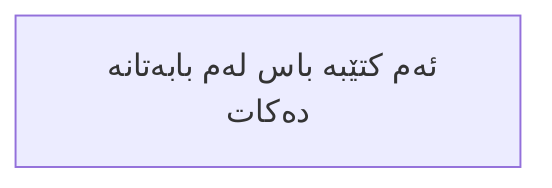

---

بسم الله الرحمن الرحيم

> [! summary] سەرتا
> هەموو ستایشێک بۆ خودایە؛ ستایشی دەکەین،داوای یارمەتیی تەنها لەئەو دەکەین و داوای لێ لێخۆشبوونی دەکەین، و پەنا دەبەین بە خودا لە گومڕایی ڕۆحی خۆمان، و لە خراپەی کردەوەکانی خۆمان. هەرکەسێک خودا ڕێی نیشان بدات، هیچ کەس ناتوانێت گومڕای بکات؛ و ئەگەر هەرکەسێکیش گومڕا بکات، هیچ کەسێك ناتوانێت دووبارە ڕێی نیشان بداتەوە. و شایەتی دەدەم کە هیچ خودایەک نییە جگە لە  الله ی تاك و تەنها، کە هاوبەش و هاوکاری نییە، و شایەتی دەدەم کە محەمەد نێردراو و پێغەمبەرەکەیەتی؛ درود و سەلامی خودای لەسەر بێت، و لەسەر هەموو پێغەمبەران و نێردراوان، و لەسەر ئەنسار و خانەوادەکەی، و لەسەر ئەو کەسانەی کە خۆشیان دەوێن، تا ڕۆژی دوایین.

**پاشان**: 

پێشتر بەنیاز بووم ڕەخنەیەک لەسەر بێباوەڕی (ئەتێیزم) بنووسم، و لە کتێبێکی گشتگیردا هەندێک لە بەڵگەکانی ڕاستی ئیسلام بخەمەڕوو؛ کاتم بۆ ئەم بیرۆکەیە تەرخان کردبوو، و هیوادار بووم لە ماوەی دیاریکراودا بیهێنمە دی!
ساڵەکان تێپەڕین، و لەگەڵ تێپەڕبوونی کاتدا، جێبەجێکردنی ئەم پڕۆژەیەش دوورخرایەوە؛ و مەبەست ئەوە بوو کە ئەمە ببێتە ئاڵنگارییەک بۆ خەڵکی بە گشتی، و ئەو کتێبەی کە ئێستا لە بەر دەستتاندایە، بەرهەمی ئەو هەوڵەیە، بە فەزڵی خودا.

**پرۆژەی تێڕوانینەکان (بصائر)**

ئەم کتێبە پێشکەشە بە بێباوەڕ و ئەوانەی کە گومانیان لە دین بۆ دروست بووە...ئەم کتێبە بۆ خوێنەری عەرەبی و بیانی... بۆ موسڵمان و بۆ ناموسڵمان... بۆ باوەڕدار بە خودا و ئەوەی کە باوەڕی پێی نییە... بۆ ئەوانەی بەدوای  ڕاستیدا دەگەڕێن و ئەوانەی فێرخوازی زانستی شەرعین.
ئەم کتێبە پێشکەشی هەموویان دەکەم. سەرەتا و لە پێش هەموویانەوە، بەو کەسانەی کە ئارەزووی لێکۆڵینەوەی زانست لە بواری ڕەخنەگرتن لە بێباوەڕی دەکەن، و بەوانەی کە ڕووبەڕووی هەر گومانێک دەبنەوە، چونکە بەڵگەکانی ناو ئەم کارە وەک ڕێبەرێک بۆ هەموو ئەم گروپانە خراونەتە ڕوو.

لەنێو ئەم کتێبەدا ئەزموونی ١٨ ساڵی خۆمم نووسیوە لە بابەتی ڕەخنەگرتن لە بێباوەڕی.

ئەمە هەوڵێکە بۆ دانانی بناغە و سیستەماتیککردنی زانست و زانین؛ چونکە بۆم دەرکەوتووە کە لقە جیاوازەکانی بابەتێك زۆرجار بە شێوەیەکی سیستماتیک ڕێک نەخراون؛ هەر لەبەر ئەم هۆکارە، دانانی ڕێبازێکی یەکتاکراوی کارکردن (مەنهەجێك) کەرەستەیەکی پێویست و سەرەکییە، چونکە پەیڕەوکردنی ڕێبازێکی کارکردنی بابەتی پارێزگاری لە ڕێکخستنی لقەکان دەکات و ڕێنماییان دەکات. ئەوە ڕێبازی پەیڕەوی کارە کە ڕێنوێنیی کەسی توێژەری وێڵ بەدوای ڕاستی  دەکات بەرەو گەشتین بە ڕاستی حاشا هەڵنەگر (ئۆبجێکتیڤ)؛ چونکە ئەگەر کەسێک وەڵامی دە گومان لەسەریەك و بێ ڕێوشوێنی دیاریکراو بداتەوە، ئەوا گومانەکە لەگەڵ وەڵامەکەدا تێکەڵ دەبێت و سەر لەبەرامبەر دەشێوێت چوونکە بنەمایەك و  بناغەیەکی بۆ دا نەنراوە بۆ ڕێکخستنی وەڵامەکان لەسەرەتاوە. هەر لەبەر ئەم هۆکارە، زۆر گرنگە ڕێبازێك دابمەزرێنین کە توانایەکی سەربەخۆ لەناو تاکەکەسدا پەرە پێبدات، و لە ڕێگەیەوە گومانکارەکە فێر بێت چۆن بابەتە ناڕوونەکان ئاراستەی بڕیارە یەکلاکەرەوەکان بکات.
بە واتایەکی تر، ئامانجی ئەم پڕۆژەیە دڵنیابوونەوەیە لەوەی کە کۆمەڵە گەنجێکی شیاومان هەبێت بۆ وەڵامدانەوەی گوومانەکان و پووچەڵ کردنەوەیان. لەهەمان کاتدا، ئەم گەنجانە شارەزایی تەواویان هەبێت لە چۆنیەتیی ڕەتکردنەوەی بەڵگەکانی بێباوەڕی، عەلمانیەت و ماددییەت، ئاگاداری کەموکوڕی و خاڵە لاوازەکانی ئەم پەردەپۆشکردنی ڕاستیانەن (کوفر)، و تێگەیشتنێکی قووڵیان هەیە بۆ ڕاستیی ئیسلام و دڵنیاکەرەوەکانی باوەڕ.

* [1] * **میتۆدۆلۆژیا** لە زمانی عەرەبیدا بەواتای مەنهەج دێت و بە زمانی کوردی سۆرانی نزیکە لە وشەی ڕێبازی پەیڕەوی کارکردن. ✅ 2026-11-03

  
---

ئەمڕۆ ئوممەتی ئیسلامی ڕووبەڕووی جەنگێکی جیهانی بووەتەوە… جەنگێک کە بۆ هەر کەسێک چاودێری ڕووداوەکانی ئێستا بکات ئاشکرایە، و ئەمە چارەنووسی پەیڕەوانی پێغەمبەرەکان بووە لە سەرتاسەری مێژوودا، کاتێک ئایینەکانی کوفرییەت—بە هەموو قوتابخانە و مەزهەب و لایەنە جیاوازەکانیانەوە—هێزەکانیان یەکدەخەن بۆ ئەوەی جەنگ بەرامبەر پەیڕەوانی پێغەمبەرەکان ئەنجام بدەن، بۆ بڵاوکردنەوەی ژەهر و گومان، و بۆ ڕێکخستنی ئەو کەسانەی کە بە ئارەزووەکانیانەوە دەجۆڵێن تاکو بێباوەڕی بە چاوێکی ڕازاوە پیشان بدەن بە خەڵک؛ ئەمە شێوازی کارکردنیان بووە بە درێژایی سەدەکان؛ ئەجێنداکەیان زۆر ناسراوە، وەک ئەوەی بەردەوام پیلان بگێڕن بۆ جێبەجێکردنی.

خودا دەفەرموێت: 
{أَتَوَاصَوْا بِهِ ۚ بَلْ هُمْ قَوْمٌ طاغُونَ} سورەتی الذاریات ئایەتی ٥٣

هەربۆیە ئەگەر خۆمان و منداڵەکانمان قایم نەکەین، و بەردەوام باوەڕمان پاک نەکەینەوە، لێشاوەکانی ئەم جەنگە هەڵمان دەلوشێت!

لەسەرووی ئەمەشەوە، ئێمە لە ئێستادا شایەتحاڵی دیاردەیەکی ڕاستەقینەی بێباوەڕین لە جیهاندا؛ ڕێژەی بێباوەڕی لە بەرزبوونەوەدایە، و جیهانی ئیسلامییش بە شەپۆلێکی بێباوەڕی داگیر دەکرێت.  شەپۆلێک کە لەلایەن دزانی ئاخیرەتەوە پێشەوایەتی دەکرێت کە دەیانەوێت ئاخیرەتی خەڵک بدزن و وایان لێبکەن ژیانی هەتاهەتایی خۆیان لەدەست بدەن. لێرەدا ئەرکی موسڵمان دێتە ئاراوە کە شارەزای ئەوە بێت چۆن ڕووبەڕووی ئەم شەپۆلە ببێتەوە و چۆن لەبەرچاوی پەروەردگاری سوودی لێ وەربگرێت؛ چونکە ئەم شەپۆلی بێباوەڕییە دەکرێت ببێتە نیعمەتێکی گەورە لەلایەن خوداوە بۆ ئەو کەسانەی سوودی لێ وەردەگرن و داوا لە پەروەردگاریان دەکەن کە بیانخاتە ژێر ئاڵای پێغەمبەرەکەیەوە (سڵاو و درودى خودا لەسەر بێت)، وەک بەرگریکارێك لە ئایینی خودا و بانگخوازێک بۆ ڕاستی؛ بۆیە فێر دەبێت چۆن خەڵک بۆ لای خودا بانگ بکات، فێر دەبێت چی باوەڕەکەی بەهێز دەکات، و فێری چەواشەکارییەکانی بێباوەڕی دەبێت، و پاشان بە تێگەیشتنەوە خەڵک بۆ لای خودا بانگ دەکات.

بە لەبەرچاوگرتنی ئەوەی کە ئەو گروپانەی زۆرترین زیانیان بەر دەکەوێت لەم ڕەوتەدا کەمینە موسڵمانەکانی سەرانسەری جیهانن، هیوادارم ناوەڕۆکی ئەم پڕۆژەیە وەربگێڕدرێتە سەر زمانەکانی تر، تاکو قسەکەرانی ئەو زمانانە—هەم موسڵمان و هەم کەسانی تر—سوودی لێ وەربگرن. جیهانی ئەمڕۆ زۆر زۆر زیاتر پێویستی بە ئێمە هەیە وەک لەوەی ئێمە پێویستمان پێی بێت!
جیهان ڕووبەڕووی شەپۆلێکی بێوێنەی بێمانایی و پووچگەرایی بووەتەوە؛ مانای مرۆڤایەتی مردووە، و نامرۆڤایەتی سەریهەڵداوە—ئەمەش دەرەنجامی چاوەڕوانکراوی بێباوەڕییە!
کەسە ژیرەکە ئەو کەسەیە کە یارمەتی لە خودا دەخوازێت و قۆڵی هەڵدەکات بۆ بانگکردنی خەڵک بۆ لای پەروەردگاری و گەیاندنی پەیامی خودا پێیان؛
خودای گەورە فەرموویەتی: ﴿ ومن أحسن قولا ممن دعا إلى الله﴾ ﴿٣٣﴾ لە سوورەتی فصلت.

لەم کتێبەدا، گرنگییم بە ئاسانکردنی زانیارییەکان و گواستنەوەی هەموو وتە و ئاماژەیەک بە شێوەیەکی ڕاستەوخۆ لە سەرچاوەکەی خۆیەوە داوە؛ تەنها ئاماژەم بە سەرچاوەکە نەکردووە، بەڵکو لە زۆر بۆنەدا، وێنەی ئاماژەکە و سەرچاوەی ڕاستەوخۆی وتە یان بەڵگەکەشم داناوە.
لەگەڵ ئەوەی هەوڵم داوە زانیارییەکان ئاسان بکەمەوە، هەندێک جار زانیارییەک دەخەمە ڕوو کە لەوانەیە لە یەکەم نیگادا بۆ خوێنەر تێگەیشتن لێی قورس بێت؛ بەڵام، بە تێپەڕبوونی کات و لەگەڵ بەرەوپێشچوون و خوێندنەوەی زیاتر لەناو لاپەڕەکانی کتێبەکەدا، لە مانای ئەو بابەتانە باشتر تێدەگەن کە لە سەرەتادا ناڕوون دەرکەوتبوون.
بابەتەکانی ئەم کتێبەم بە شێوازی پرسیار و وەڵام پێشکەش کردووە بۆ هاندانی سەرنجدان، جەخت و تەرکیز، هێشتنەوە و ئاسانیی بیرهاتنەوەی زانیارییەکان.

---

  - [ ] ئەم کتێبە ڕەتکردنەوەیەکی گشتگیرە بۆ بۆچوونەکانی بێباوەڕان سەبارەت بە گەردوون و سەرچاوەی ژیان، و لێکۆڵینەوەیەکە لە ناسراوترین ئەو گومانانەی کە دەیانخەنەڕوو. با بەڵگەکانی دروستبوونی گەردوون و بەڵگەکانی دەرکەوتنی بوونەوەرە زیندووەکان بخەینە ژێر لێکۆڵینەوە، لە کاتێکدا بەڵگەکانی بوونی دروستکەر، پاکی و بێگەردی بۆ ئەوە، دادەنێین.
  - [ ]  بۆ ڕەتکردنەوەی بۆچوونەکانی بێباوەڕان سەبارەت بە سەرچاوەی ئایین و گرنگیی ئایین بۆ مرۆڤایەتی، و بۆ خستنەڕووی هەندێک لە بەڵگەکانی ڕاستی ئیسلام، بەڵگەکانی ڕاستگۆیی پێغەمبەر، درود و سەلامی خودا لەسەر بێت، و ئەو ڕاستییانەی کە شوێنکەوتووانی کتێب (یەهوودی و مەسیحییەکان) سەبارەت بە هاتنی پێغەمبەرێکی داهاتوو دەیانزانی
  - [ ] بۆ لەناوبردنی ئەو گومانانەی لەناو بێباوەڕییتەوە سەرچاوە دەگرن، و بۆ ئاشکراکردنی ڕاستییەکانی تایبەت بە تێکچوونی ئالوودەبوونی ناچاری لە بابەتەکانی باوەڕدا، و ئەو لێکچوونە دیارەی لە نێوان ئەو تێکچوونە و گومانەکاندا هەیە.
  - [ ] وەڵامدانەوەی باوترین ئەو ناڕەزایەتییانەی کە لەلایەن بێباوەڕانی هاوچەرخەوە دەورووژێنرێن.
  - [ ] بەشێکی تایبەت دەربارەی ژنان لە ئیسلامدا.
  - [ ] ئاشکراکردنی کۆمەڵێک بیرۆکەی چەواشەکارانە کە لەنێو هەندێک کەسدا دەستیان بە بڵاوبوونەوە کردووە، وەک ڕەتکردنەوەی (ئینکاریکردنی) سونەت، فێمینیزم و یاسای کێشکردن.
  - [ ] هەندێک بەڵگەی دڵنیایی باوەڕ.
  
  ئێستا کە ئەم پڕۆژەیە کۆتایی هات، تەنها دەتوانم ستایشی پەروەردگارم بکەم، شکۆدار بێت، کە توانای تەواوکردنی پێ بەخشیم، و دەمەوێت سوپاسی هەموو ئەو کەسانە بکەم کە لە گەشتی نووسینی ئەم کتێبەدا فێریان کردم، ڕێنماییان کردم یان ئامۆژگارییان کردم، کە
نزیکەی سێ ساڵی خایاند. هەر سەرکەوتن و ڕێنوێنییەک تەنها لە خوداوەندەوەیە، لە کاتێکدا هەر هەڵە، لادان یان کەمتەرخەمییەک لە خودی خۆم و لە شەیتانەوەیە.

من بانگەشەی ئەوە دەکەم کە ئەم پڕۆژەیە هیچی تر نییە جگە لە هەنگاوێکی تاک و لاواز و کەمتەر لەسەر ڕێگایەکی فراوان و کیلۆمەتر درێژ، کە بە هەزاران بەڵگە و ئاماژە و سەلمێنەری ڕاستیی باوەڕ داپۆشراوە.

---
خودا دەفەرموێت: {  قُل لَّوْ كَانَ الْبَحْرُ مِدَادًا لِّكَلِمَاتِ رَبِّي لَنَفِدَ الْبَحْرُ قَبْلَ أَن تَنفَدَ كَلِمَاتُ رَبِّي وَلَوْ جِئْنَا بِمِثْلِهِ مَدَدًا } سورەتی الکهف ئایەتی ١٠٩
- [ ] نزا دەکەم بۆ خوا کە ئەم کارە سوودبەخش بێت، و پاداشتی بۆ دابنێت؛ چونکە ئەو بەڕاستی بەخشندەترین و میهرەبانترینە.
- [ ] وە هەرکەسێک دەیەوێت سوپاسم بکات بۆ تێگەیشتنێک کە ڕۆژێک لە بابەتێکی ئایینی خوادا بەدەستی هێناوە، با سوپاسەکەی بۆ من بە بڵاوکردنەوەی ئەم کتێبە بێت.
- [ ] سوپاس بۆ خوا، پەروەردگاری جیهانەکان، کە بە ڕەحمەتی خۆی چاکە بەخشی دەکات و بە بەخشندەیی و میهرەبانیی خۆی خراپە لادەبات.
دکتۆر. هیثم طلعت

| ئیمەیل   | Haithamsrour41@gmail.com                   |
| -------- | ------------------------------------------ |
| فەیسبووك | https://www.facebook.com/drhaithamofficial |

---
