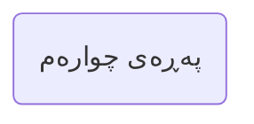

---
## بەشی یەکەم | گەردوون و ژیان

**النص العربي**: 

==🟢١- في البداية: ما هو أقصر طريق لتحصيل اليقين للمسلم والمُتشكك؟

أقصر طريق هو ورد يومي من القرآن تقرؤه بتدبّر، ولو نصف حزب يوميًا.
يكون لك ورد تدبُّر يوميًا تحافظ عليه، تقرأ آياتِ هذا الورد بتدبُّر وتأمُّل وتفكَّر.
ومن أفضل الكتب المُعينة على التدبر هو: التفسير الميسر، وهو تفسير موجز جميل!
تقرأ الآية من القرآن الكريم، ثم تقرأ تفسيرها، وهكذا إلى أن ينتهي الورد، وفي
العام التالي تنتقل لتفسير آخر مثل المختصر في التفسير، ثم تفسير الشيخ السعدي
رحمه الله وهكذا ...==🟡==

**الترجمة الکردیة**: 

١. دەستپێک: کورتترین ڕێگا بۆ گەیشتن بە دڵنیایی بۆ موسڵمانێک و گومڕایەك چییە؟

- کورتترین ڕێگا بریتییە لە خوێندنەوەی (وەك ویردی سەر زمان) بەشێک لە قورئان هەموو ڕۆژێك، کە بە وردی بخوێنرێتەوە، تەنانەت ئەگەر ڕۆژانە تەنها نیوەی جوزئێکیش بێت.
- پێویستە بەشێکی کاتت ڕۆژانە بۆ خۆت دیاری بکەیت تا لێی ورد ببیتەوە و پێوەی پابەند بیت، ئایاتەکانی ئەم بەشە بە وردی بخوێنیتەوە، تێیاندا بیر بکەیتەوە و لە ماناوەرییان ورد ببیتەوە.
- یەکێک لە باشترین کتێبەکان بۆ یارمەتیدان لەم تێڕامانەدا *تەفسیرە المیسر*ە؛ کە تەفسیرێکی جوان و پوختە!
ئایەتێک لە قورئانی پیرۆز بخوێنەرەوە، پاشان تەفسیرەکەی بخوێنەرەوە، و بەم شێوەیە بەردەوام بە تا بەشی ڕۆژانەت تەواو دەکەیت؛ و لە ساڵی داهاتوودا، بچۆ بۆ تەفسیرێکی تر، وەک *المختصر في التفسير*، پاشان تەفسیرەکەی شێخ سەعدی، خوای لێی ڕازی بێت، و هتد...

 SHAD contextual update below
ئەم وێنەیەی خوارەوە نموونەی تەفسیرێکی قورئانە کە بە شێوەی سەرچاوە کراوە (OpenSource) لە وێبسایتی ئەرشیفی ئینتەرنێت دانراوە.

Link to the website: [المختصر في التفسير ملون : Free Download, Borrow, and Streaming : Internet Archive](https://archive.org/details/20240123_20240123_1024/page/n5/mode/2up)

هەروەها، کتێبی تەفسیری ئاسان بە زمانی کوردی بەردەستن بۆ هەمان مەبەست.

![[Pasted image 20261105221347.png]]

![[Pasted image 20261105220745.png]]

![[Pasted image 20261105221256.png|498]]

==🟢وهذا الطريق طريق تدبُّر القرآن والمداومة عليه، له أسراره الإيمانية الخاصّة،
وفيه جواب مُجمَل لكل شبهة، وبه تحصل طمأنينة النفس، وفیه رُقیة من الشیطان
والوسواس! والإنسان کلما تدبَّر کتاب ربه خرج منه بمعجزاتٍ ووقفاتٍ. 
بل وکم من عدۆِ لرسول الله أراد اغتیاله، فما أن سمع آیات القرآن حتی انفطر
قلبه ولمع الإیمان في عینیه!
هذا في حال الکافر المحارب الکاره للإسلام، فکیف بصاحب الشُبهات الذي یرید
الحق، فکیف بالمسلم؟!
فللقرآن معارج إيمانية عجيبة، تستبشر به النفوس، وتنشرح له الصدور،
وعادة النفوس مع القرآن أنها إذا أخذت حظها منه عادت له مرتاعةً تُريد المزید!(١)

==🟢(١) راجع كتاب: الطريق إلى القرآن، إبراهيم السكران، متاح على الشبكة العنكبوتية.== 

ئەم ڕێگایە—ڕێگای تێڕامان لە قورئان و بەردەوامی تێیدا—نهێنیی تایبەتی باوەڕی خۆی هەیە؛ وەڵامێکی گشتگیر بۆ هەموو گومانێک لەخۆدەگرێت، ئاسوودەیی دەروونی دەبەخشێت، و پارێزگاری لە شەیتان و چرپەکانی دەکات! چەندە کەسێک زیاتر تێڕامان لە کتێبی پەروەردگاری بکات، ئەوەندە زیاتر پڕ دەبێت لە سەرسوڕمان و ساتەکانی تێگەیشتنی قووڵ.

بێگومان، چەندین دوژمنی پێغەمبەری خودا هەوڵیاندا بیکوژن، بەڵام هەر کە ئایاتەکانی قورئانیان دەبیست، دڵیان دەلەرزییەوە و باوەڕ لە چاوەکانیدا دەدرەوشایەوە! ئەمە لەگەڵ ئەو بێباوەڕە دوژمنەدا ڕوودەدات کە ڕقی لە ئیسلامە؛ کەواتە چەندە زیاتر بۆ ئەو کەسەی کە گومانی هەیە و بەدوای ڕاستیدا دەگەڕێت، و چەندە زیاتر بۆ موسڵمانێک؟!

چونکە قورئان خاوەنی بەرزبوونەوەی ڕۆحیی سەرسوڕهێنەرە کە شادی بۆ ڕۆح دەهێنن و دڵ دەکەنەوە؛ و سروشتی ڕۆح سەبارەت بە قورئان ئاوایە کە هەر کە تێری لێی بوو، دەگەڕێتەوە بۆی، بە تامەزرۆییەوە بۆی زیاتریش! (١)

(١) بڕوانە کتێبی: *ڕێگای قورئان*، لە نووسینی ئیبراهیم سەکران، کە لەسەر ئینتەرنێت بەردەستە.

---
