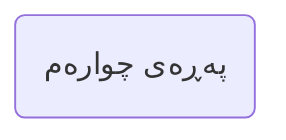
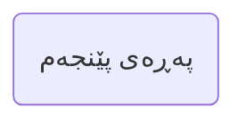
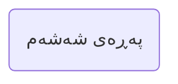

---
## بەشی یەکەم | گەردوون و ژیان

**النص العربي**: 

==🟢١- في البداية: ما هو أقصر طريق لتحصيل اليقين للمسلم والمُتشكك؟

أقصر طريق هو ورد يومي من القرآن تقرؤه بتدبّر، ولو نصف حزب يوميًا.
يكون لك ورد تدبُّر يوميًا تحافظ عليه، تقرأ آياتِ هذا الورد بتدبُّر وتأمُّل وتفكَّر.
ومن أفضل الكتب المُعينة على التدبر هو: التفسير الميسر، وهو تفسير موجز جميل!
تقرأ الآية من القرآن الكريم، ثم تقرأ تفسيرها، وهكذا إلى أن ينتهي الورد، وفي
العام التالي تنتقل لتفسير آخر مثل المختصر في التفسير، ثم تفسير الشيخ السعدي
رحمه الله وهكذا ...==🟡==

**الترجمة الکردیة**: 

١. دەستپێک: کورتترین ڕێگا بۆ گەیشتن بە دڵنیایی بۆ موسڵمانێک و گومڕایەك چییە؟

- کورتترین ڕێگا بریتییە لە خوێندنەوەی (وەك ویردی سەر زمان) بەشێک لە قورئان هەموو ڕۆژێك، کە بە وردی بخوێنرێتەوە، تەنانەت ئەگەر ڕۆژانە تەنها نیوەی جوزئێکیش بێت.
- پێویستە بەشێکی کاتت ڕۆژانە بۆ خۆت دیاری بکەیت تا لێی ورد ببیتەوە و پێوەی پابەند بیت، ئایاتەکانی ئەم بەشە بە وردی بخوێنیتەوە، تێیاندا بیر بکەیتەوە و لە ماناوەرییان ورد ببیتەوە.
- یەکێک لە باشترین کتێبەکان بۆ یارمەتیدان لەم تێڕامانەدا *تەفسیرە المیسر*ە؛ کە تەفسیرێکی جوان و پوختە!
ئایەتێک لە قورئانی پیرۆز بخوێنەرەوە، پاشان تەفسیرەکەی بخوێنەرەوە، و بەم شێوەیە بەردەوام بە تا بەشی ڕۆژانەت تەواو دەکەیت؛ و لە ساڵی داهاتوودا، بچۆ بۆ تەفسیرێکی تر، وەک *المختصر في التفسير*، پاشان تەفسیرەکەی شێخ سەعدی، خوای لێی ڕازی بێت، و هتد...

 SHAD contextual update below
ئەم وێنەیەی خوارەوە نموونەی تەفسیرێکی قورئانە کە بە شێوەی سەرچاوە کراوە (OpenSource) لە وێبسایتی ئەرشیفی ئینتەرنێت دانراوە.

Link to the website: [المختصر في التفسير ملون : Free Download, Borrow, and Streaming : Internet Archive](https://archive.org/details/20240123_20240123_1024/page/n5/mode/2up)

هەروەها، کتێبی تەفسیری ئاسان بە زمانی کوردی بەردەستن بۆ هەمان مەبەست.

![[Pasted image 20261105221347.png]]

![[Pasted image 20261105220745.png]]

![[Pasted image 20261105221256.png|589]]

==🟢وهذا الطريق طريق تدبُّر القرآن والمداومة عليه، له أسراره الإيمانية الخاصّة،
وفيه جواب مُجمَل لكل شبهة، وبه تحصل طمأنينة النفس، وفیه رُقیة من الشیطان
والوسواس! والإنسان کلما تدبَّر کتاب ربه خرج منه بمعجزاتٍ ووقفاتٍ. 
بل وکم من عدۆِ لرسول الله أراد اغتیاله، فما أن سمع آیات القرآن حتی انفطر
قلبه ولمع الإیمان في عینیه!
هذا في حال الکافر المحارب الکاره للإسلام، فکیف بصاحب الشُبهات الذي یرید
الحق، فکیف بالمسلم؟!
فللقرآن معارج إيمانية عجيبة، تستبشر به النفوس، وتنشرح له الصدور،
وعادة النفوس مع القرآن أنها إذا أخذت حظها منه عادت له مرتاعةً تُريد المزید!(١)

==🟢(١) راجع كتاب: الطريق إلى القرآن، إبراهيم السكران، متاح على الشبكة العنكبوتية.== 

ئەم ڕێگایە—ڕێگای تێڕامان لە قورئان و بەردەوامی تێیدا—نهێنیی تایبەتی باوەڕی خۆی هەیە؛ وەڵامێکی گشتگیر بۆ هەموو گومانێک لەخۆدەگرێت، ئاسوودەیی دەروونی دەبەخشێت، و پارێزگاری لە شەیتان و چرپەکانی دەکات! چەندە کەسێک زیاتر تێڕامان لە کتێبی پەروەردگاری بکات، ئەوەندە زیاتر پڕ دەبێت لە سەرسوڕمان و ساتەکانی تێگەیشتنی قووڵ.

بێگومان، چەندین دوژمنی پێغەمبەری خودا هەوڵیاندا بیکوژن، بەڵام هەر کە ئایاتەکانی قورئانیان دەبیست، دڵیان دەلەرزییەوە و باوەڕ لە چاوەکانیدا دەدرەوشایەوە! ئەمە لەگەڵ ئەو بێباوەڕە دوژمنەدا ڕوودەدات کە ڕقی لە ئیسلامە؛ کەواتە چەندە زیاتر بۆ ئەو کەسەی کە گومانی هەیە و بەدوای ڕاستیدا دەگەڕێت، و چەندە زیاتر بۆ موسڵمانێک؟!

چونکە قورئان خاوەنی بەرزبوونەوەی ڕۆحیی سەرسوڕهێنەرە کە شادی بۆ ڕۆح دەهێنن و دڵ دەکەنەوە؛ و سروشتی ڕۆح سەبارەت بە قورئان ئاوایە کە هەر کە تێری لێی بوو، دەگەڕێتەوە بۆی، بە تامەزرۆییەوە بۆی زیاتریش! (١)

(١) بڕوانە کتێبی: *ڕێگای قورئان*، لە نووسینی ئیبراهیم سەکران، کە لەسەر ئینتەرنێت بەردەستە.

---
![[Pasted image 20261106214344.png|278]]
>[!summary] النص العربي
>فالقرآن هو أقصر طريق لتحصيل اليقين، والذين قرأوا المُطوَّلات وكتب الفلاسفة
بحثًا عن اليقين اعترفوا في آخر أعمارهم أن أيسر وأفضل طريق لليقين كان طريق القرآن!
انظر ماذا قال الرازي رحمه الله بعد رحلة طويلة مع کتب الفلاسفة والمُطوَّلات الکلامیة:
م قال رحمه الله:

چونکە قورئان کورتترین ڕێگایە بۆ گەیشتن بە دڵنیایی، و ئەوانەی کە لە گەڕان بەدوای دڵنیاییدا، لێکۆڵینەوە درێژەکان و بەرهەمەکانی فەیلەسوفەکانیان خوێندووەتەوە، لە کۆتایی ژیانیاندا دانیان بەوەدا ناوە کە ئاسانترین و باشترین ڕێگا بۆ گەیشتن بە دڵنیایی، ڕێگای قورئان بووە!
سەرنج بدەنە ئەوەی کە ڕازی، خوای لێی بەخۆشبێت، دوای گەشتێکی دوور و درێژ بەناو بەرهەمەکانی فەیلەسوفان و نووسراوە ئایینییە درێژەکاندا، چی وتووە:
ئەو، خوای لێی بەخۆشبێت، فەرمووی:

>[!summary] النص العربي
"لقد تأملتُ الطرق الكلامية، والمناهجَ الفلسفية، فما رأيتها تشفي
عليلًا، ولا تروي غليلًا، ورأيت أقرب الطرق طريقة القرآن ... ثم قال: ومَن
جرَّب مثل تجربتي عرَف مثل معرفتى".(٢)

من بە تێڕامانەوە بیرم لە شێوازەکاني ئاخاوتن و ڕێبازە فەلسەفییەکان کردۆتەوە، بەڵام بۆم دەرکەوتووە کە نەئەوەتا نەخۆشەکان چاک دەکەنەوە و نە تینوێتی دەکوژێننەوە؛ و بۆم دەرکەوتووە کە نزیکترین ڕێگا ڕێگای قورئانە... ئینجا فەرمووی: 'و هەرکەسێک ئەزموونێکی هاوشێوەی منی هەبووبێت، وەک من دەزانێت'." (٢)

>[!summary] النص العربي
> وقال الشهرستاني رحمه الله:
لقد طفت في تلّك المعاهدِ كلّها *   وسَيّرت طرفِي بين تلك المعالم
فلم آَرَ إلا واضعا كفّ حائر * على ذَقَن أو قارعًا سِنّ نادم.(٣)

شەهرەستانی، خوای لێی خۆش بێت، دەڵێت:
من بەناو هەموو ئەو دامەزراوانەدا گەڕاوم و ڕێگەم داوە چاوم بەناو ئەو شوێنەوارەدا بگەڕێت،
بەڵام هیچم نەبینی جگە لە پیاوێک کە دەستی سەرسامانەی لەسەر چەناگەی دانابوو یان لە پەشیمانییەوە ددانی لەیەک دەخشاند.(٣)

>[!summary] النص العربي
وقال أېو المعالي الجوینيُّ رحمە الله:
"لقد قرأت خمسين ألفًا في خمسين ألفًا، وركبتُ البحر الخِضمَّ وخُضتُ في
الذى نهوْنى عنه، وها أنا ذا أعود إلى الحق بالحق"!

من پەنجا هەزارم لە پەنجا هەزار خوێندەوە، و بە دەریا فراوانەکاندا گەشتم کردووە و چوومەتە ناو ئەو شتەی کە لێی ئاگادار کرابوومەوە نەچم، و ئێستاش من لێرەم، لە ڕێگەی ڕاستییەوە دەگەڕێمەوە بۆ سەر ڕاستی!

>[!summary] النص العربي
كلهم اعترفوا أن طريق القرآن هو أمثل وأسهل وأيسر وأقصر طرق تحصيل اليقين.
فالقرآن کلام الله لکل أحدٍ بحسب علمه وثقافته وبساطته وعمقه؛ هو کلام
الله لکل أطیاف البشر!
وإلی جانب تدېُّر کتاب الله أدعوکم إلی قراءة أعظم الکلام، وأحسن القول بعد کلام
الله سبحانه، وهو كلام نبيه ل*، أوصي بقراءة خمسة أحاديث من رياض الصالحين
یومیًا، بشرح بسیط جمیل مثل شرح ابن عثیمین رحمه الله.
وریاض الصالحين كتاب تزكية إيمانية، وما أحوجنا لمِثل ذلك!

هەموویان دانیان ناوە کە ڕێبازی قورئان باشترین، ئاسانترین، سادەترین و کورتترین ڕێگایە بۆ گەیشتن بە دڵنیایی.
چونکە قورئان وشەی خودایە بۆ هەموو کەسێک، بەپێی ئاستی زانیاری، کەلتوور، سادەیی و قووڵیی تێگەیشتنیان؛ ئەوە وشەی خودایە بۆ هەموو مرۆڤایەتی!
لە تەنیشت خوێندنەوەی کتێبی خودا، هانتان دەدەم کە گەورەترین وتەکان و جوانترین وتارەکان بخوێننەوە دوای وتەکانی خودای گەورە، کە ئەویش وتەکانی پێغەمبەرەکەی ﷺـن. پێشنیار دەکەم ڕۆژانە پێنج فەرموودە لە *ڕیاض الصالحین* بخوێننەوە، لەگەڵ تەفسیرێکی سادە و جوان وەک هیی ئیبن عثیمین، خودا بەزەیی پێدا بێت.
*ڕیاض الصالحین* کتێبێکە کە باوەڕی مرۆڤ پاک دەکاتەوە، و چەند پێویستمان بە شتێکی وەک ئەوە هەیە!

>[!summary] النص العربي
فلتبدأ مشروع تحصیلك للیقین من الیوم، فما من حیاتك خیر إلا ما کان فیھا لله،
وغیر ذلك فباطلٌ وهباء منثور، وکما قال الإمام ابن القیم رحمه الله:

کەواتە با گەڕانەکەت بۆ دڵنیایی ئەمڕۆ دەست پێ بکات، چونکە هیچ شتێک لە ژیانتدا هیچ بەهایەکی نییە جگە لەوەی کە لە پێناوی خودادایە؛ هەر شتێکی تر درۆ و پووچیی پەرشە. وەک ئیمام ئیبن القەیم، خوای لێی بەخۆشبێت، فەرموویەتی:

>[!summary] النص العربي
"إذا كان العبد وهو في الصلاة ليس له من صلاته إلا ما عقل منها، فليس له من عمره
إلا ما كان فيه بالله ولله". (٤)

"ئەگەر بەندەیەک لە کاتی نوێژکردندا هیچی لە نوێژەکەی بەدەست نەهێنێت جگە لەوەی لێی تێدەگات، ئەوا هیچی لە ژیانی بەدەست ناهێنێت جگە لەوەی لە ڕێگەی خودا و لە پێناوی خودادا خەرجی دەکات." (٤)

>[!summary] النص العربي
(٢) سير أعلام النبلاء، م٢١ ص ٥٠١.
(٣) نهاية الإقدام في علم الكلام، ص٣.
(٤) الجواب الكافي، ص ١٨٠.

(٢) سیرە أعلام النبلاء، بەرگی ٢١، ل. ٥٠١.
(٣) نهايە العزم في علم الكلام، ل. ٣.
(٤) الجواب الكافي، ل. ١٨٠.

---

ئەتایزم (بێ باوەڕی) چیە، و چۆن شوێنکەوتوانی پۆلێن بکەین ؟

- إلحاد لە زمانی عەرەبیدا بە مانای: مەیل (ئولفەت) دێت.
- خودا دەفەرموێت: {لِّسَانُ الَّذِى يُلْحِدُونَ إِلَيْهِ أَعْجَمِىٌ وَهَذَا لِسَانُ عَرَبيٌّ مُبِينُ} سورەتی النحل ئایەتی ١٠٣
- یلحدون إليە بەواتای : مەیلیان بۆی دەچێت.

- بەڵام لەڕووی زاراوەییەوە وشەی إلحاد (بێ باوەڕی) بریتییە: 
	- ڕەتکردنەوەی بەدیهێنەر، غەیب، پێغەمبەرایەتی، زیندووبوونەوە و ڕۆژی دوایی.
- إلحاد (بێ باوەڕی) چەند گروهێکی زۆرن، وە شوێنکەوتەی مەزهەبی جیاوازیان هەیە، وەك: 

- [ ] ئەتایست (ملحد)
- [ ] خودا پەروەر
- [ ] نازانم ڕەحەتی گیانم
- [ ] گوێ پێ نەدەر
- [ ] مرۆڤ پەروەر

![[design_1.png]]

(٥) لسان العرب، إبن منظور، ماددەی لحد.

---

