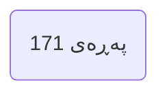
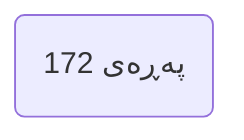
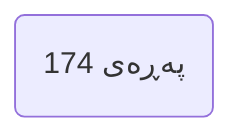
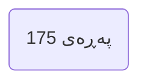
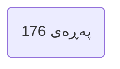
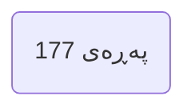
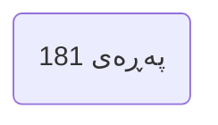
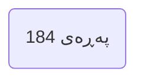
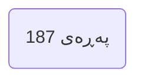
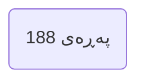

---

## بەشی سێیەم | پێغەمبەرێکی نەخوێندەوار Chapter 3 The Illiterate Prophet
### PDF Pages: 170–278 | Est. ~109 pages

---

§1 

>[!summary] Arabic Text
>الباب الثالث
>رسول الأميين

>[!summary] English Text
>The Third Door
>The Prophet of the Unlettered

>[!summary] Kurdish Text
>بەشی سێیەم
>پێغەمبەرێکی نەخوێندەوار

---


---

§2

>[!summary] Arabic Text
>٥٩
>- كيف نحتجُّ على مُلحِد بالبشارات للنبي
>ﷺ
>في كتب السابقين؟
>إذا كانت
>لا تُبطل فيﷺ السابقين المُقدَّسة، فهذا دليل على إثبات صدقه، وهذا الدليل مُلزِم
>•
>فلو صحت هذه البشارات والنبوءات، فهي برهان فعلي على أنه نبي حق
>• فهذا استدلال
>على
>صحة الإسلام
>!من خارجه
>•
>ولو صحت هذه
>في أصلها حق
>البشارات، فهي أيضاً دليل على أن النبوة في ... مفهوم
>!النبوة مفهومٌ صحيحٌ؛ حيث أن ما يُبشر به الأنبياء يقع كما هو
>•
>وقد أورد القرآنُ الكريم آياتٍ كثيرة على صحة إلزام هذا الاستدلال... الاستدلال
>بالنبوءات على صحة نبوة محمد ﷺ
>في الكتب المقدسة السابقة؛ فهذا استدلال
>مُلزم عقلاً!
>
>ﭐ
>ﭧﭐﭨﭐ
>ﱡﭐ
﴿فَإِن كُنتَ فِي شَكٍّ مِّمَّا أَنزَلْنَا إِلَيْكَ فَسْأَلِ الَّذِينَ يَقْرَءُونَ الْكِتَابَ مِن قَبْلِكَۚ لَقَدْ جَاءَكَ الْحَقُّ مِن رَبِّكَ فَلَا تَكُونَنَّ مِنَ الْمُمْتَرِينَ﴾
>﴿٩4
>﴾ سورة يونس
>•
>اسأل أهل الكتاب ستجد عندهم خبر نبوتك، وصدق الشرع الذي أتيت به
>
>
>:وقال عز مِن قائل
﴿وَيَقُولُ الَّذِينَ كَفَرُوا لَسْتَ مُرْسَلًاۚ قُلْ كَفَىٰ بِاللَّهِ شَهِيدًا بَيْنِي وَبَيْنَكُمْ وَمَن عِندَهُ عِلْمُ الْكِتَابِ﴾
﴿٤٣﴾ سورة الرعد
>•
>.فالذين عندهم علم الكتاب يعرفونه جيداً... يعرفونه معرفة تامة
>•
>:بل يعرفونه معرفة يقينية؛ لكثرة البشارات بقدومه
>ﭐ
>ﭧﭐﭨﭐ
>ﱡﭐ ﱁ
>ﱂ
>ﱃ
>ﱄ
>ﱅ
>ﱆ ﱇﱈ
>ﱉ
>
>ﱊ
>ﱋ
>ﱌ
>ﱍ
>ﱎ
>ﱏ ﱠ
>﴿
>146
> .﴾ سورة البقرة
>ﭐﭐﭐﭐﭐ
>ﭧﭐﭨﭐ
>ﱡﭐ ﱤ ﱥ
>ﱦ ﱧ ﱨ ﱩ ﱪ ﱫ ﱬ
>ﱭ
>ﱮ ﱯ ﱠ
>﴿
>157
> .﴾ سورة الأعراف

>[!summary] English Text
>59
>- How do we argue with an atheist using glad tidings for the Prophet
>ﷺ
>in the books of the predecessors?
>If the
>sacred books of the predecessors are not invalidated, this is proof of his truthfulness, and this proof is binding
>•
>If these glad tidings and prophecies are true, they are actual proof that he is a true prophet
>• This is an inference
>for
>the truth of Islam
>from outside it!
>•
>And if these
>in their origin are true
>glad tidings, they are also evidence that prophethood in ... concept
>prophethood is a correct concept; for what the prophets give glad tidings of comes to pass as it is
>•
>And the Noble Quran has cited many verses on the validity of this inference's obligation... inference
>by prophecies for the truth of Muhammad's prophethood ﷺ
>in the previous sacred books; this is an inference
>obligatory rationally!
>
>ﭐ
>ﭧﭐﭨﭐ
>ﱡﭐ
﴿فَإِن كُنتَ فِي شَكٍّ مِّمَّا أَنزَلْنَا إِلَيْكَ فَسْأَلِ الَّذِينَ يَقْرَءُونَ الْكِتَابَ مِن قَبْلِكَۚ لَقَدْ جَاءَكَ الْحَقُّ مِن رَبِّكَ فَلَا تَكُونَنَّ مِنَ الْمُمْتَرِينَ﴾
>﴿94
>﴾ Surah Yunus
>•
>Ask the People of the Book, you will find with them news of your prophethood, and the truth of the law you brought
>
>
>:And the Mighty said from the Speaker
﴿وَيَقُولُ الَّذِينَ كَفَرُوا لَسْتَ مُرْسَلًاۚ قُلْ كَفَىٰ بِاللَّهِ شَهِيدًا بَيْنِي وَبَيْنَكُمْ وَمَن عِندَهُ عِلْمُ الْكِتَابِ﴾
﴿٤٣﴾ Surah Ar-Ra'd
>•
>Those who have knowledge of the Book know him well... know him completely
>•
>:Rather they know him with certainty; due to the abundance of glad tidings of his coming
>ﭐ
>ﭧﭐﭨﭐ
>ﱡﭐ ﱁ
>ﱂ
>ﱃ
>ﱄ
>ﱅ
>ﱆ ﱇﱈ
>ﱉ
>
>ﱊ
>ﱋ
>ﱌ
>ﱍ
>ﱎ
>ﱏ ﱠ
>﴿
>146
> .﴾ Surah Al-Baqarah
>ﭐﭐﭐﭐﭐ
>ﭧﭐﭨﭐ
>ﱡﭐ ﱤ ﱥ
>ﱦ ﱧ ﱨ ﱩ ﱪ ﱫ ﱬ
>ﱭ
>ﱮ ﱯ ﱠ
>﴿
>157
> .﴾ Surah Al-A'raf

>[!summary] Kurdish Text
>٥٩
>- چۆن لێکۆڵینەوە دەکەین لەگەڵ بێباوەڕ بەکاردێنانی بشارات بۆ پێغەمبەر
>ﷺ
>لە کتێبەکانی پێشوو؟
>ئەگەر
>کتێبە مەقەدەسەکانی پێشوو ناتوانرێنەوە بە باطل، ئەمە بەڵگەیەکە بۆ ڕاستیییتی، و ئەم بەڵگەیە پێویستە
>•
>ئەگەر ئەم بشارات و پێشەنگەکان ڕاست بن، ئەوان بەڵگەیەکی ڕاستەقینەن بۆ ئەوەی نێب پێغەمبەرێکی ڕاست
>• ئەمە ھێنانی بەڵگەیەکە بۆ
>ڕاستیی ئیسلام
>لە دەرەوە!
>•
>و ئەگەر ئەم
>لە سەرچاوەکەیدا ڕاست بن
>بشارات، ھەروەھا بەڵگەیەکەن بۆ ئەوەی نێبویەتی لە ... مێنای
>نێبویەتی مێنایەکی دروستە؛ بۆوەی شتێک کە پێغەمبەران بشاراتیان دەدەن دەرکەوتووە وەک ھەیە
>•
>و قورئانی پیرۆز ئایەتە زۆرێک هەناساوە لەسەر دروستی پێویستی ئەم ھێنانییە... ھێنانی
>بە پێشەنگەکان بۆ ڕاستیی نێبویەتی محەمەد ﷺ
>لە کتێبە مەقەدەسە پێشووەکاندا؛ ئەمە ھێنانییەکە
>پێویستە بە هێزی بیر!
>
>ﭐ
>ﭧﭐﭨﭐ
>ﱡﭐ
﴿فَإِن كُنتَ فِي شَكٍّ مِّمَّا أَنزَلْنَا إِلَيْكَ فَسْأَلِ الَّذِينَ يَقْرَءُونَ الْكِتَابَ مِن قَبْلِكَۚ لَقَدْ جَاءَكَ الْحَقُّ مِن رَبِّكَ فَلَا تَكُونَنَّ مِنَ الْمُمْتَرِينَ﴾
>﴿٩٤
>﴾ سوورەی یونس
>•
>بپێسە ئەھلی کتێب، دەدۆزیت لێیان خەبەری نێبویەتیت، و ڕاستیی یاساکەی هێنانیت
>
>
>:و گەورە وت لە قسەکەر
﴿وَيَقُولُ الَّذِينَ كَفَرُوا لَسْتَ مُرْسَلًاۚ قُلْ كَفَىٰ بِاللَّهِ شَهِيدًا بَيْنِي وَبَيْنَكُمْ وَمَن عِندَهُ عِلْمُ الْكِتَابِ﴾
﴿٤٣﴾ سوورەی رعد
>•
>ئەوانەی کە زانیاری کتێب ھەیە ناسینێکیان باشە... ناسین تەواو
>•
>:بەڵکو ناسینێکی یقینی ھەیانە؛ بۆوەی زۆربوونی بشاراتی هاتیانیان
>ﭐ
>ﭧﭐﭨﭐ
>ﱡﭐ ﱁ
>ﱂ
>ﱃ
>ﱄ
>ﱅ
>ﱆ ﱇﱈ
>ﱉ
>
>ﱊ
>ﱋ
>ﱌ
>ﱍ
>ﱎ
>ﱏ ﱠ
>﴿
>١٤٦
> .﴾ سوورەی بەقەرە
>ﭐﭐﭐﭐﭐ
>ﭧﭐﭨﭐ
>ﱡﭐ ﱤ ﱥ
>ﱦ ﱧ ﱨ ﱩ ﱪ ﱫ ﱬ
>ﱭ
>ﱮ ﱯ ﱠ
>﴿
>١٥٧
> .﴾ سوورەی ئەعراف

---



---

§3

>[!summary] Arabic Text
>•
>تاراشبلا بابفاستخدام ، وعىل صدق
>النن  ي
>ﷺ
>هو استخدامٌ لبابٍ عظيمٍ طالما تغافلنا عنه، ولم نُعطِ هِ حق  ه من وجهة
>!نظري
>•
>وهذا الباب... باب البِشارات ملزمٌ كما قلت لكل أحد، وهو آية عىل مَ ن يريد أن يتأكَّد
>:من نبوته
>ﭐ
>ﭧﭐﭨﭐ
>ﱡﭐ
>ﲜ
>ﲝ
>ﲞ
>ﲟ ﲠ
>ﲡ
>ﲢ
>ﲣ
>ﲤ ﱠ
>﴿
>197
>﴾ سورة الشعراء
>فمعرفة علماء بني إسرائيل بمُحمد
>ﷺ
>!ٌّهي آية واضحة ىلع أنَّه نبي
>
>      

>[!summary] English Text
>•
>Using the door of glad tidings, and based on the truthfulness
>of the Prophet
>ﷺ
>is the use of a great door that we have long neglected, and did not give it its due from the
>perspective!
>•
>And this door... the door of glad tidings is obligatory as I said for everyone, and it is a sign for whoever wants to verify
>:his prophethood
>ﭐ
>ﭧﭐﭨﭐ
>ﱡﭐ
>ﲜ
>ﲝ
>ﲞ
>ﲟ ﲠ
>ﲡ
>ﲢ
>ﲣ
>ﲤ ﱠ
>﴿
>197
>﴾ Surah Ash-Shu'ara
>So the knowledge of the scholars of the Children of Israel about Muhammad
>ﷺ
>!is a clear sign that he is a prophet
>
>      

>[!summary] Kurdish Text
>•
>بەکارهێنانی دەری بشارات، و بە سەر ڕاستی
>نێب
>ﷺ
>بەکارهێنانی دەرێکی گەورەیە کە درێژە ھەوڵدانەوە لێی، و نەدایە بەھایەکە لە بەرچاوە
>!نظری
>•
>و ئەم دەرە... دەری بشارات پێویستە وەک کە وتووم بۆ ھەمووان، و ئایاەکە بۆ ھەرکەسێک کە دەوێت دڵنیا بکات
>:لە نێبویەتی
>ﭐ
>ﭧﭐﭨﭐ
>ﱡﭐ
>ﲜ
>ﲝ
>ﲞ
>ﲟ ﲠ
>ﲡ
>ﲢ
>ﲣ
>ﲤ ﱠ
>﴿
>١٩٧
>﴾ سوورەی شواعر
>بەدەستھێنانی زانیاری زانایانی کوردانی بەنی ئیسرائیل دەربارەی محەمەد
>ﷺ
>!ئایا بەڵگەیەکی ڕوونە بۆ ئەوەی نێبە
>
>      

---



---

§4

>[!summary] Arabic Text
>٦٠
>-
>لكن ألمْ يقع التحريف في التوراة والإنجيل، فكيف نستخدمهما في باب البشارات؟
>
>• في كل التوراة والإنجيل
>من المُسلَّمات أن التحريف لم يقع في .في أجزاء منهما
>، وإنما في
>•
>ولذلك .في أكثر من واقعة
>حاكم القرآنُ الكريم أهلَ الكتاب إىل كُ تُبهم في
>
>:فقال تعاىل
>ﱡﭐ ﱥ
>ﱦ ﱧ
>ﱨ ﱩ
>ﱪ
>ﱫ
>ﱠ
>﴿٣٩ ﴾ سورة آل
>عمران
>
>:وقال سبحانه
>ﱡﭐ
>ﱝ
>ﱞ
>ﱟ ﱠ
>ﱡ
>ﱢ ﱣﱤ ﱠ
>﴿
>47
> .﴾ سورة المائدة
>•
>والنن  ي
>ﷺ في واقعة الزنا الشهت ة إىل توراتهم؛ فقال
>حاكم أهلَ التوراة في
>ﷺ
>: ما تجدون
>حصِ ن؟
>ي التوراة على مَ ن زَ بن إذا أ
>نف
>
>•
>بل وقد أجاز لنا
>ﷺ
>:الحديثَ عن بنن ي إشائيل، فقال "حدِّثوا عن بني إسرائيل ولا حرج".(118)
>•
>وهذه كلها دالئل عىل أن كُ تُب أهل الكتاب تحمل الحق الكثت  َ ، ويكفن ي أنْ يُثبِت
>القرآنُ الكريم في أكتر من موضع
>في قبول منهج الاستدلال بباب البشارات عند أهل
>!الكتاب
>•
>ر ي ءُ الكثت  ُ من البشارات على أن
>ي نصوص كتبهم الش
>وحنر الساعة ما زال في محمد بن
>عبد هللا
>ﷺ
>.هو نن  ي آخر الزمان
>
>(118) صحيح
>:سنن أبي داود ح3661
>.

>[!summary] English Text
>60
>-
>But didn't corruption occur in the Torah and Gospel, so how do we use them in the door of glad tidings?
>
>• In all the Torah and Gospel
>it's established that corruption didn't occur in .their parts
>but rather in
>•
>Therefore .in more than one instance
>the Noble Quran judged the People of the Book by their books in
>
>:So the Exalted said
>ﱡﭐ ﱥ
>ﱦ ﱧ
>ﱨ ﱩ
>ﱪ
>ﱫ
>ﱠ
>﴿39 ﴾ Surah Al
>Imran
>
>:And the Glorified said
>ﱡﭐ
>ﱝ
>ﱞ
>ﱟ ﱠ
>ﱡ
>ﱢ ﱣﱤ ﱠ
>﴿
>47
> .﴾ Surah Al-Ma'idah
>•
>And the Prophet
>ﷺ in the famous adultery incident to their Torah; he said
>judged the People of the Torah in
>ﷺ
>: What do you find
>firm?
>in the Torah on the fornicator if
>they
>•
>Moreover, he permitted us
>ﷺ
>:to speak about the Children of Israel, he said "Speak about the Children of Israel and there is no harm".(118)
>•
>All these are evidences that the books of the People of the Book contain much truth, and it suffices that the
>Noble Quran proves in more than one place
>the acceptance of the inference method by the door of glad tidings with the People of
>the Book!
>•
>R y ءُ الكثت  ُ of glad tidings that
>in their book texts
>until this hour, Muhammad bin
>Abdullah
>ﷺ
>.is the last prophet
>
>(118) Sahih
>:Sunan Abi Dawood, 3661
>.

>[!summary] Kurdish Text
>٦٠
>-
>بەڵام نه تحریف لە تورات و ئینجیل روویداوە، بۆیە چۆن دەبێتینیان بەکاربھێنین لە دەری بشارات؟
>
>• لە ھەموو تورات و ئینجیلدا
>لە بنەماکاندا بەراستییە کە تحریف نەبووە .لە بەشەکانیان
>بەڵکو لە
>•
>بۆیە .لە زیاتر لە یەک رویداو
>قورئانی پیرۆز ھاکمی ئەھلی کتێب کرد بە کتێبەکانیان لە
>
>:بەوێ بە گەورە وت
﴿فَنَادَتْهُ الْمَلَائِكَةُ وَهُوَ قَائِمٌ يُصَلِّي فِي الْمِحْرَابِ أَنَّ اللَّهَ يُبَشِّرُكَ بِيَحْيَى مُصَدِّقًا بِكَلِمَةٍ مِّنَ اللَّهِ وَسِيدًا وَحَصُورًا وَنَبِيًّا مِّنَ الصَّالِحِينَ﴾
﴿٣٩﴾ سوورەی عێمران
>
>:و سووبحانه وت
﴿وَلْيَحْكُمْ أَهْلُ الْإِنجِيلِ بِمَا أَنزَلَ اللَّهُ فِيهِ وَمَن لَّمْ يَحْكُم بِمَا أَنزَلَ اللَّهُ فَأُولَـٰئِكَ هُمُ الْفَاسِقُونَ﴾
﴿٤٧﴾ سوورەی مائیدە
>•
>و نێب
>ﷺ لە رویداوی زنا ناسراوەکەوە بۆ توراتیان؛ وت
>ھاکمی ئەھلی تورات کرد لە
>ﷺ
>: چی دەدۆزیت
>تەند؟
>لە توراتدا بۆ کەسێک کە زنا کەیتا
>نف
>
>•
>بەلکۆ ھەروەھا ڕێگەمان دا
>ﷺ
>:قسی لەگەڵ کوردانی بەنی ئیسرائیل بکەین، وت "قسی لەگەڵ کوردانی بەنی ئیسرائیل و ھەرچەندە بێ کێشە".(118)
>•
>ھەموو ئەمە بەڵگەن بۆ ئەوەی کە کتێبەکانی ئەھلی کتێب زانیاری زۆر ڕاست ھەیە، و کەمە کە قورئانی پیرۆز لە زیاتر لە یەک شوێن
>دەرکەوات لە مقبولیتی شێوازی ھێنانی بەرواری بشارات لەگەڵ ئەھلی
>کتێب!
>•
>نوسینەکانی کتێبەکانیان زۆر لە بشاراتدا ھەیە دەربارەی
>و ھێشتا محمد بن
>عەبدوڵڵا
>ﷺ
>.نێبێکی دوایینە
>
>(١١٨) سەحیح
>:سەنەنی ئەبی داود، ٣٦٦١
>.

---


---

§5

>[!summary] Arabic Text
>٦١
>-
>هل لك بذِكْ ر أمثلة على ذلك؟
>
>
>
>ورد مثالً يف
>سفر التثنية، وهو خامس أسفار
>التوراة، ورد قول
>الرب لموسى:
>أقِ يم
>قَالَ ىلِ يَ الر ب : أ . ل هُ مْ نَبِيًّا مِ نْ وَ سَ طِ إِخْ وَ تِهِ مْ مِ ثْل ك
>
>•
>قال الرب لموسى نن  يٌّ مثلك يا
>ي هذا النص: سيأبر
>في موش من وسط إخوة بنن ي
>إشائيل!
>
>•
>لكن مَ ن هم إخوة بنن ي
>إشائيل؟
>•
>إخوة بنن ي إشائيل هم أبناء
>إسماعيل؛
>فإسماعيل
>أخ
>إسحاق، وإشائيل
>بن
>إسحاق،
>فأبناء
>إسماعيل
>هم إخوة أبناء
>إشائيل.
>
>•
>وهذا ما تُقرره
>التوراة
>نفسها... تقول
>التوراة
>عن
>إسماعيل وَ أ
>مَ امَ جَ مِ يعِ إِخْ وَ تِه
>: ُيَسْ كُ ن
>.
>
>•
>إذَ نْ يُبشر ُهللا موش
>ي نن  يٌّ من بنن ي
>ي هذا النص من سِ فر التثنية أن ه سيأبر
>نف
>إسماعيل، وهذه نبوءة ال عالقة لها
>بالمسيح عيش
>عليه السالم؛ ألن
>المسيح
>لم يكن من وسط إخوة بنن ي
>إشائيل
>بل هو منهم
>• المسيح
>كان من بنن ي
>إشائيل، وتحديدً ا مِ ن سبط يهوذا بن إشائيل.
>
>•
>بينما النن  ي
>الذي أبر من وسط إخوة بنن ي
>إشائيل، أي: من نسل
>إسماعيل
>هو فقط
>النن  ي
>محمد ﷺ.
>
>•
>ي
>ولو لم تتحقق هذه النبوءة في محمد ﷺ!، فهي لم تتحقق حنر اآلن
>•

>[!summary] English Text
>61
>-
>Do you have examples of that?
>
>
>
>An example is mentioned in
>Deuteronomy, which is the fifth book of
>the Torah, where the Lord's statement to Moses appears:
>I will raise
>THE LORD SAID TO ME: I WILL RAISE UP FOR THEM A PROPHET LIKE YOU FROM AMONG THEIR BRETHREN
>
>•
>The Lord said to Moses a prophet like you from
>in this text: will appear
>Moses from among the brothers of the Children of
>Israel!
>
>•
>But who are the brothers of the Children of
>Israel?
>•
>The brothers of the Children of Israel are the sons of
>Ishmael;
>for Ishmael
>is the brother of
>Isaac, and Israel
>son of
>Isaac,
>so the sons of
>Ishmael
>are brothers of the sons of
>Israel.
>
>•
>And this is what the
>Torah
>itself decides... the
>Torah
>says about
>Ishmael: AND HE SHALL DWELL IN THE PRESENCE OF ALL HIS BRETHREN
>.
>
>•
>So Allah gives glad tidings to Moses
>of a prophet from the sons of
>in this text from Deuteronomy that he will appear
>Ishmael, and this is a prophecy that has no connection
>to Christ Jesus
>peace be upon him; because
>Christ
>was not from among the brothers of the Children of
>Israel
>but he is from them
>• Christ
>was from the Children of
>Israel, specifically from the tribe of Judah son of Israel.
>
>•
>While the Prophet
>who appeared from among the brothers of the Children of
>Israel, i.e., from the lineage of
>Ishmael
>is only
>the Prophet
>Muhammad ﷺ.
>
>•
>And
>if this prophecy was not fulfilled in Muhammad ﷺ!, it has not been fulfilled until now
>•

>[!summary] Kurdish Text
>٦١
>-
>تۆ نموونەت ھەیە بۆ ئەوە؟
>
>
>
>نموونەیەک لە
>سفر التثنیە (دۆتەرۆنۆمی)، کە پێنجەم کتێبی توراتە، هەیە، کە وتەی راوە بۆ مووسە:
>دەھێنم
>راوە وت: دەھێنم بۆیان نێبێک وەک تۆ لە نێوان برایان
>
>•
>راوە بۆ مووسە وت: نێبێک وەک تۆ لە
>لەم نووسینەدا: دەرکەوتووە
>موسە لە نێوان براکانی کوردانی بەنی ئیسرائیل!
>
>•
>بەڵام کە ھەن براکانی کوردانی
>بەنی ئیسرائیل؟
>•
>براکانی کوردانی بەنی ئیسرائیل منداڵانی
>ئیسماێلە؛
>بۆوەی ئیسماێل
>برا
>ئیسحاقە، و ئیسرائیل
>منداڵی
>ئیسحاقە،
>بۆیە منداڵانی
>ئیسماێل
>براکانی منداڵانی
>ئیسرائیلە.
>
>•
>و ئەمەشە ئەوەیە کە
>تورات
>خۆی دەڵێت... تورات
>دەڵێت لەسەر
>ئیسماێل: و دەژین لەبەر ھەموو براکانی
>.
>
>•
>بۆیە خوا بشارات دەدات بۆ موسە
>نێبێک لە منداڵانی
>لەم نووسینەی سفر التثنیەدا کە دەرکەوتووە
>ئیسماێل، و ئەم پێشەنگەیەش پەیوەندییەک نییە
>بە مەسیح عیسا
>سڵاو بێت لێی؛ بۆوەی
>مەسیح
>نەبووە لە نێوان براکانی کوردانی بەنی ئیسرائیل
>بەڵکو لێیانە
>• مەسیح
>لە کوردانی بەنی ئیسرائیل بوو، بە تایبەتی لە تۆمەی یەھوودا برای ئیسرائیل.
>
>•
>بەھێز نێبەکە کە لە نێوان براکانی کوردانی بەنی ئیسرائیل دەرکەوتووە، واتە لە نەسل
>ئیسماێل
>تەنها
>نێب
>محەمەد ﷺ.
>
>•
>و
>ئەگەر ئەم پێشەنگە نەبووەتەوە لە محەمەد ﷺ!، ئەوە ھێشتا نەبووەتەوە
>•

---



---

§6

>[!summary] Arabic Text
>•
>والنن  ي محمد
>ﷺ
>مثل موش .عليه السالم
>•
>! فكلاها أبر بشر يعة جديدة، بينما المسيح لم يأتِ بشر يعةٍ جديدة
>•
>بل إن المسيح عليه السالم كان ،يرفض أن يُنظر له على أن ه أبر بشر يعة جديدة
>!لدرجة أنه رفض حتى تقسيم الميراث
>
>قَامَ ننِ ي عَ ل يْكُمَ ا قَاضِ يًا أ
>وْ مُ قَ س  مً ا؟
>فقال: يَا إِنْسَ انُ ، مَ نْ أ
>
>•
>أيضاً موش
>ومحمد
>عليهما الصالة والسالم، كالهما جاهَ دَ الكُفار والوثنيين؛ بينما
>المسيح
>!عليه السالم بُعث إلى بنن ي إشائيل
>•
>أضِ ف إلى ذلك أن
>موش
>ومحمداً
>عليهما الصالة والسالم، كالهما وُ لد والدتهما
>طبيعية، وتزوج وأنجب ومات موتاً طبيعياً، أما المسيح فوالدته والدة خاصة؛
>!فقد ولد بغت أبٍ، ولم يتزوج، ورُفع للسماء عليه السالم
>•
>ومن دالئل التشابه الشديد بين
>موش
>ومحمد
>عليهما الصالة والسالم أن موش
>أكثر الأنبياء ذكراً في
>القرآن الكريم، وما ذُكر بهذا التكرار إلا لتشابه الستة والمواقف
>التي تعرض لها النبي
>ﷺ في ذكر قصة
>موش، للتنبيه
>!والعظة وأخذ الدرس والعبرة والربط على القلوب
>•
>وكانت دائماً قصص
>موش
>في الصعاب التي تعرض لها
>حارص النبي
>ﷺ
>والصحابة
>حنر كان النبي
>ﷺ
>:يقول "رَحِمَ اللَّهُ مُوسَى، لقَدْ أُوذِيَ بأَكْث
>•
>فكما حُورب موش حُورب محمد
>خرج
>صلى هللا عليه وسلم، وكما أ
>موش
>من بلده
>خرج
>محمد
>ﷺ، وكما جاهد
>موش
>جاهد النبي محمد
>ﷺ، وكما انترص موش
>انترص محمد
>ﷺ.
>
>•
>فالنن  ي الذي مثل موش
>ومن نسل إخوة بنن ي
>إشائيل، هو وحده
>محمد
>ﷺ!
>
>•
>بل إن الكتاب المقدس يُقِ ر أن ه لم يقم نن  يٌّ في إشائيل مثل موش
>عليه السالم!
>
>(119) متفق
>:عليه، البخاري ح6059
>، 
>مسلم ح1062
>.

>[!summary] English Text
>•
>And the Prophet Muhammad
>ﷺ
>is like Moses .peace be upon him
>•
>! For both brought a new law, while Christ did not bring a new law
>•
>Rather Christ peace be upon him refused to be seen as bringing a new law
>!To the extent that he refused even to divide the inheritance
>
>WHO MADE ME A JUDGE OR DIVIDER OVER YOU?
>He said: O MAN, WHO MADE ME
>
>•
>Also Moses
>and Muhammad
>peace be upon them both, both fought disbelievers and polytheists; while
>Christ
>!peace be upon him was sent only to the Children of Israel
>•
>Add to that that
>Moses
>and Muhammad
>peace be upon them both, both were born of mothers
>in a natural way, married and had children and died a natural death, but Christ his mother was special;
>!born without a father, did not marry, and was raised to heaven peace be upon him
>•
>And from the evidences of the strong similarity between
>Moses
>and Muhammad
>peace be upon them both, Moses
>is the most mentioned prophet in
>the Noble Quran, and what is mentioned with this repetition is only for the similarity of circumstances and situations
>that the Prophet
>ﷺ faced in the mention of the story of
>Moses, for admonition
>!and lesson and reflection and firming of hearts
>•
>And the stories of
>Moses
>in the hardships he faced were always
>a comfort for the Prophet
>ﷺ
>and companions
>when the Prophet
>ﷺ
>:said "MAY ALLAH HAVE MERCY ON MOSES, FOR HE WAS HARMED BY THE MOST
>•
>Just as Moses was fought, Muhammad was fought
>ﷺ went out
>, and just as Moses
>went out from his land
>Muhammad
>ﷺ went out, and as Moses struggled, the Prophet Muhammad
>ﷺ struggled, and as Moses was patient, Muhammad
>ﷺ was patient.
>
>•
>So the prophet who is like Moses
>and from the lineage of the brothers of the Children of
>Israel, is only
>Muhammad
>ﷺ!
>
>•
>Rather the Holy Book acknowledges that no prophet arose in Israel like Moses
>peace be upon him!
>
>(119) Agreed upon: Bukhari 6059, Muslim 1062.

>[!summary] Kurdish Text
>•
>و نێب محەمەد
>ﷺ
>وەک موسە .سڵاو بێت لێی
>•
>! بۆوەی ھەردووکیان شەرێتێکی نوێ هێنانی، بەڵام مەسیح شەرێتێکی نوێ نەهێنانی
>•
>بەڵکو مەسیح سڵاو بێت لێی وای لەوەی وەک ھێنەرێک بۆ شەرێتێکی نوێ ببینرێت
>!بۆ پێچەوەی کە ھەتا دابینکردنەوەی میراتش وەستاند
>
>قَامَ ننِ ي عَ ل يْكُمَ ا قَاضِ يًا أ
>وْ مُ قَ س  مً ا؟
>وت: یَا إِنْسَ انُ ، مَ نْ أ
>
>•
>ھەروەھا موسە
>و محەمەد
>سڵاو بێت لێیان، ھەردووکیان جەھەد کەرد بەرامبەر کافران و مشرکان؛ بەھێز مەسیح
>!سڵاو بێت لێی تەنها بۆ کوردانی بەنی ئیسرائیل بەفرمان ھات
>•
>زیاتر لە ئەمە کە
>موسە
>و محەمەد
>سڵاو بێت لێیان، ھەردووکیان لە دایکێکدا لێدەرکەوتن بە شێوەیەکی بنەڕەتی، و هاوسەرگیری کرد و منداڵیان ھەبوو و مەرد بە مرگی بنەڕەتی، بەڵام مەسیح دایکی تایبەتی ھەبووە؛
>!بێ باوکی لێدەرکەوتووە، نەھاوسەرگیری کرد، و بۆ ئاسمان بەرزی کرا سڵاو بێت لێی
>•
>و لە بەڵگەکانی ھاوشێوەی توند نێوان
>موسە
>و محەمەد
>سڵاو بێت لێیان، موسە
>زۆرترین پێغەمبەرە کە ناسراوە لە
>قورئانی پیرۆزدا، و ئەوەی بەم تێکرارییە ناسراوە تەنها بۆ ھاوشێوەی دۆخ و شوێنەکانە
>کە نێب
>ﷺ روویداوە لەبەر نووسینی دەربارەی
>موسە، بۆ تێبینی
>!و دەربڕین و بیردۆزی و پێوەندیدان لەسەر دڵان
>•
>و ھەمیشە دەرەوەی موسە
>لە سەختییەکانی کە رووبەڕوویی بە
>ھاوڕێی نێب
>ﷺ
>و ھاوڕەکان
>کاتێک نێب
>ﷺ
>:وت "خوا ڕەحم بکات بۆ موسە، بۆوەی زۆرترین
>•
>وەک موسە ھاتووە بەر دەنگ، محەمەدش ھاتووە بەر دەنگ
>ﷺ چووە دەرەوە، و وەک موسە
>چووە دەرەوە، و وەک موسە جەھەد کرد، نێب محەمەد
>ﷺ جەھەد کرد، و وەک موسە بەھێزی، محەمەد
>ﷺ بەھێزی.
>
>•
>بۆیە نێبەکەی وەک موسە
>و لە نەсли براکانی کوردانی بەنی ئیسرائیل، تەنها
>محەمەد
>ﷺ!
>
>•
>بەلکۆ کتێبی مەقەدەس ناسنامەیە کە ھیچ پێغەمبەرێک نەبووە لە ئیسرائیل وەک موسە
>سڵاو بێت لێی!
>
>(١١٩) راەوەکراوە: بوخاری ٦٠٥٩، مەسلم ١٠٦٢.

---



---

§7

>[!summary] Arabic Text
>عندما نعود لتكملة النص في سفر التثنية، يقول النص
>سَأَجْعَلُ كَلَامِي فِي فِيهِ
>وَ أَوْصِيهِ بِهِ
>فَيُكَلِّمَهُمْ بِكُل مَا آمُرُهُ بِهِ.
>
>
>أَجْعَلُ كَلَامِي فِي فِيهِ:
>كلام الله مباشر في فم النبي
>ﷺ الذي لا يقرأ
>؛ لأنه أمي
>!في ألواح، ولا بكتاب يتنزل مرة واحدة من السماء
>في فمه لا في
>واللا يكتب، فيكون كلام الله في
>بل هو وحي إلهي .سيتنزل وينطق به هذا النبي القادم
>ولذلك ننظ
>
>ﭐ
ﱡﭐ
﴿إِنَّا أَنزَلْنَا التَّوْرَاةَ فِيهَا هُدًى وَنُورٌ﴾
>1
> .﴾ سورة الإخلاص
>
ﱡﭐ
﴿وَكَتَبْنَا عَلَيْهِمْ فِيهَا أَنَّ النَّفْسَ بِالنَّفْسِ وَالْعَيْنَ بِالْعَيْنِ وَالْأَنفَ بِالْأَنفِ وَالْأُذُنَ بِالْأُذُنِ وَالسِّنَّ بِالسِّنِّ وَالْجُرُوحَ قِصَاصٌۚ فَمَن تَعَافَىٰ بِهِ فَهُوَ كَفَّارَةٌ لَّهُۚ وَمَن لَّمْ يَحْكُم بِمَا أَنزَلَ اللَّهُ فَأُولَـٰئِكَ هُمُ الظَّالِمُونَ﴾
>1
>﴿
>1
> .﴾ سورة العلق
>
ﱡﭐ
﴿وَقَفَّنَا عَلَىٰ آثَارِهِم بِعِيسَى ابْنِ مَرْيَمَ مُصَدِّقًا لِّمَا بَيْنَ يَدَيْهِ مِنَ التَّوْرَاةِ وَآتَيْنَاهُ الْإِنجِيلَ فِيهِ هُدًى وَنُورٌ وَمُصَدِّقًا لِّمَا بَيْنَ يَدَيْهِ مِنَ التَّوْرَاةِ وَهُدًى وَمَوْعِظَةً لِّلْمُتَّقِينَ﴾
>﴿
>1
> .﴾ سورة الكافرون
>❑
>في فمه
>فكلام الله في
>ﷺ
>!مباشرة
>      

>[!summary] English Text
>When we return to complete the text in Deuteronomy, the text says
>I WILL PUT MY WORDS IN HIS MOUTH
>AND COMMAND HIM
>AND HE SHALL SPEAK TO THEM ALL THAT I COMMAND HIM.
>
>
>I WILL PUT MY WORDS IN HIS MOUTH:
>God's words directly in the mouth of the Prophet
>ﷺ who does not read
>; because he is unlettered
>!from tablets, nor from a book sent down once from heaven
>in his mouth not in
>and he doesn't write, so God's words are in
>Rather it is divine revelation .that will descend and this coming prophet will speak it
>Therefore we see
>
>Quranic verses
>ﭐ
ﱡﭐ
﴿إِنَّا أَنزَلْنَا التَّوْرَاةَ فِيهَا هُدًى وَنُورٌ﴾
>1
> .﴾ Surah Al-Ikhlas
>
ﱡﭐ
﴿وَكَتَبْنَا عَلَيْهِمْ فِيهَا أَنَّ النَّفْسَ بِالنَّفْسِ وَالْعَيْنَ بِالْعَيْنِ وَالْأَنفَ بِالْأَنفِ وَالْأُذُنَ بِالْأُذُنِ وَالسِّنَّ بِالسِّنِّ وَالْجُرُوحَ قِصَاصٌۚ فَمَن تَعَافَىٰ بِهِ فَهُوَ كَفَّارَةٌ لَّهُۚ وَمَن لَّمْ يَحْكُم بِمَا أَنزَلَ اللَّهُ فَأُولَـٰئِكَ هُمُ الظَّالِمُونَ﴾
>1
>﴿
>1
> .﴾ Surah Al-Alaq
>
ﱡﭐ
﴿وَقَفَّنَا عَلَىٰ آثَارِهِم بِعِيسَى ابْنِ مَرْيَمَ مُصَدِّقًا لِّمَا بَيْنَ يَدَيْهِ مِنَ التَّوْرَاةِ وَآتَيْنَاهُ الْإِنجِيلَ فِيهِ هُدًى وَنُورٌ وَمُصَدِّقًا لِّمَا بَيْنَ يَدَيْهِ مِنَ التَّوْرَاةِ وَهُدًى وَمَوْعِظَةً لِّلْمُتَّقِينَ﴾
>﴿
>1
> .﴾ Surah Al-Kafirun
>❑
>in his mouth
>So God's words in
>ﷺ
>!directly
>      

>[!summary] Kurdish Text
>کاتێک دەگەڕێینەوە بۆ تەواوکردنی نووسین لە سفر التثنیە، نووسین دەڵێت
>دەھێنم قسەکانیم لە دەمەکەیدا
>و فەرمان دەدەم بەھ
>و دەقسی بە ھەموو شتێک کە فەرمان دەدەم بەھ.
>
>
>دەھێنم قسەکانیم لە دەمەکەیدا:
>قسی خوا بە راستی لە دەمی نێب
>ﷺ کە ناخوێنێتەوە
>؛ بۆوەی نەنووسراوە
>!لە لووحەکان، نە لە کتێبێک کە یەک جار لە ئاسمان دابەرێت
>لە دەمەکەدا نە لە
>و نەنووسێت، بۆیە قسی خوا لە
>بەڵکو وەحییەکی خواویە .کە دەربەرێت و ئەم نێبە داهاتووە دەقسی بکات
>بۆیە دەبینین
>
>ئایەتی قورئان
>ﭐ
ﱡﭐ
﴿إِنَّا أَنزَلْنَا التَّوْرَاةَ فِيهَا هُدًى وَنُورٌ﴾
>١
> .﴾ سوورەی ئێخلاس
>
ﱡﭐ
﴿وَكَتَبْنَا عَلَيْهِمْ فِيهَا أَنَّ النَّفْسَ بِالنَّفْسِ وَالْعَيْنَ بِالْعَيْنِ وَالْأَنفَ بِالْأَنفِ وَالْأُذُنَ بِالْأُذُنِ وَالسِّنَّ بِالسِّنِّ وَالْجُرُوحَ قِصَاصٌۚ فَمَن تَعَافَىٰ بِهِ فَهُوَ كَفَّارَةٌ لَّهُۚ وَمَن لَّمْ يَحْكُم بِمَا أَنزَلَ اللَّهُ فَأُولَـٰئِكَ هُمُ الظَّالِمُونَ﴾
>١
>﴿
>١
> .﴾ سوورەی عەلق
>
ﱡﭐ
﴿وَقَفَّنَا عَلَىٰ آثَارِهِم بِعِيسَى ابْنِ مَرْيَمَ مُصَدِّقًا لِّمَا بَيْنَ يَدَيْهِ مِنَ التَّوْرَاةِ وَآتَيْنَاهُ الْإِنجِيلَ فِيهِ هُدًى وَنُورٌ وَمُصَدِّقًا لِّمَا بَيْنَ يَدَيْهِ مِنَ التَّوْرَاةِ وَهُدًى وَمَوْعِظَةً لِّلْمُتَّقِينَ﴾
>﴿
>١
> .﴾ سوورەی کافەرۆن
>❑
>لە دەمەکەدا
>بۆیە قسی خوا لە
>ﷺ
>!بە راستی
>      

---



---

§8

>[!summary] Arabic Text
>٦٢
>-
>لكن هناك أنبياءَ كذبةً كثيرين ظهروا في بالد العرب بعد ظهور
>النبي
>صلى الله عليه وسلم؛ فكيف نُفرِّق بينهم وبين النبي الصادق؟
>
>❑
>!في نفس السفر... سفر التثنية، يُجيب عن هذا السؤال
>النص في ففي هذا النص فرقانِ ظاهرانِ نعرف من خلالهما النبي
>
>: يقول النص
>وَأَمَّا النَّبِيُّ الَّذِي يُطْغِي، فَيَتَكَلَّمُ بِاسْمِي كَلَامًا لَم أُوصِهِ أَن يَتَكَلَّمَ بِهِ
>فَيَمُوتُ ذَلِكَ النَّبِي.
>
>•
>النن  ي . الذي يفتر ي على الله، ويتكلم بما لم يُوحِ به اللهُ إليه يموت ذلك النن  ي
>•
>!النن  ي الكاذب يهلك قبل إتمام رسالته
>•
>ي بين النن  ي الصادق والنن  ي الكاذب، ففن أول
>وهذا بالمناسبة هو نفس التفريق القرآبن
>بِعثة النن  ي
>ﷺ أوح الله إليه
>ﱡﭐﭐ
﴿لَقَدْ صَدَقَ اللَّهُ رَسُولَهُ الرُّؤْيَا بِالْحَقِّ لَتَدْخُلُنَّ الْمَسْجِدَ الْحَرَامَ إِن شَاءَ اللَّهُ آمِنِينَ مُحَلِّقِينَ رُءُوسَكُمْ وَمُقَصِّرِينَ لَا تَخَافُونَ فَعَلِمَ مَا لَمْ تَعْلَمُوا فَجَعَلَ مِن دُونِ ذَٰلِكَ فَتْحًا قَرِيبًا﴾
>ﱻ ﱼ ﱽ ﱾ ﱠ
> .سورة الحاقة
>•
>!سورة الحاقة وهي سورة مكية تُقرر أن النن  ي الكاذب سيهلك قبل إتمامه للرسالة
>فماذا ح
>•
>لم يمُ تِ النن  ي
>ﷺ
>:إلا بعد أن تم ت الرسالة، ونزل قول الله تعاىل
>ﱡﭐﭐ ﱫ
>ﱬ
>ﱭ
>ﱮ
>ﱯ
>ﱰ
>ﱱ
>ﱲ
>ﱳ
>ﱴ ﱵﱶ ﱠ
>﴿٣ ﴾ سورة
>.المائدة
>فالرسالة تم ت، والشريعة كملت، ومات ﷺ
>. بعد نزول هذه الآية بأيام
>•
>هذا هو الفرق الأول بين النن  ي الصادق والنن  ي الكاذب... النن  ي الصادق !تتم رسالته

>[!summary] English Text
>62
>-
>But there are many false prophets who appeared in the land of the Arabs after the appearance of
>the Prophet
>peace be upon him; so how do we distinguish between them and the true prophet?
>
>❑
>!In the same book... Deuteronomy, answers this question
>the text in In this text are two clear distinctions by which we know the prophet
>
>: The text says
>AND THE PROPHET WHO PRESUMES TO SPEAK A WORD IN MY NAME WHICH I HAVE NOT COMMANDED HIM TO SPEAK, THAT PROPHET SHALL DIE.
>
>•
>The prophet who fabricates against Allah, and speaks what Allah did not reveal to him, that prophet dies.
>•
>!The false prophet perishes before completing his message.
>•
>This by the way is the same Quranic distinction
>between the true prophet and the false prophet, in the first
>mission of the Prophet
>ﷺ Allah revealed to him
>ﱡﭐﭐ
﴿لَقَدْ صَدَقَ اللَّهُ رَسُولَهُ الرُّؤْيَا بِالْحَقِّ لَتَدْخُلُنَّ الْمَسْجِدَ الْحَرَامَ إِن شَاءَ اللَّهُ آمِنِينَ مُحَلِّقِينَ رُءُوسَكُمْ وَمُقَصِّرِينَ لَا تَخَافُونَ فَعَلِمَ مَا لَمْ تَعْلَمُوا فَجَعَلَ مِن دُونِ ذَٰلِكَ فَتْحًا قَرِيبًا﴾
>ﱻ ﱼ ﱽ ﱾ ﱠ
> .Surah Al-Haqqah
>•
>!Surah Al-Haqqah is a Meccan surah that decides that the false prophet will perish before completing his message.
>So what h
>•
>The Prophet
>ﷺ
>did not die except after the message was completed, and Allah's words were revealed
>ﱡﭐﭐ ﱫ
>ﱬ
>ﱭ
>ﱮ
>ﱯ
>ﱰ
>ﱱ
>ﱲ
>ﱳ
>ﱴ ﱵﱶ ﱠ
>﴿3 ﴾ Surah
>.Al-Ma'idah
>So the message was completed, the law perfected, and he died ﷺ
>. days after this verse was revealed
>•
>This is the first distinction between the true prophet and the false prophet... the true prophet !completes his message

>[!summary] Kurdish Text
>٦٢
>-
>بەڵام ھەن پێغەمبەر درۆزە زۆرێک هەن کە لە وڵاتی عەرەب دەرکەوتن لە دوای دەرکەوتنی
>نێب
>سڵاو ی خوا لێی بێت؛ بۆیە چۆن دەتوانین جیاکەینیان بکەین لە نێبە ڕاستەقینەکە؟
>
>❑
>!لە ھەمان کتێبەدا... سفر التثنیە، وەڵامی ئەم پرسیارە دەدات
>نووسین لە ئەم نووسینەدا جیاوازییەکی ڕوون ھەیە کە لێیان دەزانین نێبە
>
>: نووسین دەڵێت
>و ھەر پێغەمبەرێک کە بە درۆژ دەگات بە ناوی، و قسە دەکات بە شتێک کە من فەرمان نەدایە بۆی قسە بکات، ئەو پێغەمبەرە دەمێرێت.
>
>•
>نێبەکەی کە درۆز دەکات لەسەر خوا، و قسە دەکات بە شتێک کە خوا نەوەحیی کردووە بۆی، ئەو پێغەمبەرە دەمێرێت.
>•
>!پێغەمبەری درۆز لە پێش تەواوبوونی پەیامی مێرێت.
>•
>ئەمەش بەھا، ھاوشێوەی قورئانییەکەیە
>نێوان نێبە ڕاستەقینەوە و نێبە درۆز، لە یەکەم
>بەفرمان نێب
>ﷺ خوا وەحی کردووە
>ﱡﭐﭐ
﴿لَقَدْ صَدَقَ اللَّهُ رَسُولَهُ الرُّؤْيَا بِالْحَقِّ لَتَدْخُلُنَّ الْمَسْجِدَ الْحَرَامَ إِن شَاءَ اللَّهُ آمِنِينَ مُحَلِّقِينَ رُءُوسَكُمْ وَمُقَصِّرِينَ لَا تَخَافُونَ فَعَلِمَ مَا لَمْ تَعْلَمُوا فَجَعَلَ مِن دُونِ ذَٰلِكَ فَتْحًا قَرِيبًا﴾
>ﱻ ﱼ ﱽ ﱾ ﱠ
> .سوورەی حاقە
>•
>!سوورەی حاقە سوورەیەکی مەکییە کە قەدەغە دەکات کە پێغەمبەری درۆز دەمێرێت لە پێش تەواوکردنی پەیام.
>چی ھەبێت
>•
>نێب
>ﷺ نەمێردا بەبێ تەواوبوونی پەیام، و قسەی خوا گەورە دەرکەوتووە
>ﱡﭐﭐ ﱫ
>ﱬ
>ﱭ
>ﱮ
>ﱯ
>ﱰ
>ﱱ
>ﱲ
>ﱳ
>ﱴ ﱵﱶ ﱠ
>﴿٣ ﴾ سوورە
>.مائیدە
>بۆیە پەیام تەواو بوو، و یاسا تەواو کرا، و مێرد ﷺ
>. دوای چەند ڕۆژ لە دەرکەوتنی ئەم ئایەتە
>•
>ئەمە یەکەم جیاوازییە لە نێوان نێبە ڕاستەقینە و نێبە درۆز... نێبە ڕاستەقینە !تەواو دەکات پەیامەکەی

---



---

§9

>[!summary] Arabic Text
>•
>ي سفر التثنية
>هناك فرقٌ ثانٍ بين النن  ي الصادق والنن  ي الكاذب يذكره نفسُ النص في
>يقول النص
>وَإِنْ قُلْتَ فِي قَلْبِكَ: كَيْفَ نَعْرِفُ الْكَلَامَ الَّذِي لَمْ يَتَكَلَّمَ بِهِ الرَّبُّ؟
>فَمَا
>تَكَلَّمَ بِهِ النَّبِيُّ بِاسْمِ الرَّبِّ وَلَمْ يَحْدُثْ وَلَمْ يَصِرْ: تنبَّأ ونبوءته لم تتحقق
>فَهُوَ الْكَلَامُ الَّذِي لَمْ يَتَكَلَّمَ بِهِ الرَّبُّ، بَلْ بِطُغْيَانٍ تَكَلَّمَ بِهِ النَّبِيُّ: نبي
>كَاذب فَلَا تَخَفْ مِنْهُ.
>التفريق الأول
>• واآلن بالله عليكم؟
>
>
>هل يستطيع أحدكم أن يُحصي ما تنبَّأ به النبي محمد ﷺ
>، ووقع كما تنبَّأ؟
>
>
>هل يوجد نبيٌّ من الأنبياء؛ سواءً في العهد القديم أو الجديد أخبر
>بعدد النبوءات التي أخبر بها النبي ﷺ
>ووقعت كما أخبر؟
>•
>بل لو جمعنا جميع النبوءات التي تنبأ بها المسيح
>عليه السالم، وأضفنا إليها جميع
>النبوءات التي تنبأ بها موش عليه السالم، وأضفنا إليهما جميع النبوءات التي تنبأ
>ي مجموعها أقل عددً ا من النبوءات
>بها جميع أنبياء العهد القديم؛ فهذه النبوءات في
>التي أخبر بها النبي
>ﷺ
>!وتحققت كما هي
>      

>[!summary] English Text
>•
>In Deuteronomy
>there is a second distinction between the true prophet and the false prophet mentioned in the same text
>The text says
>AND IF YOU SAY IN YOUR HEART: HOW SHALL WE KNOW THE WORD WHICH THE LORD HAS NOT SPOKEN?
>WHATEVER
>THE PROPHET SPEAKS IN THE NAME OF THE LORD AND IT DOES NOT COME TO PASS NOR COME TRUE: he prophesied and his prophecy was not fulfilled
>THAT IS THE WORD WHICH THE LORD DID NOT SPEAK, BUT THE PROPHET SPOKE IT IN PRESUMPTION: a false
>prophet SO DO NOT FEAR HIM.
>The first distinction
>• And now by Allah, I ask you?
>
>
>Can any of you enumerate what the Prophet Muhammad ﷺ
>prophesied, and it came to pass as he prophesied?
>
>
>Is there any prophet among the prophets; whether in the Old Testament or New Testament who informed
>of the number of prophecies that the Prophet ﷺ
>prophesied and they were fulfilled as he said?
>•
>Rather if we gathered all the prophecies that Christ
>peace be upon him prophesied, and added all
>the prophecies that Moses peace be upon him prophesied, and added to them all the prophecies that
>their total is fewer in number than the prophecies
>all the Old Testament prophets prophesied; so these prophecies in
>that the Prophet ﷺ
>prophesied and they were fulfilled as they are!
>      

>[!summary] Kurdish Text
>•
>لە سفر التثنیە
>جیاوازییەکی دووەم ھەیە لە نێوان نێبە ڕاستەقینە و نێبە درۆز کە ھەمان نووسین دەناسێنێت
>نووسین دەڵێت
>و ئەگەر لە دڵت قسە بکەیت: چۆن دەزانین قسەی راوەی کە راوە نەقسییە؟
>بەڵام
>قسەی کە نێبە قسە دەکات بە ناوی راوە و نەرەوە و نەدەبێت: پێشەنگ کردووە و پێشەنگەکەی نەبووەتەوە
>ئەوە قسەیە کە راوە نەقسییە، بەڵکو بە تازەی قسەی کردووە نێبە: نێبە درۆز بەھۆی نەترسە لێی.
>جیاوازیی یەکەم
>• و ئێستا بە خوا دەوای تۆم؟
>
>
>دەتوانێت ھەرکەسێک لێوە پێشەنگەکانی نێب محەمەد ﷺ
>بجێبەجێ بکات، و بوو وەک کە پێشەنگ کرد؟
>
>
>ئایا نێبێک ھەیە لە نێبییەکان؛ ھەر لە عەھد کۆن یان نوێ باس کردووە
>بۆ ژمارەی پێشەنگەکانی نێب محەمەد ﷺ
>و بوون وەک کە پێشەنگ کرد؟
>•
>بەڵکو ئەگەر ھەموو پێشەنگەکانی مەسیح
>سڵاو بێت لێی، و بۆی زیاد بکەین ھەموو
>پێشەنگەکانی موسە سڵاو بێت لێی، و پاشان زیاد بکەین بۆیان ھەموو پێشەنگەکانی
>ژمارەی کەمترە لە پێشەنگەکان
>ھەموو نێبییەکانی عەھد کۆن؛ بۆیە ئەم پێشەنگەکان لە
>کە نێب محەمەد ﷺ
>پێشەنگ کردووە و بوون وەک ھەن!
>      

---


---

§10

>[!summary] Arabic Text
>٦٣
>-
>مثل ماذا هذه النبوءات التي تنبأ بها النبي ﷺ
>ووقعت كما أخبر؟
>
>
>1
>-
>أخبر القرآن الكريم أنَّ الله عز وجل سيرُدُّ رسوله
>ﷺ
>بعد أن خرج من
>...مكة إلى المدينة سوف يرده مرةً أخرى إلى مكة.
>
>ﭧﭐﭨﭐ
>ﱡﭐ ﱁ
>ﱂ ﱃ
>ﱄ
>ﱅ
>ﱆ
>ﱇ ﱈﱉ ﱠ
>﴿
>85 ﴾ سورة
>القصص.
>
>•
>ووعد الرجل بلده؛ لأنه . ينصرف ثم يعود، وقد تم كما أخت
>2
>-
>وأخبر القرآنُ الكريم أن النن  ي
>ﷺ
>سيدخل المسجد الحرام وصحابته محلقي ن رؤوسهم
>و مُقَصِّرين بعد أنْ منعهم المشر كون من دخوله

>[!summary] English Text
>63
>-
>What are these prophecies that the Prophet ﷺ
>prophesied and were fulfilled as he said?
>
>1
>-
>The Noble Quran informed that Allah the Exalted will return His Messenger
>ﷺ
>after he left
>...Mecca to Medina, He will return him once again to Mecca.
>
>ﭧﭐﭨﭐ
>ﱡﭐ ﱁ
>ﱂ ﱃ
>ﱄ
>ﱅ
>ﱆ
>ﱇ ﱈﱉ ﱠ
>﴿
>85 ﴾ Surah
>Al-Qasas.
>
>•
>And the man's promise to his land; because he . leaves then returns, and it happened as he said
>2
>-
>And the Noble Quran informed that the Prophet
>ﷺ
>will enter the Sacred Mosque with his companions, heads shaved
>and shortened, after the polytheists prevented them from entering it

>[!summary] Kurdish Text
>٦٣
>-
>وەک چی ئەم پێشەنگەکانی کە نێب محەمەد ﷺ
>پێشەنگ کرد و بوون وەک کە وت؟
>
>1
>-
>قورئانی پیرۆز راگەیاند کە خوا گەورە دەبێتەوە پێغەمبەرەکەی
>ﷺ
>لە دوای چوونی لە
>...مەککە بۆ مەدینە، دووبارە دەوێتە مەککە.
>
>ﭧﭐﭨﭐ
>ﱡﭐ ﱁ
>ﱂ ﱃ
>ﱄ
>ﱅ
>ﱆ
>ﱇ ﱈﱉ ﱠ
>﴿
>٨٥ ﴾ سوورە
>alqasas (القصص).
>
>•
>و بەھێزی پیاوەکە بۆ وڵاتی خۆی؛ بۆوەی . دەچێت پاشان دەگەڕێتەوە، و بوو وەک کە وت
>2
>-
>و قورئانی پیرۆز راگەیاند کە نێب
>ﷺ
>دەچێتە مەسجیدی حەرەم و ھاوبەشانی دەقکراو سەرەکانیان
>و قەڵەکراو دوای کە مشرکان مانعیان کرد لێرە

---


---

§11

>[!summary] Arabic Text
>ﭐ
>ﭧﭐﭨﭐ
>ﱡﭐ ﲧ ﲨ
>ﲩ
﴿وَأَذِّنْ فِي النَّاسِ بِالْحَجِّ يَأْتُوكَ رِجَالًا وَعَلَىٰ كُلِّ ضَامِرٍ يَأْتُونَ مِن كُلِّ فَجٍّ عَمِيقٍ﴾
>ﱠ
>﴿
>27
>﴾ سورة
>الفتح.، وقد تم كما تنبأ
>3
>-
>واخبره أنَّه بعد دخول المسجد الحرام سيكون هنا فتح
ﱡﭐﭐ
﴿لَقَدْ صَدَقَ اللَّهُ رَسُولَهُ الرُّؤْيَا بِالْحَقِّ لَتَدْخُلُنَّ الْمَسْجِدَ الْحَرَامَ إِن شَاءَ اللَّهُ آمِنِينَ مُحَلِّقِينَ رُءُوسَكُمْ وَمُقَصِّرِينَ لَا تَخَافُونَ فَعَلِمَ مَا لَمْ تَعْلَمُوا فَجَعَلَ مِن دُونِ ذَٰلِكَ فَتْحًا قَرِيبًا﴾
﴿لَقَدْ صَدَقَ اللَّهُ رَسُولَهُ الرُّؤْيَا بِالْحَقِّ لَتَدْخُلُنَّ الْمَسْجِدَ الْحَرَامَ إِن شَاءَ اللَّهُ آمِنِينَ مُحَلِّقِينَ رُءُوسَكُمْ وَمُقَصِّرِينَ لَا تَخَافُونَ فَعَلِمَ مَا لَمْ تَعْلَمُوا فَجَعَلَ مِن دُونِ ذَٰلِكَ فَتْحًا قَرِيبًا﴾
>ﲺ ﲻ ﱠﭐ ﴿
>27
>  ﴾ سورة
>الفتح، وقد تم فتح خيبر بعد دخول المسجد
>الحرام.
>4
>-
>:وأخبره أنه سوف يُغني قريشًا
>ﱡﭐ
﴿وَمَا جَعَلْنَا أَصْحَابَ النَّارِ إِلَّا مَلَائِكَةً وَمَا جَعَلْنَا عِدَّتَهُمْ إِلَّا فِتْنَةً لِّلَّذِينَ كَفَرُوا لِيَسْتَيْقِنَ الَّذِينَ أُوتُوا الْكِتَابَ وَيَزْدَادَ الَّذِينَ آمَنُوا إِيمَانًا وَلَا يَرْتَابَ الَّذِينَ أُوتُوا الْكِتَابَ وَالْمُؤْمِنُونَ وَمَا جَعَلْنَا هَٰذِهِ إِلَّا فِتْنَةً لِّلَّذِينَ كَفَرُوا﴾
>﴿
>28
>﴿
>﴾
>سورة
>التوبة.، وقد تم
>5
>-
>.وأخبر أنَّ أبا لهب سوف يموت على الكفر، وقد تم
>ﱡﭐ
﴿تَبَّتْ يَدَا أَبِي لَهَبٍ وَتَبَّ﴾
>سورة
>المسد.
>
>مع أن أبا لهب ظل حيًّا بعد نزول هذه السورة أكثر من أحد عشر عاماً، ومع ذلك لم
>!يُسلم طوال هذه المدة
>نبوءات كثيرة أخت
>القرآن
>!الكريم ووقعت كما هي
>6
>-
>وأخبر القرآن الكريم أنَّ الوليد بن المغيرة... وهو أبو خالد بن الوليد
>سوف يموت على الكفر
ﱡﭐ
﴿يَـٰٓأَيُّهَا الْمُدَّثِّرُ﴾
﴿يَـٰٓأَيُّهَا الْمُدَّثِّرُ﴾
>:(المدثر26
>.)، وقد كان

>[!summary] English Text
>ﭐ
>ﭧﭐﭨﭐ
>ﱡﭐ ﲧ ﲨ
>ﲩ
﴿وَأَذِّنْ فِي النَّاسِ بِالْحَجِّ يَأْتُوكَ رِجَالًا وَعَلَىٰ كُلِّ ضَامِرٍ يَأْتُونَ مِن كُلِّ فَجٍّ عَمِيقٍ﴾
>ﱠ
>﴿
>27
>﴾ Surah
>Al-Fath. And it was fulfilled as prophesied.
>3
>-
>And He informed him that after entering the Sacred Mosque there would be a victory
ﱡﭐﭐ
﴿لَقَدْ صَدَقَ اللَّهُ رَسُولَهُ الرُّؤْيَا بِالْحَقِّ لَتَدْخُلُنَّ الْمَسْجِدَ الْحَرَامَ إِن شَاءَ اللَّهُ آمِنِينَ مُحَلِّقِينَ رُءُوسَكُمْ وَمُقَصِّرِينَ لَا تَخَافُونَ فَعَلِمَ مَا لَمْ تَعْلَمُوا فَجَعَلَ مِن دُونِ ذَٰلِكَ فَتْحًا قَرِيبًا﴾
﴿لَقَدْ صَدَقَ اللَّهُ رَسُولَهُ الرُّؤْيَا بِالْحَقِّ لَتَدْخُلُنَّ الْمَسْجِدَ الْحَرَامَ إِن شَاءَ اللَّهُ آمِنِينَ مُحَلِّقِينَ رُءُوسَكُمْ وَمُقَصِّرِينَ لَا تَخَافُونَ فَعَلِمَ مَا لَمْ تَعْلَمُوا فَجَعَلَ مِن دُونِ ذَٰلِكَ فَتْحًا قَرِيبًا﴾
>ﲺ ﲻ ﱠﭐ ﴿
>27
>  ﴾ Surah
>Al-Fath, and the conquest of Khaybar was fulfilled after entering the Sacred Mosque.
>4
>-
>:And He informed him that He would enrich Quraysh
>ﱡﭐ
﴿وَمَا جَعَلْنَا أَصْحَابَ النَّارِ إِلَّا مَلَائِكَةً وَمَا جَعَلْنَا عِدَّتَهُمْ إِلَّا فِتْنَةً لِّلَّذِينَ كَفَرُوا لِيَسْتَيْقِنَ الَّذِينَ أُوتُوا الْكِتَابَ وَيَزْدَادَ الَّذِينَ آمَنُوا إِيمَانًا وَلَا يَرْتَابَ الَّذِينَ أُوتُوا الْكِتَابَ وَالْمُؤْمِنُونَ وَمَا جَعَلْنَا هَٰذِهِ إِلَّا فِتْنَةً لِّلَّذِينَ كَفَرُوا﴾
>﴿
>28
>﴿
>﴾
>Surah
>At-Tawbah. And it was fulfilled.
>5
>-
>.And He informed that Abu Lahab will die on disbelief, and it was fulfilled.
>ﱡﭐ
﴿تَبَّتْ يَدَا أَبِي لَهَبٍ وَتَبَّ﴾
>Surah
>Al-Masad.
>
>Even though Abu Lahab remained alive for more than eleven years after this surah was revealed, yet
>he did not
>!become Muslim throughout this period
>Many prophecies were informed
>by the Quran
>!and they were fulfilled as they are.
>6
>-
>And the Noble Quran informed that Al-Walid ibn Al-Mughirah... who is the father of Khalid ibn Al-Walid
>will die on disbelief
ﱡﭐ
﴿يَـٰٓأَيُّهَا الْمُدَّثِّرُ﴾
﴿يَـٰٓأَيُّهَا الْمُدَّثِّرُ﴾
>:(Al-Muddaththir 26
>. And it was so.

>[!summary] Kurdish Text
>ﭐ
>ﭧﭐﭨﭐ
>ﱡﭐ ﲧ ﲨ
>ﲩ
﴿وَأَذِّنْ فِي النَّاسِ بِالْحَجِّ يَأْتُوكَ رِجَالًا وَعَلَىٰ كُلِّ ضَامِرٍ يَأْتُونَ مِن كُلِّ فَجٍّ عَمِيقٍ﴾
>ﱠ
>﴿
>٢٧
>﴾ سوورەی
>فەتح. و بوو وەک کە پێشەنگ کراوە.
>3
>-
>و راگەیاند کە دوای دەرکەوتنی مەسجیدی حەرەم ھەیە فەتحێک
ﱡﭐﭐ
﴿لَقَدْ صَدَقَ اللَّهُ رَسُولَهُ الرُّؤْيَا بِالْحَقِّ لَتَدْخُلُنَّ الْمَسْجِدَ الْحَرَامَ إِن شَاءَ اللَّهُ آمِنِينَ مُحَلِّقِينَ رُءُوسَكُمْ وَمُقَصِّرِينَ لَا تَخَافُونَ فَعَلِمَ مَا لَمْ تَعْلَمُوا فَجَعَلَ مِن دُونِ ذَٰلِكَ فَتْحًا قَرِيبًا﴾
﴿لَقَدْ صَدَقَ اللَّهُ رَسُولَهُ الرُّؤْيَا بِالْحَقِّ لَتَدْخُلُنَّ الْمَسْجِدَ الْحَرَامَ إِن شَاءَ اللَّهُ آمِنِينَ مُحَلِّقِينَ رُءُوسَكُمْ وَمُقَصِّرِينَ لَا تَخَافُونَ فَعَلِمَ مَا لَمْ تَعْلَمُوا فَجَعَلَ مِن دُونِ ذَٰلِكَ فَتْحًا قَرِيبًا﴾
>ﲺ ﲻ ﱠﭐ ﴿
>٢٧
>  ﴾ سوورەی
>فەتح، و فەتحی خەیبەر بوو دوای دەرکەوتنی مەسجیدی حەرەم.
>4
>-
>:و راگەیاند کە قورێش دەگەورێنێت
>ﱡﭐ
﴿وَمَا جَعَلْنَا أَصْحَابَ النَّارِ إِلَّا مَلَائِكَةً وَمَا جَعَلْنَا عِدَّتَهُمْ إِلَّا فِتْنَةً لِّلَّذِينَ كَفَرُوا لِيَسْتَيْقِنَ الَّذِينَ أُوتُوا الْكِتَابَ وَيَزْدَادَ الَّذِينَ آمَنُوا إِيمَانًا وَلَا يَرْتَابَ الَّذِينَ أُوتُوا الْكِتَابَ وَالْمُؤْمِنُونَ وَمَا جَعَلْنَا هَٰذِهِ إِلَّا فِتْنَةً لِّلَّذِينَ كَفَرُوا﴾
>﴿
>٢٨
>﴿
>﴾
>سوورەی
>تەوبە. و بوو.
>5
>-
>.و راگەیاند کە ئەبوو لەهەب دەمێرێت لە بێباوەڕی، و بوو.
>ﱡﭐ
﴿تَبَّتْ يَدَا أَبِي لَهَبٍ وَتَبَّ﴾
>سوورەی
>مەسد.
>
>بەھێز ئەبوو لەهەب زیاتر لە یانزە ساڵ ژیانی لە دوای دەرکەوتنی ئەم سوورە، بەڵام
>نەبوو
>!موسڵمان ھەموو ئەم ماوە
>پێشەنگە زۆرێک راگەیاند
>قورئان
>!پیرۆز و بوون وەک ھەن
>6
>-
>و قورئانی پیرۆز راگەیاند کە وەلید بن موعەیرە... کە باوکی خالید بن وەلیدە
>دەمێرێت لە بێباوەڕی
ﱡﭐ
﴿يَـٰٓأَيُّهَا الْمُدَّثِّرُ﴾
﴿يَـٰٓأَيُّهَا الْمُدَّثِّرُ﴾
>:(مەدەثر ٢٦
>.)، و بوو.

---


---

§12

>[!summary] Arabic Text
>والسؤال
>❑
>في أي لحظةٍ؟
>فهذا كان أمراً وارداً في
>
>•
>ومع ذلك يضع القرآن نبوءة أن الوليد بن المغيرة، لن يُسلم، وسيموت كافراً
>وتتحقق النبوءة!بحرفها
>•
>بل وأخبر القرآن أن الوليد بن المغيرة رُزق ببنين كثر، وهو يطمع في
>الزيادة، لكن
>.كل... لن يرزق ببنين آخرين؛ وقد تم
>ﭐ
>ﭧﭐﭨﭐ
>ﱡﭐ
﴿وَمَا جَعَلْنَا أَصْحَابَ النَّارِ إِلَّا مَلَائِكَةً وَمَا جَعَلْنَا عِدَّتَهُمْ إِلَّا فِتْنَةً لِّلَّذِينَ كَفَرُوا لِيَسْتَيْقِنَ الَّذِينَ أُوتُوا الْكِتَابَ وَيَزْدَادَ الَّذِينَ آمَنُوا إِيمَانًا وَلَا يَرْتَابَ الَّذِينَ أُوتُوا الْكِتَابَ وَالْمُؤْمِنُونَ وَمَا جَعَلْنَا هَٰذِهِ إِلَّا فِتْنَةً لِّلَّذِينَ كَفَرُوا﴾
﴿وَمَا جَعَلْنَا أَصْحَابَ النَّارِ إِلَّا مَلَائِكَةً وَمَا جَعَلْنَا عِدَّتَهُمْ إِلَّا فِتْنَةً لِّلَّذِينَ كَفَرُوا لِيَسْتَيْقِنَ الَّذِينَ أُوتُوا الْكِتَابَ وَيَزْدَادَ الَّذِينَ ئامَنُوا إِيمَانًا وَلَا يَرْتَابَ الَّذِينَ أُوتُوا الْكِتَابَ وَالْمُؤْمِنُونَ وَمَا جَعَلْنَا هَٰذِهِ إِلَّا فِتْنَةً لِّلَّذِينَ كَفَرُوا﴾
>سورة .المدثر
>•
>!فهو يتمنى الزيادة، لكن كل لن يُرزق بآخرين، فوقع كما أخت القرآن الكريم
>7
>-
>وتنبأ القرآن الكريم أن الروم ستَهزم الفرس في بضع سنين مع أن
>هذا كان
>.مستحيلاً بحساب موازين القوى في تلك الفترة، وقد تم
>ﭧﭐﭨﭐ
>ﱡﭐ
>ﲝ
>ﲞ ﲟ
>ﲠ
>ﲡ
>ﲢ
>ﲣ ﲤ
>ﲥ
>ﲦ
>ﲧ
>ﲨ ﲩ
>ﲪ ﲫﲬ ﲭ
>ﲮ
>ﲯ
>ﲰ
>ﲱ ﲲﲳ
>ﲴ
>ﲵ
>ﲶ
>ﲷ
>ﲸ ﲹﲺ
>ﲻ
>ﲼ ﲽﲾ ﲿ
>﴿إِنَّا أَنزَلْنَا التَّوْرَاةَ فِيهَا هُدًى وَنُورٌ﴾
>ﱈ
>ﱉ
>ﱊ ﱋ ﱌ
>ﱠ
>.سورة الروم
>❑
>!فهذا وعد من الله، وقد وقع كما وَعَدَ سبحانه

>[!summary] English Text
>And the question
>❑
>at any moment?
>So this was a possibility in
>
>•
>Yet the Quran places a prophecy that Al-Walid ibn Al-Mughirah will not become Muslim, and will die a disbeliever
>and the prophecy is fulfilled! To the letter.
>•
>And the Quran informed that Al-Walid ibn Al-Mughirah was blessed with many sons, and he hoped for
>more, but
>.all... he will not be granted other sons; and it was fulfilled.
>ﭐ
>ﭧﭐﭨﭐ
>ﱡﭐ
﴿وَمَا جَعَلْنَا أَصْحَابَ النَّارِ إِلَّا مَلَائِكَةً وَمَا جَعَلْنَا عِدَّتَهُمْ إِلَّا فِتْنَةً لِّلَّذِينَ كَفَرُوا لِيَسْتَيْقِنَ الَّذِينَ أُوتُوا الْكِتَابَ وَيَزْدَادَ الَّذِينَ آمَنُوا إِيمَانًا وَلَا يَرْتَابَ الَّذِينَ أُوتُوا الْكِتَابَ وَالْمُؤْمِنُونَ وَمَا جَعَلْنَا هَٰذِهِ إِلَّا فِتْنَةً لِّلَّذِينَ كَفَرُوا﴾
﴿وَمَا جَعَلْنَا أَصْحَابَ النَّارِ إِلَّا مَلَائِكَةً وَمَا جَعَلْنَا عِدَّتَهُمْ إِلَّا فِتْنَةً لِّلَّذِينَ كَفَرُوا لِيَسْتَيْقِنَ الَّذِينَ أُوتُوا الْكِتَابَ وَيَزْدَادَ الَّذِينَ ئامَنُوا إِيمَانًا وَلَا يَرْتَابَ الَّذِينَ أُوتُوا الْكِتَابَ وَالْمُؤْمِنُونَ وَمَا جَعَلْنَا هَٰذِهِ إِلَّا فِتْنَةً لِّلَّذِينَ كَفَرُوا﴾
>Surah .Al-Muddaththir
>•
>!He wishes for increase, but all will not be granted others, so it fell as the Noble Quran informed.
>7
>-
>And the Noble Quran prophesied that the Romans will defeat the Persians in a few years even though
>this was
>impossible by the balance of powers calculation in that period, and it was fulfilled.
>ﭧﭐﭨﭐ
>ﱡﭐ
>ﲝ
>ﲞ ﲟ
>ﲠ
>ﲡ
>ﲢ
>ﲣ ﲤ
>ﲥ
>ﲦ
>ﲧ
>ﲨ ﲩ
>ﲪ ﲫﲬ ﲭ
>ﲮ
>ﲯ
>ﲰ
>ﲱ ﲲﲳ
>ﲴ
>ﲵ
>ﲶ
>ﲷ
>ﲸ ﲹﲺ
>ﲻ
>ﲼ ﲽﲾ ﲿ
>﴿إِنَّا أَنزَلْنَا التَّوْرَاةَ فِيهَا هُدًى وَنُورٌ﴾
>ﱈ
>ﱉ
>ﱊ ﱋ ﱌ
>ﱠ
>.Surah Ar-Rum
>❑
>!This is a promise from Allah, and it occurred as He the Exalted promised.

>[!summary] Kurdish Text
>و پرسیار
>❑
>لە ھەر شوێنێک؟
>بۆوەی ئەمە کێشەیەک بوو لە
>
>•
>بەڵام قورئان پێشەنگ دەدات کە وەلید بن موعەیرە نەبێت موسڵمان، و بێباوەڕ دەمێرێت
>و پێشەنگەکە دەرکەوتووە! بە تەواوی پیت.
>•
>بەلکۆ قورئان راگەیاند کە وەلید بن موعەیرە منداڵ زۆر ھەبووە، و ھیوای زیاتر ھەبوو، بەڵام
>ھەموو... ھیچ منداڵێکی دیکە نەدەھێنێت؛ و بوو.
>ﭐ
>ﭧﭐﭨﭐ
>ﱡﭐ
﴿وَمَا جَعَلْنَا أَصْحَابَ النَّارِ إِلَّا مَلَائِكَةً وَمَا جَعَلْنَا عِدَّتَهُمْ إِلَّا فِتْنَةً لِّلَّذِينَ كَفَرُوا لِيَسْتَيْقِنَ الَّذِينَ أُوتُوا الْكِتَابَ وَيَزْدَادَ الَّذِينَ آمَنُوا إِيمَانًا وَلَا يَرْتَابَ الَّذِينَ أُوتُوا الْكِتَابَ وَالْمُؤْمِنُونَ وَمَا جَعَلْنَا هَٰذِهِ إِلَّا فِتْنَةً لِّلَّذِينَ كَفَرُوا﴾
﴿وَمَا جَعَلْنَا أَصْحَابَ النَّارِ إِلَّا مَلَائِكَةً وَمَا جَعَلْنَا عِدَّتَهُمْ إِلَّا فِتْنَةً لِّلَّذِينَ كَفَرُوا لِيَسْتَيْقِنَ الَّذِينَ أُوتُوا الْكِتَابَ وَيَزْدَادَ الَّذِينَ ئامَنُوا إِيمَانًا وَلَا يَرْتَابَ الَّذِينَ أُوتُوا الْكِتَابَ وَالْمُؤْمِنُونَ وَمَا جَعَلْنَا هَٰذِهِ إِلَّا فِتْنَةً لِّلَّذِينَ كَفَرُوا﴾
>سوورەی .مەدەثر
>•
>!ھیوای زیاتر ھەیە، بەڵام ھەموو نەدەھێنێت، بۆیە وەک کە قورئانی پیرۆز راگەیاند بوو.
>7
>-
>و قورئانی پیرۆز پێشەنگ کرد کە ڕۆمانیان دەشکنن فەرسییەکان لە چەند ساڵێکدا بەھێز
>ئەمە
>.نەمکنێت بە حەسابکردنی موازینەکانی ھێز لەو کاتیە، و بوو.
>ﭧﭐﭨﭐ
>ﱡﭐ
>ﲝ
>ﲞ ﲟ
>ﲠ
>ﲡ
>ﲢ
>ﲣ ﲤ
>ﲥ
>ﲦ
>ﲧ
>ﲨ ﲩ
>ﲪ ﲫﲬ ﲭ
>ﲮ
>ﲯ
>ﲰ
>ﲱ ﲲﲳ
>ﲴ
>ﲵ
>ﲶ
>ﲷ
>ﲸ ﲹﲺ
>ﲻ
>ﲼ ﲽﲾ ﲿ
>﴿إِنَّا أَنزَلْنَا التَّوْرَاةَ فِيهَا هُدًى وَنُورٌ﴾
>ﱈ
>ﱉ
>ﱊ ﱋ ﱌ
>ﱠ
>.سوورەی روم
>❑
>!ئەمە بەھێزی خوا، و بوو وەک کە سووبحانه بەھێزی دا.

---



---

§13

>[!summary] Arabic Text
>8
>-
>وتنبأ القرآن الكريم أن اليهود لن يتمنوا الموت حين تحداهم النبي
>صلى الله عليه وسلم أن يقولوا فقط هذه الكلمة "نحن نتمنى الموت"
>فلم يجرؤوا على قولها
ﭐﱡﭐ
﴿قُلْ يَـٰٓأَيُّهَا الَّذِينَ هَادُوا إِن زَعَمْتُمْ أَنَّكُمْ أَوْلِيَاءَ لِلَّهِ مِن دُونِ النَّاسِ فَتَمَنَّوُا الْمَوْتَ إِن كُنتُمْ صَادِقِينَ﴾
﴿قُلْ يَـٰٓأَيُّهَا الَّذِينَ هَادُوا إِن زَعَمْتُمْ أَنَّكُمْ أَوْلِيَاءَ لِلَّهِ مِن دُونِ النَّاسِ فَتَمَنَّوُا الْمَوْتَ إِن كُنتُمْ صَادِقِينَ﴾
﴿قُلْ يَـٰٓأَيُّهَا الَّذِينَ هَادُوا إِن زَعَمْتُمْ أَنَّكُمْ أَوْلِيَاءَ لِلَّهِ مِن دُونِ النَّاسِ فَتَمَنَّوُا الْمَوْتَ إِن كُنتُمْ صَادِقِينَ﴾
﴿قُلْ يَـٰٓأَيُّهَا الَّذِينَ هَادُوا إِن زَعَمْتُمْ أَنَّكُمْ أَوْلِيَاءَ لِلَّهِ مِن دُونِ النَّاسِ فَتَمَنَّوُا الْمَوْتَ إِن كُنتُمْ صَادِقِينَ﴾
>ﲟ
﴿كُنتُمْ خَيْرَ أُمَّةٍ أُخْرِجَتْ لِلنَّاسِ تَأْمُرُونَ بِالْمَعْرُوفِ وَتَنْهَوْنَ عَنِ الْمُنكَرِ وَتُؤْمِنُونَ بِاللَّهِ﴾
>ﲨ
﴿وَلَوْ آمَنَ أَهْلُ الْكِتَابِ لَكَانَ خَيْرًا لَّهُم مِّنْهُمُ الْمُؤْمِنُونَ وَأَكْثَرُهُمُ الْفَاسِقُونَ﴾
>ﲯ ﲰ ﱠ
>.سورة الجمعة
>•
>،فما تمنوا الموت أبداً؛ لأنهم يعلمون أنهم لو تمنوه أمام النبي لماتوا من ساعتهم
>!فما تمنوه مع المطالبة والإلزام
>
>
>:حتى قال بعض العلماء "لا يتمنون ذلك مع خفته وسهولته و
>ﷺ بشدة حرصهم على تكذيبه وفضيحته؛ تعَجَبَ!
>❑
>
>و لم يقل هذا من عندي، بل قال: هذا من عند ربي وإلهي وإلهِ كم، وهذا مقام لا يُبديه
>النن  ي
>ﷺ
>.إلا مع اليقين
>•
>وقد تحت   ت الملحدة وأعداء رسول الله
>ﷺ
>لماذا لم يتمن اليهود الموتَ زمن رسول
>الله ﷺ
>.فيكذبوه بذلك فيستريحون ويُريحون
>•
>نبوءات لا حصر لها أخت بها القرآنُ الكريم، ووقعت كما أخت
>9
>-
>و النبي
>ﷺ
>تنبأ بقتل
>أمية بن خلف، والحديث في
>البخاري
>وقتل .أمية بن خلف
>10
>-
>وتنبأ
>ﷺ
>بأن أم حرام بنت ملحان ستكون من غُزاة البحر، والحديث في صحيح
>مسلم. (
>120
>)

>[!summary] English Text
>8
>-
>And the Noble Quran prophesied that the Jews will not wish for death when the Prophet
>peace be upon him challenged them to say only this phrase "We wish for death"
>they did not dare to say it
ﭐﱡﭐ
﴿قُلْ يَـٰٓأَيُّهَا الَّذِينَ هَادُوا إِن زَعَمْتُمْ أَنَّكُمْ أَوْلِيَاءَ لِلَّهِ مِن دُونِ النَّاسِ فَتَمَنَّوُا الْمَوْتَ إِن كُنتُمْ صَادِقِينَ﴾
﴿قُلْ يَـٰٓأَيُّهَا الَّذِينَ هَادُوا إِن زَعَمْتُمْ أَنَّكُمْ أَوْلِيَاءَ لِلَّهِ مِن دُونِ النَّاسِ فَتَمَنَّوُا الْمَوْتَ إِن كُنتُمْ صَادِقِينَ﴾
﴿قُلْ يَـٰٓأَيُّهَا الَّذِينَ هَادُوا إِن زَعَمْتُمْ أَنَّكُمْ أَوْلِيَاءَ لِلَّهِ مِن دُونِ النَّاسِ فَتَمَنَّوُا الْمَوْتَ إِن كُنتُمْ صَادِقِينَ﴾
﴿قُلْ يَـٰٓأَيُّهَا الَّذِينَ هَادُوا إِن زَعَمْتُمْ أَنَّكُمْ أَوْلِيَاءَ لِلَّهِ مِن دُونِ النَّاسِ فَتَمَنَّوُا الْمَوْتَ إِن كُنتُمْ صَادِقِينَ﴾
>ﲟ
﴿كُنتُمْ خَيْرَ أُمَّةٍ أُخْرِجَتْ لِلنَّاسِ تَأْمُرُونَ بِالْمَعْرُوفِ وَتَنْهَوْنَ عَنِ الْمُنكَرِ وَتُؤْمِنُونَ بِاللَّهِ﴾
>ﲨ
﴿وَلَوْ آمَنَ أَهْلُ الْكِتَابِ لَكَانَ خَيْرًا لَّهُم مِّنْهُمُ الْمُؤْمِنُونَ وَأَكْثَرُهُمُ الْفَاسِقُونَ﴾
>ﲯ ﲰ ﱠ
>.Surah Al-Jumu'ah
>•
>So they never wished for death; because they knew that if they wished it before the Prophet they would die that very hour
>!So they did not wish for it even with the demand and obligation
>
>
>:Even some scholars said "They do not wish for it despite its lightness and ease and
>ﷺ with their intense desire to belie him and disgrace him; they wondered!
>❑
>
>And he did not say this from himself, but said: This is from my Lord and my God and your God, and this is a station that the Prophet
>ﷺ
>does not express except with certainty.
>•
>And the atheists and enemies of the Messenger of Allah
>ﷺ
>wondered why the Jews did not wish for death during the time of the Messenger of
>Allah ﷺ
>.so they could belie him thereby and find rest and give rest
>•
>Innumerable prophecies were informed by the Noble Quran, and occurred as informed
>9
>-
>And the Prophet
>ﷺ
>prophesied the killing of
>Umayyah ibn Khalaf, and the hadith is in
>Bukhari
>And Umayyah ibn Khalaf was killed.
>10
>-
>And the Prophet
>ﷺ
>prophesied that Umm Haram bint Milhan will be among the sea raiders, and the hadith is in Sahih
>Muslim. (120)

>[!summary] Kurdish Text
>8
>-
>و قورئانی پیرۆز پێشەنگ کرد کە ئەھلی یھوود دەمێننەوە بۆ مەرگ کاتێک نێب
>سڵاو ی خوا لێی بێت داوای لێیان کرد تەنها ئەم قسەیە بڵێن "ئێمە دەوێین مەرگ"
>نەبوون لێیان دڵێن
ﭐﱡﭐ
﴿قُلْ يَـٰٓأَيُّهَا الَّذِينَ هَادُوا إِن زَعَمْتُمْ أَنَّكُمْ أَوْلِيَاءَ لِلَّهِ مِن دُونِ النَّاسِ فَتَمَنَّوُا الْمَوْتَ إِن كُنتُمْ صَادِقِينَ﴾
﴿قُلْ يَـٰٓأَيُّهَا الَّذِينَ هَادُوا إِن زَعَمْتُمْ أَنَّكُمْ أَوْلِيَاءَ لِلَّهِ مِن دُونِ النَّاسِ فَتَمَنَّوُا الْمَوْتَ إِن كُنتُمْ صَادِقِينَ﴾
﴿قُلْ يَـٰٓأَيُّهَا الَّذِينَ هَادُوا إِن زَعَمْتُمْ أَنَّكُمْ أَوْلِيَاءَ لِلَّهِ مِن دُونِ النَّاسِ فَتَمَنَّوُا الْمَوْتَ إِن كُنتُمْ صَادِقِينَ﴾
﴿قُلْ يَـٰٓأَيُّهَا الَّذِينَ هَادُوا إِن زَعَمْتُمْ أَنَّكُمْ أَوْلِيَاءَ لِلَّهِ مِن دُونِ النَّاسِ فَتَمَنَّوُا الْمَوْتَ إِن كُنتُمْ صَادِقِينَ﴾
>ﲟ
﴿كُنتُمْ خَيْرَ أُمَّةٍ أُخْرِجَتْ لِلنَّاسِ تَأْمُرُونَ بِالْمَعْرُوفِ وَتَنْهَوْنَ عَنِ الْمُنكَرِ وَتُؤْمِنُونَ بِاللَّهِ﴾
>ﲨ
﴿وَلَوْ آمَنَ أَهْلُ الْكِتَابِ لَكَانَ خَيْرًا لَّهُم مِّنْهُمُ الْمُؤْمِنُونَ وَأَكْثَرُهُمُ الْفَاسِقُونَ﴾
>ﲯ ﲰ ﱠ
>.سوورەی جومە
>•
>بۆیە ھەرگیز مەرگ نەوەستی؛ بۆوەی دەزانیان ئەگەر مەرگ بویستنەوە پێش نێبەکەوە لەو کاتە مێردان
>!بۆیە بە داوا و پێویستیش مەرگ نەوەستی
>
>
>:ھەتا کەسێک لە زانایەکان وت "نەوەست بۆوەی سوکە و ئاسانییەکە و
>ﷺ بە توندی خۆیان بۆ دروست نەکردنی و شەرمێندییان؛ شیدا!
>❑
>
>و نەوت لە خۆی وت، بەڵکو وت: ئەمە لەلایەن راوەشمن و خوایم و خوات، و ئەم مەقامەشە نەبێت
>نێب
>ﷺ
>بێ یقین دەربکەوێت.
>•
>و بێباوەڕان و دوژمنانی پێغەمبەری خوا
>ﷺ
>شیدا بۆوەی چی ئەھلی یھوود مەرگ نەوەستی کاتی پێغەمبەری
>خوا ﷺ
>.بۆوەی وەک دروست بکەن و ڕاحتی بدەن
>•
>پێشەنگە بێ سنۆرێک ھەن کە قورئانی پیرۆز راگەیاند، و بوون وەک کە راگەیاند
>9
>-
>و نێب
>ﷺ
>پێشەنگ کرد کوشتنی
>ئوومەیە بن خەلەف، و قسیس لە
>بوخاری
>و کوژیایەوە .ئوومەیە بن خەلەف
>10
>-
>و نێب
>ﷺ
>پێشەنگ کرد کە ئەم حەرام بن ملحان دەبێتەوە لەنێوان دەرکەوتنی دەریا، و قسیس لە سەحیح
>مەسلم. (
>١٢٠
>)

---


---

§14

>[!summary] Arabic Text
>❑
>!وقد وقع كما تنبأ
>
>11
>-
>وتنبأ بأن الحسن بن علي سيُصلح
>الله به بين فئتين عظيمتين من
>المسلمين، والحديث في البخاري. (
>121
>)
>
>ووقع كما تنبأ
>ﷺ
>وسُمي العام الذي أصلح الله
>به بين المسلمين على يد الحسن بن علي، سُمِي
>ب: عام الجماعة
>❑
>تخيل لو مات الحسن بن علي طفلاً صغيراً؟
>12
>-
>وتنبأ
>ﷺ
>أن عماراً ستقتله الفئة الباغية، والحديث في
>البخاري. (
>122
>)
>ووقع كما تنبأ ﷺ .
>13
>-
>وتنبأ بأن عمر وعثمان وعلي وطلحة والزبير لن يموتوا على فُرُشهم
>كما يموت الناس، وإنما سيموتون شهداء ووقع كما تنبأ
>ﷺ.
>!فماتوا شهداء
>
>(121) صحيح
>:البخاري ح2704
>.
>
>(122) صحيح
>:البخاري ح447
>.

>[!summary] English Text
>❑
>!And it occurred as he prophesied
>
>11
>-
>And he prophesied that Al-Hasan ibn Ali will reconcile
>Allah with him between two great factions of
>the Muslims, and the hadith is in Bukhari. (121)
>
>And it occurred as he prophesied
>ﷺ
>And the year was named in which Allah reconciled
>the Muslims through Al-Hasan ibn Ali, it was named
>as: The Year of Unity
>❑
>Imagine if Al-Hasan ibn Ali had died as a small child?
>12
>-
>And he prophesied
>ﷺ
>that Ammar will be killed by the oppressive faction, and the hadith is in
>Bukhari. (122)
>And it occurred as he prophesied ﷺ .
>13
>-
>And he prophesied that Umar, Uthman, Ali, Talha, and Zubayr will not die on their beds
>as people die, but rather they will die as martyrs and it occurred as he prophesied
>ﷺ.
>!They died as martyrs
>
>(121) Sahih
>:Bukhari 2704
>.
>
>(122) Sahih
>:Bukhari 447
>.

>[!summary] Kurdish Text
>❑
>!و بوو وەک کە پێشەنگ کرد
>
>11
>-
>و پێشەنگ کرد کە حەسەن بن عەلی دەبێتەوە بۆ ڕێکخستن
>خوا بەوەی نێوان دوو گروپە گەورەیەک لە
>موسڵمانان، و قسیس لە بوخاری. (١٢١)
>
>و بوو وەک کە پێشەنگ کرد
>ﷺ
>و ساڵەکە ناوی هات کە خوا ڕێکخست
>موسڵمانان بە دەستی حەسەن بن عەلی، ناوی هات
>بە: ساڵی یەکگرتوو
>❑
>بیر بکەرەوە ئەگەر حەسەن بن عەلی منداڵێکی بچووک مێرد؟
>12
>-
>و نێب
>ﷺ
>پێشەنگ کرد کە عەمەر دەکەوێتەوە بەلایەن گروپی تازە، و قسیس لە
>بوخاری. (١٢٢)
>و بوو وەک کە پێشەنگ کرد ﷺ .
>13
>-
>و پێشەنگ کرد کە عومەر و عثمان و عەلی و تەلحە و زوبەیر نەمێرن لەسەر دۆخیان
>وەک مرۆڤان، بەڵکو بە شەھید دەمێرێن و بوو وەک کە پێشەنگ کرد
>ﷺ.
>!مێردن بە شەھید
>
>(١٢١) سەحیح
>:بوخاری ٢٧٠٤
>.
>
>(١٢٢) سەحیح
>:بوخاری ٤٤٧
>.

---


---

§15

>[!summary] Arabic Text
>14
>-
>وأخبر
>ﷺ برسالة حاطب بن أبي
>بلتعة، والحديث في البخاري
>وجد الصحابة ما أخبر به
>ﷺ
>!بصورته
>
>15
>-
>وأخبر
>ﷺ
>.بمقتل القادة الثالثة في غزوة مؤتة
>16
>-
>وأخبر .بمقتل كسرى في اليوم الذي مات فيه
>17
>-
>وأخبر بموت النجاشي في اليوم الذي مات فيه، وصلى عليه صلاة
>الغائب
>
>
>!وتنبأ بأحداثٍ كثيرةٍ حصلت بعده، وكلها وردت بأسانيد على أعلى درجات الصحة
>مئات النبوءات التي فقط ذكرت طرفاً منها، وما زالت النبوءات التي أخت بها ﷺ
>تتحقق
>.حتى الساعة
>
>
>إذن النبي الصادق، يتنبأ ويقع ما يتنبأ به، بينما النبي الكاذب يتنبأ ولا يقع ما يتنبأ به
>!بل يخذله الله
>      

>[!summary] English Text
>14
>-
>And the Prophet
>ﷺ informed of Hatib ibn Abi
>Balta'ah's letter, and the hadith is in Bukhari
>The companions found what he informed
>ﷺ
>!exactly as he said
>
>15
>-
>And the Prophet
>ﷺ informed
>.of the killing of the three commanders in the Battle of Mu'tah
>16
>-
>And he informed .of the death of Khosrau on the day he died
>17
>-
>And he informed of the death of Al-Najashi on the day he died, and he prayed the
>absentee prayer for him
>
>
>!And he prophesied many events that occurred after him, and all were reported with chains of narration at the highest levels of authenticity
>Hundreds of prophecies of which only a portion was mentioned, and the prophecies informed by ﷺ
>continue to be fulfilled
>.to this hour
>
>
>So the true prophet prophesies and what he prophesies occurs, while the false prophet prophesies and what he prophesies does not occur
>!Rather Allah abandons him
>      

>[!summary] Kurdish Text
>14
>-
>و نێب
>ﷺ راگەیاند نامەی حاتیب بن ئەبی
>بلتەعە، و قسیس لە بوخاری
>دۆزی ھاوبەشەکان شتێک کە وت
>ﷺ
>!بە تەواوی شێوە
>
>15
>-
>و نێب
>ﷺ راگەیاند
>.کوشتنی سێ سەرۆک لە جەنگی مؤوتە
>16
>-
>و راگەیاند .کوشتنی کسرا لە رووژی کە مێرد
>17
>-
>و راگەیاند لە مەرگی نەجاشی لە رووژی کە مێرد، و نوێژی گەیب بۆی کرد
>
>
>!و پێشەنگ کرد بۆ رویداوە زۆرەکە کە دوای ئەوە روویداوە، و ھەموویان بە سندێک هەن لە بەرزترین ئاستی دروستی
>سەدەکان لە پێشەنگە کە تەنها کۆنەوەیەک تێدایە، و پێشەنگەکانی کە نێب ﷺ راگەیاند
>بەردەوام دەبێن
>.تا ئێستا
>
>
>بۆیە نێبە ڕاستەقینە، پێشەنگ دەکات و دەرکەوێت کە پێشەنگ کرد، بەھێز نێبە درۆز پێشەنگ دەکات و ناداتەوە کە پێشەنگ کرد
>!بەڵکو خوا دەبێنێت
>      

---



---

§16

>[!summary] Arabic Text
>64
>-
>هل هناك نصوص أخرى بالبشارات في التوراة؟
>
>❑
>النصوص كثيرة... نعود للتوراة وتحديداً
>لسفر التثنية:
>
>•
>في فصول قليلة بعد البشارة بالنن  ي الذي سيخرج من وسط إخوة بنن ي

>[!summary] English Text
>64
>-
>Are there other texts with glad tidings in the Torah?
>
>❑
>The texts are many... we return to the Torah, specifically
>Deuteronomy:
>
>•
>In a few chapters after the glad tidings of the prophet who will emerge from among the brothers of the Children of

>[!summary] Kurdish Text
>64
>-
>ئایا نووسینەکانی دیکە ھەن بەشورات لە توراتەوە؟
>
>❑
>نووسینەکان زۆرن... دەگەڕێینەوە بۆ تورات و بە تایبەت
>بۆ سفر التثنیە:
>
>•
>لە چەندین بابەکە دوای بشاراتی نێبەکەی کە دەرکەوێت لە نێوان براکانی کوردانی

---


---

§17

>[!summary] Arabic Text
>
>
>الرب من سيناء هذه شر يعة موش! في سيناء
>
>و تجاء الرب من سيناء: أل من جبل فاران، و أشرق لهم من سعير، وتأل
>سيناء، و جاء من ربوات القدس، و عن يمينه نار الشريعة.
>
>
>جاء الرب من سيناء هذه شر يعة موش في سيناء
>
>أل من جبل فاران
>جبل فاران هو المكان الذي سكنه إسماعيل عليه السالم، وهذا
>ما تُقرره التوراة بنفسها
>
>ففنقرأ من سفر التكوين الإصحاح الحادي والعشرين
>فَسَمِعَ اللهُ صَوْتَ الْغُلَامِ، وَنَادَى
>الملائكة هَاجَرَ مِنَ السَّمَاءِ وَقَالَ لَهَا: مَا لَكِ يَا هَاجَرُ؟ لاَ تَخَافِي؛ إِنَّ اللهَ قَدْ سَمِعَ لِصَوْت
>الْغُلَامِ حَيْثُ هُوَ.
>
>
>م ة عَظِيمَة
>سَأَجْعَلُهُ أ
>سَ أ
>قُومِ يَحْمِي عَلَى الْغُلَامَ، وَ شُدِّي يَدَكِ بِهِ؛ إِنَّهُ لَبْنَ
>.
>
>و فتَحَ اللهُ عَيْنَيْهَا، فَأَبْصَرَتِ الْقِرْبَةَ مَاءً وَسَقَتِ الْغُلَام
>مَاءً فَذَهَبَتْ وَ مَلَأَتْ.
>
>وَ كَانَ اللهُ مَعَ الْغُلَامِ فَكَبِرَ، وَ سَكَنَ فِي الْبَرِيَّةِ، وَكَانَ يَنْمُو رَامِيَ قَوْس.
>
>وَ أَخَذَتْ لَهُ زَوْجَةً مِنْ أَرْضِ مِصْر
>وَ سَكَنَ فِي بَرِيَّةِ فَارَانَ، وَ أ
>
>
>قال الرب لهاجر احْ مِي عَلَى الْغُلَام: وهو إسماعيل. م ة عَظِيمَة
>سَأَجْعَلُهُ أ
>عليه السالم سَ أ
>
>فَأ تْبِئْ مَاء: وهو بئر زمزم
>
>وَ كَانَ يَنْمُو رَامِيَ قَوْس تذكرون حديث النبي
>ﷺ
>في
>البخاري:
>"ارْمُوا بَنِي إِسْمَاعِيلَ فَإِنَّ أَبَاكُمْ كَانَ رَامِيًا".(123)
>فكيف عائش الربألا هَّدج َّنأﷺ
>❑
>الشاهد أن إسماعيل
>سكن في بري ة فاران، وبشرت التوراة أن نوراً عظيماً سيأبر
>من فاران، وهو نور الشريعة!
>
>
>بالمناسبة نفس هذا النص
>الربط بين شر يعة موش ومحمد
>ﷺ
>بمكان بعثتهما
>موجود في القرآن الكريم؛
>ﭧﭐﭨﭐ
>ﱡﭐ
﴿وَالزَّيْتُونِ﴾
ﱡﭐ
﴿وَطُورِ سِينِينَ﴾
ﱡﭐ
﴿وَهَٰذَا الْبَلَدِ الْأَمِينِ﴾
>ﱤﱠ
>.سورة التين
>•
>أقسم الله بطور سينين
>بالرسالة التي جاءت في-طور سيناء- وهي رسالة
>موش،
>وهي رسالة التي جاءت مرة أخرى في-هذا البلد الأمين- وهي رسالة
>محمد
>عليهما
>الصالة والسالم
>•
>في بَرِيَّةِ فَارَانَ أكثر من مرة عبر أسفار التوراة
>وقد تكرر خت نزول نور الشريعة في
>•
>ففي سفر
>حبقوق
>النبي، نجد هذا النص: جاء الله
>من تيمان، والقدوس
>من جبل
>فارانَ سِلَهُ.
>
>
>السماوات، والأرضُ امْتَلأ
>تَسَبِيحِ ه
>جَلَلُهُ غَط
>
>كَانَ لَمَعَانُهُ ك النُّور، لَهُ مِنْ يَدِهِ شُعَاعٌ، وَ هُنَاكَ اسْتِتَارُ قُدْرَتِه
>
>وَ عِنْدَ رِجْلَيْهِ خَرَجَتِ الْحُمَّى
>قُدَامَهُ ذَهَبَ الْوَ‌بَأ. وهذا ما حصل حين دخل النبي
>ﷺ
>المدينةَ، فخرجت حُمَّى المدينة من أمامه إلى الجُحفة، وذهب الوبأ... والحديث في
>البخاري.(124)
>
>(123) صحيح
>:البخاري ح3507
>.
>(124) صحيح
>:البخاري ح1889
>.

>[!summary] English Text
>
>The Lord came from Sinai, this is the law of Moses! In Sinai
>
>The Lord came from Sinai: He shone forth from Mount Paran, and He dawned on them from Seir, and He shone
>from Sinai, and came from the myriads of holiness, and from His right hand a fiery law.
>
>
>The Lord came from Sinai, this is the law of Moses in Sinai
>
>From Mount Paran
>Mount Paran is the place where Ishmael peace be upon him dwelt, and this
>is what the Torah itself decides
>
>So we read in Genesis chapter 21
>AND GOD HEARD THE VOICE OF THE LAD, AND THE ANGEL
>OF GOD CALLED HAGAR FROM HEAVEN AND SAID TO HER: WHAT AILS THEE, HAGAR? FEAR NOT; FOR GOD HAS HEARD THE VOICE
>OF THE LAD WHERE HE IS.
>
>
>A GREAT NATION
>I WILL MAKE HIM A
>I WILL
>MAKE HIM A PEOPLE TO PROTECT THE LAD, AND STRENGTHEN THY HAND OVER HIM; FOR HE IS A SON
>.
>
>AND GOD OPENED HER EYES, AND SHE SAW THE WELL OF WATER, AND SHE GAVE THE LAD WATER
>TO DRINK, AND SHE WENT AND FILLED IT.
>
>AND GOD WAS WITH THE LAD, AND HE GREW, AND HE DWELT IN THE WILDERNESS, AND HE BECAME AN ARCHER.
>
>AND HE TOOK FOR HIM A WIFE FROM THE LAND OF EGYPT
>AND HE DWELT IN THE WILDERNESS OF PARAN, AND A
>
>
>The Lord said to Hagar: Hold onto the lad, he is Ishmael. A GREAT NATION
>I WILL MAKE HIM A
>peace be upon him S A
>
>SHE SAW THE WATER: it is the Zamzam well
>
>AND HE GREW, AN ARCHER remember the hadith of the Prophet
>ﷺ
>in
>Bukhari:
>"SHOOT, O SONS OF ISHMAEL, FOR YOUR FATHER WAS AN ARCHER".(123)
>How the Lord taught him to shoot
>❑
>The evidence is that Ishmael
>dwelt in the wilderness of Paran, and the Torah gave glad tidings that a great light will emerge
>from Paran, and it is the light of the law!
>
>
>By the way, this same text
>linking the law of Moses and Muhammad
>ﷺ
>by the place of their missions
>exists in the Noble Quran;
>ﭧﭐﭨﭐ
>ﱡﭐ
﴿وَالزَّيْتُونِ﴾
ﱡﭐ
﴿وَطُورِ سِينِينَ﴾
ﱡﭐ
﴿وَهَٰذَا الْبَلَدِ الْأَمِينِ﴾
>ﱤﱠ
>.Surah At-Tin
>•
>Allah swore by Mount Sinai
>by the revelation that came in-Mount Sinai- which is the revelation of
>Moses,
>and the revelation that came again in-this secure city- which is the revelation of
>Muhammad
>peace be upon them both
>•
>In the wilderness of Paran more than once across the books of the Torah
>the descent of the light of the law was repeated
>•
>So in the book of
>Habakkuk
>the Prophet, we find this text: God came
>from Teman, and the Holy One
>from Mount
>Paran, Selah.
>
>
>The heavens, and the earth are filled
>WITH HIS PRAISE
>HIS GLORY COVERS
>
>HIS RADIANCE WAS LIKE THE LIGHT, HE HAS FROM HIS HAND RAYS, AND THERE IS THE CONCEALMENT OF HIS POWER
>
>AND BEFORE HIM WENT THE PESTILENCE
>PLAGUE WENT FORTH AT HIS FEET. And this is what happened when the Prophet
>ﷺ
>entered Medina, the fever of Medina went out before him to Al-Juhfah, and the plague went... and the hadith in
>Bukhari.(124)
>
>(123) Sahih
>:Bukhari 3507
>.
>(124) Sahih
>:Bukhari 1889
>.

>[!summary] Kurdish Text
>
>راوە لە سینای، ئەمە یاسای موسەیە! لە سینای
>
>راوە لە سینای: لە چیاکی فاران دەرکەوتووە، و لە سعیر روشنی داوە، و لە سینای ڕوون کرا، و لە زۆرینەی پیرۆزییەکاندا ھات، و لە دەستی ڕاستیدا ناری یاسا.
>
>
>راوە لە سینای، ئەمە یاسای موسەیە لە سینای
>
>لە چیای فاران
>چیای فاران شوێنەکەیە کە ئیسماێل سڵاو بێت لێی نشتیبووە، و ئەمەشە
>تورات خۆی قەدەغە دەکات
>
>بۆیە دەخوێنین لە سفر التکوین (جینسیس) بابەی ٢١
>خوا دەنگی منداڵەکە گوێگرت، و فەرشتەی خوا هاجەرەوە لە ئاسمان داوا کرد: چی تۆ هاجەر؟ نترێ؛ بۆوەی خوا دەنگی
>منداڵەکە گوێگرتووە لەو شوێنە.
>
>
>قۆمێکی گەورە
>دەکەمەوە بۆ
>سَ أ
>دەکەم بە قۆم بۆ پاراستنی منداڵەکە، و دەستت بەھێز بکە لەسەری؛ بۆوەی کۆچکە.
>.
>
>خوا چاوەکانی کردنەوە، و دۆزی بەیرکەی ئاو، و مەندووی ئاوی منداڵەکەی دا
>
>و خوا ھەبوو لەگەڵ منداڵەکە، و زۆر بوو، و لە بەدێم نشتی، و بە تێكێشوان کەوت.
>
>و ھاوسەرێک بۆی ھێنای لە وڵاتی میسر
>و لە بەدێمی فاران نشت، و أ
>
>
>راوە بۆ هاجەر وت: پارێزەرەوە بۆ منداڵەکە، ئەوە ئیسماێلە. قۆمێکی گەورە
>دەکەمەوە بۆ
>سڵاو بێت لێی سَ أ
>
>دۆزی ئاو: ئەوە بێرکەی زەزمە
>
>و زۆر بوو تێكێشوان، تێكێشوانی تێشان بە یادی قسەی نێب
>ﷺ
>لە
>بوخاری:
>"تیران بکەن، ھەوڵە بەنی ئیسماێل، بۆوەی باوکتان تێكێشوان بوو".(١٢٣)
>چۆن خوا تێكێشواندا فێر کرد
>❑
>بەڵگەکە ئیسماێل
>لە بەدێمی فاران نشتیبووە، و تورات بشارات دا کە نوری گەورەیەک دەرکەوێت
>لە فاران، و ئەوەش نوری یاسا!
>
>
>بەھا، هەمان نووسینە
>پەیوەندی نێوان یاسای موسە و محەمەد
>ﷺ
>بە شوێنی فەرمانیان
>ھەیە لە قورئانی پیرۆزدا;
>ﭧﭐﭨﭐ
>ﱡﭐ
﴿وَالزَّيْتُونِ﴾
ﱡﭐ
﴿وَطُورِ سِينِينَ﴾
ﱡﭐ
﴿وَهَٰذَا الْبَلَدِ الْأَمِينِ﴾
>ﱤﱠ
>.سوورەی تین
>•
>خوا بە چیای سینین قسەم کرد
>بە وەحییەکەی کە لە-چیای سینا- ھاتووە، کە وەحیی
>موسەیە،
>و وەحییەکەی دووبارە لە-ئەم شاری پارێزگار- ھاتووە، کە وەحیی
>محەمەدە
>سڵاو بێت لێیان ھەردووکیان
>•
>لە بەدێمی فاران زیاتر لە یەک جار لە سەفەرەکانی تورات
>دەرکەوتنی نوری یاسا تێکرارییە
>•
>بۆیە لە کتێبی
>حبقوق
>نێبەکە، ئەم نووسینە دۆزرین: خوا ھات لە تێیمان، و پیرۆزەکە
>لە چیای
>فاران، سێلە.
>
>
>ئاسمان، و زەوی
>پڕ بە سەبێح
>بەھێزی خوا داپەچەوە
>
>ڕووناکییەکە وەک نوری بوو، لە دەستی شەوەكان ھەیە، و ھێنانی شاردنی ھێزیان
>
>و پێشووی ھەتا
>نەخۆشبوونی مەرگ ھێنای لە پێشووە. و ئەمەشە روویدا کاتێک نێب
>ﷺ
>چووە مەدینە، تەندووری مەدینە لە پێشیان چووە جەحەفە، و نەخۆشبوونی مەرگ... و قسیس لە
>بوخاری.(١٢٤)
>
>(١٢٣) سەحیح
>:بوخاری ٣٥٠٧
>.
>(١٢٤) سەحیح
>:بوخاری ١٨٨٩
>.

---


---

§18

>[!summary] Arabic Text
>65
>-
>لكن هل تحد ثت التوراةُ عن نسل إسماعيل الذين سكنوا مكة؟
>
>•
>طبقً ا للتوراة، فإن
>إسماعيل
>عليه السالم كان له أبناء
>كُتر، ومنهم
>شخص يُدعى قيدار.
>
>•
>وقيدار
>هو الابن الثاني
>لإسماعيل.
>
>تقول التوراة:
>
>•
>أسماء بني
>إسماعيل
>هَذِهِ أَسْمَاؤُهُمْ حَسَبَ مَوَالِيدِهِم
>بِأ:
>نَبَايُوت
>بِكْر
>إسماعيل،
>وَ قِيدَار.
>
>•
>وقيدار
>!في مكة، وتربى فيها
>هذا عاش في
>•
>وقبيلة قيدار
>كانت تُعَد من أكثر القبائل العربية تنظيماً؛ فهي قبيلة عربية كبيرة من
>نسل
>إسماعيل
>عليه السالم.
>
>•
>وكما يَعرِف النسابون، فإن قيدار هو جد
>عدنان؛
>وعدنان
>هو جد النبي
>ﷺ، ولم يزل أبناء قيدار
>بمكة يتناسلون
>فهم أجداد
>قريش.
>
>•
>إذن قيدار بن إسماعيل، ومن نسل قيدار
>،جاء عدنان
>وعدنان
>هو جد النبي صلى
>عليه وسلم.
>
>      

>[!summary] English Text
>65
>-
>But did the Torah speak about the descendants of Ishmael who dwelt in Mecca?
>
>•
>According to the Torah,
>Ishmael
>peace be upon him had many
>sons, among them
>a person named Qedar.
>
>•
>And Qedar
>is the second son
>of Ishmael.
>
>The Torah says:
>
>•
>Names of the sons of
>Ishmael
>THESE ARE THEIR NAMES ACCORDING TO THEIR BIRTHS
>WITH:
>NEBAIOTH
>THE FIRSTBORN
>OF ISHMAEL,
>AND QEDAR.
>
>•
>And Qedar
>!dwelt in Mecca, and grew up there
>this lived in
>•
>And the tribe of Qedar
>was considered one of the most organized Arab tribes; it is a large Arab tribe from
>the lineage of
>Ishmael
>peace be upon him.
>
>•
>And as genealogists know, Qedar is the ancestor of
>Adnan;
>and Adnan
>is the ancestor of the Prophet
>ﷺ, and the sons of Qedar never ceased
>to multiply in Mecca
>so they are the ancestors of
>Quraysh.
>
>•
>So Qedar son of Ishmael, and from the lineage of Qedar
>came Adnan
>and Adnan
>is the ancestor of the Prophet peace
>be upon him.
>
>      

>[!summary] Kurdish Text
>65
>-
>بەڵام ئایا تورات قسەی کردووە لەسەر نەسل ئیسماێل کە لە مەککە نشتیبوون؟
>
>•
>بەپێی تورات،
>ئیسماێل
>سڵاو بێت لێی منداڵ زۆر ھەبووە، و لێیان
>کەسێک بە ناوی قەیدار.
>
>•
>و قەیدار
>منداڵی دووەمە
>بۆ ئیسماێل.
>
>تورات دەڵێت:
>
>•
>ناوەکانی منداڵانی
>ئیسماێل
>ئەمە ناوەکانیان ھەن بەپێی دایین
>بە:
>نەبایوت
>یەکەم
>ئیسماێل،
>و قەیدار.
>
>•
>و قەیدار
>!لە مەککە، و لێرە گەشە
>ئەمەش ژیای لە
>•
>و تایفەی قەیدار
>لە زۆرترین تایفەکانی عەرەب بە شێوەیەکی ڕێکخاو ھەن؛ تایفەیەکی گەورەی عەرەبە لە
>نەسل
>ئیسماێل
>سڵاو بێت لێی.
>
>•
>و وەک ناسنامەناس ھەیە، قەیدار باوکی
>عدنانە؛
>و عدنان
>باوکی نێبە
>ﷺ، و منداڵانی قەیدار لە مەککە دووبارە نەبوون
>ئەوان باوکی
>قورەیشە.
>
>•
>بۆیە قەیدار برا ئیسماێلە، و لە نەсли قەیدار
>ھاتووە عدنان
>و عدنان
>باوکی نێب سڵاو ی خوا بێت لێی.
>
>      

---



---

§19

>[!summary] Arabic Text
>ي قراءة ما قالته
>سنبدأ في التوراة، وهذا النص من أخطر وأعجب نصوص البشارات
>في التوراة
>بالنبي
>محمد ﷺ في سفر
>، وهذا النص ورد تحديداً في إشَ عْ يَاء النبي
>في
>الإصحاح الثاني
>واألربعي ن
>يقول النص
>
>•
>:هُوَ ذَا عَبْدِي الَّذِي أَعْضُدُهُ
>هو ذا عبدي الذي ي عبد الله الذي سيؤيده
>أؤيده... سيأبر
>!الله
>•
>:مُخْتَارِي الَّذِي سُرَّتْ بِهِ نَفْسِي
>المصطفى المختار، مَ ن سيكون هذا الشخص؟
>•
>" وهذه الكلمة مختاري في هذا الإصحاح
>" تنفي تمامً ا أن يكون الشخص المُبشَر به في
>هو المسيح عليه السالم، كما يدعي
>النصارى،
>فالمسيح طبقً ا لمعتقدهم مولود
>منذ أبد الدهور فهو الابن منذ الأزل؛ فكيف يكون مختاراً؟
>•
>: وَضَعْتُ رُوحِي عَلَيْهِ فَيُخْرِجُ الْحَقَّ لِلْأُمَم
>يخرج الحق للأمم، أي: ستكون شريعته
>للناس كافة.
>
>•
>،ومن المعلوم أن الأنبياء كانوا يُبعثون إلى أقوامهم خاصة والمسيح عليه السالم
>رسل إلى بني
>أيضاً أ
>إسرائيل؛ ولذلك لما جاءته المرأة الكنعانية، وهي ليست من بني
>إسرائيل، قال لها
>المسيح:
>لَمْ أُرْسَلْ إِلَّا إِلَى خِرَافِ بَيْتِ إِسْرَائِيلَ الضَّالَّة
>.
>
>•
>لكن قد يزعم النصارى أن دعوة المسيح صارت بعد ذلك عالمية–
>بعد الصلب
>المزعوم-
>لكن النص هنا يتحدث عن المصطفى المختار الذي ستكون رسالته من
>البداية لجميع الأمم.
>•
>والوحيد الذي أبر ليُخرِج الحق لجميع الأمم من أول دعوته هو محمد
>ﷺ:
>"وكان
>النبيُّ يُبعَث إلى قومه خاصةً، وبُعثتُ إلى الناس كافة".
>
>•
>فهو مبعوث للعالمين
>ﱡﭐﭐ
﴿لِإِيلَافِ قُرَيْشٍ﴾
ﱡﭐ
﴿إِيلَافِهِمْ رِحْلَةَ الشِّتَاءِ وَالصَّيْفِ﴾
ﱡﭐ
﴿فَلْيَعْبُدُوا رَبَّ هَٰذَا الْبَيْتِ﴾
ﱡﭐ
﴿الَّذِي أَطْعَمَهُم مِّن جُوعٍ وَآمَنَهُم مِّنْ خَوْفٍ﴾
>﴿
>158
>﴿
>﴿
>﴾ سورة
>الأعراف

>[!summary] English Text
>We begin reading what the
>Torah said, and this text is among the most dangerous and amazing glad tidings
>in the Torah
>about the Prophet
>Muhammad ﷺ in the book of
>and this text is found specifically in Isaiah the Prophet
>in
>chapter
>forty-two.
>The text says
>
>•
>:BEHOLD MY SERVANT WHOM I UPHOLD
>Behold My servant whom I will support
>support him... He will emerge
>God
>•
>:MY CHOSEN ONE IN WHOM MY SOUL DELIGHTS
>My chosen one in whom My soul delights, who will this person be?
>•
>"And this word 'My Chosen One' in this chapter
>" completely rules out that the person given glad tidings in
>is Jesus Christ, as the
>Christians claim,
>for Christ according to their belief is born
>from eternity past so he is the Son from eternity; how can he be chosen?
>•
>:I HAVE PUT MY SPIRIT UPON HIM, HE WILL BRING FORTH JUSTICE TO THE NATIONS
>He brings forth justice to the nations, meaning: his law
>will be for all people.
>
>•
>And it is known that prophets were sent to their specific peoples, and Jesus peace be upon him
>was also sent to the Children of
>Israel; therefore when the Canaanite woman came to him, who was not from the Children of
>Israel, Christ said to her:
>I WAS SENT ONLY TO THE LOST SHEEP OF THE HOUSE OF ISRAEL.
>
>•
>But Christians may claim that Christ's call became universal later–
>after the alleged
>crucifixion-
>But the text here speaks of the chosen one whose message will be
>for all nations from the beginning.
>•
>And the only one who emerged to bring forth justice to all nations from his first call is Muhammad
>ﷺ:
>"AND
>THE PROPHET WAS SENT TO HIS PEOPLE SPECIFICALLY, AND I WAS SENT TO ALL MANKIND".
>
>•
>So he is sent to all worlds
>Quranic verse
>﴿
>158
>﴿
>﴿
>﴾ Surah
>Al-A'raf

>[!summary] Kurdish Text
>دەستپێ دەکەین بە خوێندنەوەی ئەوەی تورات وتووە، و ئەم نووسینە لەنێوان ترسناکترین و سەیرکەرەوەترین بشارات
>لە توراتەکەدا
>دەربارەی نێب
>محەمەد ﷺ لە کتێبی
>، و ئەم نووسینە تایبەتە لە ئیشەعیا نێب
>لە
>بابەتی
>دۆین و چواریدا
>نووسین دەڵێت
>
>•
>:ئەمە خزمەتگوزارێکەمە کە من دەھێنم
>ئەو خزمەتگوزارەی کە خوا دەپارێزێت
>دەھێنێت... دەرکەوێت
>خوا
>•
>:ھەڵبژاردەکەم کە دڵم خۆشحاڵی کردووە
>مصطفای ھەڵبژاردە، کەسێک بێت ئەم کەسە؟
>•
>"و ئەم ووشەیە ھەڵبژاردەکەمە لەم بابەتەدا
>" بە تەواوی ڕەد دەکات کە کەسێکی دەربارەی ھەنایان بشارات کراوە لە
>مسیح عیسا بێت، وەک کە
>نەصرانیان بانگەش دەکەن،
>بۆوەی مەسیح بەپێی باوەڕی خۆیان لە داھاتوویی کۆن لێدایکراوە، بۆوەی مناڵە لە داھاتووە؛ چۆن دەکرێت ھەڵبژاردەکراو بێت؟
>•
>:من ڕووحەکەم لەسەری دایە، بۆیە ھەق دەھێنێت بۆ هەموو نەتەوەکان
>ھەق دەھێنێت بۆ نەتەوەکان، واتە: یاسای تەواو
>بۆ ھەموو مرۆڤ.
>
>•
>و ناسراوە کە پێغەمبەران بۆ تایفەکانیان بە تایبەتی بەفەرمان ھاتوون، و مەسیح سڵاو بێت لێی
>بەفەرمان بۆ کوردانی بەنی ئیسرائیل ھاتووە؛ بۆیە کە خاتوونێکی کەنعانی ھات، کە نەبوو لە کوردانی بەنی
>ئیسرائیل، مەسیح وتەوە:
>نەهاتوومە بۆ بەرزییەکانی کە لە ماڵی ئیسرائیل گومەن.
>
>•
>بەڵام نەصرانیان دەوازین کە بانگی مەسیح دوایین جیھانی بووە–
>دوای صلب
>وھمی-
>بەڵام نووسینەکە لێرە قسە دەکات لەسەر ھەڵبژاردەکە کە پەیامەکەی لە سەرەتا بۆ ھەموو نەتەوە ھەیە.
>•
>و تەنها کەسێک کە ھاتووە بۆ ھەق دەرکەوتن بۆ ھەموو نەتەوە لە یەکەم بانگیدا محەمەدە
>ﷺ:
>"و
>نێب بەفەرمان بۆ خەڵکی خۆی بە تایبەتی، و من بەفەرمان بۆ ھەموو مرۆڤان ھاتووم".
>
>•
>بۆیە فەرمانبەرە بۆ ھەموو جیھان
>ئایەتی قورئان
>﴿
>١٥٨
>﴿
>﴿
>﴾ سوورەی ئەعراف

---



---

§20

>[!summary] Arabic Text
>
>نُكمِ ل نص إشَ عْ يَاء :
>
>
>
>لَا يَصِيحُ وَلَا يَرْفَعُ وَلَا يُسْمَعُ فِي الشَّارِعِ صَوْتَه : وهذا حال النبي
>ﷺ :
>"كان كثير الصمت"
>كما ورد في حديث جابر .
>(125)
>
>•
>
>فكان
>ﷺ
>هادئاً لا يصيح، وَلَا يُسْمَعُ فِي الشَّارِعِ صَوْتَهُ، بينما المسيح عليه السالم نُقل
>في الإنجيل أنه لم ا حُكم عليه بالصلب، صرخ صرخة شديدة
>عنه في
>
>
>لْيُخَل صَ هُم مِّن
>نَ عَ اتِ اللَّهِ الْقَادِرِ أ
>شَدِيدٍ، وَ دُمُوعِ طَلَبَاتٍ وَ تَرَص
>إِذْ قَدَمَ بِرَص
>الْمَوْت
>، الْمَوْتُ جَلَّ تَقْوَاه
>
>وَ سُمِعَ لَهُ مِنْ أَ .
>
>•
>:وانتبهوا لكلمة "وَسُمِعَ لَهُ مِنْ أَجْلِ تَقْوَاه
>اللهُ عز وجل سَمِع للمسيح، وأجاب
>دعاءه بعد أن حُكم عليه بالصلب، فهل صُلب بعد أن أجاب الله دعاءه؟
>•
>
>!على كل هذا ليس موضوعنا
>•
>
>إذن النص لا يصيح، وَلاَ يُسْمَعُ فِي الشَّارِعِ صَوْتَه :
>هذا النص لا ينطبق أبداً على
>المسيح عليه السالم، ومن المعلوم أيضاً أن المسيح كان كثيراً ما ينهر الفريسيين
>في المفسدين
>ويصيح في
>•
>
>وذات يومٍ صَنَعَ سوطاً وطرَدَ الجميع من الهيكل، وقال لا تجعلوا بيتَ أبي بيت
>تجارة.
>
>(125) صحيح
>:الجامع ح4822
>.

>[!summary] English Text
>
>We complete the text of Isaiah:
>
>
>
>HE WILL NOT CRY OUT, NOR RAISE HIS VOICE, NOR MAKE HIS VOICE HEARD IN THE STREET: and this is the condition of the Prophet
>ﷺ:
>"He was very silent"
>as mentioned in Jabir's hadith.
>(125)
>
>•
>
>So the Prophet
>ﷺ
>was calm, not crying out, NOR IS HIS VOICE HEARD IN THE STREET, while Christ peace be upon him was reported
>in the Gospel that when judgment of crucifixion was passed, he screamed a severe scream
>about him in
>
>
>TO SAVE THEM FROM
>THE CRY OF GOD THE MIGHTY
>SEVERE, AND TEARS OF SUPPLICATION AND HUMILITY
>WHEN HE OFFERED WITH HUMILITY
>DEATH
>HE WAS HEARD BECAUSE OF HIS PIETY.
>
>•
>:And notice the word "AND HE WAS HEARD FOR HIS PIETY
>Allah the Mighty heard Christ, and answered
>his supplication after he was judged for crucifixion, so was he crucified after Allah answered his prayer?
>•
>
>!On all this is not our subject
>•
>
>So the text does not cry out, NOR IS VOICE HEARD IN THE STREET:
>this text does not apply at all to
>Christ peace be upon him, and it is also known that Christ often rebuked the Pharisees
>in the corrupt
>and cried out in
>•
>
>And one day he made a whip and drove everyone from the temple, and said: Do not make my Father's house a house
>of trade.
>
>(125) Sahih
>:Al-Jami' 4822
>.

>[!summary] Kurdish Text
>
>تەواوی نووسی ئیشەعیا دەکەین:
>
>
>
>نەقسی دەکات، و نەبەرز دەکات، و دەنگی لە شاریکەدا دەگەیشێت: و ئەمە دۆخی نێبە
>ﷺ :
>"زۆر بێدەنگ بوو"
>وەک کە لە قسەی جابیر ھەبووە.
>(١٢٥)
>
>•
>
>بۆیە نێب
>ﷺ
>ئارام بوو، نەقسی نەکرد، و دەنگی لە شاریکەدا نەگەیشت، بەھێز مەسیح سڵاو بێت لێی ڕەوانە کراوە
>لە ئینجێل کە کاتێک ھووكمی صلب دا، چیخیانەوە بە توندی
>دەربارەی لە
>
>
>بۆ ڕزگارکردنیان لە
>چیخی خوا ی گەورە
>توند، و گریان بەخوین و ناز
>کاتێک پێشکەش کرد بە ناز
>مەرگ
>، مەرگ گەورەی لەبەر تەقوای
>گەیشتووە بەھۆی خۆشحاڵی.
>
>•
>:و تێبینی بکەن بۆ ووشەی "و گەیشتووە بەھۆی تەقوای
>خوا گەورە گوێی لە مەسیح کرد، و وەڵامیدا دا بە دوای ھووكمی صلب، بەڵام ئایا صلب کرایەوە دوای ئەوەی خوا وەڵامی دوایکردنەکەی دا؟
>•
>
>!لە ھەموو ئەمەدا ئەمە مەبەستمان نییە
>•
>
>بۆیە نووسینەکە نەقسی دەکات، و دەنگ لە شاریکەدا دەگەیشێت:
>ئەم نووسینە ھیچ کاتێک ناگونجێت لەسەر
>مەسیح سڵاو بێت لێی، و ناسراوەش ھەیە کە مەسیخ زۆرجار فەریسییەکان
>لە مەفسدەکاندا
>دەنێرێت
>و چیخ دەکات لە
>•
>
>و یەک ڕۆژ شەوتێک دروست کرد و ھەمووان لە بیناکەوە دەرکرد، وت: ماڵی باوکم مەکەن ماڵی بازرگانی.
>
>(١٢٥) سەحیح
>:جامع ٤٨٢٢
>.

---


---

§20

>[!summary] Arabic Text
>

>[!summary] English Text
>

>[!summary] Kurdish Text
>

---

```mermaid
flowchart LR
P(پەڕەی 189)
```

---

§21

>[!summary] Arabic Text
>نعود لسفر
>
>
>قَصَبَةً مَرْضُوضَةً لَا تَقْصِفُ، وَ فَتِيلَةً خَامِدَةً لَا تُطْفَأ فِي كُل
>: أي مُتبِع للشريعة في
>كَبِيرَةٍ وَصَغِيرَةٍ، فهو لا يفعل شيئاً ولو بسيطاً من تلقاء نفسه
>ﭐﱡﭐ
﴿قُلْ يَـٰٓأَيُّهَا الَّذِينَ هَادُوا إِن زَعَمْتُمْ أَنَّكُمْ أَوْلِيَاءَ لِلَّهِ مِن دُونِ النَّاسِ فَتَمَنَّوُا الْمَوْتَ إِن كُنتُمْ صَادِقِينَ﴾
﴿قُلْ يَـٰٓأَيُّهَا الَّذِينَ هَادُوا إِن زَعَمْتُمْ أَنَّكُمْ أَوْلِيَاءَ لِلَّهِ مِن دُونِ النَّاسِ فَتَمَنَّوُا الْمَوْتَ إِن كُنتُمْ صَادِقِينَ﴾ ﱋ ﱌ ﱍ ﱎ ﱏ
>ﱐ ﱑ ﱒ ﱓ ﱔ ﱕ ﱠ
>.سورة النجم
>•
>
>: لَا يَكِلُّ وَلَا يَنْكَسِرُ حَتَّى يَضَعَ الْحَقَّ فِي الْأَرْضِ يعني حني يتم الشريعة، فهو
>لا يكل ولا ينكسر، بل سيبفر حياً حني يتم الشريعة؛ والنبي محمد
>ﷺ
>لم يمُت حني
>أتم الشريعة ونزل قوله تعاىل
>ﭐﱡﭐ
﴿قُلْ يَـٰٓأَيُّهَا الَّذِينَ هَادُوا إِن زَعَمْتُمْ أَنَّكُمْ أَوْلِيَاءَ لِلَّهِ مِن دُونِ النَّاسِ فَتَمَنَّوُا الْمَوْتَ إِن كُنتُمْ صَادِقِينَ﴾
﴿قُلْ يَـٰٓأَيُّهَا الَّذِينَ هَادُوا إِن زَعَمْتُمْ أَنَّكُمْ أَوْلِيَاءَ لِلَّهِ مِن دُونِ النَّاسِ فَتَمَنَّوُا الْمَوْتَ إِن كُنتُمْ صَادِقِينَ﴾
>ﱫ
>ﱬ
>ﱭ
>ﱮ
>ﱯ
>ﱰ
>ﱱ
>ﱲ
>ﱳ
>ﱴ ﱵﱶ ﱠ
>﴿٣ ﴾ سورة .المائدة
>•
>
>والحظ كلمة،"ال ينكسر
>:أي: أنه معصوم من القتل حني يتم الشريعة
>ﱡﭐ
>ﱺ
>ﱻ
>ﱼ ﱽﱾ ﱠ
>﴿
>67
>﴿
>﴿
>﴿
>﴿
>﴿
>﴿
>.﴾ سورة المائدة
>
>
>:عِهْدَتَه
>و تَنْتَظِرُ الْجَزَائِرَ شَرَعَةَ!أهل الجُزر والجزيرة العربية الكل ينتظر شريعته
>
>
>هُكَذَا يَقُولُ اللَّهُ الرَّبُّ، خَالِقُ السَّمَاوَاتِ وَ نَاشِرِهَا، بَاسِطُ الأَرْضِ وَ نَتَائِجِهَا، مُعْطِي
>الشَّعْبِ عَلَيْهَا نَسَمَةً، وَ السَّاكِنِينَ فِيهَا رُوحَاً :: يعطِي الناس روحاً وهو الوحي
>ﱡﭐ
>ﱁ
>ﱂ
>ﱃ
>ﱄ ﱅ ﱆﱇ ﱠ
>﴿٥2
>﴿
>﴿
>﴿
>﴿
>﴿
>﴿
>.﴾ سورة الشورى
>
>
>، إِنَّا الرَّبَّ قَدْ دَعَوْنَاكَ بِالإِحْفَظُكَ
>أَحْفَظُكَ
>
>مِثْقاً بِيَدِكَ وَ أَفَأ
ﱡﭐ
﴿إِنَّا أَنزَلْنَا التَّوْرَاةَ فِيهَا هُدًى وَنُورٌ﴾
>ﱻ
>ﱼ ﱽﱾ ﱠ﴿
>67
>﴿
>﴿
>﴿
>﴿
>﴿
>﴿
>.﴾ سورة المائدة
>
>
>إِمَام
>جْعَلُكَ عَهْداً لِلشَّعْبِ وَ نُوراً لِلْأُم
>وَ أ :: شريعته نور للأمم
>ﭐﱡﭐ
﴿قُلْ يَـٰٓأَيُّهَا الَّذِينَ هَادُوا إِن زَعَمْتُمْ أَنَّكُمْ أَوْلِيَاءَ لِلَّهِ مِن دُونِ النَّاسِ فَتَمَنَّوُا الْمَوْتَ إِن كُنتُمْ صَادِقِينَ﴾
﴿قُلْ يَـٰٓأَيُّهَا الَّذِينَ هَادُوا إِن زَعَمْتُمْ أَنَّكُمْ أَوْلِيَاءَ لِلَّهِ مِن دُونِ النَّاسِ فَتَمَنَّوُا الْمَوْتَ إِن كُنتُمْ صَادِقِينَ﴾
>ﲶ
>ﲷ
>ﲸ
>ﲹ ﱠ
>﴿
>174
>﴿
>﴿
>﴿
>﴿
>﴿
>﴿
>.﴾ سورة النساء
>
>
>، إِمَام
>وَ نُوراً لِلْأُم :أي: لجميع الناس
>ﱡﭐ
>ﲕ
>ﲖ
>ﲗ
>ﲘ
>ﲙ ﱠ ﴾
>﴿
>28
>﴿
>﴿
>﴿
>﴿
>﴿
>﴿
>.﴾ سورة سبأ
>
>هل هذه البشارة تنطبق على شخصٍ غيره
>ﷺ؟

>[!summary] English Text
>Back to the book of
>
>
>A BRUISED REED HE WILL NOT BREAK, AND A SMOLDERING WICK HE WILL NOT EXTINGUISH IN ALL
>: meaning a follower of the law in
>LARGE AND SMALL, so he does nothing even small of his own accord
>Quranic verse
>ﭐﱡﭐ
﴿قُلْ يَـٰٓأَيُّهَا الَّذِينَ هَادُوا إِن زَعَمْتُمْ أَنَّكُمْ أَوْلِيَاءَ لِلَّهِ مِن دُونِ النَّاسِ فَتَمَنَّوُا الْمَوْتَ إِن كُنتُمْ صَادِقِينَ﴾
﴿قُلْ يَـٰٓأَيُّهَا الَّذِينَ هَادُوا إِن زَعَمْتُمْ أَنَّكُمْ أَوْلِيَاءَ لِلَّهِ مِن دُونِ النَّاسِ فَتَمَنَّوُا الْمَوْتَ إِن كُنتُمْ صَادِقِينَ﴾ ﱋ ﱌ ﱍ ﱎ ﱏ
>ﱐ ﱑ ﱒ ﱓ ﱔ ﱕ ﱠ
>.Surah An-Najm
>•
>
>: HE WILL NOT FAINT NOR BE CRUSHED UNTIL HE ESTABLISHES JUSTICE IN THE EARTH means when he completes the law, so he
>does not tire nor break, but will emerge alive until he completes the law; and the Prophet Muhammad
>ﷺ
>did not die until
>he completed the law and Allah's words were revealed
>ﭐﱡﭐ
﴿قُلْ يَـٰٓأَيُّهَا الَّذِينَ هَادُوا إِن زَعَمْتُمْ أَنَّكُمْ أَوْلِيَاءَ لِلَّهِ مِن دُونِ النَّاسِ فَتَمَنَّوُا الْمَوْتَ إِن كُنتُمْ صَادِقِينَ﴾
﴿قُلْ يَـٰٓأَيُّهَا الَّذِينَ هَادُوا إِن زَعَمْتُمْ أَنَّكُمْ أَوْلِيَاءَ لِلَّهِ مِن دُونِ النَّاسِ فَتَمَنَّوُا الْمَوْتَ إِن كُنتُمْ صَادِقِينَ﴾
>ﱫ
>ﱬ
>ﱭ
>ﱮ
>ﱯ
>ﱰ
>ﱱ
>ﱲ
>ﱳ
>ﱴ ﱵﱶ ﱠ
>﴿3 ﴾ Surah .Al-Ma'idah
>•
>
>And note the word, "HE WILL NOT BE BROKEN
>:meaning: he is protected from being killed until he completes the law
>ﱡﭐ
>ﱺ
>ﱻ
>ﱼ ﱽﱾ ﱠ
>﴿
>67
>﴿
>﴿
>﴿
>﴿
>﴿
>﴿
>.﴾ Surah Al-Ma'idah
>
>
>:HIS COVENANT
>AND THE ISLANDS WAIT FOR HIS LAW!The people of the coasts and the Arabian Peninsula all wait for his law
>
>
>THUS SAYS THE LORD GOD, CREATOR OF THE HEAVENS AND SPREADER OF THEM, EXTENDER OF THE EARTH AND ITS OUTCOMES, GIVER
>THE PEOPLE UPON IT BREATH, AND THE DWELLERS IN IT SPIRIT :: gives people spirit which is revelation
>ﱡﭐ
>ﱁ
>ﱂ
>ﱃ
>ﱄ ﱅ ﱆﱇ ﱠ
>﴿52
>﴿
>﴿
>﴿
>﴿
>﴿
>﴿
>.﴾ Surah Ash-Shura
>
>
>BEHOLD WE THE LORD HAVE CALLED YOU IN RIGHTEOUSNESS
>I WILL HOLD YOU
>
>BY YOUR HAND AND I WILL MAKE
ﱡﭐ
﴿إِنَّا أَنزَلْنَا التَّوْرَاةَ فِيهَا هُدًى وَنُورٌ﴾
>ﱻ
>ﱼ ﱽﱾ ﱠ﴿
>67
>﴿
>﴿
>﴿
>﴿
>﴿
>﴿
>.﴾ Surah Al-Ma'idah
>
>
>I WILL MAKE YOU A LEADER
>A COVENANT FOR THE PEOPLE AND A LIGHT FOR THE NATIONS
>AND A :: his law is a light for the nations
>ﭐﱡﭐ
﴿قُلْ يَـٰٓأَيُّهَا الَّذِينَ هَادُوا إِن زَعَمْتُمْ أَنَّكُمْ أَوْلِيَاءَ لِلَّهِ مِن دُونِ النَّاسِ فَتَمَنَّوُا الْمَوْتَ إِن كُنتُمْ صَادِقِينَ﴾
﴿قُلْ يَـٰٓأَيُّهَا الَّذِينَ هَادُوا إِن زَعَمْتُمْ أَنَّكُمْ أَوْلِيَاءَ لِلَّهِ مِن دُونِ النَّاسِ فَتَمَنَّوُا الْمَوْتَ إِن كُنتُمْ صَادِقِينَ﴾
>ﲶ
>ﲷ
>ﲸ
>ﲹ ﱠ
>﴿
>174
>﴿
>﴿
>﴿
>﴿
>﴿
>﴿
>.﴾ Surah An-Nisa
>
>
>, IMAM
>AND A LIGHT FOR THE NATIONS :meaning: for all people
>ﱡﭐ
>ﲕ
>ﲖ
>ﲗ
>ﲘ
>ﲙ ﱠ ﴾
>﴿
>28
>﴿
>﴿
>﴿
>﴿
>﴿
>﴿
>.﴾ Surah Saba
>
>Does this glad tiding apply to anyone other than
>ﷺ?

>[!summary] Kurdish Text
>دەگەڕینەوە بۆ کتێبی
>
>
>قەڵبە مەرەوزییەکە نەدەخەینێت، و بەیری خەمەوتووەکە نەدەکەوێنێت لە ھەموو
>: واتە بەرەو دەرەوەی یاسا لە
>گەورە و بچووک، بۆیە ھیچ شتێک ناکات ھەتا بچووک لە خۆیدا
>ئایەتی قورئان
>ﭐﱡﭐ
﴿قُلْ يَـٰٓأَيُّهَا الَّذِينَ هَادُوا إِن زَعَمْتُمْ أَنَّكُمْ أَوْلِيَاءَ لِلَّهِ مِن دُونِ النَّاسِ فَتَمَنَّوُا الْمَوْتَ إِن كُنتُمْ صَادِقِينَ﴾
﴿قُلْ يَـٰٓأَيُّهَا الَّذِينَ هَادُوا إِن زَعَمْتُمْ أَنَّكُمْ أَوْلِيَاءَ لِلَّهِ مِن دُونِ النَّاسِ فَتَمَنَّوُا الْمَوْتَ إِن كُنتُمْ صَادِقِينَ﴾ ﱋ ﱌ ﱍ ﱎ ﱏ
>ﱐ ﱑ ﱒ ﱓ ﱔ ﱕ ﱠ
>.سوورەی نجم
>•
>
>: نەخۆش نابێت و نەخەم نابێت ھەتا کە ھەق دابنێرێت لە زەوی، واتە کەتە یاسا تەواو دەکات، بۆیە
>نەخۆش نابێت و نەخەم نابێت، بەڵکو ژیانی دەبێتەوە ھەتا یاسا تەواو بکات؛ و نێب محەمەد
>ﷺ
>نەمێردا ھەتا
>تەواوکردنی یاسا و قسەی خوا گەورە دەرکەوتووە
>ﭐﱡﭐ
﴿قُلْ يَـٰٓأَيُّهَا الَّذِينَ هَادُوا إِن زَعَمْتُمْ أَنَّكُمْ أَوْلِيَاءَ لِلَّهِ مِن دُونِ النَّاسِ فَتَمَنَّوُا الْمَوْتَ إِن كُنتُمْ صَادِقِينَ﴾
﴿قُلْ يَـٰٓأَيُّهَا الَّذِينَ هَادُوا إِن زَعَمْتُمْ أَنَّكُمْ أَوْلِيَاءَ لِلَّهِ مِن دُونِ النَّاسِ فَتَمَنَّوُا الْمَوْتَ إِن كُنتُمْ صَادِقِينَ﴾
>ﱫ
>ﱬ
>ﱭ
>ﱮ
>ﱯ
>ﱰ
>ﱱ
>ﱲ
>ﱳ
>ﱴ ﱵﱶ ﱠ
>﴿٣ ﴾ سوورە .مائیدە
>•
>
>و تێبینی بکەن بۆ ووشە،"نەخەم نابێت
>:واتە: پارێزگارە لە کوشتنی ھەتا یاسا تەواو بکات
>ﱡﭐ
>ﱺ
>ﱻ
>ﱼ ﱽﱾ ﱠ
>﴿
>٦٧
>﴿
>﴿
>﴿
>﴿
>﴿
>﴿
>.﴾ سوورەی مائیدە
>
>
>:بەھا
>و گوندەکان چاوەڕوانن بۆ یاسای!خەڵکی سەرھێڵ و جزیرەی عەرەب ھەموو چاوەڕوانن بۆ یاسای خەو
>
>
>بەم شێوەیە راوە خوا گەورە دەڵێت، خالقەکانی ئاسمان و داھاتێنەرانیان، فراوەکەرەوەی زەوی و دەرکەوتنیان، دابینکەر
>خەڵک لەسەری ھەواس، و دەرەوەداران لێی ڕووح :: دەدات ڕووح بە مرۆڤان وەوە وەحیە
>ﱡﭐ
>ﱁ
>ﱂ
>ﱃ
>ﱄ ﱅ ﱆﱇ ﱠ
>﴿٥٢
>﴿
>﴿
>﴿
>﴿
>﴿
>﴿
>.﴾ سوورەی شوری
>
>
>بەوایە مێ کە خوا بانگ کردووە بە دادپەروەری
>دەپارێزیت
>
>بە دەستت گرتووە و دەکەم
ﱡﭐ
﴿إِنَّا أَنزَلْنَا التَّوْرَاةَ فِيهَا هُدًى وَنُورٌ﴾
>ﱻ
>ﱼ ﱽﱾ ﱠ﴿
>٦٧
>﴿
>﴿
>﴿
>﴿
>﴿
>﴿
>.﴾ سوورەی مائیدە
>
>
>سەرۆک
>دەکەمت بە بەھا بۆ خەڵک و نوری بۆ نەتەوە
>وَ أ :: یاسای خەو نوری نەتەوەکە
>ﭐﱡﭐ
﴿قُلْ يَـٰٓأَيُّهَا الَّذِينَ هَادُوا إِن زَعَمْتُمْ أَنَّكُمْ أَوْلِيَاءَ لِلَّهِ مِن دُونِ النَّاسِ فَتَمَنَّوُا الْمَوْتَ إِن كُنتُمْ صَادِقِينَ﴾
﴿قُلْ يَـٰٓأَيُّهَا الَّذِينَ هَادُوا إِن زَعَمْتُمْ أَنَّكُمْ أَوْلِيَاءَ لِلَّهِ مِن دُونِ النَّاسِ فَتَمَنَّوُا الْمَوْتَ إِن كُنتُمْ صَادِقِينَ﴾
>ﲶ
>ﲷ
>ﲸ
>ﲹ ﱠ
>﴿
>١٧٤
>﴿
>﴿
>﴿
>﴿
>﴿
>﴿
>.﴾ سوورەی نەسا
>
>
>، سەرۆک
>و نوری بۆ نەتەوە :واتە: بۆ ھەموو مرۆڤ
>ﱡﭐ
>ﲕ
>ﲖ
>ﲗ
>ﲘ
>ﲙ ﱠ ﴾
>﴿
>٢٨
>﴿
>﴿
>﴿
>﴿
>﴿
>﴿
>.﴾ سوورەی سبا
>
>ئایا ئەم بشاراتە گونجێت لەسەر کەسێکی دیکە
>ﷺ؟

---

```mermaid
flowchart LR
P(پەڕەی 190)
```

---

§22

>[!summary] Arabic Text
>
>
>سُورِينَ ، مِنْ بَيْتِ السِّجْنِ الْجَالِسِينَ فِي
>لِتَفْتَحَ عُيُونَ الْعُمْيِ، لِتُخْرِجَ مِنَ الْحَبْسِ الْمَأْ
>:الظُّلْمَة
>
>يفتحِ اللهُ به عيوناً عمياً وآذاناً صماً... يُنجي اللهُ به الناسَ من النار
ﭐﱡﭐ
﴿كُنتُمْ خَيْرَ أُمَّةٍ أُخْرِجَتْ لِلنَّاسِ تَأْمُرُونَ بِالْمَعْرُوفِ وَتَنْهَوْنَ عَنِ الْمُنكَرِ وَتُؤْمِنُونَ بِاللَّهِ﴾
﴿قُلْ يَـٰٓأَيُّهَا الَّذِينَ هَادُوا إِن زَعَمْتُمْ أَنَّكُمْ أَوْلِيَاءَ لِلَّهِ مِن دُونِ النَّاسِ فَتَمَنَّوُا الْمَوْتَ إِن كُنتُمْ صَادِقِينَ﴾
﴿قُلْ يَـٰٓأَيُّهَا الَّذِينَ هَادُوا إِن زَعَمْتُمْ أَنَّكُمْ أَوْلِيَاءَ لِلَّهِ مِن دُونِ النَّاسِ فَتَمَنَّوُا الْمَوْتَ إِن كُنتُمْ صَادِقِينَ﴾
>ﱵ
>ﱶ
>ﱷ
>ﱸ
>ﱹ
>ﱺ
>ﱻ ﱼﱽ ﱠ
>﴿
>130 .﴾ سورة آل عمران
>•
>
>في هذا الإصحاح من
>بالمناسبة هناك نقطة طريفة في سفر إشَ عْ يَاء ، وهي أن أهل الكتاب
>منذ زمن النبي
>ﷺ
>ينتبهون إلى أن هذا الإصحاح يُشت بصورة واضحة للنبي محمد
>ﷺ؛ ولذلك
>نُقل عبدُ الله بن عمروِ بنِ العاص :رضي الله عنه
>"واللَّهِ إنَّه ملَو صُوفٌ فِي التَّوْرَاةِ بِبَعْضِ صِفَتِهِ فِي القُرْآنِ لَيْسَ بِفَظٍّ وَلا
>غَلِيظٍ، وَلاَ سَخَّابٍ فِي الأَسْوَاقِ، وَلاَ يَدْفَعُ بِالسَّيِّئَةِ السَّيِّئَةَ، وَلَكِنْ يَعْفُو
>وَيَغْفِرُ، وَلَن يَقْبِضَهُ اللَّهُ حَتَّى يُقِيمَ بِهِ المِلَّةَ العَوَجَاءَ، بِأَن يَقُولُوا: لا إِلَه
>إلاَّ اللَّهُ، وَيَفْتَحُ بِهَا أَعْيُنًا عُمْيَاً، وَآذَاناً صُمّاً، وَقُلُوباً غُلْفاً
>."
>
>(126) صحيح
>:الجامع ح4822
>.

>[!summary] English Text
>
>
>PRISONERS, FROM THE PRISON OF THOSE SITTING IN
>TO OPEN THE EYES OF THE BLIND, TO BRING OUT FROM THE PRISON THOSE IN
>:DARKNESS
>
>Allah opens with him blind eyes and deaf ears... Allah saves with him people from fire
ﭐﱡﭐ
﴿كُنتُمْ خَيْرَ أُمَّةٍ أُخْرِجَتْ لِلنَّاسِ تَأْمُرُونَ بِالْمَعْرُوفِ وَتَنْهَوْنَ عَنِ الْمُنكَرِ وَتُؤْمِنُونَ بِاللَّهِ﴾
﴿قُلْ يَـٰٓأَيُّهَا الَّذِينَ هَادُوا إِن زَعَمْتُمْ أَنَّكُمْ أَوْلِيَاءَ لِلَّهِ مِن دُونِ النَّاسِ فَتَمَنَّوُا الْمَوْتَ إِن كُنتُمْ صَادِقِينَ﴾
﴿قُلْ يَـٰٓأَيُّهَا الَّذِينَ هَادُوا إِن زَعَمْتُمْ أَنَّكُمْ أَوْلِيَاءَ لِلَّهِ مِن دُونِ النَّاسِ فَتَمَنَّوُا الْمَوْتَ إِن كُنتُمْ صَادِقِينَ﴾
>ﱵ
>ﱶ
>ﱷ
>ﱸ
>ﱹ
>ﱺ
>ﱻ ﱼﱽ ﱠ
>﴿
>130 .﴾ Surah Al-Imran
>•
>
>In this chapter of
>by the way there is a subtle point in the book of Isaiah, that the People of the Book
>since the time of the Prophet
>ﷺ
>noticed that this chapter points clearly to the Prophet Muhammad
>ﷺ; therefore
>Abdullah ibn Amr ibn Al-As was transmitted: may Allah be pleased with him
>"BY ALLAH, HE IS DESCRIBED IN THE TORAH WITH SOME OF HIS DESCRIPTION IN THE QURAN, NOT HARSH
>NOR COARSE, NOR A SHOUTER IN THE MARKETS, NOR REPAYING EVIL WITH EVIL, BUT HE PARDONS
>AND FORGIVES, AND ALLAH WILL NOT TAKE HIM UNTIL HE ESTABLISHES WITH IT THE CROOKED RELIGION, BY THEM SAYING: THERE IS NO GOD
>EXCEPT ALLAH, AND HE OPENS WITH IT BLIND EYES, AND DEAF EARS, AND SEALED HEARTS
>."
>
>(126) Sahih
>:Al-Jami' 4822
>.

>[!summary] Kurdish Text
>
>
>دەربەندەکان، لە بەندی یانە کە دەنشن لە
>بۆ کردنەوەی چاوی کورەکان، بۆ دەرکردنی لە بەندەکانی کە لە
>:تاریکی
>
>خوا بەوە دەکەوێتەوە چاوی کور و گوێی ناشنوا... خوا بەوە مرۆڤ دەپارێزێت لە ئاگر
ﭐﱡﭐ
﴿كُنتُمْ خَيْرَ أُمَّةٍ أُخْرِجَتْ لِلنَّاسِ تَأْمُرُونَ بِالْمَعْرُوفِ وَتَنْهَوْنَ عَنِ الْمُنكَرِ وَتُؤْمِنُونَ بِاللَّهِ﴾
﴿قُلْ يَـٰٓأَيُّهَا الَّذِينَ هَادُوا إِن زَعَمْتُمْ أَنَّكُمْ أَوْلِيَاءَ لِلَّهِ مِن دُونِ النَّاسِ فَتَمَنَّوُا الْمَوْتَ إِن كُنتُمْ صَادِقِينَ﴾
﴿قُلْ يَـٰٓأَيُّهَا الَّذِينَ هَادُوا إِن زَعَمْتُمْ أَنَّكُمْ أَوْلِيَاءَ لِلَّهِ مِن دُونِ النَّاسِ فَتَمَنَّوُا الْمَوْتَ إِن كُنتُمْ صَادِقِينَ﴾
>ﱵ
>ﱶ
>ﱷ
>ﱸ
>ﱹ
>ﱺ
>ﱻ ﱼﱽ ﱠ
>﴿
>١٣٠ .﴾ سوورەی عێمران
>•
>
>لەم بابەتەی
>بەھا، ھەیە نوکتەیەکی جوان لە کتێبی ئیشەعیا، کە خەڵکی کتێب
>لە کاتی نێب
>ﷺ
>تێگەیشتوون کە ئەم بابەتە بە شێوەیەکی ڕوون بۆ نێب محەمەد
>ﷺ دەناسین؛ بۆیە
>عەبدوڵڵا بن عەمرو بن عاص ھاتووە: سڵاو بێت خوا لێی
>"و خوا، ئەوە لە توراتدا بە بەشێکی وەسفی بە نووسیوە لە قورئان، نە توند
>نە قەسی، نە بانگی بازاڕەکان، نە بە بێخێر بە بێخێر دەگات، بەڵکو بەخشی دەکات
>و دەبەخشن، و خوا ناداتووەتەوە ھەتا کە بەوە یاسای کەوێژە دەقیم بکات، بە وایەیان وتەوە: لێ خوا نییە
>جگە لە خوا، و دەکەوێتەوە چاوی کور و گوێی ناشنوا و دڵی دابخەن."
>
>(١٢٦) سەحیح
>:جامع ٤٨٢٢
>.

---

```mermaid
flowchart LR
P(پەڕەی 191)
```

---

§23

>[!summary] Arabic Text
>هذه الصفا
>نعود لنص
>
>
>إِنَّا الرَّبَّ هَذَا اسْمِي
>أَعْطِيهِ الْآخَرَ، وَ لَا تَسْبِيحِي لِلْمَنْحُوتَات
>و مَجْدِي لَا: مَنْ هو النبي
>الذي أبر لعباد المنحوتات... عباد الأوثان؟
>
>هل المسيحُ عليه السالم أتى لعباد الأوثان أم لليهود؟
>•
>الذي أبر لعباد المنحوتات هو النبي محمد
>ﷺ.
>
>
>:فهو الذي دعا عباد الأوثان للتوحيد
>ﱡﭐ
﴿تَبَارَكَ الَّذِي بِيَدِهِ الْمُلْكُ وَهُوَ عَلَىٰ كُلِّ شَيْءٍ قَدِيرٌ﴾
﴿٣﴾
>.سورة الحج
>•
>:عَلِمَةً بِهَا
>أَنْ تَنْبُتَ أ
>
>نَا مُخْتَبِرٌ بِهَا. قَبْلَ أَنْ
>تَتْ، وَ الْحَدِيثَاتُ أ
>
>هُوَ ذَا الأَوْلِيَاتُ قَدْ أَخْبَرْتُ بِهَا
>كَمْتَ حَقْ بِالَّذِي سَيَحْصُل
>أنا أ
>•
>:غْنِيَةً جَدِيدَةً
>غَنُّوا لِلرَّبِّ أ !أغنية جديدة... تجويداً جديداً... تجويد القرآن
>•
>هذه الصوت الجديد على أهل الأرض... صوت تجويد القرآن، وما فيه من غُنة
>في الحديث: ليس من ا مَ ن لم يتغن بالقرآن
>وتجويد وتغنٍّ، وكما ورد في

>[!summary] English Text
>These attributes
>Back to the text
>
>
>I AM THE LORD, THIS IS MY NAME
>I WILL GIVE MY GLORY TO ANOTHER, AND MY PRAISE TO THE CARVED IMAGES
>AND MY GLORY NO: WHO IS THE PROPHET
>WHO EMERGED FOR THE SERVANTS OF CARVED IMAGES... WORSHIPPERS OF IDOLS?
>
>Did Christ peace be upon him come for idol worshippers or for the Jews?
>•
>The one who emerged for the servants of carved images is the Prophet Muhammad
>ﷺ.
>
>
>:So he is the one who called idol worshippers to monotheism
>ﱡﭐ ﲹ ﲺ ﲻ ﲼ ﱠ﴿03 ﴾
>.Surah Al-Hajj
>•
>:A SIGN WITH IT
>THAT PLANTS GROW
>
>I AM TESTING WITH IT. BEFORE
>IT SPRINGS FORTH, AND THE HADITHS ARE
>THIS IS THE FIRST THINGS I INFORMED YOU OF
>HOW TRUE WHAT WILL HAPPEN
>I
>•
>:A NEW SONG
>SING TO THE LORD A !A new song... a new recitation... Quranic recitation
>•
>This new voice upon the people of the earth... voice of Quranic recitation, and the ghunnah within it
>in the hadith: There is no one among us who does not recite the Quran melodiously
>and recitation and melody, and as mentioned in

>[!summary] Kurdish Text
>ئەم تایبەتمەندییانە
>دەگەڕینەوە بۆ نووسین
>
>
>من راوەم، ئەمە ناوی منە
>دەدەم بە دیکە، و ستایشم نە بۆ وتە دەرکەوتووەکان
>و بەھێزی من نە: کەسێک بێت نێبە
>کە دەرکەوتووە بۆ خزمەتگوزارانی وتە دەرکەوتووەکان... خزمەتگوزارانی بۆتەکان؟
>
>ئایا مەسیح سڵاو بێت لێی بۆ خزمەتگوزارانی بۆتەکەوە یان بۆ یەھوود؟
>•
>کەسێک کە دەرکەوتووە بۆ خزمەتگوزارانی وتە دەرکەوتووەکە نێب محەمەدە
>ﷺ.
>
>
>:بۆیە ئەوە کە بانگ کرد بۆ خزمەتگوزارانی بۆتە بۆ تەوحید
>ﱡﭐ
﴿تَبَارَكَ الَّذِي بِيَدِهِ الْمُلْكُ وَهُوَ عَلَىٰ كُلِّ شَيْءٍ قَدِيرٌ﴾
﴿٣﴾
>.سوورەی حەج
>•
>:بەڵگەیەک بۆ
>کەوتەوە
>
>من تاقیبکەم بەوە. پێش ئەوەی
>بێرەوە، و قسەکان
>ئەمە یەکەم شتەکانن کە وتومانەوە
>چەند دروستە بە شتێک کە دەرکەوێت
>من ھەیە
>•
>:گۆڕانێکی نوێ
>بەخۆین بۆ راوە بکەن !گۆڕانێکی نوێی قسە... گۆڕانێکی نوێی قورئان
>•
>ئەم دەنگە نوێیە لەسەر خەڵکی زەوی... دەنگی قورئان، و گونەی لێیدا
>لە قسەدا: لێ مرۆڤێک نییە کە نەقورئان بێجێینەوە
>و قورئان و گۆڕان، و وەک کە لێیدا ھەبووە

---

```mermaid
flowchart LR
P(پەڕەی 192)
```

---

§24

>[!summary] Arabic Text
>•
>: الْأَرْض
>
>قَض
>
>تسْبِيحَهُمْ مِنْ أ !في كل مكان
>هذا التسبيح الجديد سيظهر في
>•
>: فِي هَاءِ الْمُنْحَدِرُونَ فِي الْبَحْر
>
>أ .وَمِلْؤُهُ وَ الْجَزَائِرُ وَ سُكَّانُهَا
>•
>:لِتَرْفَعِ التِّيَةُ وَ مُدُنُهَا صَوْتَهَا فِي كُل مَكَان عَلَى يَدِ هَذَا النَّبِي
>صوت الأذان الذي ستُرفع في
>الديار التي سكنها قِيدَار: وهنا لنا أن !نتوقف وقفة انبهار
>•
>الديار التي سكنها قيدار :
>قيدار
>تحدثنا عنه قبل قليل، وقلنا إنه ابن إسماعيل وجد
>عدنان، فنَسْل قيدار !بمكة
>•
>والديار التي سكنها قيدار هي ديار قريش؛ وديار قريش لم ترتفع فيها إلا تسبيحات
>الإسلام، ولم يُرفع فيها صوت إلا صوت الأذان الذي
>ظهر بظهور نبي الإسلام
>
>
>فقوم قريش ما أتاهم نبيٌّ قبل محمد
>ﷺ
>:ﱡﭐ
>ﱭ
>ﱮ ﱯ
>
>ﱰ
>ﱱ
>ﱲ
>ﱳﱠ﴿
>6
>.﴾ سورة يس
>
>وقال ربنا سبحانه
>ﭐﱡﭐ
﴿قُلْ يَـٰٓأَيُّهَا الَّذِينَ هَادُوا إِن زَعَمْتُمْ أَنَّكُمْ أَوْلِيَاءَ لِلَّهِ مِن دُونِ النَّاسِ فَتَمَنَّوُا الْمَوْتَ إِن كُنتُمْ صَادِقِينَ﴾
﴿قُلْ يَـٰٓأَيُّهَا الَّذِينَ هَادُوا إِن زَعَمْتُمْ أَنَّكُمْ أَوْلِيَاءَ لِلَّهِ مِن دُونِ النَّاسِ فَتَمَنَّوُا الْمَوْتَ إِن كُنتُمْ صَادِقِينَ﴾
>ﲙ
>ﲚ
>ﲛ ﲜ
>ﲝ
>ﲞ ﱠ ﴿
>44
>﴿
>.﴾ سورة سبأ
>•
>فمكة لم يدخلها نبيٌّ منذ سكنها قيدار،، ولم يعلُ فيها صوت التسبيحات الجديدة
>وصوت الأذان الله أكبر الله أكبر الله أكبر الله أكبر، إلا بمبعث
>نبي الإسلام ... النبي
>!الذي هدم المنحوتات، ورفع صوت التسبيحات والأذان
>فهل تنطبق هذه النبوءة على غيره
>ﷺ
>بأقل قدر من التعقُّل؟
>نُكمِل النصّ
>•
>: لِتَترَنَّ مْ سُكَّانُ سَالِع
>أين يقع سالع؟
>•
>جبل سالع جبلٌ معروفٌ بالمدينة المنورة، وهو معروف بها حتى اليوم، يبعُدُ عند
>المسجد النبوي بحواىلي خمسُ مِائَة متر.

>[!summary] English Text
>•
>: THE EARTH
>
>DECREE
>
>THEIR GLORIFICATION FROM !in every place
>this new glorification will appear in
>•
>: THOSE WHO GO DOWN INTO THE SEA
>
>AND ITS FULLNESS AND THE ISLANDS AND THEIR INHABITANTS
>•
>:LET THE VILLAGES AND THEIR CITIES RAISE THEIR VOICE IN EVERY PLACE BY THE HAND OF THIS PROPHET
>the voice of the adhan that will be raised in
>the lands where Qedar dwelt: and here we pause in wonder
>•
>the lands where Qedar dwelt:
>Qedar
>we spoke of him a little while ago, and said he is the son of Ishmael and ancestor of
>Adnan, so the lineage of Qedar !in Mecca
>•
>And the lands where Qedar dwelt are the lands of Quraysh; and the lands of Quraysh never had raised in them except the glorifications of
>Islam, and no voice was raised in them except the voice of the adhan that
>appeared with the emergence of the Prophet of Islam
>
>
>For the people of Quraysh no prophet came to them before Muhammad
>ﷺ
>Quranic verse
>ﱡﭐ
>ﱭ
>ﱮ ﱯ
>
>ﱰ
>ﱱ
>ﱲ
>ﱳﱠ﴿
>6
>.﴾ Surah Ya-Sin
>
>And our Lord the Exalted said
>ﭐﱡﭐ
﴿قُلْ يَـٰٓأَيُّهَا الَّذِينَ هَادُوا إِن زَعَمْتُمْ أَنَّكُمْ أَوْلِيَاءَ لِلَّهِ مِن دُونِ النَّاسِ فَتَمَنَّوُا الْمَوْتَ إِن كُنتُمْ صَادِقِينَ﴾
﴿قُلْ يَـٰٓأَيُّهَا الَّذِينَ هَادُوا إِن زَعَمْتُمْ أَنَّكُمْ أَوْلِيَاءَ لِلَّهِ مِن دُونِ النَّاسِ فَتَمَنَّوُا الْمَوْتَ إِن كُنتُمْ صَادِقِينَ﴾
>ﲙ
>ﲚ
>ﲛ ﲜ
>ﲝ
>ﲞ ﱠ ﴿
>44
>﴿
>.﴾ Surah Saba
>•
>So Mecca had no prophet enter it since Qedar dwelt there, nor did the voice of the new glorifications rise in it
>and the voice of the adhan Allah Akbar Allah Akbar Allah Akbar Allah Akbar, except with the mission of
>the Prophet of Islam ... the Prophet
>who demolished the idols, and raised the voice of glorifications and the adhan
>Does this prophecy apply to anyone other than
>ﷺ
>with even the least reasoning?
>We complete the text
>•
>:LET THE INHABITANTS OF SELA SING
>Where is Sela?
>•
>Mount Sela is a known mountain in Medina, known there to this day, about
>five hundred meters from
>the Prophet's Mosque.

>[!summary] Kurdish Text
>•
>: زەوی
>
>فەرمان
>
>ستایشیان لە !لە ھەر شوێنێک
>ئەم ستایشە نوێ دەرکەوێت لە
>•
>: لەوانەی دەچنە دەریا
>
>و پڕبوونی و جەزیرەکان و خەڵکییان
>•
>:بۆ بەرزبوونەوەی گوندەکان و شارەکانیان دەنگیان لە ھەر شوێنێک بە دەستی ئەم نێبە
>دەنگی ئەزان کە دەبەرزبوونەوە لە
>دەورەکانی کە نشتیوە قەیدار: و لێرەدا با ھەلە گەرین بۆ وێشاندنی شیدا
>•
>دەورەکانی کە قەیدار نشتیوە:
>قەیدار
>لێی قسەمان کرد، و وتین کە مناڵی ئیسماێلە و باوکی
>عدنان، بۆیە نەسل قەیدار !لە مەککە
>•
>و دەورەکانی کە قەیدار نشتیوە دەورەکانی قورەیشەن؛ و دەورەکانی قورەیش ھیچ ستایشێک نەبووەتەوە جگە لە ستایشەکانی
>ئیسلام، و ھەیەک دەنگ نەبووەتەوە جگە لە دەنگی ئەزان کە
>بوو بە دەرکەوتنی نێب ی ئیسلام
>
>
>بۆیە خەڵکی قورەیش ھیچ نێبێک نەهات لە پێش محەمەد
>ﷺ
>ئایەتی قورئان
>ﱡﭐ
>ﱭ
>ﱮ ﱯ
>
>ﱰ
>ﱱ
>ﱲ
>ﱳﱠ﴿
>٦
>.﴾ سوورەی یاسین
>
>و راوەشمان گەورە وت
>ﭐﱡﭐ
﴿قُلْ يَـٰٓأَيُّهَا الَّذِينَ هَادُوا إِن زَعَمْتُمْ أَنَّكُمْ أَوْلِيَاءَ لِلَّهِ مِن دُونِ النَّاسِ فَتَمَنَّوُا الْمَوْتَ إِن كُنتُمْ صَادِقِينَ﴾
﴿قُلْ يَـٰٓأَيُّهَا الَّذِينَ هَادُوا إِن زَعَمْتُمْ أَنَّكُمْ أَوْلِيَاءَ لِلَّهِ مِن دُونِ النَّاسِ فَتَمَنَّوُا الْمَوْتَ إِن كُنتُمْ صَادِقِينَ﴾
>ﲙ
>ﲚ
>ﲛ ﲜ
>ﲝ
>ﲞ ﱠ ﴿
>٤٤
>﴿
>.﴾ سوورەی سبا
>•
>بۆیە مەککە ھیچ نێبێک نەچووە لەوەی قەیدار نشتیبووە،، و دەنگی ستایشە نوێکان نەبەرز بوو لێرە
>و دەنگی ئەزان خوا گەورە خوا گەورە خوا گەورە خوا گەورە، تەنها بە فەرمانی
>نێب ی ئیسلام ... نێبە
>کە وێنە دەرکەوتووەکەن ھەڵەگرت، و دەنگی ستایش و ئەزان بەرزبوو
>ئایا ئەم پێشەنگە گونجێت لەسەر کەسێکی دیکە
>ﷺ
>بە کەمترین پێی تێگەیشتن؟
>تەواوی نووسین دەکەین
>•
>: خەڵکی سالع بێجێنەوە
>کێشەی سالع کەوە؟
>•
>چیای سالع چیایەک ناسراوە لە مەدینە، و لێرەدا ناسراوە ھەتا ئێستا، دوورە لە
>مەسجیدی نێب لە نزیکەی پێنج سەد مەتر.

---

```mermaid
flowchart LR
P(پەڕەی 193)
```

---

§25

>[!summary] Arabic Text
>

>[!summary] English Text
>

>[!summary] Kurdish Text
>

---

```mermaid
flowchart LR
P(پەڕەی 194)
```

---

§25

>[!summary] Arabic Text
>
>
>: لِتَترَنَّ مْ سُكَّانُ سَالِع لو وقَفت عىل جبل سالع اليوم ستستمع بنفسك لأذان المسجد
>النبوي... ستر ى بعينيك هذه النبوءة وقد تحققت، فقد سُ مع صوت التسبيح... صوت
>!الأذان على جبل سالع
>
>•
>إن الأذان الذي تسمعه عند جبل سالع اليوم هو تحقيق لنبوءةٍ أخت الله بها بني
>إسرائيل قبل حوالى ثلاث آالف عام على يد النبي إشعياء!
>
>•
>وهذا الجبل جبل سالع بالمناسبة هو الذي جرتْ عنده أحداث
>غزوة الخندق، حين
>اجتمعت الجيوش لغزو
>المدينة المنورة، فأرسل الله ريحاً عظيمة أهلكت
>جيوشهم.
>
>(127) متفق
>:عليه، البخاري ح2704
>.
>
>(128) صحيح
>:البخاري ح447
>.

>[!summary] English Text
>
>
>:LET THE INHABITANTS OF SELA SING if you stood on Mount Sela today you would hear the adhan of the
>Prophet's Mosque yourself... you would see with your eyes this prophecy fulfilled, for the voice of glorification... the voice of
>!the adhan was heard on Mount Sela
>
>•
>The adhan you hear at Mount Sela today is the fulfillment of a prophecy Allah gave to the Children of
>Israel about three thousand years ago through the Prophet Isaiah!
>
>•
>And this mountain Mount Sela by the way is where the events of
>the Battle of the Trench occurred, when
>armies gathered to invade
>Medina, so Allah sent a great wind that destroyed
>their armies.
>
>(127) Agreed upon:
>Bukhari 2704
>.
>
>(128) Sahih
>:Bukhari 447
>.

>[!summary] Kurdish Text
>
>
>: خەڵکی سالع بێجێنەوە ئەگەر ئێستا سەر چیای سالع بکەوێت بە خۆت دەنگی ئەزانی مەسجیدی نێب دەگەیشێت... بە چاوەکانت ئەم پێشەنگە دەبینی کە دەرکەوتووە، بۆوەی دەنگی ستایش... دەنگی
>!ئەزان لەسەر چیای سالع گوێگرتووە
>
>•
>ئەزان کە لە چیای سالع ئێستا دەگەیشێت ھەوڵدەرەوەیەکە بۆ پێشەنگی کە خوا دا بۆ کوردانی بەنی ئیسرائیل لە نزیکەی سێ هەزار ساڵ پێش ئێستا بە دەستی نێب ئیشەعیا!
>
>•
>و ئەم چیایە چیای سالع بەھا، ھەوڵدەرەوەی
>جەنگی خەندقە، کاتێک
>ھێزەکان جمع بوون بۆ دەستپێکردن لە
>مەدینە، خوا بادیانە گەورەیەک نارد کە
>ھێزەکانیان ھەڵەگەڕاند.
>
>(١٢٧) راەوەکراوە:
>بوخاری ٢٧٠٤
>.
>
>(١٢٨) سەحیح
>:بوخاری ٤٤٧
>.

---

```mermaid
flowchart LR
P(پەڕەی 194)
```

---

§26

>[!summary] Arabic Text
>ﭐﭐ
>ﭧﭐﭨﭐﱡﭐ
﴿قُلْ يَـٰٓأَيُّهَا الَّذِينَ هَادُوا إِن زَعَمْتُمْ أَنَّكُمْ أَوْلِيَاءَ لِلَّهِ مِن دُونِ النَّاسِ فَتَمَنَّوُا الْمَوْتَ إِن كُنتُمْ صَادِقِينَ﴾
﴿قُلْ يَـٰٓأَيُّهَا الَّذِينَ هَادُوا إِن زَعَمْتُمْ أَنَّكُمْ أَوْلِيَاءَ لِلَّهِ مِن دُونِ النَّاسِ فَتَمَنَّوُا الْمَوْتَ إِن كُنتُمْ صَادِقِينَ﴾
>ﱞ
>ﱟ
>ﱠ ﱡ
>ﱢ ﱣ
>ﱤ ﱥ
>ﱦ
>ﱧ ﱨ
>ﱩ
>ﱪ
>ﱫ ﱬ ﱭﱮ
>ﱯ ﱠ
>﴿٩ .﴾ سورة الأحزاب
>•
>وعلى سفح جبل سالع حتى الساعة توجد المساجد السبعة
>التي بناها الصحابة
>أثناء حفر
>الخندق؛ لتكون مواقع مراقبة أثناء
>الغزوة!
>نُكمِل النص
>
>مِنْ رُؤُوسِ الْجِبَالِ لِيَهْتِفُوا
>لِيُعْطُوا الرَّبَّ مَجْداً: الهُتاف من رؤوس الجبال، تشتهر به
>أمة
>محمد
>ﷺ
>.مثل: جبال الصفا والمروة، وجبل عرفات، وجبل الرحمة
>
>وَ يُخْتَبِرُوا بِتَسْبِيحِهِ فِي الْجَزَائِر: يُبلغون رسالة ربهم إلى بلاد الأرض.
>
>•
>أي دليلٍ أكتر تحديداً وتفصيلاً من هذا النص على أن النبي محمداً
>ﷺ
>مكتوب
>عندهم في التوراة؟
>      

>[!summary] English Text
>ﭐﭐ
>ﭧﭐﭨﭐﱡﭐ
﴿قُلْ يَـٰٓأَيُّهَا الَّذِينَ هَادُوا إِن زَعَمْتُمْ أَنَّكُمْ أَوْلِيَاءَ لِلَّهِ مِن دُونِ النَّاسِ فَتَمَنَّوُا الْمَوْتَ إِن كُنتُمْ صَادِقِينَ﴾
﴿قُلْ يَـٰٓأَيُّهَا الَّذِينَ هَادُوا إِن زَعَمْتُمْ أَنَّكُمْ أَوْلِيَاءَ لِلَّهِ مِن دُونِ النَّاسِ فَتَمَنَّوُا الْمَوْتَ إِن كُنتُمْ صَادِقِينَ﴾
>ﱞ
>ﱟ
>ﱠ ﱡ
>ﱢ ﱣ
>ﱤ ﱥ
>ﱦ
>ﱧ ﱨ
>ﱩ
>ﱪ
>ﱫ ﱬ ﱭﱮ
>ﱯ ﱠ
>﴿9 .﴾ Surah Al-Ahzab
>•
>And on the slope of Mount Sela until today stand the seven mosques
>that the companions built
>during the digging of
>the trench; to serve as observation posts during
>the invasion!
>We complete the text
>
>FROM THE HEADS OF THE MOUNTAINS TO ACCLAIM
>TO GIVE THE LORD GLORY: acclamation from mountain tops, famous for
>the nation of
>Muhammad
>ﷺ
>.like: Safa and Marwa, Mount Arafat, Mount of Mercy
>
>AND THEY PROCLAIM WITH HIS GLORIFICATION IN THE ISLANDS: they convey their Lord's message to the lands of the earth.
>
>•
>What more specific and detailed evidence is there from this text that the Prophet Muhammad
>ﷺ
>is written
>in the Torah?
>      

>[!summary] Kurdish Text
>ﭐﭐ
>ﭧﭐﭨﭐﱡﭐ
﴿قُلْ يَـٰٓأَيُّهَا الَّذِينَ هَادُوا إِن زَعَمْتُمْ أَنَّكُمْ أَوْلِيَاءَ لِلَّهِ مِن دُونِ النَّاسِ فَتَمَنَّوُا الْمَوْتَ إِن كُنتُمْ صَادِقِينَ﴾
﴿قُلْ يَـٰٓأَيُّهَا الَّذِينَ هَادُوا إِن زَعَمْتُمْ أَنَّكُمْ أَوْلِيَاءَ لِلَّهِ مِن دُونِ النَّاسِ فَتَمَنَّوُا الْمَوْتَ إِن كُنتُمْ صَادِقِينَ﴾
>ﱞ
>ﱟ
>ﱠ ﱡ
>ﱢ ﱣ
>ﱤ ﱥ
>ﱦ
>ﱧ ﱨ
>ﱩ
>ﱪ
>ﱫ ﱬ ﱭﱮ
>ﱯ ﱠ
>﴿٩ .﴾ سوورەی ئەحزاب
>•
>و لە بان چیای سالع ھێشتا مەسجیدە ھەفتەکان ھەن
>کە ھاوبەشەکان دروست کردووە
>کاتی کێشکردنەوەی
>خەندق؛ بۆ بە مۆدێڵێک بۆ نێوەڕاستکردن کاتی
>دزگیران!
>تەواوی نووسین دەکەین
>
>لە سەرەوەی چیاکان بۆ بانگکردن
>بۆ دەین بۆ راوە بە ھێزی: بانگ لە سەرەوەی چیاکان، ناسراوە بۆ
>نەتی
>محەمەد
>ﷺ
>.وەک: چیای صەفا و مەرەوە، و چیای عەرەفات، و چیای رەحمەت
>
>و بە ستایشی خەوان دەناسن بۆ جەزیرەکان: پەیامی راوەیان دەگەڕێنەوە بۆ وڵاتەکان.
>
>•
>چی بەڵگەیەکی تر زۆر تایبەت و وردتر لەم نووسینەدا ھەیە کە نێب محەمەد
>ﷺ
>ناسراوە
>لە توراتەوە؟
>      

---

```mermaid
flowchart LR
P(پەڕەی 195)
```

---

§27

>[!summary] Arabic Text
>كانت بنو إشائيل من خت األمم، وكان فيهم أنبياءُ كُتر، وفيهم صالحون، وأئمة، وعُباد
>الله؛ ولذلك قال ربنا سبحانه عنهم
>ﲌ
>ﲍ ﲎ
>ﲏ
>ﲐ
>ﲑ
>ﲒ
>ﲓ ﲔ ﲕﲖ
>ﲗ
>ﲘ
>ﲙ
>ﲚ
>ﲛ
>ﲜ
>ﲝ
>ﲞ ﲟ
>ﲠ
>ﲡ
>ﲢ
>ﲣ
﴿حم﴾
ﭐﱡﭐ
﴿وَ الْكِتَابِ الْمُبِينِ﴾
﴿١﴾ سورة الدخان
>
>فقد كانوا أمة فيها صالحٌ كثيرٌ، اختارهم الله بعلمه على .العالمين
>❑
>
>، لكن نتيجة ارتباطهم بالوثنيين وتعلُّقِ كثيرين منهم بالدنيا بدأ يظهر فيهم الفساد
>والتعدي، والشر كيات، والوثنيات، ومن أجل ذلك تنبأ النبي إشَ عْ يَاء بخراب
>أورشليم ...
>خراب الهيكل؛ بسبب ذنوب بني إشائيل وفسادهم وفساد نسائهم
>
>ففي أول سفر
>إشَ عْ يَاء
>في أول إصحاحاته يُخبر الرب أن بني إشائيل قد فسدوا وظهرت
>فيهم المعاصي والفواحش
>
>
>رُ ؤْ يَا إِشَ عْ يَاءَ الر ب يَتَكَلَّم :
>سَمِعَ ا إِشْ عَائِيل
>الثوْرُ يَعْرِفُ قَانِيَهُ، وَ الْحِمَارُ مِعْلَفَ صَاحِبِهِ، أ
>فًَلَ يَعْرِفُ . شَعْبِي الَ يَعْرِفُ، أَوْلَادِي لَا يَفْهَمُونَ: ومعنى الكالم أن الثور يعرف الشخص الذي يرعاه ويُطعمه
>!بينما شعب إشrael لا يعرف خالقه ورازقه
>
>و يْلٌ لِلْأُمَّةِ الْآثِمَةِ
>الْخَاطِئَةِ، الشَّعْبِ الثَّقِيلِ الإِثْمِ، نَسْلِ فَاعِلِي الشَّرِّ، أَبْنَاء
>مُفْسِدِينَ، تَرَكُوا
>الرَّبَ، اسْتَهَانُوا بِقُدُسِ إِشْرَائِيلَ، بِالَدُكُمْ خَرِبَةٌ، مُدُنُكُمْ مُحْرَقَةٌ بِالنَارِ، أَعْبُرُ الْغُرَبَاء
>لِقُدَامَكُمْ
>:وهذا فيه وعيد شديد على لسان نبيهم؛ نتيجة لطغيانهم، فسوف تهلك
>.بلادهم، وتخرَب على أيدي الأعداء

>[!summary] English Text
>The Children of Israel were the best of nations, and among them were many prophets, and righteous people, imams, and worshippers
>of Allah; therefore our Lord the Exalted said about them
>Quranic verse
>ﲌ
>ﲍ ﲎ
>ﲏ
>ﲐ
>ﲑ
>ﲒ
>ﲓ ﲔ ﲕﲖ
>ﲗ
>ﲘ
>ﲙ
>ﲚ
>ﲛ
>ﲜ
>ﲝ
>ﲞ ﲟ
>ﲠ
>ﲡ
>ﲢ
>ﲣ
﴿حم﴾
ﭐﱡﭐ
﴿وَ الْكِتَابِ الْمُبِينِ﴾
﴿١﴾ Surah Ad-Dukhan
>
>For they were a nation with much righteousness, chosen by Allah with His knowledge over .the worlds
>❑
>
>But as a result of their association with polytheists and many of them clinging to the world, corruption began to appear among them
>and transgression, shirk, and polytheism, and for this reason the Prophet Isaiah prophesied the destruction of
>Jerusalem ...
>Destruction of the Temple; due to the sins of the Children of Israel, their corruption, and the corruption of their women
>
>In the first book of
>Isaiah
>in its first chapters the Lord informs that the Children of Israel corrupted and there appeared
>in them sins and immoralities
>
>
>HEAR, O HEAVENS, AND GIVE EAR, O EARTH, FOR THE LORD HAS SPOKEN:
>THE OX KNOWS ITS OWNER, AND THE DONKEY ITS MASTER'S CRIB, BUT
>MY PEOPLE DO NOT KNOW, MY CHILDREN DO NOT UNDERSTAND: and the meaning is that the ox knows the one who tends and feeds it
>!while the people of Israel do not know their Creator and Provider
>
>WOE TO THE SINFUL NATION
>PEOPLE LADEN WITH INIQUITY, SEED OF EVILDOERS, CHILDREN
>CORRUPTERS, THEY HAVE FORSAKEN
>THE LORD, THEY HAVE DESPISED THE HOLY ONE OF ISRAEL, YOUR LAND IS DESOLATE, YOUR CITIES BURNED WITH FIRE, STRANGERS
>BEFORE YOU
>:And this is a severe warning on the tongue of their prophet; as a result of their tyranny, their lands will perish
>and be ruined at the hands of enemies

>[!summary] Kurdish Text
>کوردانی بەنی ئیسرائیل باشترین نەتەوە بوون، و لێیان پێغەمبەر زۆر ھەبوو، و لێیان ڕاستگە و ئیمام و خزمەتگوزار
>خوا ھەبوون؛ بۆیە راوەشمان گەورە قسەی کرد لێیان
>ئایەتی قورئان
>ﲌ
>ﲍ ﲎ
>ﲏ
>ﲐ
>ﲑ
>ﲒ
>ﲓ ﲔ ﲕﲖ
>ﲗ
>ﲘ
>ﲙ
>ﲚ
>ﲛ
>ﲜ
>ﲝ
>ﲞ ﲟ
>ﲠ
>ﲡ
>ﲢ
>ﲣ
﴿حم﴾
ﭐﱡﭐ
﴿وَ الْكِتَابِ الْمُبِينِ﴾
﴿١﴾ سوورەی دوخان
>
>بۆوەیان نەتەوەیەک بوون کە زۆر ڕاستی ھەبووە، خوا بە زانیاری خۆی ھەڵبژاردییان لەسەر .جیهانان
>❑
>
>بەڵام بە ھۆی پەیوەندییان بە مشرکان و ھەوڵی زۆریان بە جیهان، بەسادە دەستپێکرد لێیان
>و تێکەلکردن، و شریک کردن، و مێتۆسی، و بۆ ئەم هۆکارە نێب ئیشەعیا پێشەنگ کرد بە خراپبوونی
>ئۆرشالیم...
>خرابی هەیکەڵ؛ بەھۆی تەوانەکانی کوردانی بەنی ئیسرائیل و بەسادەیانیان و بەسادەی ژنان
>
>لە یەکەم کتێبی
>ئیشەعیا
>لە یەکەم بابەتەکانی دا خوا دەڵێت کە کوردانی بەنی ئیسرائیل بەسادە بوون و دەرکەوت
>لێیان تەوان و فاحشەکان
>
>
>بگۆرە، هە نیوێژەرە، و گوێ لێبگرە، هەر زەوی، بۆوەی راوە قسەی کردووە:
>گاکە باوەکەی خۆی دەناسرێت، و خەرەکە بێرکەی ھەبەستانیدا دەناسرێت، بەڵام
>خەڵکم نەدەناسرێت، منداڵانم نەفێمان: و مێنای قسەکە ئەوەیە کە گاکە کەسێک کە چاوەڕوانی و نان دەدات دەناسرێت
>!بەھێز خەڵکی ئیسرائیل نەدەناسرێن خالق و رزاقیان
>
>وای بۆ نەتەوەیەک تاوانبار
>خەڵکی تەوانبار، تۆمەی تاوان، تۆمەی سەربازی شەر، مناڵان
>مفسدەر، تەخاوە
>راوە، ھەڵوەشاند، استھانة بە پیرۆزی ئیسرائیل، وڵاتەکانتان خراپە، شارەکانتان سووتاوە بە ئاگر، بێگومانە
>پێش چاوەکانتان
>:و ئەمە ھەدەدی توندە لە دەم نێبەکانیان؛ بە ھۆی زۆرکردنیان، وڵاتەکانیان ناکۆکراون
>و خراپ دەبن بە دەستی دوژمنان

---

```mermaid
flowchart LR
P(پەڕەی 196)
```

---

§28

>[!summary] Arabic Text
>
>يُكمِل إشَ عْ يَاء :وحْي الرب قائًلا
>
>
>سْمَعَ مِنْكُمْ، وَ إِنْ كَثَّرْتُمُ الصَّلَاةَ لَا
>أَسْتُرُ عَيْنَي
>
>يْدِيكُمْ أ
>
>فَحِينَ تَبْسُطُونَ أَيْدِيَكُمْ مَالِئَة
>أ
>كُثِرَ الشَّرُّ، وَلِذَلِكَ لَمْ يَعُدِ اللهُ يَسْتَجِيب
>صْبَحَتْ فَاسِدَةً، وَ بَنُو إِشْرَائِيلَ أ
>دَمًا: صِهْيُونَ
>! ْلِدُ عَائِهِم
>
>كُفُّوا عَنِ الْفِع
>مَامِ عَيْنَيْ
>
>فَعَالَكُمْ مِنْ أ
>اِغْتَسِلُوا، تَنَقُّوا، اعْزِلُوا شَرَّ أ
>لِلشَّر.
>
>
>تَعَلَّمُوا فَعْلَ الْخَيْرِ، اطْلُبُوا الْحَقَّ، انْصِفُوا الْمَظْلُومَ، اقْضُوا لِلْيَتِيمِ، حَامُوا عَنِ الأَرْمَلَة:
>.كلها وصايا بالعودة للعمل الصالح
>
>
>بَنَاتِ صِهْيُونَ يَتَشَامَخْنَ، وَ يَمْشِينَ مَمْدُودَاتِ الأَعْنَاقِ: يعنى يمشيْن معطلاتٍ مُميالت
>
>
>يَدَهُنَّ
>وَ غَامِزَاتٍ بِعُيُونِهِنَ، وَ خَاطِرَاتٍ فِي مَشْيِهِنَ، وَ يُخَشْخِشْنَ بِأَنَّ أَبْن
>يُرِضِينَ لِيَفْتِنَ الرِّجَالَ
>يعنى يرقص
>وبأرجلهن ليفتتن
>الرجال.
>•
>
>.في النساء
>لقد انتشر الفساد في
>•
>
>.كانت النتيجةُ الطبيعيةُ أن موعد خراب أورشليم !قد اقترب

>[!summary] English Text
>
>Isaiah continues: the revelation of the Lord saying
>
>
>I WILL NOT HEAR FROM YOU, AND EVEN IF YOU MULTIPLY PRAYER
>I WILL HIDE MY EYES
>
>FROM YOU, WHEN YOU SPREAD YOUR HANDS FULL OF
>BLOOD
>YOU MULTIPLIED EVIL, AND THEREFORE ALLAH NO LONGER ANSWERS
>IT BECAME CORRUPT, AND THE CHILDREN OF ISRAEL
>BLOOD: ZION
>!IS FULL OF
>
>CEASE FROM EVIL
>FROM BEFORE MY EYES
>
>YOUR DEEDS
>WASH YOURSELVES, PURIFY YOURSELVES, REMOVE EVIL
>FOR EVIL.
>
>
>LEARN TO DO GOOD, SEEK JUSTICE, DEFEND THE OPPRESSED, JUDGE FOR THE ORPHAN, PROTECT THE WIDOW:
>.All commandments to return to righteous deeds
>
>
>DAUGHTERS OF ZION ARE HAUGHTY, AND WALK WITH OUTSTRETCHED NECKS: meaning they walk with arrogance
>
>
>WINKING
>WITH THEIR EYES, AND TEASING IN THEIR WALK, AND MAKING NOISE WITH THEIR ANKLETS TO ATTRACT
>MEN
>meaning they dance
>with their legs to tempt
>men.
>•
>
>.In women
>corruption has spread in
>•
>
>.The natural result was that the appointment of Jerusalem's destruction !had drawn near

>[!summary] Kurdish Text
>
>ئیشەعیا دووبارە دەکات: وەحیی راوە وت
>
>
>من لێوە گوێ نابگرم، و ھەتا ئەگەر نوێژی زیاتر بکەن
>چاوانم لێی دابم
>
>لێرە، کاتێک دەستەکانتان بەخۆن بکەن پڕ لە
>خۆن
>زۆر کردووتە شەر، و بۆیە خوا دووبارە وەڵام نادەدات
>بووە بەسادە، و کوردانی بەنی ئیسرائیل
>خۆن: صِهْیون
>!پڕبووەتەوە
>
>وەقفی شەر
>پێش چاوەکانم
>
>کارییەکانتان لە
>شۆر بکەنەوە، پاک بکەنەوە، جیاو بکەن شەر
>بۆ شەر.
>
>
>ببیرۆ بۆ کارکردنی باش، ھەق بدۆزەرەوە، مەظلووم پارێز بکە، بۆ منداڵی بێ دایک قضاوت بکە، پارێز بکە لەبەر باوەڕ مێردووە:
>.ھەموو فەرمانەکە بۆ گەڕانەوە بۆ کارە باشەکان
>
>
>کچەکانی صِهْیون سەر بەرز دەکەن، و دەچن بە مێنێکی درێژ: واتە بە ھێوازی دەچن
>
>
>دەستیان
>پام دەکەن بە چاوەکانیان، و شێوهزار دەکەن لە گەشتیدا، و خەشكەش دەکەن بە ھەڵکەوتنیان بۆ
>دڵنیاوی پیاوان
>واتە گۆرانی دەکەن
>بە پێیان بۆ فەتینەوەی پیاوان.
>•
>
>.لە ژنانەوە
>بەسادە فڕاوە
>•
>
>.نجیجەی بنەڕەتییە کە کاتی خراپبوونی ئۆرشالیم !نزیک بووە

---

```mermaid
flowchart LR
P(پەڕەی 197)
```

---

§29

>[!summary] Arabic Text
>
>وَيْلٌ لِلَّذِي لَمْ يَسْمَعْ شَرَعَةَ
>الرَّبِّ
>وَلَدٌ كَذِبَةٌ، أ
>أَلَنَّهُ شَعْبٌ مُتَمَرِّدٌ، أ.
>
>•
>يُقَشَّرُونَ وَيُسَحَقُونَ، وَتَهْلِكُ أُورُشَلِيمَ! وَيَهْرُبُ رِجَالُهَا
>•
>وبالفعل خَرِبَت
>أُورُشَلِيمَ، وَهُدِمَت
>صِهْيَوْنَ!
>
>•
>وحاول اليهود !بعد ذلك بناءَها، لكنها لم تعد لسابق مجدها مرةً أخرى أبداً
>•
>وبعد قرون طويلة، وبعد ظهور
>المسيح
>عليه السالم ظن الناسُ أن مجد أورشليم
>سيعود على يد
>المسي
>الخلاص، وسوف تعود صِهْيَوْنَ
>مرةً أخرى، ويرتفع مجد
>!الهيكل اليهودي كما كان
>•
>لكن تحصل المفاجأة الكت ى
>• المسيح
>لم يفعلْ شيئاً من ذلك، بل هو بشر بخراب
>أوروشليم والهيكل، حين إن ه لن
>ي
>يبفر في
>أوروشليم
>.حجر على حجر
>
>
>وَ فِيمَا هُوَ خَارِجٌ مِنَ الْهَيْكَلِ، قَالَ لَهُ وَاحِدٌ مِنْ تَلَامِيذِهِ: يَا مُعَلَّمُ، انْظُرْ! مَا هَذِه الْحِجَارَ ة
>!وَ هَذِه الْأَبْنِيَةُ أبنية أورشليم
>
>
>تَنْظُرُ هَذِه الْأَبْنِيَةَ الْعَظِيمَةَ؟ لَا يُتْرَكُ حَجَرٌ عَلَى حَجَر
>
>جَابَ يَسُوعُ وَ قَالَ لَهُ: أ
>فَأ
>.لَنْ يُنْقَض
>❑
>
>وبالفعل بعد رفع المسيح
>للسماء لم تمضِ أعوام قليلة حين خَرِبَ الهيكل الخراب
>الأخت وخَرِبَت أورشليم
>•
>
>في عام
>حصل هذا الخراب الشنهت في70
>ميلادية على يد
>الرومان، وحتى
>الساعة يقيم اليهود
>طقوسَ عزاءٍ سنوية تذكراً بهذا الخراب الذي لم يُبنَ بعده
>الهيكل
>.أبداً

>[!summary] English Text
>
>WOE TO HIM WHO DID NOT HEAR THE LAW OF
>THE LORD
>A LYING CHILD,
>FOR IT IS A REBELLIOUS PEOPLE.
>
>•
>THEY ARE FLAYED AND CRUSHED, AND JERUSALEM PERISHES! AND ITS MEN FLEE
>•
>And indeed Jerusalem was ruined,
>and Zion was
>demolished!
>
>•
>And the Jews tried! after that to rebuild it, but it never returned to its former glory ever again
>•
>And after long centuries, and after the appearance of
>Christ
>peace be upon him, people thought that the glory of Jerusalem
>would return by the hand of
>the Sav
>messiah, and Zion would
>return once again, and the glory of
>the Jewish temple would rise as it was!
>•
>But the great surprise occurs
>• Christ
>did nothing of that, rather he gave glad tidings of the destruction of
>Jerusalem and the temple, when he said not
>one stone will
>remain in
>Jerusalem
>upon another stone.
>
>
>AND AS HE WAS GOING OUT OF THE TEMPLE, ONE OF HIS DISCIPLES SAID TO HIM: O TEACHER, LOOK! WHAT ARE THESE STONES
>!AND THESE BUILDINGS buildings of Jerusalem
>
>
>DO YOU SEE THESE GREAT BUILDINGS? NO STONE SHALL BE LEFT UPON STONE
>
>JESUS ANSWERED AND SAID TO HIM: S
>IT WILL NOT
>.BE DEMOLISHED
>❑
>
>And indeed after Christ's
>ascension to heaven not many years passed until the temple was destroyed the
>great destruction and Jerusalem
>was ruined!
>•
>
>In year
>this famous destruction occurred in 70
>CE at the hands of
>the Romans, and until
>today the Jews hold
>annual mourning rituals in remembrance of this destruction which the temple was never
>built after
>.ever again

>[!summary] Kurdish Text
>
>وای بۆ کەسێک کە نەگوێی یاسای
>راوە
>منداڵێک درۆزە،
>بۆوەی خەڵکێک باگییە.
>
>•
>یان قورە دەکرێن و دابین دەبن، و ئۆرشالیم ناکۆکراوە! و مێردان دەکەون
>•
>و بەراستی خەراب بوو
>ئۆرشالیم، و ھەڵگری
>صِهْیون!
>
>•
>و یەھوود ھەوڵدان! لە دوای ئەوە بۆ دووبارە دروستکردنی، بەڵام ھەرگیز نەگەیشت بە بەرزترین مێژووی تێکەوتووە
>•
>و دوای سەدە درێژەکان، و دوای دەرکەوتنی
>مەسیح
>سڵاو بێت لێی، خەڵک باوەڕیان کرد کە بەھێزی ئۆرشالیم
>دەگەڕێتەوە بە دەستی
>مەسیحا
>مەنژیدەر، و صِهْیون
>دووبارە دەگەڕێتەوە، و بەھێزی هەیکەڵی یەھودی
>وەک پێشتر دەربەرێت!
>•
>بەڵام شیدایە گەورەکە روویداوە
>• مەسیح
>ھیچ شتێک نەکرد لەوە، بەڵکو پێشەنگی خراپبوونی
>ئۆرشالیم و هەیکەڵ کرد، کاتێک وت نەخواز
>یەک دەنگ لەسەر یەک دەنگ لە
>ئۆرشالیم
>ماوە.
>
>
>و کاتێک دەچوو لە دەرەوەی هەیکەڵ، یەکە لە شاگردەکانی وت لێی: باس بابەر، ببینە! ئەم دەنگانە چیین
>!و ئەم بیناکانە بیناکانی ئۆرشالیم
>
>
>ئایا ئەم بیناکان گەورەببینە؟ ھیچ دەنگێک لەسەر دەنگ نەمێنێت
>
>مەسیح وەڵام دا و وت: بەڵێ
>.نەدەخەرێت
>❑
>
>و بەراستی دوای بەرزکردنەوەی مەسیح
>بۆ ئاسمان نەبوو چەند ساڵێک کەت هەیکەڵ خراپ کرای خراپبوونی گەورە و خەراب بوو ئۆرشالیم
>•
>
>لە ساڵی
>ئەم خراپبوونی ناسراوە لە ٧٠
>میلادی روویدا بە دەستی
>رومان، و ھێشتا یەھوود
>بینینی ساڵانە دەکەن بۆ بیربوونی ئەم خراپبوونی کە ھیچ کات هەیکەڵ نەدروست کرایەوە
>.ھەتا ئێستا

---

```mermaid
flowchart LR
P(پەڕەی 198)
```

---

§30

>[!summary] Arabic Text
>•
>لقد خَرِب الهيكل، ولم يُبْنَ حتى الساعة، بل لم يَعُدْ يعرف له اليهود
>!مكاناً أصلاً
>•
>وهذا دليل عملي وعقلي لبني
>إشrael
>على نَسْخ الشريعة... على نَسْخ الرسالة
>• فالهيكل
>!قد انقضى أمره
>•
>إذا هُدم الهيكل رمز العبادة اليهودية
>وأصل المرجعية الدينية اليهودية، ولم
>يُعرف حتى مكانه إلى الآن، فهذا دليل
>على أن الشريعة اليهودية ستُنسخ
>!بشريعةٍ أخرى
>•
>وأن الرسالة قد تنتقل إلى أمةٍ أخرى تعمل
>بأثمار الشريعة الإلهية التي أهملها
>اليهود!
>
>•
>العجيب أنه بعد أربعين إصحاحاً من نبوءة إشَ عْ يَاء بخراب الهيكل، يبدأ إشَ عْ يَاء في
>البشارة بظهور أورشليم
>جديدة... ظهور صِهْيَوْن جديدة
>
>صِهْيَوْن
>تعني: بيت الرب الآمن المنيع
>•
>بشر إشَ عْ يَاء بصِهْيَوْن جديدة، ليست كصِهْيَوْن القديمة التي كثرُ فيها الفساد والكُفر
>والتتج، وإنما صِهْيَوْن جديدة
>•
>!! في بلاد العرب
>لقد بشر ببيتٍ للرب في
>
>      

>[!summary] English Text
>•
>The Temple was destroyed, and has not been built until today, nor do the Jews
>even know its place at all
>•
>And this is a practical and rational proof for the Children of
>Israel
>on the abrogation of the law... on the abrogation of the message
>• For the Temple
>!its matter is finished
>•
>If the Temple, symbol of Jewish worship
>and the root of Jewish religious reference, was demolished, and its place is not known until now, this is evidence
>that the Jewish law will be abrogated
>!by another law
>•
>And that the message may transfer to another nation that acts
>with the fruits of the divine law which the
>Jews neglected!
>
>•
>The wonder is that after forty chapters of Isaiah's prophecy of the Temple's destruction, Isaiah begins
>glad tidings of the appearance of Jerusalem
>anew... the appearance of Zion anew
>
>ZION
>means: the secure, fortified House of the Lord
>•
>Isaiah gave glad tidings of a new Zion, not like the old Zion where corruption and disbelief increased
>and transgression, but a new Zion
>•
>!! in the land of the Arabs
>He gave glad tidings of a House for the Lord in
>
>      

>[!summary] Kurdish Text
>•
>ھەیکەڵ خەراب کرا، و ھێشتا دروست نەکراوە، بەھێز یەھوود
>نەزانن شوێنەکەی ھیچ کات
>•
>و ئەمە بەڵگەیەکی کاربەر و بیرکردنەوەیەکە بۆ کوردانی
>بەنی ئیسرائیل
>بۆ نەسخ یاسا... بۆ نەسخ پەیام
>• بۆوەی هەیکەڵ
>!کۆتاییش هات
>•
>ئەگەر هەیکەڵ نیشانەی پارێزگاری یەھودی
>و سەرچاوەی سەرەکی مرۆڤایەتی یەھودی خراپ کرا، و شوێنەکەی ھێشتا نەناسرێت، ئەمە بەڵگەیەکە بۆ ئەوەی یاسای یەھودی
>دەنەسخێنەوە
>!بە یاسایەکی دیکە
>•
>و پەیامەکەش دەکرێتەوە بۆ نەتەوەیەک کە کار دەکات
>بە مەوەی یاسای خواوی کە یەھوود بێئەبەھێنێت!
>
>•
>شیدا کە دوای چل بابەت لە پێشەنگی ئیشەعیا بۆ خراپبوونی هەیکەڵ، ئیشەعیا دەستپێ دەکات
>بە بشارات دەرکەوتنی ئۆرشالیم
>نوێ... دەرکەوتنی صِهْیون نوێ
>
>صِهْیون
>واتای: ماڵە پارێزگارەکەی راوە
>•
>ئیشەعیا بشارات دا بۆ صِهْیونی نوێ، نە وەک صِهْیونی کۆنەوە کە زۆرتر لێی بەسادە و بێباوەڕی
>و تێکەلکردن بوو، بەڵکو صِهْیونی نوێ
>•
>!! لە وڵاتی عەرەب
>بشارات دا بۆ ماڵێک بۆ راوە لە
>
>      

---

```mermaid
flowchart LR
P(پەڕەی 199)
```

---

§29

>[!summary] Arabic Text
>

>[!summary] English Text
>

>[!summary] Kurdish Text
>

---

```mermaid
flowchart LR
P(پەڕەی 198)
```

---

§30

>[!summary] Arabic Text
>

>[!summary] English Text
>

>[!summary] Kurdish Text
>

---

```mermaid
flowchart LR
P(پەڕەی 199)
```

---

§31

>[!summary] Arabic Text
>68
>-
>كيف بش ر إشَ عيَاء ببيتٍ للرب في بلاد العرب؟
>
>❑
>
>نَعَم ، بيت للرب في بلاد العرب تُساق إليه كِباش وأغنام وجِمال مكة
>!كأضاحٍ لتُذبح في موسم الحج
>
>
>ي وسط أبناء
>ن ي ء نور هذا البيت في
>سيُض
>إسماعيل؛ ليمحو الله به الظلمة التي غشيت
>!ر ي ء، وسيبفر بَهيًّا إلى الأبد، وفرَحً ا لكل الأجيال
>العالم، وستُجنى إليه ثمرات كل ش
>ي التوراة حتى الساعة، والتي لا يشك إنسان مُنصِف اطلع عليها أن
>وهذه البشارات في
>.في مكة المكرمة
>المقصود هو بيت الله الحرام في
>
>
>فهي بشاراتٌ يعرفها كل
>من درس التوراة!، لكن أحبارهم يكتمون الحق
>
>
>:أما عوام هم فجهلةٌ ال يعرفون من كتابهم إال شيئاً يست ًا
>ﭐﱡﭐ
﴿قُلْ يَـٰٓأَيُّهَا الَّذِينَ هَادُوا إِن زَعَمْتُمْ أَنَّكُمْ أَوْلِيَاءَ لِلَّهِ مِن دُونِ النَّاسِ فَتَمَنَّوُا الْمَوْتَ إِن كُنتُمْ صَادِقِينَ﴾
﴿قُلْ يَـٰٓأَيُّهَا الَّذِينَ هَادُوا إِن زَعَمْتُمْ أَنَّكُمْ أَوْلِيَاءَ لِلَّهِ مِن دُونِ النَّاسِ فَتَمَنَّوُا الْمَوْتَ إِن كُنتُمْ صَادِقِينَ﴾
>ﱋ
>ﱌ ﱍ
>ﱎ
>ﱏ
>ﱐ
>ﱑ ﱒ ﱓ ﱔ
>ﱕ ﱠ
>﴿
>78
>﴿
>﴿
>﴿
>﴿
>﴿
>﴿
>.﴾ سورة البقرة
>•
>!ي هذه البشارات العجيبة
>وآآن لننظر في
>•
>
>تنبأ إشَ عْ يَاء النبي بخراب الهيكل بعد فساد بني إشrael كما !قلنا
>
>
>ج الحق للأمم؛ والذي سيرفع صوت
>ِ
>ثم بش ر بقدوم النبي الذي سيُخر
>التسبيحات والأذان في ديار قيدار وسالع، أي: في مكة والمدينة
>
>
>
>وبعد هذه البشارة التي ناقشناها بالتفصيل قبل قليل؛ بشر إشَ عْ يَاء ببيت الرب الجديد
>ي ديار
>الذي سيكون في قيدار!

>[!summary] English Text
>68
>-
>How did Isaiah give glad tidings of a House for the Lord in the land of the Arabs?
>
>❑
>
>YES, a House for the Lord in the land of the Arabs to which rams, sheep, and camels of Mecca
>are driven
>!as sacrifices to be slaughtered in the Hajj season
>
>
>in the midst of the sons of
>the light of this House will
>Ishmael; to erase with it the darkness that covered
>!things, and it will remain radiant forever, and joy for all generations
>the world, and the fruits of everything will be harvested to it
>in the Torah until today, and no fair-minded person who has seen them can doubt that
>These glad tidings in
>.the intended is the Sacred House of Allah in Mecca
>
>
>So they are glad tidings known to every
>one who studied the Torah! but their scholars conceal the truth
>
>
>:As for their common folk, they are ignorant, knowing from their book only something little
>Quranic verse
>ﭐﱡﭐ
﴿قُلْ يَـٰٓأَيُّهَا الَّذِينَ هَادُوا إِن زَعَمْتُمْ أَنَّكُمْ أَوْلِيَاءَ لِلَّهِ مِن دُونِ النَّاسِ فَتَمَنَّوُا الْمَوْتَ إِن كُنتُمْ صَادِقِينَ﴾
﴿قُلْ يَـٰٓأَيُّهَا الَّذِينَ هَادُوا إِن زَعَمْتُمْ أَنَّكُمْ أَوْلِيَاءَ لِلَّهِ مِن دُونِ النَّاسِ فَتَمَنَّوُا الْمَوْتَ إِن كُنتُمْ صَادِقِينَ﴾
>ﱋ
>ﱌ ﱍ
>ﱎ
>ﱏ
>ﱐ
>ﱑ ﱒ ﱓ ﱔ
>ﱕ ﱠ
>﴿
>78
>﴿
>﴿
>﴿
>﴿
>﴿
>﴿
>.﴾ Surah Al-Baqarah
>•
>!in these amazing glad tidings
>And now let us look
>•
>
>Isaiah the Prophet prophesied the destruction of the Temple after the corruption of the Children of Israel as !we said
>
>
>bringing forth justice for the nations; and who will raise the voice of
>Then he gave glad tidings of the coming of the Prophet who will bring
>glorifications and the adhan in the lands of Qedar and Sela, i.e.: in Mecca and Medina
>
>
>
>And after this glad tiding which we discussed in detail a little while ago; Isaiah gave glad tidings of the new House of the Lord
>which will be in the lands of
>Qedar!

>[!summary] Kurdish Text
>68
>-
>چۆن ئیشەعیا بشارات دا بۆ ماڵێک بۆ راوە لە وڵاتی عەرەب؟
>
>❑
>
>بەڵێ، ماڵێک بۆ راوە لە وڵاتی عەرەب کە بۆی قۆچبەر، بەرزی، و مێلەکانی مەککە
>دەچن
>!بە قوربانی بۆ لە کاتی حەج دادەنرێن
>
>
>لە نێوان منداڵانی
>نۆری ئەم ماڵە دەبێتەوە لە
>ئیسماێل؛ بۆ پاککردنەوەی تاریکی کە داپەچەوە
>!شتەکان، و جاھانیش بێت، و شادی بۆ ھەموو ھەولەکان
>جیهان، و مێوەی ھەموو شتەکە دەکرێنەوە بۆی
>لە توراتەکەدە ھێشتا، و ھیچ مرۆڤی دادپەرێک کە دەبینێت دەبێجێت کە
>ئەم بشاراتە لە
>.مەککەی مەقەدەسە
>مقصد ماڵی خوا لە
>
>
>بۆیە ئەم بشاراتە ناسراوەن بۆ ھەموو
>کەسێک کە تورات خوێندووە! بەڵام باوەڕەیان دەبینن
>
>
>:بەلێ هەوڵدەرانە سادەیان جهلە، لە کتێبەکەیدا تەنها شتێکی کەم ناسن
>ئایەتی قورئان
>ﭐﱡﭐ
﴿قُلْ يَـٰٓأَيُّهَا الَّذِينَ هَادُوا إِن زَعَمْتُمْ أَنَّكُمْ أَوْلِيَاءَ لِلَّهِ مِن دُونِ النَّاسِ فَتَمَنَّوُا الْمَوْتَ إِن كُنتُمْ صَادِقِينَ﴾
﴿قُلْ يَـٰٓأَيُّهَا الَّذِينَ هَادُوا إِن زَعَمْتُمْ أَنَّكُمْ أَوْلِيَاءَ لِلَّهِ مِن دُونِ النَّاسِ فَتَمَنَّوُا الْمَوْتَ إِن كُنتُمْ صَادِقِينَ﴾
>ﱋ
>ﱌ ﱍ
>ﱎ
>ﱏ
>ﱐ
>ﱑ ﱒ ﱓ ﱔ
>ﱕ ﱠ
>﴿
>٧٨
>﴿
>﴿
>﴿
>﴿
>﴿
>﴿
>.﴾ سوورەی بەقەرە
>•
>!لەم بشاراتە سەیرکەرەوەدا
>و ئێستا با دەبینین
>•
>
>نێب ئیشەعیا پێشەنگی خراپبوونی هەیکەڵ کرد دوای بەسادەی کوردانی بەنی ئیسرائیل وەک !وتومانە
>
>
>ھەق دەھێنێت بۆ نەتەوەکان؛ و کەسێک کە دەنگی
>پاشان بشارات دا بۆ هاتی نێبەکە کە
>ستایش و ئەزان بەرزبکات لە دەورەی قەیدار و سالع، واتە: لە مەککە و مەدینە
>
>
>
>و دوای ئەم بشاراتەی کە وردمان باسی باسی کردووە بە وردی؛ نێب ئیشەعیا بشارات دا بۆ ماڵی نوێی راوە
>لە دەورەی
>قەیدار!

---

```mermaid
flowchart LR
P(پەڕەی 200)
```

---

§32

>[!summary] Arabic Text
>

>[!summary] English Text
>

>[!summary] Kurdish Text
>

---

```mermaid
flowchart LR
P(پەڕەی 201)
```

---

§33

>[!summary] Arabic Text
>

>[!summary] English Text
>

>[!summary] Kurdish Text
>

---

```mermaid
flowchart LR
P(پەڕەی 202)
```

---

§34

>[!summary] Arabic Text
>

>[!summary] English Text
>

>[!summary] Kurdish Text
>

---

```mermaid
flowchart LR
P(پەڕەی 203)
```

---

§32

>[!summary] Arabic Text
>
>
>يقول إشَ عيَاء : النن ي
>
>
>
>شرْ قَ عَ ل يْكِ : أشر ق على أي ة بلدة؟
>
>قُومِي اسْتَنِيرِي؛ ألَن هُ قَدْ جَاءَ نُورُكِ، وَ مَجْدُ الرَّبِّ أ
>عَل يْكِ فَاسْتَنِيرِي
>!ستن ي
>
>
>: َي الأَرْض
>
>ألَن هُ هَاء هِيَ الظُّلْمَةُ تُغَط ي!ظلمة الكفر تغ طي الأرض
>
>
>قُ الرَّبَ، وَ مَجْدُهُ عَ ل يْكِ يُرَى فَتَسِت يئُنَ الْأُمَمُ فِي
>م ا عَ ل يْكِ فَيُشرْق
>
>وَ الظَّ لُ مُ الد امِ سُ الأُمَمَ . أ
>نُورِكِ، وَ الْمُلُوكُ فِي ضِيَاءِ إِشْرَاقِ ك.
>
>
>
>بِري
>ي حِينَئِذٍ تَنْظُرِينَ وَ تَنْتَعِينَ وَ يَخْفُقُ قَلْبُكِ وَ يَت سَ عُ؛ ألَن هُ تَتَحَوَّلُ إِل يْكِ ثَرْوَةُ الْبَحْرِ، وَ يَأ
>ي إِل يْكِ غِنَنَ الأُمَم
>:ي جن ا ثمرات الأمم
>ﱡﭐ
﴿وَالتِّينِ وَالزَّيْتُونِ﴾
ﱡﭐ
﴿وَطُورِ سِينِينَ﴾
ﱡﭐ
﴿وَهَٰذَا الْبَلَدِ الْأَمِينِ﴾
>ﲠ ﱠ﴿٥7
>﴿
>﴿
>﴿
>﴿
>﴿
>﴿
>.﴾ سورة القصص
>
>
>: تُغَ ط يكِ ك ت رَةُ الْجِمَال .في هذا البلد الذي سيكون فيه بيتُ الرب قوافلُ الجِمال
>تنتشر في
>
>
>:بِري مِنْ شَبَا، تَحْمِلُ ذَهَبًا وَ لُبَانًا
>بُكْرَانُ مَدْيَنَ وَ عِيفَةَ كُلُّهَا تَأْتِي مملكة
>مَدْيَنَ وَ عِيفَةَ فِي األَنْبَاطَ القَدِيمَةَ بِبِلَادِ الش ام، وَ هِيَ رِحْلَةَ الصَ يْف
>!أما شبا فهي اليمن، وهي رحلة الشتاء
>ﱡﭐ
﴿لِإِيلَافِ قُرَيْشٍ﴾
ﱡﭐ
﴿إِيلَافِهِمْ رِحْلَةَ الشِّتَاءِ وَالصَّيْفِ﴾
ﱡﭐ
﴿فَلْيَعْبُدُوا رَبَّ هَٰذَا الْبَيْتِ﴾
ﱡﭐ
﴿الَّذِي أَطْعَمَهُم مِّن جُوعٍ وَآمَنَهُم مِّنْ خَوْفٍ﴾ سورة قريش
>❑
>
>،ي من بالد اليمن
>ي من بالد الشام، وقوافل الشتاء تأبر
>ي الصيف تأبر
>فكانت قوافلُ قريش في
>!تحمل البضائع لأهل قريش
>: كُل غَ نَمِ قِ يدَ ارَ تَجْ تَمِ عُ إِل يْكِ هذه الفقرة العجيبة ال يمكن أن يُقصد بها إال بيت الله
>!في الحرم المكي
>الحرام في

>[!summary] English Text
>
>
>Isaiah says: The Prophet
>
>
>
>ARISE, SHINE: Arise, shine over which town?
>
>ARISE, SHINE; FOR YOUR LIGHT HAS COME, AND THE GLORY OF THE LORD HAS
>RISEN UPON YOU
>!SHINE
>
>
>:O THE EARTH
>
>FOR BEHOLD, THIS IS THE DARKNESS THAT COVERS!Darkness of disbelief covers the earth
>
>
>FOR THE LORD HAS RISEN, AND HIS GLORY IS SEEN UPON YOU SO THE NATIONS SHALL WALK IN
>YOUR LIGHT, AND THE KINGS IN THE BRIGHTNESS OF YOUR RISING.
>
>
>
>THEN YOU SHALL SEE AND BE RADIANT, AND YOUR HEART SHALL THRILL AND EXPAND; FOR THE WEALTH OF THE SEA SHALL TURN TO YOU, AND THE
>WEALTH OF THE NATIONS SHALL COME TO YOU
>:THE FRUITS OF THE NATIONS SHALL COME
>Quranic verse
>ﱡﭐ
﴿وَالتِّينِ وَالزَّيْتُونِ﴾
ﱡﭐ
﴿وَطُورِ سِينِينَ﴾
ﱡﭐ
﴿وَهَٰذَا الْبَلَدِ الْأَمِينِ﴾
>ﲠ ﱠ﴿57
>﴿
>﴿
>﴿
>﴿
>﴿
>﴿
>.﴾ Surah Al-Qasas
>
>
>:THE CAMELS' MULTITUDE WILL COVER YOU .In this land where the House of the Lord will be, caravans of camels
>will spread in
>
>
>:THE SONS OF MIDIAN AND EPHAH, ALL COMING FROM SHEBA, BRINGING GOLD AND FRANKINCENSE
>THE FIRSTBORN OF MIDIAN AND EPHAH ALL COME FROM THE ANCIENT NABATEAN KINGDOM IN THE LAND OF SYRIA, AND IT IS THE SUMMER JOURNEY
>!AS FOR SHEBA, IT IS YEMEN, AND IT IS THE WINTER JOURNEY
>ﱡﭐ
﴿لِإِيلَافِ قُرَيْشٍ﴾
ﱡﭐ
﴿إِيلَافِهِمْ رِحْلَةَ الشِّتَاءِ وَالصَّيْفِ﴾
ﱡﭐ
﴿فَلْيَعْبُدُوا رَبَّ هَٰذَا الْبَيْتِ﴾
ﱡﭐ
﴿الَّذِي أَطْعَمَهُم مِّن جُوعٍ وَآمَنَهُم مِّنْ خَوْفٍ﴾ Surah Quraysh
>❑
>
>,from the land of Yemen
>from the land of Syria, and winter caravans come
>summer caravans come
>So the caravans of Quraysh in
>!carry goods for the people of Quraysh
>: ALL THE FLOCKS OF QEDAR GATHER TO YOU this amazing verse cannot be intended for anything except the House of Allah
>!in the Sacred Sanctuary
>in Mecca

>[!summary] Kurdish Text
>
>
>نێب ئیشەعیا دەڵێت:
>
>
>
>بەرھە دەرکەوە: بەرھە دەرکەوە بۆ کێشوێنێک؟
>
>بەھێز دەرکەوە، بۆوەی نوری تۆ ھاتووە، و بەھێزی راوە
>لەسەر تۆ دەرکەوتووە، بەھێز بەرھە دەرکەوە
>!بەرھە دەرکەوە
>
>
>:هە زەوی
>
>بۆوەی ئەمە تاریکیە کە داپەچەوە!تاریکی کێفر دەدابەچێتەوە زەوی
>
>
>بۆوەی راوە بەرز بووە، و بەھێزی راوە دەرکەوتووە لەسەر تۆ، بۆیە نەتەوەکان دەچن لە
>نوری تۆدا، و پاشauan لە روناکی بەرھە دەرکەوتنت.
>
>
>
>پاشان دەبینی و دەرۆن دەکەیت، و دڵت دەڵەرزنێت و فراو دەبێتەوە؛ بۆوەی سەرچاوەی دەریا دەگۆڕێتەوە بۆ تۆ، و
>سەرچاوەی نەتەوەکان دەچنە تۆ
>:مێوەی نەتەوەکان دەچنە تۆ
>ئایەتی قورئان
>ﱡﭐ
﴿وَالتِّينِ وَالزَّيْتُونِ﴾
ﱡﭐ
﴿وَطُورِ سِينِينَ﴾
ﱡﭐ
﴿وَهَٰذَا الْبَلَدِ الْأَمِينِ﴾
>ﲠ ﱠ﴿٥٧
>﴿
>﴿
>﴿
>﴿
>﴿
>﴿
>.﴾ سوورەی قەساس
>
>
>:مێڵەکانی مێوە دەدابەنەوە پێت .لەم وڵاتەی کە ماڵی راوەی ھەیە قوافلەکانی مێوە
>دەفرەوەن لە
>
>
>:مێوەی مەدین و عیفە ھەموویان دەچن لە شبا، تەڵا و کندەر ھێنن
>یەکەم مێوەی مەدین و عیفە ھەموویان دەچن لە باڵادەی نەباتین کۆن لە وڵاتی شام، و ئەمەش یاری هاوینە
>!بۆوەی شبا یەمەنە، و یاری زمستانە
>ﱡﭐ
﴿لِإِيلَافِ قُرَيْشٍ﴾
ﱡﭐ
﴿إِيلَافِهِمْ رِحْلَةَ الشِّتَاءِ وَالصَّيْفِ﴾
ﱡﭐ
﴿فَلْيَعْبُدُوا رَبَّ هَٰذَا الْبَيْتِ﴾
ﱡﭐ
﴿الَّذِي أَطْعَمَهُم مِّن جُوعٍ وَآمَنَهُم مِّنْ خَوْفٍ﴾ سوورەی قورەیش
>❑
>
>،لە وڵاتی یەمەن
>لە وڵاتی شام، و قوافلی زمستان دەچن
>قوافلی هاوین دەچن
>بۆیە قوافلی قورەیش لە
>ھەناردن کێشە بۆ خەڵکی قورەیش
>: ھەموو بەرزی قەیدار دەچنە تۆ ئەم دوایە جوانە ناتوانێت بۆ ھیچ شتێک تر بێت جگە لە ماڵی خوا
>!لە باوەکانی مەککە
>بەھێز

---

```mermaid
flowchart LR
P(پەڕەی 201)
```

---

§33

>[!summary] Arabic Text
>
>
>: كُل غَنَمِ قِيدَارَ تَجْتَمِعُ إِلَيْكِ قيدار كما قلنا هو ابن إسماعيل :ي
>الثاني سْمَاءُ بَنِي
>
>وَ هَذِهِ أ إِسْمَاعِيل:
>نَبَايُوتُ بِكْرُ إِسْمَاعِيلَ، وَ قِيدَار .
>
>
>قيدار ي
>عاش في مكة وتربى فيها، وهو كما قلنا جد
>عدنان، وعدنان جد النبي
>ﷺ، ولم يزل
>.أبناء قيدار بمكة يتناسلون، فأبناء قيدار هم أبناء قريش
>
>
>: كُل غَنَمِ قِيدَارَ تَجْتَمِعُ إِلَيْكِ !أغنام قيدار تُساق إليكِ لتُذبح
>
>
>سوى البيت الحرام؟
>فهل ذُبحت أغنام مكة لبيت
>
>
>أضاحي قيدار لم تُقدم على مذبح كنيسة المسيح، ولا على مذبح أورشليم... هيكل
>اليهود، على كل تاريخ العرب
>
>!لم تُسق أغنام قيدار إال إلى الحرم المكي
>
>
>: وَ كِبَاشُ نَبَايُوتَ تَخْدِمُ ك !وكذلك لم تُسق كباش نَبَايُوتَ إال إلى الحرم المكي
>ونبايوت هو الابن البِكْر لإسماعيل :عليه السالم
>
>في بلاد العرب، نبوءة واضحة كالشمس عن البيت الحرام
>فهذه نبوءة عن بيت الرب في
>!بمكة
>
>
>: كُل غَنَمِ قِيدَارَ تَجْتَمِعُ إِلَيْكِ . كِبَاشُ نَبَايُوتَ تَخْدِمُكِ . تَصْعَدُ مَقْبُولَةً عَلَى مَذْبَحِي تُذْبَح
>!في الحج
>هدياً في

>[!summary] English Text
>
>
>: ALL THE FLOCKS OF QEDAR GATHER TO YOU Qedar as we said is the son of Ishmael: the
>second NAMES OF THE SONS OF
>
>ISHMAEL
>THESE ARE THEIR NAMES: NEBAIOTH THE FIRSTBORN OF ISHMAEL, AND QEDAR.
>
>
>Qedar
>lived in Mecca and grew up there, and as we said he is the ancestor of
>Adnan, and Adnan is the ancestor of the Prophet
>ﷺ, and the sons of Qedar never ceased
>to multiply in Mecca, so the sons of Qedar are the sons of Quraysh.
>
>
>: ALL THE FLOCKS OF QEDAR GATHER TO YOU !The flocks of Qedar are driven to you to be slaughtered
>
>
>Except the Sacred House?
>Were the flocks of Mecca slaughtered for a house
>
>
>The sacrifices of Qedar were not offered on the altar of Christ's church, nor on the altar of Jerusalem... the Temple of
>the Jews, throughout all Arab history
>
>!The flocks of Qedar were never driven except to the Sacred Sanctuary
>
>
>: AND THE RAMS OF NEBAIOTH SHALL SERVE YOU !And likewise the rams of Nebaioth were never driven except to the Sacred Sanctuary
>And Nebaioth is the firstborn son of Ishmael :peace be upon him
>
>In the land of the Arabs, a prophecy clear as the sun about the Sacred House
>This is a prophecy about the House of the Lord in
>!Mecca
>
>
>: ALL THE FLOCKS OF QEDAR GATHER TO YOU. THE RAMS OF NEBAIOTH SHALL SERVE YOU. THEY SHALL ASCEND ACCEPTED UPON MY ALTAR TO BE SLAUGHTERED
>!in the Hajj
>as offerings

>[!summary] Kurdish Text
>
>
>: ھەموو بەرزی قەیدار دەچنە تۆ قەیدار وەک وتوومان مناڵی ئیسماێلە: دووەم ناوەکانی منداڵانی
>
>ئیسماێل
>ئەمە ناوەکانیان ھەن: نەبایوت یەکەم مناڵی ئیسماێل، و قەیدار.
>
>
>قەیدار
>لە مەککە زیان و گەش کرد، و وەک وتوومان باوکی
>عدنانە، و عدنان باوکی نێبە
>ﷺ، و منداڵانی قەیدار ھەرگیز نەوەستوون، بۆیە منداڵانی قەیدار منداڵانی قورەیشن.
>
>
>: ھەموو بەرزی قەیدار دەچنە تۆ !بەرزی قەیدار دەسەنن بۆ کرتن
>
>
>جگە لە ماڵی حەرەم؟
>ئایا بەرزی مەککە لێرەدا بۆ ماڵێک کەotten؟
>
>
>قوربانییەکانی قەیدار نەکراون لەسەر بەرزی کەلیسای مەسیح، نە لەسەر بەرزی ئۆرشالیم... هەیکەڵی
>یەھوود، ھەموو مێژووی عەرەب
>
>!بەرزی قەیدار ھیچ کاتێک نەهێنرا بۆ باوەکانی حەرەم
>
>
>: و قۆچبەرانی نەبایوتش خزمەتت دەکەن !ھەروەھا قۆچبەرانی نەبایوت ھیچ کاتێک نەهێنرا بۆ باوەکانی حەرەم
>و نەبایوت مناڵی یەکەمی ئیسماێلە :سڵاو بێت لێی
>
>لە وڵاتی عەرەب، پێشەنگیەک وەک ھەفتاوە دەربارەی ماڵی حەرەم
>ئەمە پێشەنگەیەکە دەربارەی ماڵی راوە لە
>!مەککە
>
>
>: ھەموو بەرزی قەیدار دەچنە تۆ. قۆچبەرانی نەبایوت خزمەتت دەکەن. بەرزبوون مقبول لەسەر بەرزی من دەکرێنەوە بۆ کرتن
>!لە حەج
>بە قوربانی

---

```mermaid
flowchart LR
P(پەڕەی 202)
```

---

§34

>[!summary] Arabic Text
>
>
>:زَي نُ بَيْتَ جَمَاعِي لِي
>وَ أ .تزيي ن البيت الحرام وكس وته
>
>
>: نُكمِ ل النص
>
>
>
>مِنْ هَؤُلَاءِ الطَّائِرُونَ كَسَحَابٍ، وَكَ الْحَمَامِ إِلَى بُيُوتِهَا : هذا نصٌّ عجيبٌ ؛ انظروا لمشهد
>!في وقت الحج
>الطيارات التي تأبر
>إلى مكة في
>•
>!فهم بالفعل طائرون كسحابٍ إلى البيت الحرام
>
>
>بِر ِ ي بِبَنِيكِ
>مِنْ
>بَعِيدٍ، وَ سُفُنَ تَرْشِحُ فِي الأَوَّلِ، لِتَأْتِي
>الْجَزَائِرَ تَنْتَظِرُ بُنْيَكِ مِنْ بَعِيد: يأتون من كل
>المكان
ﱡﭐﭐ
﴿وَأَذِّنْ فِي النَّاسِ بِالْحَجِّ يَأْتُوكَ رِجَالًا وَعَلَىٰ كُلِّ ضَامِرٍ يَأْتُونَ مِن كُلِّ فَجٍّ عَمِيقٍ﴾
﴿وَأَذِّنْ فِي النَّاسِ بِالْحَجِّ يَأْتُوكَ رِجَالًا وَعَلَىٰ كُلِّ ضَامِرٍ يَأْتُونَ مِن كُلِّ فَجٍّ عَمِيقٍ﴾
>﴿
>27
>﴿
>.﴾ سورة الحج
>
>
>: بَرِي بِبَنِيكِ مِنْ بَعِيدٍ وَ فِضَّتَهُمْ وَ ذَهَبَهُمْ مَعَهُم
>لِتَأْتِي هذه البالد اليوم للحج، وب هذه
>الصورة في األضاحي
>العربية، هل تحصل هذه الصورة لبيتٍ على وجه الأرض اليوم سوى للبيت الحرام
>بمكة؟
>
>
>أكرر سؤالي لأهميَّته: هل تحصل هذه الصورة لبيتٍ على وجه الأرض
>اليوم سوى للبيت الحرام بمكة؟
>
>
>: سَوَارَكِ
>وَ بَنُو الْغَرِيبِ يَبْنُونَ أ .مَامَ وَشُعُوب كَثِيرَةَ عَبْرَ الزَّمَن
>يُشَارِكُونَ فِي بِنَاءِ أَسْوَارَ الْحَرَمِ
>أ
>
>
>: وَ مُلُوكُهُمْ يَخْدِمُونَكِ الملوك خُد ام الحرم؛ حين صار المَلِك يَشرُف بتسميته خادم
>الحرمَيْن
>•
>ي الأرض اليوم إال على المسجد
>وهذه الصورة والله ال تنطبق في !الحرام

>[!summary] English Text
>
>
>:ADORN THE HOUSE OF MY MEETING
>AND A .adorn the Sacred House and clothe it
>
>
>: COMPLETE THE TEXT
>
>
>
>FROM THESE FLYING LIKE CLOUDS, AND LIKE DOVES TO THEIR HOMES: this is a wonderful text; look at the scene
>!during Hajj time
>the planes that fly
>to Mecca in
>•
>!Indeed they fly like clouds to the Sacred House
>
>
>FROM AFAR
>YOUR SONS FROM
>AFAR, AND SHIPS CARRYING IN THE FIRST, TO BRING
>THE ISLANDS AWAIT YOUR STRUCTURE FROM AFAR: they come from every
>place ﱡﭐﭐ
﴿وَأَذِّنْ فِي النَّاسِ بِالْحَجِّ يَأْتُوكَ رِجَالًا وَعَلَىٰ كُلِّ ضَامِرٍ يَأْتُونَ مِن كُلِّ فَجٍّ عَمِيقٍ﴾
>﴿
>27
>﴿
>.﴾ Surah Al-Hajj
>
>
>: FROM AFAR YOUR SONS FROM AFAR, AND THEIR SILVER AND THEIR GOLD WITH THEM
>TO BRING this land today for Hajj, and in this
>image in the sacrifices
>Arab, does this image occur for any house on the face of the earth today except the Sacred House
>in Mecca?
>
>
>I repeat my question for its importance: does this image occur for a house on the face of the earth
>today except the Sacred House in Mecca?
>
>
>: YOUR WALLS
>AND THE SONS OF STRANGERS BUILD YOUR .MEETING PLACE AND PEOPLES MANY THROUGH TIME
>PARTICIPATE IN BUILDING THE WALLS OF THE SANCTUARY
>A
>
>
>: AND THEIR KINGS SERVE YOU kings SERVING THE SANCTUARY; when the KING took pride in being named SERVANT OF THE
>TWO SANCTUARIES
>•
>on earth today except the
>And this image by Allah does not apply in !Sacred Mosque

>[!summary] Kurdish Text
>
>
>:جێگیرکردنی ماڵی کۆمەڵگەی من
>و ئەوە .جێگیرکردنی ماڵی حەرەم و جاماکرینی
>
>
>: تەواوی نووسین
>
>
>
>لە ئەم فڕۆکەیە کە وەک خەم دەچن، و وەک بەڤ بۆ ماڵەکانیان: ئەم نووسینە جوانە؛ چاوەڕوانی منظرەکە بکەن
>!لە کاتی حەج
>فڕۆکەکانی کە دەفڕۆن
>بۆ مەککە لە
>•
>!یان بەراستی وەک خەم دەچنە ماڵی حەرەم
>
>
>لە دوورەوە
>منداڵەکانت لە دوورەوە، و کەشتییەکان بار دەکەن لە یەکەم، بۆ ھێنانی
>جەزیرەکان چاوەڕوان تایبەتمەندییەکانت لە دوورەوە: دەچن لە ھەر شوێنێک
ﱡﭐﭐ
﴿وَأَذِّنْ فِي النَّاسِ بِالْحَجِّ يَأْتُوكَ رِجَالًا وَعَلَىٰ كُلِّ ضَامِرٍ يَأْتُونَ مِن كُلِّ فَجٍّ عَمِيقٍ﴾
﴿وَأَذِّنْ فِي النَّاسِ بِالْحَجِّ يَأْتُوكَ رِجَالًا وَعَلَىٰ كُلِّ ضَامِرٍ يَأْتُونَ مِن كُلِّ فَجٍّ عَمِيقٍ﴾
>﴿
>٢٧
>﴿
>.﴾ سوورەی حەج
>
>
>: لە دوورەوە منداڵەکانت لە دوورەوە، و نەقییان و تەڵایان لێیدا
>بۆ ھێنانی ئێمە ئێستا بۆ حەج، و بە ئەم
>وێنەدا لە قوربانی
>عەرەبی، ئایا ئەم وێنەیە بۆ ماڵێک لە روی زەمینی ئێستا دۆزێت جگە لە ماڵی حەرەم
>بە مەککە؟
>
>
>دوبارە پرسیارەکەم دەکەم بۆ گرنگی: ئایا ئەم وێنەیە بۆ ماڵێک لە روی زەمینی ئێستا دۆزێت جگە لە ماڵی حەرەم لە مەککە؟
>
>
>: دیوارت
>و منداڵانی بێگانە دروست دەکەن .ماڵی کۆمەڵگەی من و خەڵک زۆر لەبەر کات
>بەھەسی دابینکردنی دیوارەکانی حەرەم
>دەبن
>A
>
>
>: و پاشauan خزمەتت دەکەن پاشauan خزمەتگوزاری حەرەم؛ کاتێک نەریت بە ناوی خادم
>دوو حەرەم دەستنیشان کرد
>•
>لە زەوی ئێستا جگە لە مەسجیدی
>و ئەم وێنەیە خوا ناگونجێت لە !حەرەم

---

```mermaid
flowchart LR
P(پەڕەی 203)
```

---

§35

>[!summary] Arabic Text
>
>
>: نَبْتُكِ ، وَ بِرِضْوَ ابْنِ ي رَحِمَ تُك
>أَلْبَنَ ي بِغَضَ نِي رِض
>أنظروا للفَ رْق بين الحرم قبل تطهت ه على يد

(End of file - total 2199 lines. Use offset=2200 to continue.)

---

§36

>[!summary] Arabic Text
>

>[!summary] English Text
>

>[!summary] Kurdish Text
>

---

```mermaid
flowchart LR
P(پەڕەی 205)
```

---

§37

>[!summary] Arabic Text
>

>[!summary] English Text
>

>[!summary] Kurdish Text
>

---

```mermaid
flowchart LR
P(پەڕەی 206)
```

---

§38

>[!summary] Arabic Text
>

>[!summary] English Text
>

>[!summary] Kurdish Text
>

---

```mermaid
flowchart LR
P(پەڕەی 207)
```

---

§39

>[!summary] Arabic Text
>

>[!summary] English Text
>

>[!summary] Kurdish Text
>

---

```mermaid
flowchart LR
P(پەڕەی 208)
```

---

§40

>[!summary] Arabic Text
>

>[!summary] English Text
>

>[!summary] Kurdish Text
>

---

```mermaid
flowchart LR
P(پەڕەی 209)
```

---

§41

>[!summary] Arabic Text
>

>[!summary] English Text
>

>[!summary] Kurdish Text
>

---

```mermaid
flowchart LR
P(پەڕەی 210)
```

---

§42

>[!summary] Arabic Text
>

>[!summary] English Text
>

>[!summary] Kurdish Text
>

---

```mermaid
flowchart LR
P(پەڕەی 211)
```

---

§43

>[!summary] Arabic Text
>

>[!summary] English Text
>

>[!summary] Kurdish Text
>

---

```mermaid
flowchart LR
P(پەڕەی 212)
```

---

§44

>[!summary] Arabic Text
>

>[!summary] English Text
>

>[!summary] Kurdish Text
>

---

```mermaid
flowchart LR
P(پەڕەی 213)
```

---

§45

>[!summary] Arabic Text
>

>[!summary] English Text
>

>[!summary] Kurdish Text
>

---

```mermaid
flowchart LR
P(پەڕەی 214)
```

---

§46

>[!summary] Arabic Text
>

>[!summary] English Text
>

>[!summary] Kurdish Text
>

---

```mermaid
flowchart LR
P(پەڕەی 215)
```

---

§47

>[!summary] Arabic Text
>

>[!summary] English Text
>

>[!summary] Kurdish Text
>

---

```mermaid
flowchart LR
P(پەڕەی 216)
```

---

§48

>[!summary] Arabic Text
>

>[!summary] English Text
>

>[!summary] Kurdish Text
>

---

```mermaid
flowchart LR
P(پەڕەی 217)
```

---

§49

>[!summary] Arabic Text
>

>[!summary] English Text
>

>[!summary] Kurdish Text
>

---

```mermaid
flowchart LR
P(پەڕەی 218)
```

---

§50

>[!summary] Arabic Text
>

>[!summary] English Text
>

>[!summary] Kurdish Text
>

---

```mermaid
flowchart LR
P(پەڕەی 219)
```

---

§51

>[!summary] Arabic Text
>

>[!summary] English Text
>

>[!summary] Kurdish Text
>

---

```mermaid
flowchart LR
P(پەڕەی 220)
```

---

§52

>[!summary] Arabic Text
>

>[!summary] English Text
>

>[!summary] Kurdish Text
>

---

```mermaid
flowchart LR
P(پەڕەی 221)
```

---

§53

>[!summary] Arabic Text
>

>[!summary] English Text
>

>[!summary] Kurdish Text
>

---

```mermaid
flowchart LR
P(پەڕەی 222)
```

---

§54

>[!summary] Arabic Text
>

>[!summary] English Text
>

>[!summary] Kurdish Text
>

---

```mermaid
flowchart LR
P(پەڕەی 223)
```

---

§55

>[!summary] Arabic Text
>

>[!summary] English Text
>

>[!summary] Kurdish Text
>

---

```mermaid
flowchart LR
P(پەڕەی 224)
```

---

§56

>[!summary] Arabic Text
>

>[!summary] English Text
>

>[!summary] Kurdish Text
>

---

```mermaid
flowchart LR
P(پەڕەی 225)
```

---

§57

>[!summary] Arabic Text
>

>[!summary] English Text
>

>[!summary] Kurdish Text
>

---

```mermaid
flowchart LR
P(پەڕەی 226)
```

---

§58

>[!summary] Arabic Text
>

>[!summary] English Text
>

>[!summary] Kurdish Text
>

---

```mermaid
flowchart LR
P(پەڕەی 227)
```

---

§59

>[!summary] Arabic Text
>

>[!summary] English Text
>

>[!summary] Kurdish Text
>

---

```mermaid
flowchart LR
P(پەڕەی 228)
```

---

§60

>[!summary] Arabic Text
>

>[!summary] English Text
>

>[!summary] Kurdish Text
>

---

```mermaid
flowchart LR
P(پەڕەی 229)
```

---

§61

>[!summary] Arabic Text
>

>[!summary] English Text
>

>[!summary] Kurdish Text
>

---

```mermaid
flowchart LR
P(پەڕەی 230)
```

---

§62

>[!summary] Arabic Text
>

>[!summary] English Text
>

>[!summary] Kurdish Text
>

---

```mermaid
flowchart LR
P(پەڕەی 231)
```

---

§63

>[!summary] Arabic Text
>

>[!summary] English Text
>

>[!summary] Kurdish Text
>

---

```mermaid
flowchart LR
P(پەڕەی 232)
```

---

§64

>[!summary] Arabic Text
>

>[!summary] English Text
>

>[!summary] Kurdish Text
>

---

```mermaid
flowchart LR
P(پەڕەی 233)
```

---

§65

>[!summary] Arabic Text
>

>[!summary] English Text
>

>[!summary] Kurdish Text
>

---

```mermaid
flowchart LR
P(پەڕەی 234)
```

---

§66

>[!summary] Arabic Text
>

>[!summary] English Text
>

>[!summary] Kurdish Text
>

---

```mermaid
flowchart LR
P(پەڕەی 235)
```

---

§67

>[!summary] Arabic Text
>

>[!summary] English Text
>

>[!summary] Kurdish Text
>

---

```mermaid
flowchart LR
P(پەڕەی 236)
```

---

§68

>[!summary] Arabic Text
>

>[!summary] English Text
>

>[!summary] Kurdish Text
>

---

```mermaid
flowchart LR
P(پەڕەی 237)
```

---

§69

>[!summary] Arabic Text
>

>[!summary] English Text
>

>[!summary] Kurdish Text
>

---

```mermaid
flowchart LR
P(پەڕەی 238)
```

---

§70

>[!summary] Arabic Text
>

>[!summary] English Text
>

>[!summary] Kurdish Text
>

---

```mermaid
flowchart LR
P(پەڕەی 239)
```

---

§71

>[!summary] Arabic Text
>

>[!summary] English Text
>

>[!summary] Kurdish Text
>

---

```mermaid
flowchart LR
P(پەڕەی 240)
```

---

§72

>[!summary] Arabic Text
>

>[!summary] English Text
>

>[!summary] Kurdish Text
>

---

```mermaid
flowchart LR
P(پەڕەی 241)
```

---

§73

>[!summary] Arabic Text
>

>[!summary] English Text
>

>[!summary] Kurdish Text
>

---

```mermaid
flowchart LR
P(پەڕەی 242)
```

---

§74

>[!summary] Arabic Text
>

>[!summary] English Text
>

>[!summary] Kurdish Text
>

---

```mermaid
flowchart LR
P(پەڕەی 243)
```

---

§75

>[!summary] Arabic Text
>

>[!summary] English Text
>

>[!summary] Kurdish Text
>

---

```mermaid
flowchart LR
P(پەڕەی 244)
```

---

§76

>[!summary] Arabic Text
>

>[!summary] English Text
>

>[!summary] Kurdish Text
>

---

```mermaid
flowchart LR
P(پەڕەی 245)
```

---

§77

>[!summary] Arabic Text
>

>[!summary] English Text
>

>[!summary] Kurdish Text
>

---

```mermaid
flowchart LR
P(پەڕەی 246)
```

---

§78

>[!summary] Arabic Text
>

>[!summary] English Text
>

>[!summary] Kurdish Text
>

---

```mermaid
flowchart LR
P(پەڕەی 247)
```

---

§79

>[!summary] Arabic Text
>

>[!summary] English Text
>

>[!summary] Kurdish Text
>

---

```mermaid
flowchart LR
P(پەڕەی 248)
```

---

§80

>[!summary] Arabic Text
>

>[!summary] English Text
>

>[!summary] Kurdish Text
>

---

```mermaid
flowchart LR
P(پەڕەی 249)
```

---

§81

>[!summary] Arabic Text
>

>[!summary] English Text
>

>[!summary] Kurdish Text
>

---

```mermaid
flowchart LR
P(پەڕەی 250)
```

---

§82

>[!summary] Arabic Text
>

>[!summary] English Text
>

>[!summary] Kurdish Text
>

---

```mermaid
flowchart LR
P(پەڕەی 251)
```

---

§83

>[!summary] Arabic Text
>

>[!summary] English Text
>

>[!summary] Kurdish Text
>

---

```mermaid
flowchart LR
P(پەڕەی 252)
```

---

§84

>[!summary] Arabic Text
>

>[!summary] English Text
>

>[!summary] Kurdish Text
>

---

```mermaid
flowchart LR
P(پەڕەی 253)
```

---

§85

>[!summary] Arabic Text
>

>[!summary] English Text
>

>[!summary] Kurdish Text
>

---

```mermaid
flowchart LR
P(پەڕەی 254)
```

---

§86

>[!summary] Arabic Text
>

>[!summary] English Text
>

>[!summary] Kurdish Text
>

---

```mermaid
flowchart LR
P(پەڕەی 255)
```

---

§87

>[!summary] Arabic Text
>

>[!summary] English Text
>

>[!summary] Kurdish Text
>

---

```mermaid
flowchart LR
P(پەڕەی 256)
```

---

§88

>[!summary] Arabic Text
>

>[!summary] English Text
>

>[!summary] Kurdish Text
>

---

```mermaid
flowchart LR
P(پەڕەی 257)
```

---

§89

>[!summary] Arabic Text
>

>[!summary] English Text
>

>[!summary] Kurdish Text
>

---

```mermaid
flowchart LR
P(پەڕەی 258)
```

---

§90

>[!summary] Arabic Text
>

>[!summary] English Text
>

>[!summary] Kurdish Text
>

---

```mermaid
flowchart LR
P(پەڕەی 259)
```

---

§91

>[!summary] Arabic Text
>

>[!summary] English Text
>

>[!summary] Kurdish Text
>

---

```mermaid
flowchart LR
P(پەڕەی 260)
```

---

§92

>[!summary] Arabic Text
>

>[!summary] English Text
>

>[!summary] Kurdish Text
>

---

```mermaid
flowchart LR
P(پەڕەی 261)
```

---

§93

>[!summary] Arabic Text
>

>[!summary] English Text
>

>[!summary] Kurdish Text
>

---

```mermaid
flowchart LR
P(پەڕەی 262)
```

---

§94

>[!summary] Arabic Text
>

>[!summary] English Text
>

>[!summary] Kurdish Text
>

---

```mermaid
flowchart LR
P(پەڕەی 263)
```

---

§95

>[!summary] Arabic Text
>

>[!summary] English Text
>

>[!summary] Kurdish Text
>

---

```mermaid
flowchart LR
P(پەڕەی 264)
```

---

§96

>[!summary] Arabic Text
>

>[!summary] English Text
>

>[!summary] Kurdish Text
>

---

```mermaid
flowchart LR
P(پەڕەی 265)
```

---

§97

>[!summary] Arabic Text
>

>[!summary] English Text
>

>[!summary] Kurdish Text
>

---

```mermaid
flowchart LR
P(پەڕەی 266)
```

---

§98

>[!summary] Arabic Text
>

>[!summary] English Text
>

>[!summary] Kurdish Text
>

---

```mermaid
flowchart LR
P(پەڕەی 267)
```

---

§99

>[!summary] Arabic Text
>

>[!summary] English Text
>

>[!summary] Kurdish Text
>

---

```mermaid
flowchart LR
P(پەڕەی 268)
```

---

§100

>[!summary] Arabic Text
>

>[!summary] English Text
>

>[!summary] Kurdish Text
>

---

```mermaid
flowchart LR
P(پەڕەی 269)
```

---

§101

>[!summary] Arabic Text
>

>[!summary] English Text
>

>[!summary] Kurdish Text
>

---

```mermaid
flowchart LR
P(پەڕەی 270)
```

---

§102

>[!summary] Arabic Text
>

>[!summary] English Text
>

>[!summary] Kurdish Text
>

---

```mermaid
flowchart LR
P(پەڕەی 271)
```

---

§103

>[!summary] Arabic Text
>

>[!summary] English Text
>

>[!summary] Kurdish Text
>

---

```mermaid
flowchart LR
P(پەڕەی 272)
```

---

§104

>[!summary] Arabic Text
>

>[!summary] English Text
>

>[!summary] Kurdish Text
>

---

```mermaid
flowchart LR
P(پەڕەی 273)
```

---

§105

>[!summary] Arabic Text
>

>[!summary] English Text
>

>[!summary] Kurdish Text
>

---

```mermaid
flowchart LR
P(پەڕەی 274)
```

---

§106

>[!summary] Arabic Text
>

>[!summary] English Text
>

>[!summary] Kurdish Text
>

---

```mermaid
flowchart LR
P(پەڕەی 275)
```

---

§107

>[!summary] Arabic Text
>

>[!summary] English Text
>

>[!summary] Kurdish Text
>

---

```mermaid
flowchart LR
P(پەڕەی 276)
```

---

§108

>[!summary] Arabic Text
>

>[!summary] English Text
>

>[!summary] Kurdish Text
>

---

```mermaid
flowchart LR
P(پەڕەی 277)
```

---

§109

>[!summary] Arabic Text
>

>[!summary] English Text
>

>[!summary] Kurdish Text
>

---

```mermaid
flowchart LR
P(پەڕەی 278)
```

---

