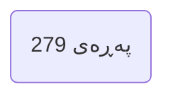
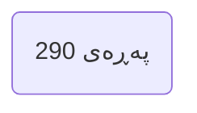
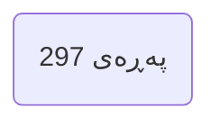

---

## بەشی چوارەم | مەعجەزە زانستییەکان Chapter 4 Scientific Miracles

### PDF Pages: 279–314 | Est. ~36 pages

---

§1

>[!summary] Arabic Text
>

>[!summary] English Text
>

>[!summary] Kurdish Text
>

---



---

§2

>[!summary] Arabic Text
>

>[!summary] English Text
>

>[!summary] Kurdish Text
>

---


---

§3

>[!summary] Arabic Text
>

>[!summary] English Text
>

>[!summary] Kurdish Text
>

---


---

§4

>[!summary] Arabic Text
>

>[!summary] English Text
>

>[!summary] Kurdish Text
>

---


---

§5

>[!summary] Arabic Text
>

>[!summary] English Text
>

>[!summary] Kurdish Text
>

---


---

§6

>[!summary] Arabic Text
>

>[!summary] English Text
>

>[!summary] Kurdish Text
>

---


---

§7

>[!summary] Arabic Text
>

>[!summary] English Text
>

>[!summary] Kurdish Text
>

---


---

§8

>[!summary] Arabic Text
>

>[!summary] English Text
>

>[!summary] Kurdish Text
>

---


---

§9

>[!summary] Arabic Text
>

>[!summary] English Text
>

>[!summary] Kurdish Text
>

---


---

§10

>[!summary] Arabic Text
>

>[!summary] English Text
>

>[!summary] Kurdish Text
>

---


---

§11

>[!summary] Arabic Text
>

>[!summary] English Text
>

>[!summary] Kurdish Text
>

---


---

§12

>[!summary] Arabic Text
>

>[!summary] English Text
>

>[!summary] Kurdish Text
>

---



---

§13

>[!summary] Arabic Text
>

>[!summary] English Text
>

>[!summary] Kurdish Text
>

---


---

§14

>[!summary] Arabic Text
>

>[!summary] English Text
>

>[!summary] Kurdish Text
>

---


---

§15

>[!summary] Arabic Text
>

>[!summary] English Text
>

>[!summary] Kurdish Text
>

---


---

§16

>[!summary] Arabic Text
>

>[!summary] English Text
>

>[!summary] Kurdish Text
>

---


---

§17

>[!summary] Arabic Text
>

>[!summary] English Text
>

>[!summary] Kurdish Text
>

---


---

§18

>[!summary] Arabic Text
>

>[!summary] English Text
>

>[!summary] Kurdish Text
>

---


---

§19

>[!summary] Arabic Text
>

>[!summary] English Text
>

>[!summary] Kurdish Text
>

---



---

§20

>[!summary] Arabic Text
>

>[!summary] English Text
>

>[!summary] Kurdish Text
>

---


---

§21

>[!summary] Arabic Text
>

>[!summary] English Text
>

>[!summary] Kurdish Text
>

---

```mermaid
flowchart LR
P(پەڕەی 299)
```

---

§22

>[!summary] Arabic Text
>

>[!summary] English Text
>

>[!summary] Kurdish Text
>

---

```mermaid
flowchart LR
P(پەڕەی 300)
```

---

§23

>[!summary] Arabic Text
>

>[!summary] English Text
>

>[!summary] Kurdish Text
>

---

```mermaid
flowchart LR
P(پەڕەی 301)
```

---

§24

>[!summary] Arabic Text
>

>[!summary] English Text
>

>[!summary] Kurdish Text
>

---

```mermaid
flowchart LR
P(پەڕەی 302)
```

---

§25

>[!summary] Arabic Text
>

>[!summary] English Text
>

>[!summary] Kurdish Text
>

---

```mermaid
flowchart LR
P(پەڕەی 303)
```

---

§26

>[!summary] Arabic Text
>

>[!summary] English Text
>

>[!summary] Kurdish Text
>

---

```mermaid
flowchart LR
P(پەڕەی 304)
```

---

§27

>[!summary] Arabic Text
>

>[!summary] English Text
>

>[!summary] Kurdish Text
>

---

```mermaid
flowchart LR
P(پەڕەی 305)
```

---

§28

>[!summary] Arabic Text
>

>[!summary] English Text
>

>[!summary] Kurdish Text
>

---

```mermaid
flowchart LR
P(پەڕەی 306)
```

---

§29

>[!summary] Arabic Text
>

>[!summary] English Text
>

>[!summary] Kurdish Text
>

---

```mermaid
flowchart LR
P(پەڕەی 307)
```

---

§30

>[!summary] Arabic Text
>

>[!summary] English Text
>

>[!summary] Kurdish Text
>

---

```mermaid
flowchart LR
P(پەڕەی 308)
```

---

§31

>[!summary] Arabic Text
>

>[!summary] English Text
>

>[!summary] Kurdish Text
>

---

```mermaid
flowchart LR
P(پەڕەی 309)
```

---

§32

>[!summary] Arabic Text
>

>[!summary] English Text
>

>[!summary] Kurdish Text
>

---

```mermaid
flowchart LR
P(پەڕەی 310)
```

---

§33

>[!summary] Arabic Text
>

>[!summary] English Text
>

>[!summary] Kurdish Text
>

---

```mermaid
flowchart LR
P(پەڕەی 311)
```

---

§34

>[!summary] Arabic Text
>

>[!summary] English Text
>

>[!summary] Kurdish Text
>

---

```mermaid
flowchart LR
P(پەڕەی 312)
```

---

§35

>[!summary] Arabic Text
>

>[!summary] English Text
>

>[!summary] Kurdish Text
>

---

```mermaid
flowchart LR
P(پەڕەی 313)
```

---

§36

>[!summary] Arabic Text
>

>[!summary] English Text
>

>[!summary] Kurdish Text
>

---

```mermaid
flowchart LR
P(پەڕەی 314)
```

---

