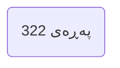
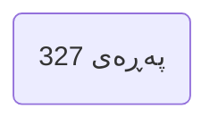
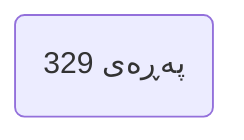
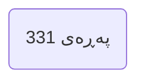

---

## بەشی پێنجەم | گەورەترین بەڵگەی ڕاستیی ئیسلام Chapter 5 Greatest Proof of Islam's Truth

### PDF Pages: 315–336 | Est. ~22 pages

---

§1

>[!summary] Arabic Text
>الباب الخامس
>على
>أعظمُ بُرهان
>
>على صحة الإسلام
>
>صحَّ ة

>[!summary] English Text
>The Fifth Door
>On
>Greatest Proof
>
>of Islam's Truth
>
>Truth

>[!summary] Kurdish Text
>بەشی پێنجەم
>سەر
>گەورەترین بەڵگە
>
>بۆ ڕاستیی ئیسلام
>
>ڕاستی

---


---

§2

>[!summary] Arabic Text
>105
>-
>ما أعظمُ بُرهانٍ على صحة الإسلام؟
>
>❑
>
>أعظم معجزة في الإسلام على الإطلاق، وأعظم آية أُيد بها النبيُّ محمد
>ﷺ، وأعظم برهان على صحة هذا الدين، هو
>كتابُ الله عز وجل ... هو القرآن
>الكريم.
>
>
>قال النبي
>ﷺ: في الحديث المتفق على صحته
>
>"ما مِنَ الأَنبِياءِ نَبِيٌّ إِلا أُعْطِيَ مِنَ الآيَاتِ ما مِثْلُهُ أُمِنَ، أَوْ آمَنَ، عليه البَشَرُ، وإن ما
>كَانَ الذي أُوتِيتُ وَحْيًا أَوْحَاهُ اللهُ إِلَيَ، فَأَرْجُو أَنِّي أَكْثَرُهُم تَابِعًا يَومَ القِيَامَة."
>(174)
>
>❑
>
>فهذا القرآنُ أعظم آيةٍ جاء بها نبي
>ﷺ؛ ولذلك رجا
>أن يكون أكثر الأنبياء تابعاً يوم
>القيامة.
>❑
>
>واآلن قارنْ بين هذينِ الموقفينِ، ثم انظر لحال العالم اليوم لتعرف هل رجاء النبي
>ﷺ
>!يتحقق أم لا
>الموقف الأول
>ذات يومٍ خرج النبي
>ﷺ
>على أصحابه قبل أن يصلوا العشاء فقال لهم
>:"إن ه ليسَ أحَد مِن أهْلِ الأَرْضِ يُصَلِي هذِه الصَلَاةَ غَيْرُكُم
>(175)
>
>❑
>
>لا يوجد مَنْ يُصلي العشاء على وجه الأرض غير هؤلاء النفر الذين يقفون حول النبي
>ﷺ.
>
>واآلن ننظُر للموقف الثاني
>
>يَشر النبي
>ﷺ
>أصحابَه أن ه لن يبفر بيتٌ على ظهر الأرض إلا وسوف تصله رسالة
>الإسلام:
>
>(174) متفق
>:عليه، البخاري ح7274
>:، مسلم ح152
>
>(175) متفق
>:عليه، البخاري ح862
>:، مسلم ح638
>.

>[!summary] English Text
>105
>-
>What is the greatest proof of Islam's truth?
>
>❑
>
>The greatest miracle in Islam absolutely, and the greatest sign with which the Prophet
>Muhammad
>ﷺ was supported, and the greatest proof of the truth of this religion, is
>the Book of Allah the Exalted ... the Noble
>Quran.
>
>
>The Prophet
>ﷺ said in the hadith agreed upon its authenticity:
>
>"There is no prophet among the prophets except that he was given signs like which people believed, and what
>I was given was revelation that Allah revealed to me, so I hope that I will be the most followed of them on the Day of Judgment."
>(174)
>
>❑
>
>So this Quran is the greatest sign brought by a Prophet
>ﷺ; therefore he hoped
>to be the most followed of the prophets on the
>Day of Judgment.
>❑
>
>And now compare these two positions, then look at the state of the world today to know whether the Prophet's
>ﷺ
>hope is fulfilled or not.
>The first position:
>One day the Prophet
>ﷺ went out to his companions before they prayed Isha and said to them:
>"There is no one on the face of the earth praying this prayer except you."
>(175)
>
>❑
>
>There is no one who prays Isha on the face of the earth except these few people standing around the Prophet
>ﷺ.
>
>And now we look at the second position:
>
>The Prophet
>ﷺ gives glad tidings to his companions that no house on the face of the earth will remain but the message of
>Islam will reach it:
>
>(174) Agreed upon
>: Bukhari 7274
>: Muslim 152
>
>(175) Agreed upon
>: Bukhari 862
>: Muslim 638
>.

>[!summary] Kurdish Text
>105
>-
>چی گەورەترین بەڵگەیە بۆ ڕاستیی ئیسلام؟
>
>❑
>
>گەورەترین مەعجەزە لە ئیسلامدا بە تەواوی، و گەورەترین ئایەتە کە پێغەمبەر محەمەد
>ﷺ بەھۆی دەستپێکرد، و گەورەترین بەڵگە بۆ ڕاستیی ئەم دینە، وە
>کتێبی خوا گەورە ... وە قورئانی پیرۆز.
>
>
>پێغەمبەر
>ﷺ وتووە لە قسەیەکدا کە لەسەر دروستیی پێکراوە
>
>"ھیچ پێغەمبەرێک لە پێغەمبەران نایە بەبێ ئەوەی ئایەتێک دەدات کە خەڵک بەوە باوەڕ بکەن، و ئەوەی من دەستپێ کردووە وەحییەک بوو کە خوا نووسی بۆم، بۆیە ھیوای من ھەیە کە من زۆرتر لە ھەموویان لە ڕۆژی قیامەت بەتابەع بکەن."
>(174)
>
>❑
>
>بۆیە ئەم قورئانە گەورەترین ئایەتە کە پێغەمبەرێک ھاتووە؛ بۆیە ھیوای ھەبوو
>بێت زۆرترین پێغەمبەر لە ڕۆژی قیامەت بەتابەع بکەن.
>❑
>
>و ئێستا بەربەندی ئەم دوو دۆخە بکەرەوە، پاشان ببینە بۆ دۆخی جیهان ئێستا بۆ بزانیت ئایا ھیوای پێغەمبەر
>ﷺ
>دڵنیاکراوە یان نا.
>دۆخی یەکەم
>رووژێک پێغەمبەر
>ﷺ چووە دەرەوە سەر ھاوبەشانی پێش دوایینەوەی نەوەژ و وتیان:
>"ھیچ کەسێک لەسەر روی زەویدا نەنەوەژی ئەم نەوەژە جگە لێوانەی کە دەسەڕێکانتان."
>(175)
>
>❑
>
>ھیچ کەسێک نەنەوەژی نەوەژی عەشا لەسەر روی زەویدا جگە لە ئەم کەمە کەسانە کە دەستن دەستن دەکەن لەبەر پێغەمبەر
>ﷺ.
>
>و ئێستا دەبینین بۆ دۆخی دووەم
>
>پێغەمبەر
>ﷺ باشخەبەر دەدات بۆ ھاوبەشانی خۆی کە ھیچ ماڵێک نەمێنێت لەسەر روی زەو بەبێ ئەوەی نامەی
>ئیسلام دەرکەوێت:
>
>(174) راوەکراوە
>: بوخاری ٧٢٧٤
>: مەسلم ١٥٢
>
>(175) راوەکراوە
>: بوخاری ٨٦٢
>: مەسلم ٦٣٨
>.

---


---

§3

>[!summary] Arabic Text
>."لا يَبْقى على ظَهرِ الأَرضِ بَيتُ مَدَرٍ وال وَبَرٍ إِلا أَدْخَلَه اللهُ كَلِمَةَ الإِسلام
>(176)
>
>
>واآلن لننظر لواقع العالم اليوم ونرى
>
>
>الإسلام اليوم هو أشد ديانات الأرض انتشاراً وأثراً على الإطلاق، بل وال وَجْه للمقارنة
>أصًلا بينه وبي  ن غَيْرِهِ.
>
>
>
>!فالإسلام بالفعل كاد أن يدخُل كل بيتٍ على وجه الأرض، وسيدخل اليوم أو غداً كل بيت
>
>
>فهل رجاء النبي
>ﷺ يتحق ق أم لا؟
>
>(176)
>تخريج المسند: ح23814، إسناده صحيح.

>[!summary] English Text
>"No house of mud or hair will remain on the face of the earth except that Allah will enter the word of Islam into it."
>(176)
>
>
>And now let us look at the reality of the world today and see
>
>
>Islam today is the most widespread and influential religion on earth, absolutely, and there is no basis for
>comparison
>between it and anything else.
>
>
>
>!Islam has indeed nearly entered every house on the face of the earth, and it will enter today or tomorrow every house.
>
>
>So is the Prophet's
>ﷺ hope fulfilled or not?
>
>(176)
>From Musnad: 23814, its chain is authentic.

>[!summary] Kurdish Text
>"ھیچ ماڵێکی خێز یان بەل نەمێنێت لەسەر روی زەوی بێوەی خوا ناوی ئیسلام لێی داخڵ بکات."
>(176)
>
>
>و ئێستا با بینی دۆخی جیهان ئێستا بکەین و ببینین
>
>
>ئیسلام ئێستا زۆرترین دینی فرو Bremerی لە زەویدا، بە تەواوی، و ھیچ بەنەمایەک نییە بۆ
>پێچەوانە
>نێوان ئەوە و ھیچ شتێکی دیکە.
>
>
>
>!ئیسلام بە ڕاستی نزیک بووەتەوە ھەموو ماڵێک لەسەر روی زەویدا، و ئێستا یان سبوو ھەموو ماڵێک دەچێتە ناو.
>
>
>بۆیە ئایا ھیوای پێغەمبەر
>ﷺ دڵنیاکراوە یان نا؟
>
>(176)
>لە مەسند: ٢٣٨١٤، سندەکە دروستە.

---


---

§4

>[!summary] Arabic Text
>•
>ما أخط به
>ﷺ
>!يقع على الرغم من ضعفنا
>•
>وها هو كتاب الله محفوظٌ بيننا، وسيبقى إلى يوم القيامة
>ﭐﱡﭐ ..
>ﲖ
>ﲗ
>ﲘ
>ﲙ
>ﲚ
>ﲛ
>ﲜ ﲝﲞ
>ﲟ
>ﲠ
>ﲡ..ﱠ﴿٥٦
>،﴾سورة الروم !فالقرآنُ نزل ليبقى إلى يوم القيامة
>•
>وسيظل هذا الكتابُ معجزةَ الإسلام الكُبرى
>ﭐﱡﭐ ﲥ
>ﲦ
>ﲧ
>ﲨ
>ﲩ
>ﲪ
>ﲫ ﲬﲭ ..
>ﱠ
>﴿٥١
>﴾ سورة العنكبوت
>•
>:فهذا القرآن كافٍ لمن أراد الحق من أهل الأرض
>ﭐﱡﭐ ﲣ ﲤ ﲥ ﲦ ﲧ ﲨ
>ﲩ ﲪ ﲫ ﱠ
>﴿
>1
>﴾ سورة الفرقان
>•
>مة ضخمة، واستبفر على القرون
>فهو نذير للعالمين، وقد أوجد الله به من الهباء أمة
>!من الناس ما كانوا ليدخلوا التاريخ أبداً لوال نهوض هذا الكتاب بهم
>•
>وحي  ن نزل القرآن أخت ُهللا ي هذا القرآن شرَف هذه الأمةِ ومجدَها، وأنهم
>نبيه أن  بهذا القرآن سيدخلون التاريخ
>ﭐﱡﭐ
>ﲥ
>ﲦ
>ﲧ ﲨﲩ
>ﲪ
>ﲫ ﱠ
>﴿
>44
>﴾
>سورة الزخرف
>•
>!وإنه لشرَفٌ لك ولقومك وسوف تُسألون عن أداء حقه
>ﭐﱡﭐﭐ ﲯ ﲰ ﲱ ﲲ ﲳ ﲴﲵ ..
>ﱠ
>﴿
>10
>﴾ سورة الأنبياء
>•
>فيه شرَفُكم... فيه عز ة هذه الأمة طالما تمس  كت به
>•
>!أما إذا تَركته الأمة خلف ظهرها أصابها الضعفُ والهوانُ حين تعود إليه

>[!summary] English Text
>•
>What the Prophet
>ﷺ
>brought comes to pass despite our weakness
>•
>And here is the Book of Allah preserved among us, and it will remain until the Day of Judgment
>Quranic verse
>ﭐﱡﭐ ..
>Quranic verse
>(56), Surah Ar-Rum
>!The Quran was revealed to remain until the Day of Judgment
>•
>And this Book will remain the greatest miracle of Islam
>Quranic verses
>(51), Surah Al-Ankabut
>•
>:This Quran is sufficient for whoever seeks the truth among the people of the earth
>Quranic verse
>(1), Surah Al-Furqan
>•
>A huge nation, and dominance over centuries
>He is a warner to the worlds, and Allah brought forth through it from nothingness a
>great nation
>!of people who would never have entered history without the rise of this Book among them
>•
>And when the Quran was revealed, Allah honored this nation with this Quran, and they
>His Prophet, that with
>this Quran they will enter history
>Quranic verse
>(44), Surah Az-Zukhruf
>•
>!And indeed it is an honor for you and your people, and you will be asked about its due right
>Quranic verse
>(10), Surah Al-Anbiya
>•
>In it is your honor... in it is the glory of this nation as long as they hold fast to it
>•
>!But if the nation abandons it behind its back, weakness and humiliation befall them when they return to it

>[!summary] Kurdish Text
>•
>شتێک کە پێغەمبەر
>ﷺ
>ھاتووە دەرکەوتووە لەبەر ھێزیمان
>•
>و ئێستا کتێبی خوا پارێزراوە لەنێوانمان، و ھێشتا دەبێتەوە ھەتا ڕۆژی قیامەت
>ئایەتی قورئان
>ﭐﱡﭐ ..
>ئایەتی قورئان
>(56)، سوورەی روم
>!قورئان دەرکەوتووە بۆ ھەستا ڕۆژی قیامەت
>•
>و ئەم کتێبەش دەبێتەوە مەعجەزە گەورەی ئیسلام
>ئایەتی قورئان
>(51)، سوورەی عنکبوت
>•
>:ئەم قورئانە بەباشتر بۆ ھەرکەسێک کە دەوێت ڕاستی بزانێت لە خەڵکی زەوی
>ئایەتی قورئان
>(1)، سوورەی فرقان
>•
>نەتەوەیەکی گەورە، و ھێوازی سەدەکان
>ئاوازی جیهانە، و خوا دروست کردووە بەوەی لە ھیچەوە
>!کەسایەتییەکی زۆر لە مرۆڤ، کە ھەرگیز ناتوانن بێ ئەم کتێبەوە بگەڕنێت بۆ مێژوو
>•
>و کاتی کە قورئان نەزیرا، خوا ئەم نەتەوە بەشێوازی بە قورئان پارێز کرد، و ئەوان
>پێغەمبەرەکانیان، کە بە
>ئەم قورئانە دەچنە مێژوو
>ئایەتی قورئان
>(44)، سوورەی زوخرەف
>•
>!و ئەمە بێخێر شرێفێکە بۆ تۆ و قۆمەکەت، و دەبێت لێوە پرسیار بکرێت بۆ ھەدەی تێدای
>ئایەتی قورئان
>(10)، سوورەی ئەنبیا
>•
>لێرەدا شرێفەکەت ھەیە... لێرەدا بەھێزی ئەم نەتەوە تا کە کاتێک بەھێزی دەگرن بەوە
>•
>!بەڵام ئەگەر نەتەوەکە وای خۆی دابخەین لە پشت شێوەوە، لەوێربوون و شەرمەزاری دەکەوێنێت کاتی دەگەڕێنەوە بۆی

---


---

§5

>[!summary] Arabic Text
>
>
>قال النبي
>ﷺ:
>:
>يا مَعْشَرَ المهاجرينَ! خِصال خَمْس
>إذا ابتُلِيتُمْ بهِ ن، وأعوذُ باللهِ أن تُدْرِكُوهُ ن
>-
>وذكر منها -
>ولم يَنْقُضُوا عهدَ اللهِ وعهدَ رسولِه إِلا سُلَّطَ اللهُ عليهم عَدُوَّهُم من
>غَيْرِهِمْ، فَأَخَذُوا بعضَ ما كان في أَيْدِيهِمْ، وما لَمْ تَحْكُم أَئِمَّةُهُم بِكِتَابِ اللهِ عَز وَجَل
>"وَيَتَخَيَّرُوا فيما أَنْزَلَ اللهُ إِلا جَعَلَ اللهُ بَأْسَهُمْ بَيْنَهُمْ
>(177)
>!فلا تعود هذه الأمة لمجدِها حتى تعود لكتاب ربها
>القرآن هو حبلُ اللهِ المتين، وهوَ طريقُ صلاح هذه الأمة... مَنْ
>حَكَمَ بِهِ عَدَلَ، ومن دعا إِلَيْهِ هُدِي
>إِلَى صِرَاطٍ مُسْتَقِيم
>ومسلمة
>نِ أعظم ما أُوصي به كلَ مسلم
>؛ تدبُّر هذا
>!الكتاب كل يوم
>كل يوم يكون لك وِردٌ من القرآن بتدبُّر ولو نصف حزب
>تقرأ الآية بتأمُّل، ثم تقرأ تفسيراً يستَفي عليه يعينك على التدبُر، مثل: التفسير الميسر
>
>
>أو تفسير: الشيخ السعدي
>
>
>
>!ثم تُعيد قراءة الآية مرة أخرى، ثم تذهب إلى الآية التي تليها وهكذا
>
>
>.هذا والله بابُ اليقين الأيس
>
>
>مِتِنا مما هي
>أيشُ باب لتحصيل اليقين، وأيشُ باب لنجاة أنفسِ
>فيه هو
>تدبُر كتاب الله!
>
>
>فعندما تقوم بتدبُر القرآن، ويتحوَّل القرآن إلى،
>حياة
>.ساعتها وهللا ننجو وننهض
>•
>، في كل آية حَلٌ لمشكلةٍ، وتفريجاً لهَمٍّ، وزوالاً لشُبهةٍ، وطمأنينة لنفس
>فسوف تجد فيه
>.وسكينة لقلب
>•
>!فهذا خطاب ربك لك أيها الإنسان
>•
>فالقرآن يشرح اللهُ به الصدرَ، ويغرس به الإيمانَ في
>القلب
>
>(177) صحيح
>الجامع ح7978
>.

>[!summary] English Text
>
>
>The Prophet
>ﷺ said:
>:
>O company of Muhajirun! Five traits
>if you are afflicted with them, and I seek refuge in Allah that you reach them
>-
>And mentioned among them -
>They do not break the covenant of Allah and the covenant of His Messenger except Allah empowers their enemies over them from
>other than themselves, so they take some of what is in their hands, and their leaders do not rule by the Book of Allah the Mighty and Majestic
>except Allah makes their might between them."
>(177)
>!This nation will never return to its glory until it returns to the Book of its Lord
>The Quran is the firm rope of Allah, and it is the path of rectitude for this nation... Whoever
>rules by it acts justly, and whoever calls to it is guided
>to a straight path
>And a Muslim
>The greatest thing I advise every Muslim
>is to reflect upon this
>Book every day
>Every day let there be a portion for you from the Quran with reflection, even half a hizb
>Read the verse with contemplation, then read an interpretation that helps you reflect, such as: the easy interpretation
>
>
>Or the interpretation of: Sheikh Al-Sa'di
>
>
>
>!Then re-read the verse once more, then go to the next verse and so on
>
>
>.This, by Allah, is the door of the most certain certainty
>
>
>What are the doors to attaining certainty, and what is the door to salvation of
>souls
>in it is
>reflecting upon the Book of Allah!
>
>
>For when you engage in reflection upon the Quran, and the Quran transforms into,
>life
>.At that moment, by Allah, we are saved and we rise
>•
>In every verse, a solution for a problem, a relief for a grief, a removal of a doubt, and tranquility for the soul
>.And serenity for the heart
>•
>!For this is the speech of your Lord to you, O human
>•
>For the Quran explains the breast with Allah's permission, and plants faith in
>the heart
>
>(177) Sahih
>Al-Jami' 7978
>.

>[!summary] Kurdish Text
>
>
>پێغەمبەر
>ﷺ وت:
>:
>ی مێشووری ھەجرین! پێنج تایبەتمەندی
>ئەگەر دەبینرێن بەھۆیان، و من دڵنیای خوا دەکەم کە دەگەیشن
>-
>و لێیان باس کراوە -
>نەقین بە بەھا ی خوا و بەھا ی پێغەمبەرەوە ھەتا خوا دەسەڵاتیان دەدات لەسەر دژیانیان لە
>جیاواز خۆیان، بۆیە بەشێک لەوەی لە دەستیان ھەیە دەگرن، و سەرۆکەکانیان بە کتێبی خوا نەمەسرن
>جگە لەوەی خوا نەوەستانەتییان دەکاتەوە نێوانیان."
>(177)
>!ئەم نەتەوە ناتوانێت بگەڕێتەوە بۆ بەرزترین مێژووی خۆی ھەتا کە بگەڕێتەوە بۆ کتێبی راوەشمان خۆی
>قورئان ھێڵەی سەرەکەوتووی خوا، و ڕێگای دروستییە بۆ ئەم نەتەوە... ھەرکەس بەوە دەمەسر بکات دادوەر دەبێت، و ھەرکەس بانگ بکات بۆی ڕوون دەکرێتەوە
>بۆ ھێڵی ڕاست.
>و موسڵمان
>گەورەترین شتێک کە من داوام دەکەم بۆ ھەر موسڵمان
>بۆ تێبینی کردنی ئەم
>کتێبە ھەموو ڕۆژ
>ھەر ڕۆژێک بەشێک بۆت بێت لە قورئاندا بە تێبینی و ھەتا نەوە یەک حزب
>ئایەتەکە بخۆنەوە بە تێبینی، پاشان وتوویەکە بخۆنەوە کە یارمەتیت دەدات بۆ تێبینی، وەک: وتووی ئاسانی
>
>
>یان وتووی: شێخ سعیدی
>
>
>
>!پاشان دووبارە ئایەتەکە بخۆنەوە، پاشان بچۆ بۆ ئایەتی دوایینە و ھەروەها
>
>
>.ئەمە خوا، دەربەوەی یقینترین یقینە
>
>
>چییان دروازیەکان بۆ دەستپێکردنی یقین، و چی دروازییە بۆ ڕزگارکردنی ڕوون
>لێرەدایە
>تێبینی کتێبی خوا!
>
>
>بۆوەی کاتی تۆ تێبینی قورئان دەکەیت، و قورئان دەگۆڕێتەوە بۆ
>ژیان
>.ئەم کاتەدا بە خوا دەڕووین و دەبەرزین
>•
>لە ھەر ئایەتێکدا چارەسەرێک بۆ کێشە، و راوەشتنێک بۆ غم، و لێدەرکردنێک بۆ گومان، و ئارامی بۆ ڕوون
>.و ئارامی بۆ دڵ
>•
>!بۆوەی ئەمە قسەی راوەشمانە بۆ تۆ، ھاومەڵ
>•
>بۆوەی قورئان سەینەوە دەکات بە ڕێگای خوا، و باوەڕ دابنێت لە
>دڵ
>
>(177) سەحیح
>جامع ٧٩٧٨
>.

---


---

§6

>[!summary] Arabic Text
>وللقرآن أ
>سرٌ عظيمٌ؛ ولذلك كم من عدُو لرسول الله
>ﷺ
>أراد اغتياله، فما
>!أن سمع آياتِ القرآن حتى انفطر قلبه وتشد ق اإليمان من عينيه
>(178)
>
>ي قلب معمعة القتال واشتداد
>وقد نب هنا الله تعاىل إىل هذه الحقيقة، وأخبرنا أن الكافر في
>رح السيوف قد يُرح من حين يستمع القرآن
>ﭐﱡﭐ ﲳ ﲴ ﲵ ﲶ ﲷ
>ﲸ ﲹ ﲺ ﲻ ﲼ ﲽ ﲾ ﲿ..
>ﱠ
>﴿
>6
> .﴾ سورة التوبة
>
>
>كيف ينكسر كافرٌ في لحظة احتدام قتالٍ لصوت كتاب عدوه؟
>
>
>إنها !أسرار القرآن
>❑
>
>فللقرآن
>سلطانٌ قاهرٌ على النفوس، وال يزال غضاً طريًّا على كثرة التر دد مع ما فيه من
>ي الأزمات، ويزيل
>الخلوات، وتهفو إليه النفوس في
>قوانين وتشر يعات، وهو الأنيس في
>الوحشة عن أي مكانٍ وُجد فيه
>
>ﱡﭐ ﱘ ﱙ ﱚ ﱛ ﱜ ﱝ ﱞ ﱟ ﱠ  ﱡ ﱢ ﱣ ﱤ ﱥ ﱦ
>ﱧ ﱨ ﱩ ﱪ ﱫ ﱬ ﱭ ﱮ ﱯ ﱰ ﱱ ﱲ ﱳ ﱴ ﱵ ﱶ ﱷ ﱸ ﱹ ﱺ
>ﱻﱠ
>﴿
>23
> .﴾ سورة الزمر
>
>
>فكتابُ الله تفرح به النفس حتى إذا أخذت حظَّها منه عادت مُرتبعة
>.تريد المزيد (
>179
>)
>
>
>:وانظر لحال النصارى الذي يبتغون الحق ماذا يفعلون إذا سمعوا القرآن
>ﱡﭐ
>ﲣ
>ﲤ
>ﲥ
>ﲦ
>ﲧ
>ﲨ
>ﲩ
>ﲪ
>ﲫ
>ﲬ
>ﲭ
>ﲮ
>ﲯ
>ﲰ ﲱﲲ
>ﲳ
>ﲴ
>ﲵ
>ﲶ
>ﲷ
>ﲸ ﱠ
>﴿
>83
> .﴾ سورة المائدة
>
>•
>ي عيونهم من الدموع حين
>أي شخص يقرأ هذه الآية يعلم أن هذا الذي فاض في
>سمِعوا القرآن .شيء فاق قدرتهم على
>احتمال(
>180
>)
>
>(178) إبراهيم السكران، كتاب: رقائق القرآن، وكتاب: الطريق إلى القرآن.
>(179)
>(180) رسالة خاتم النبيين محمد صلى الله عليه وسلم، د. ثامر بن ناصر، مكتبة الرشد.

>[!summary] English Text
>And the Quran has a
>great secret; therefore many an enemy of the Messenger of Allah
>ﷺ
>wanted to assassinate him, but
>!as soon as he heard the verses of the Quran, his heart burst open and tears of faith flowed from his eyes
>(178)
>
>In the heart of the heat of battle and the severity of
>fighting, Allah the Exalted informed us of this truth, and told us that the disbeliever in
>the heat of swords may find relief when he hears the Quran
>Quranic verses
>ﭐﱡﭐ ﲳ ﲴ ﲵ ﲶ ﲷ
>ﲸ ﲹ ﲺ ﲻ ﲼ ﲽ ﲾ ﲿ..
>ﱠ
>﴿
>6
> .﴾ Surah At-Tawbah
>
>
>How does a disbeliever break in a moment of intense combat at the sound of his enemy's Book?
>
>
>These are !the secrets of the Quran
>❑
>
>For the Quran has
>an overwhelming authority over souls, and it remains fresh and tender despite the repetition with what it contains of
>crises, and it removes
>solitudes, and hearts yearn for it in
>laws and legislation, and it is the intimate companion in
>loneliness wherever it is found
>
>Quranic verses
>ﱡﭐ ﱘ ﱙ ﱚ ﱛ ﱜ ﱝ ﱞ ﱟ ﱠ  ﱡ ﱢ ﱣ ﱤ ﱥ ﱦ
>ﱧ ﱨ ﱩ ﱪ ﱫ ﱬ ﱭ ﱮ ﱯ ﱰ ﱱ ﱲ ﱳ ﱴ ﱵ ﱶ ﱷ ﱸ ﱹ ﱺ
>ﱻﱠ
>﴿
>23
> .﴾ Surah Az-Zumar
>
>
>So the Book of Allah brings joy to the soul until it has taken its fill, then it returns anxious
>.wanting more (
>179
>)
>
>
>:And look at the state of the Christians who seek the truth, what do they do when they hear the Quran
>Quranic verses
>ﱡﭐ
>ﲣ
>ﲤ
>ﲥ
>ﲦ
>ﲧ
>ﲨ
>ﲩ
>ﲪ
>ﲫ
>ﲬ
>ﲭ
>ﲮ
>ﲯ
>ﲰ ﲱﲲ
>ﲳ
>ﲴ
>ﲵ
>ﲶ
>ﲷ
>ﲸ ﱠ
>﴿
>83
> .﴾ Surah Al-Ma'idah
>
>•
>In their eyes are tears when
>Any person who reads this verse knows that this which overflowed in
>they heard the Quran .something beyond their
>capacity to bear(
>180
>)
>
>(178) Ibrahim Al-Sakran, Book: Quranic Gems, and Book: The Way to the Quran.
>(179)
>(180) Letter of the Seal of the Prophets Muhammad peace be upon him, Dr. Thamer bin Nasser, Al-Rashid Library.

>[!summary] Kurdish Text
>و قورئان
>ھێڵێکی مێژووی ھەیە؛ بۆیە زۆرینە دژی پێغەمبەر
>ﷺ
>دەویست کوشتنی، بەڵام
>!ھەتایە ئایەتی قورئان گوێیان کرد، دڵی بەھێز دابردا و گریان بەخۆشحاڵی لەچاوەکانیان دەرکەوت
>(178)
>
>لە دڵی جەنگە توندەکاندا و تۆندی
>جەنگدا، خوا گەورە ئاگادارمان کرد بە ئەم ڕاستییە، و وتوومان کە بێباوەڕ لە
>تۆندی شێوەتەوە دەکرێت ئارام بگات کاتی کە قورئان گوێی دەگرێت
>ئایەتی قورئان
>ﭐﱡﭐ ﲳ ﲴ ﲵ ﲶ ﲷ
>ﲸ ﲹ ﲺ ﲻ ﲼ ﲽ ﲾ ﲿ..
>ﱠ
>﴿
>٦
> .﴾ سوورەی تەوبە
>
>
>چۆن بێباوەڕێک دەخەمێنێت لە کاتی توندی جەنگدا بە دەنگی کتێبی دژی؟
>
>
>ئەمە !سەرەوەی قورئان
>❑
>
>بۆ قورئان
>دەسەڵاتێکی توندە سەر ڕوون، و ھێشتا تازە و نازک ماوە، بە ھۆی تێکراری بە ھۆی ئەوەی لێیدا ھەیە لە
>کێشەکان، و دەخەینەوە
>شێوازی تەنها، و دڵەکان هەواس دەکەن بۆی لە
>یاساکان و یاساکان، و ھاوبەشە لە
>تەنها لە ھەر شوێنێک کە دۆزراوە
>
>ئایەتی قورئان
>ﱡﭐ ﱘ ﱙ ﱚ ﱛ ﱜ ﱝ ﱞ ﱟ ﱠ  ﱡ ﱢ ﱣ ﱤ ﱥ ﱦ
>ﱧ ﱨ ﱩ ﱪ ﱫ ﱬ ﱭ ﱮ ﱯ ﱰ ﱱ ﱲ ﱳ ﱴ ﱵ ﱶ ﱷ ﱸ ﱹ ﱺ
>ﱻﱠ
>﴿
>23
> .﴾ سوورەی زومەر
>
>
>بۆیە کتێبی خوا خوشی دڵ دەکات ھەتا خۆشحاڵیەکەی دەستبگەرێت، پاشان دەگەڕێتەوە بۆ
>ترس و دڵنیای دەوێت
>.زیاتر (
>179
>)
>
>
>:و ببینە بۆ دۆخی نەصرانییەکانی کە دەگەڕێن بۆ ڕاستی، چی دەکەن کاتی کە قورئان گوێیان دەکرێت
>ئایەتی قورئان
>ﱡﭐ
>ﲣ
>ﲤ
>ﲥ
>ﲦ
>ﲧ
>ﲨ
>ﲩ
>ﲪ
>ﲫ
>ﲬ
>ﲭ
>ﲮ
>ﲯ
>ﲰ ﲱﲲ
>ﲳ
>ﲴ
>ﲵ
>ﲶ
>ﲷ
>ﲸ ﱠ
>﴿
>83
> .﴾ سوورەی مائیدە
>
>•
>لە چاوەکان گریان ھەیە کاتێک
>ھەر کەسێک ئەم ئایەتە بخۆنێتەوە دەزانی کە ئەمە شتێکە کە فاض کردووە لە
>گوێیان قورئان گوێی کرد .بە ھێزی ھێنانیان
>بە ھێزی ھێنانیان
>بە ھێزی ھێنانیان
>(180)
>
>(178) ئیبراهیم سکەران، کتێب: ڕەقائەق قورئان، و کتێب: ڕێگای قورئان.
>(179)
>(180) نامەی خاتەمی پێغەمبەرانی محەمەد سڵاو ی خوا لێی، د. تامەر بین ناسەر، مەکتەبای ڕاشید.

---


---

§7

>[!summary] Arabic Text
>•
>ما أخط به
>ﷺ
>!يقع على الرغم من ضعفنا
>
>•
>وها هو كتاب الله محفوظٌ بيننا، وسيبقى إلى يوم القيامة
>ﭐﱡﭐ .. 
>ﲖ
>ﲗ
>ﲘ
>ﲙ
>ﲚ
>ﲛ
>ﲜ ﲝﲞ
>ﲟ
>ﲠ
>ﲡ..ﱠ﴿٥٦
>،﴾ سورة الروم !فالقرآنُ نزل ليبقى إلى يوم القيامة
>•
>وسيظل هذا الكتابُ معجزةَ الإسلام الكُبرى
>ﭐﱡﭐ ﲥ
>ﲦ
>ﲧ
>ﲨ
>ﲩ
>ﲪ
>ﲫ ﲬﲭ ..
>ﱠ
>﴿٥١
> .﴾ سورة العنكبوت
>•
>:فهذا القرآن كافٍ لمن أراد الحق من أهل الأرض
>ﭐﱡﭐ ﲥ
>ﲦ
>ﲧ
>ﲨ
>ﲩ
>ﲪ
>ﲫ ﲬﲭ ..
>ﱠ
>﴿٥١
> .﴾ سورة العنكبوت
>•
>مة ضخمة، واستبفر على القرون
>فهو نذير للعالمين، وقد أوجد الله به من الهباء أمة
>جيًلا
>!من الناس ما كانوا ليدخلوا التاريخ أبداً لوال نهوض هذا الكتاب بهم
>•
>وحي  ن نزل القرآن أخت ُهللا ي هذا القرآن شر فَ هذه الأمةِ ومجدَها، وأنهم
>نبيه أن  بهذا القرآن سيدخلون التاريخ
>ﭐﱡﭐ
>ﲥ
>ﲦ
>ﲧ ﲨﲩ
>ﲪ
>ﲫ ﱠ
>﴿
>44
>﴾ سورة الزخرف
>•
>!وإنه لشرَفٌ لك ولقومك وسوف تُسألون عن أداء حقه
>ﭐﱡﭐﭐ ﲯ ﲰ ﲱ ﲲ ﲳ ﲴﲵ ..
>ﱠ
>﴿
>10
>﴾ سورة الأنبياء
>•
>فيه شرَفُكم... فيه عز ة هذه الأمة طالما تمس  كت به
>•
>!أما إذا تَركته الأمة خلف ظهرها أصابها الضعفُ والهوانُ حين تعود إليه

>[!summary] English Text
>•
>What the Prophet
>ﷺ
>brought comes to pass despite our weakness
>
>•
>And here is the Book of Allah preserved among us, and it will remain until the Day of Judgment
>Quranic verse
>ﭐﱡﭐ ..
>Quranic verse
>(56), Surah Ar-Rum
>!The Quran was revealed to remain until the Day of Judgment
>•
>And this Book will remain the greatest miracle of Islam
>Quranic verse
>(51), Surah Al-Ankabut
>•
>:This Quran is sufficient for whoever wants the truth among the people of the earth
>Quranic verse
>(51), Surah Al-Ankabut
>•
>A huge nation, and dominance over centuries
>He is a warner to the worlds, and Allah brought forth through it from nothingness a
>great nation
>!of people who would never have entered history without the rise of this Book among them
>•
>And when the Quran was revealed, Allah honored this nation with this Quran, and they
>His Prophet, that with
>this Quran they will enter history
>Quranic verse
>(44), Surah Az-Zukhruf
>•
>!And indeed it is an honor for you and your people, and you will be asked about its due right
>Quranic verse
>(10), Surah Al-Anbiya
>•
>In it is your honor... in it is the glory of this nation as long as they hold fast to it
>•
>!But if the nation abandons it behind its back, weakness and humiliation befall them when they return to it

>[!summary] Kurdish Text
>•
>شتێک کە پێغەمبەر
>ﷺ
>ھاتووە دەرکەوتووە لەبەر ھێزیمان
>
>•
>و ئێستا کتێبی خوا پارێزراوە لەنێوانمان، و ھێشتا دەبێتەوە ھەتا ڕۆژی قیامەت
>ئایەتی قورئان
>ﭐﱡﭐ ..
>ئایەتی قورئان
>(56)، سوورەی روم
>!قورئان دەرکەوتووە بۆ ھەستا ڕۆژی قیامەت
>•
>و ئەم کتێبەش دەبێتەوە مەعجەزە گەورەی ئیسلام
>ئایەتی قورئان
>(51)، سوورەی عنکبوت
>•
>:ئەم قورئانە بەباشتر بۆ ھەرکەسێک کە دەوێت ڕاستی بزانێت لە خەڵکی زەوی
>ئایەتی قورئان
>(51)، سوورەی عنکبوت
>•
>نەتەوەیەکی گەورە، و ھێوازی سەدەکان
>ئاوازی جیهانە، و خوا دروست کردووە بەوەی لە ھێچەوە
>!کەسایەتییەکی زۆر لە مرۆڤ، کە ھەرگیز ناتوانن بێ ئەم کتێبەوە بگەڕێنێت بۆ مێژوو
>•
>و کاتی کە قورئان نەزیرا، خوا ئەم نەتەوە بەشێوازی بە قورئان پارێز کرد، و ئەوان
>پێغەمبەرەکانیان، کە بە
>ئەم قورئانە دەچنە مێژوو
>ئایەتی قورئان
>(44)، سوورەی زوخرەف
>•
>!و ئەمە بێخێر شرێفێکە بۆ تۆ و قۆمەکەت، و دەبێت لێوە پرسیار بکرێت بۆ ھەدەی تێدای
>ئایەتی قورئان
>(10)، سوورەی ئەنبیا
>•
>لێرەدا شرێفەکەت ھەیە... لێرەدا بەھێزی ئەم نەتەوە تا کە کاتێک بەھێزی دەگرن بەوە
>•
>!بەڵام ئەگەر نەتەوەکە وای خۆی دابخەین لە پشت شێوەوە، لەوێربوون و شەرمەزاری دەکەوێنێت کاتی دەگەڕێنەوە بۆی

---


---

§8

>[!summary] Arabic Text
>•
>وبالفعل هذا ما حصل،
>و لم يمُت النبي
>ﷺ
>.إلا وانتهت الوثنية من قريش للأبد
>• فللقرآن أثرُ هُ العجيب؛ تُسلِم له النفس شيعةً،
>ولو كانت نفسَ كافر معادٍ للقرآن
>• وأنت قد تعرضُ عليك شبهة،
>فتُورِد عليها الردود العلمية والعقلية وأقوال أهل
>العلم، لكن ما أن تأبر
>بآيةٍ قرآنية في
>موضع الشاهد حين يزول الإشكال، وتطميئن
>النفس بالعلم، لكن ما أن تأبر
>السائل ولو كانت ملحداً
>وهذا من عجائب أشار القرآن.
>
>
>فللقرآن أثرُ عجيبٌ في النفس
>
>
>يقول الجبت بن مطعم أنه حين كان كافراً وذهب ليفاوض النبي
>ﷺ
>في أشْى بدر
>نف
>:يقول
>"سَمِعْتُ النبي ﷺ
>ي المَغْرِبِ سورةَ الطَورِ، فَلَمَّا بَلَغَ هَذِه الآيَة
>فِ
>يَقْرَأ: ﱡﭐ ﱚ ﱛ ﱜ ﱝ
>ﱞ
>ﱟ ﱠ ﱡ ﱢ ﱣ ﱤ
>ﱥ ﱦﱧ ﱨ ﱩ ﱪ ﱫ ﱬ ﱭ ﱮ
>ﱯ ﱰ ﱱ
>ﱲ ﱳ ﱠ
>قَالَ:
>سورة الطور، قال:
>ك ادَ قَلْنِ ي أن ." َ يَطِ ت
>(181)
>
>
>
>مع أن الجبت بن مطعم أبر متحفزاً ضد الإسلام، لكن ما أن سمع سورة الطور حين
>.خلبت أحاسيسَ ه سكينةُ القرآن
>
>
>!فللقرآن أسرارُهُ الخاصة ومعارجُهُ الإيمانية
>
>      
>
>(181) صحيح
>:البخاري، ح4854
>.

>[!summary] English Text
>•
>And indeed this is what happened,
>and the Prophet
>ﷺ
>did not die until polytheism ended among Quraysh forever.
>• For the Quran has a wondrous effect on the soul; it submits to it willingly,
>even if it were the soul of a disbeliever hostile to the Quran.
>• And you may be presented with a doubt,
>so you present scientific and rational responses and statements of scholars
>on the point of evidence, but as soon as it is met
>with a Quranic verse in
>the place of evidence, the confusion vanishes, and the soul is reassured by knowledge, but as soon as it is met
>the questioner even if he was an atheist.
>And this is from the wonders the Quran pointed to.
>
>
>For the Quran has a wondrous effect on the soul.
>
>
>Al-Jubayr ibn Mut'im narrates that when he was a disbeliever and went to negotiate with the Prophet
>ﷺ
>at the return from
>Badr
>he says:
>:"I HEARD THE PROPHET ﷺ
>RECITING SURAH AT-TUR IN THE WEST, SO WHEN HE REACHED THIS VERSE
>HE RECITED: ﱡﭐ ﱚ ﱛ ﱜ ﱝ
>ﱞ
>ﱟ ﱠ ﱡ ﱢ ﱣ ﱤ
>ﱥ ﱦﱧ ﱨ ﱩ ﱪ ﱫ ﱬ ﱭ ﱮ
>ﱯ ﱰ ﱱ
>ﱲ ﱳ ﱠ
>HE SAID:
>HE RECITED SURAH AT-TUR, HE SAID:
>MY HEART ALMOST FLEW FROM ." THAT IT WOULD FLY
>(181)
>
>
>
>Even though Al-Jubayr ibn Mut'im came prepared against Islam, but as soon as he heard Surah At-Tur,
>.his feelings were captivated by the tranquility of the Quran
>
>
>!For the Quran has its own secrets and spiritual ascents
>
>      
>
>(181) Sahih
>:Bukhari 4854
>.

>[!summary] Kurdish Text
>•
>و بەراستی ئەمەشە روویداوە،
>و نێب
>ﷺ نەمێردا ھەتا کە مێتۆسی لە قورەیش بە تەواوی کۆتایی هەات
>• بۆ قورئان ھێڵەیەکی سەیرکەرەوە ھەیە سەر ڕوون؛ دەبێتەوە بە رازی، 
>ھەتا ئەگەر دڵی بێباوەڕ دژی قورئان بێت
>• و تۆ دەکرێت رووبەڕووی گومانێک بکەیت،
>بۆیە تۆ وەڵامە زانستییە و بیرکردنەوەیی و قسەی زانایان
>دەدەیت لەسەر نوکتەی بەڵگە، بەڵام ھەتایە کە بە ئایەتی قورئانی
>دەستپێدەکرێت لە
>شوێنی بەڵگە، گومانەکە ناکۆکرێتەوە، و ڕوون دڵنیاکراوە بە زانیاری، بەڵام ھەتایە کە بە
>پێشەوە
>پرسیارکردنەوە کەسێک ھەتا ئەگەر بێباوەڕ بێت
>و ئەمەش لە شیدایەکاندایە کە قورئان باس کردووە.
>
>
>بۆ قورئان ھێڵەیەکی سەیرکەرەوە ھەیە سەر ڕوون
>
>
>جەبیر بن مطەعڵ ڕوونکردنەوە دەدات کە کاتێک بێباوەڕ بوو و چوو بۆ مێش کردنی لەگەڵ نێب
>ﷺ
>لە دوای
>بدر
>نف
>دەڵێت:
>:"من قورئان گوێی لە باوەیی دوایین سۆران، بۆیە کاتی ھەیتە ئەم ئایەتە
>خوێند: ﱡﭐ ﱚ ﱛ ﱜ ﱝ
>ﱞ
>ﱟ ﱠ ﱡ ﱢ ﱣ ﱤ
>ﱥ ﱦﱧ ﱨ ﱩ ﱪ ﱫ ﱬ ﱭ ﱮ
>ﱯ ﱰ ﱱ
>ﱲ ﱳ ﱠ
>تێناسەوە:
>سۆرەی طوور خوێند، وت:
>دڵم تەقریب دەبوو دەفڕێت." ." ئەوە کە فڕێن
>(181)
>
>
>
>بەھۆی کە جەبیر بن مطەعڵ لێرەدا بە بێباوەڕی ھاتوو بۆ ئیسلام، بەڵام ھەتایە کە سۆرەی طوور گوێی کرد،
>.ھەستییەکانی بە ئارامی قورئان گولraina
>
>
>!بۆ قورئان سەرەوەی خۆی ھەیە و مێنێژی رووحی ھەیە
>
>      
>
>(181) سەحیح
>:بوخاری ٤٨٥٤
>.

---



---

§9

>[!summary] Arabic Text
>106
>-
>ما أفضل طريق لتفنيد الأفكار المنحرفة؟
>
>
>
>تدبُر القرآن
>،أيضاً هو أفضل طريق لتفنيد الأفكار الضالة والشُبهات والوساوس
>ي
>ف لو قرأ الشاب المسلمُ آياتِ القرآن في
>وسيلة الدنيا: أن الدنيا مجرد وسيلة، ومركزية
>الآخرة:
>ﭐﱡﭐ ﱎ
>ﱏ
>ﱐ ﱑ
>ﱒ ﱓﱔ ﱕ
>ﱖ
>ﱗ
>ﱘ ..ﱠ﴿٥ .﴾ سورة فاطر
>
>
>.وآيات أزلية الصراع بين الحق والباطل
>
>
>وآيات معنى التكليف
>
>
>وآيات ضرورة التمحيص والابتلاء: ﭐﱡﭐ
>ﲓ ﲔ ﲕ
>ﲖ ﲗ
>ﲘ
>ﲙ
>ﲚ ﲛ
>ﲜ ﱠ
>﴿
>2
> .﴾ سورة العنكبوت
>
>
>وآيات ضرورة التسليم للنص الشرعي: ﭐﱡﭐﭐ
>ﱷ
>ﱸ
>ﱹ
>ﱺ ﱻ
>ﱽ ﱾﱿ ..ﱠ﴿
>190 .﴾ سورة يونس
>
>
>وآيات عدم الاغترار بالبَه رَج المادي: ﱡﭐ ﳅ
>ﳆ
>ﳇ
>ﳈ
>ﳉ
>ﳊ
>ﳋ
>ﳌ
>ﳍ
>ﳎ
>ﳏ
>ﳐ ﳑ
>ﳒ
>ﳓ
>ﳔ
>ﳕ
>ﱠ
>﴿٣٣ ﴾ سورة
>الزخرف
>
>
>إذا قرأ المسلمُ هذه الآيات بتدبُر، باهلل عليكم ماذا سيتبق ى بعد ذلك من أطالل
>!الانحرافات الفكرية المعاصرة؟
>(182)
>
>•
>حي  ن يقرأ المسلم
>آيات القرآن فإنه ليس
>أمام "خطابٍ فكريٍّ " يستطيع التخلُّص
>ي وجهة النظر" بل هو
>منه عت مخرج "الاختلاف في .أمام "خطاب الله" مباشر ةا
>•
> . فإما الانصياعَ، وإما النفاقَ الفكري
>•
>.وال تسويات أو حلول وسط أمام أوامر مَ لِك الملوك سبحانه وتعاىل
>•
>ي العقل المسلم ما ال تصنعه كل المطوالت
>قراءة صادقة لكتاب الله تصنع في
>.الفكرية (
>183
>)
>
>
>
>!لذلك احرصوا على كتاب ربكم بتدبُر
>ففيه !خت ا الدنيا والآخرة
>
>
>.فيه مبتدأ ومنتهى تحصين العقل المسلم
>
>(182)
>إبراهيم السكران كتاب: رقائق القرآن، وكتاب: الطريق إلى القرآن.
>
>(183)
>إبراهيم السكران كتاب: رقائق القرآن، وكتاب: الطريق إلى القرآن.

>[!summary] English Text
>106
>-
>What is the best way to refute deviant ideas?
>
>
>
>Reflection on the Quran
>is also the best way to refute deviant ideas, doubts, and whispers
>in
>If the Muslim youth reads the verses of the Quran in
>the worldly means: that the world is merely a means, and the centrality of
>the Hereafter:
>Quranic verse
>ﭐﱡﭐ ﱎ
>ﱏ
>ﱐ ﱑ
>ﱒ ﱓﱔ ﱕ
>ﱖ
>ﱗ
>ﱘ ..ﱠ﴿5 .﴾ Surah Fatir
>
>
>.And verses of the eternal conflict between truth and falsehood
>
>
>And verses on the meaning of responsibility
>
>
>And verses on the necessity of scrutiny and trial: Quranic verses
>ﭐﱡﭐ
>ﲓ ﲔ ﲕ
>ﲖ ﲗ
>ﲘ
>ﲙ
>ﲚ ﲛ
>ﲜ ﱠ
>﴿
>2
> .﴾ Surah Al-Ankabut
>
>
>And verses on the necessity of submission to the legal text: Quranic verses
>ﭐﱡﭐﭐ
>ﱷ
>ﱸ
>ﱹ
>ﱺ ﱻ
>ﱼ
>ﱽ ﱾﱿ ..ﱠ﴿
>190 .﴾ Surah Yunus
>
>
>And verses on not being deceived by material splendor: Quranic verses
>ﱡﭐ ﳅ
>ﳆ
>ﳇ
>ﳈ
>ﳉ
>ﳊ
>ﳋ
>ﳌ
>ﳍ
>ﳎ
>ﳏ
>ﳐ ﳑ
>ﳒ
>ﳓ
>ﳔ
>ﳕ
>ﱠ
>﴿33 .﴾ Surah
>Az-Zukhruf
>
>
>If the Muslim reads these verses with reflection, by Allah upon you what will remain after that of
>contemporary intellectual deviations?
>(182)
>
>•
>When the Muslim reads
>the verses of the Quran, he is not
>facing an "intellectual discourse" he can escape
>from an "exit point of view" but rather he is
>facing "the speech of Allah" directly
>•
> .So either submission, or intellectual hypocrisy
>•
>.No compromises or middle solutions before the commands of the King of kings, the Exalted
>•
>What the Muslim mind cannot make all the
>lengthy writings
>A sincere reading of the Book of Allah creates in
>.the intellectual sphere (
>183
>)
>
>
>
>!Therefore, hold fast to the Book of your Lord with reflection
>For in it !lies the salvation of this world and the Hereafter
>
>
>.In it is the beginning and end of fortifying the Muslim mind
>
>(182)
>Ibrahim Al-Sakran, Book: Quranic Gems, and Book: The Way to the Quran.
>
>(183)
>Ibrahim Al-Sakran, Book: Quranic Gems, and Book: The Way to the Quran.

>[!summary] Kurdish Text
>106
>-
>چی باشترین ڕێگایە بۆ ڕدکردنەوەی بیرۆکە هەڵەکان؟
>
>
>
>تێبینی قورئان
>ھەروەھا باشترین ڕێگایە بۆ ڕدکردنەوەی بیرۆکە هەڵەکان، شەوبەبوون و تەнемە
>ی
>ئەگەر کوڕێک لە موسڵمانان قورئان بخۆنێتەوە لە
>مێدی الدنیا: کە جیهان تەنها ھاوبەشێکە، و سەرەکیی ئاخیرەت:
>ئایەتی قورئان
>ﭐﱡﭐ ﱎ
>ﱏ
>ﱐ ﱑ
>ﱒ ﱓﱔ ﱕ
>ﱖ
>ﱗ
>ﱘ ..ﱠ﴿٥ .﴾ سوورەی فاتەر
>
>
>.و ئایەتەکانی دوامدارەوەی جەنگی ڕاست و درۆز
>
>
>و ئایەتەکانی مێنای بەرپرسیاریدا
>
>
>و ئایەتەکانی پێویستی تاقیکردنەوە و تاقیگە: ئایەتی قورئان
>ﭐﱡﭐ
>ﲓ ﲔ ﲕ
>ﲖ ﲗ
>ﲘ
>ﲙ
>ﲚ ﲛ
>ﲜ ﱠ
>﴿
>2
> .﴾ سوورەی عنکبوت
>
>
>و ئایەتەکانی پێویستی دابینکردنەوە بە نووسی یاسایی: ئایەتی قورئان
>ﭐﱡﭐﭐ
>ﱷ
>ﱸ
>ﱹ
>ﱺ ﱻ
>ﱼ
>ﱽ ﱾﱿ ..ﱠ﴿
>190 .﴾ سوورەی یونس
>
>
>و ئایەتەکانی نەبوونی گولەوە لە جوانی ماددی: ئایەتی قورئان
>ﱡﭐ ﳅ
>ﳆ
>ﳇ
>ﳈ
>ﳉ
>ﳊ
>ﳋ
>ﳌ
>ﳍ
>ﳎ
>ﳏ
>ﳐ ﳑ
>ﳒ
>ﳓ
>ﳔ
>ﳕ
>ﱠ
>﴿٣٣ ﴾ سوورەی
>زۆخرەف
>
>
>ئەگەر موسڵمان ئەم ئایەتانە بە تێبینی بخۆنێتەوە، بە خوا لەبەر تۆ چی ڕوومێنێت لە دوای ئەوە لە
>بیرۆکە هەڵە بەراوردی ھێشتا؟
>(182)
>
>•
>کاتی موسڵمان
>ئایەتەکانی قورئان دەخوێنێتەوە، ئەو کات ناتوانێت
>پێش "قسییە فێرکارییەکە" بکەوە بە
>"دەرگای بینین" بەڵکو رووبەڕووی "قسیی خوا" بە تایبەتیی
>•
> . بۆیە یان فەرمانبەرداری، یان نفاقی بیرکردنەوە
>•
>.نە ھەوڵدان یان چارەسەری ناوەند لەبەر فەرمانەکان مَلِک ملوک، گەورە
>•
>چی منداڵی ھونەرمندان ناتوانن بکەن
>خوێندنەوەی ڕاستییەک بۆ کتێبی خوا دروست دەکات لە
>.پێشكەشکردنە بیرکردنەوەییەکان (
>183
>)
>
>
>
>!بۆیە تۆماردەکەن بە تێبینی کتێبی راوەشمان بکەن بە تێبینی
>بۆوەی لێرەدا ناوەند ناوەند و کۆتایی ناوەندە بۆ پارێزگاری بیر موسڵمان
>
>
>بۆوەی لێرەدا ناوەند ناوەند و کۆتایی ناوەندە بۆ پارێزگاری بیر موسڵمان
>
>(182)
>ئیبراهیم سکەران، کتێب: ڕەقائەق قورئان، و کتێب: ڕێگای قورئان.
>
>(183)
>ئیبراهیم سکەران، کتێب: ڕەقائەق قورئان، و کتێب: ڕێگای قورئان.

---


---

§10

>[!summary] Arabic Text
>107
>-
>ما سمات القرآن البارزة؟
>
>•
>
>ال يوجد كتاب نز ه الخالق وقد سه، وأمر بالتوحيد والتصديق بالرسل وتتن ن ي ههم عن
>كل نقيصةٍ، والحث على الصالحات الباقيات مثل
>القرآن .؛ منذ كانت الدنيا
>•
>
>فالقرآن منسوجٌ بالتوحيد ، منسوج بتعظيم الأنبياء، منسوج باأمر بالخت ات وترك
>المنكرات، كل هذا بحبكة لغوية ونسج لم .يعهد ه العرب
>(184)
>
>
>
>يقول شيخ الإسلام ابن تيمية :رحمه الله "فليس في التوراة ولا الإنجيل مماثل لمعان
>•
>
>وإعجاز
>القرآن
>ليس في لغته فقط كما يظن أغلب .في لفظه فقط
>الملحدة، ولا في
>
>
>يقول شيخ الإسلام ابن تيمية :رحمه الله "فالإعجاز في معناه أعظم وأكثر من الإع
>
>      
>
>(184)
>رسالة خاتم النبيين محمد
>ﷺ، د. ثامر بن ناصر، مكتبة الرشد
>(185)
>الجواب
>الصحيح
>، م5 ص435
>.
>(185)
>الجواب
>الصحيح
>، م5 ص434
>.

>[!summary] English Text
>107
>-
>What are the prominent features of the Quran?
>
>•
>
>There is no book revealed by the Creator and commanded monotheism, belief in the messengers, and warned against
>every vice, and encouraged the enduring good deeds like
>the Quran .; since the world existed
>•
>
>So the Quran is woven with monotheism, woven with honoring the prophets, woven with the command to do good and forbid
>evil, all this with a linguistic composition and weaving the Arabs had never
>known before
>(184)
>
>
>
>Shaykh al-Islam Ibn Taymiyyah - may Allah have mercy on him - said: "There is nothing in the Torah or the Gospel similar to the meanings
>•
>
>And the miracle
>of the Quran
>is not only in its language as most atheists think .in its wording only
>
>
>Shaykh al-Islam Ibn Taymiyyah - may Allah have mercy on him - said: "The miracle in its meaning is greater and more than the miracle
>
>      
>
>(184)
>Letter of the Seal of the Prophets Muhammad
>ﷺ, Dr. Thamer bin Nasser, Al-Rashid Library
>(185)
>The correct
>answer
>, vol 5 p435
>.
>(185)
>The correct
>answer
>, vol 5 p434
>.

>[!summary] Kurdish Text
>107
>-
>چی تایبەتمەندییە گونجاوەکانی قورئان؟
>
>•
>
>ھیچ کتێبێک نەزیراوە لەلایەن خالقەکەوە، و فەرماندا بە تەوحید و باوەڕ لە پێغەمبەران و دابین کرد بۆ
>ھەر بێبهرە، و ھێنانی کارە باشەوەکانی ماوەوە وەک
>قورئان .؛ لە کاتی کە جیهان ھەبووە
>•
>
>بۆیە قورئان بە تەوحید نساوە، بە ناونیشانی پێغەمبەران نساوە، بە فەرمان بۆ خێرکردن و دەرکردنی
>بێخێر، ھەموو ئەمە بە ھەڵبژاردنێکی زمانی و نسین کە نەبووە
>ناسراوە لەلایەن عەرەب
>(184)
>
>
>
>شێخی ئیسلام ئیبن تیمیە - خوا ڕەحمەتی لێ بکات - وت: "لە تورات و ئینجیل ھاوشێوەی مێنای
>•
>
>و مەعجەزە
>قورئان
>نە تەنها لە زمانیان وەک زۆربەی بێباوەڕان باوەڕ دەکەن .لە زمانییان تەنها
>
>
>شێخی ئیسلام ئیبن تیمیە - خوا ڕەحمەتی لێ بکات - وت: "مەعجەزە لە مێنایدا گەورەتر و زیاترە لە مەعجەزە
>
>      
>
>(184)
>نامەی خاتەمی پێغەمبەرانی محەمەد
>ﷺ، د. تامەر بین ناسەر، مەکتەبای ڕاشید
>(185)
>وەڵامی
>درۆست
>، م5 ص435
>.
>(185)
>وەڵامی
>درۆست
>، م5 ص434
>.

---


---

§11

>[!summary] Arabic Text
>108
>-
>ما سمات إعجاز القرآن البالغي؟
>
>
>:أما إعجاز القرآن البالغي فْلنه
>•
>.جاء بأفصح الألفاظ
>•
>.في أحسن نظم التأليف
>•
>.مُ ضمنًا أصحَّ المعاني
>•
>واللفظة الواحدة من القرآن لو أخذتها وأدرت لغة العرب لتحصل على لفظة أحسن
>.منها ما استطعت (
>187
>)
>
>•
>ولو أردت أن تؤلف بكلماتٍ أخرى غير كلمات القرآن؛ لتوازي حسن تأليفه ورونقه
>.لشهدت له بالنرص، وعىل نفسك بالعجز
>•
>:ي قوله تعاىل
>ي وكتر تها، وتالؤم الكالم فن
>انظر إيجاز اللفظ مع دقة المعابن
>ﭐﱡﭐ ﲹ
>ﲺ ﲻ ﲼ ﲽ
>ﲾ ﲿ ﳀ ﳁ ﳂ ﳃ ﳄ ﳅﳆ
>ﳇ ﳈ ﳉ ﳊ ﱠ
>﴿
>44
> .﴾ سورة هود
>•
>:ي  قوله تعاىل
>ي المعجز فن
>وانظر إىل الإيجاز القرآبن
>ﭐﱡﭐ ﱏ ﱐ ﱑ ﱒ
>ﱠﱓﱔ
>﴿
>80
> .﴾ سورة يوسف
>
>
>:خَ ل صُ وا نَجِ يًّا معناها .خال بعضهم ببعض يتناجون ويتشاورون ال يخالطهم غت ُهم
>!ي بعبارةٍ أوجَ زَ وتؤدي نفس هذا المعنن
>أتحد  ى أي ملحد أن يأبر
>ي
>لو أخذت أي كلمة من القرآن وأدرت لغة العرب لن تجد أدق منها، ولا أوىل منها في
>موضعها وسياقها
>
>
>:وانظر لقوله تعاىل
>ﱡﭐ
>ﱁ
>ﱂ
>ﱃ
>ﱄ ﱠ
>﴿
>130
> .﴾ سورة الصافات
>
>
>:سْ ل مَ ا
>
>فَل م ا أ .خضعا وانقادا لأمر الله تعاىل
>
>
>: وَ تَلَّهُ لِلْجَ بِي ن .وضعه على جبه
>•
>ي بهذا المعنن المطلوب بنفس هذا العدد من
>هل يستطيع بليغ أن يأبر
>الكلمات بنفس هذا السياق الجمالي، الذي لا يخرج عن ست آيات التي قبلها والنر ي
>بعدها؟
>•
>ولذا عندما سمع العربُ الأقراح كالمَ الله، قال بعضُ هم قبل أنْ يُسلموا من
>فرط انجذابه قال : "كادَ قَلْنِي أنْ يَطِ ت ."
>(188)
>
>      
>
>(187)
>رسالة خاتم النبيين محمد
>ﷺ، د. ثامر بن ناصر، مكتبة الرشد
>(188)
>صحيح
>:البخاري ح4854
>.

>[!summary] English Text
>108
>-
>What are the characteristics of the Quran's rhetorical miracle?
>
>
>As for the Quran's rhetorical miracle, it is because it
>•
>.Came with the most eloquent words
>•
>.In the best systems of composition
>•
>.Containing the most correct meanings
>•
>And if you took a single word from the Quran and searched the Arabic language, you would not find a more eloquent
>word than it, whatever you could manage (
>187
>)
>
>•
>And if you wanted to compose with words other than the Quran's words, to match the beauty of its composition and elegance
>.You would witness its superiority, and admit your own inability
>•
>:In His saying, the Exalted
>y in its multiplicity, and harmony of speech in
>Look at the brevity of the word with the precision of meanings
>Quranic verse
>ﭐﱡﭐ ﲹ
>ﲺ ﲻ ﲼ ﲽ
>ﲾ ﲿ ﳀ ﳁ ﳂ ﳃ ﳄ ﳅﳆ
>ﳇ ﳈ ﳉ ﳊ ﱠ
>﴿
>44
> .﴾ Surah Hud
>•
>:In His saying, the Exalted
>y the miraculous in
>And look at the Quranic conciseness
>Quranic verses
>ﭐﱡﭐ ﱏ ﱐ ﱑ ﱒ
>ﱠﱓﱔ
>﴿
>80
> .﴾ Surah Yusuf
>
>
>:خَ ل صُوا نَجِ يًّا معناها .خال بعضهم ببعض يتناجون ويتشاورون لا يخالطهم غت ُهم
>!in a more concise phrase that conveys the same meaning
>I challenge any atheist to express
>If you took any word from the Quran and searched the Arabic language, you would not find a more precise
>one, nor earlier in
>its place and context
>
>
>:And look at His saying, the Exalted
>Quranic verse
>ﱡﭐ
>ﱁ
>ﱂ
>ﱃ
>ﱄ ﱠ
>﴿
>130
> .﴾ Surah As-Saffat
>
>
>:سْ ل مَ ا
>
>فَل مَا أ .خضعا وانقدا لأمر الله تعاىل
>
>
>: وَ تَلَّهُ لِلْجَ بِي ن .placed it on his forehead
>•
>With this required meaning with this same number of
>Can any rhetorician express
>words in this same beautiful context, which does not depart from the six verses before it and the one
>after it?
>•
>And so when the eloquent Arabs heard the speech of Allah, some of them said before converting to Islam out of
>excessive attraction: "I almost said that it flies."
>(188)
>
>      
>
>(187)
>Letter of the Seal of the Prophets Muhammad
>ﷺ, Dr. Thamer bin Nasser, Al-Rashid Library
>(188) Sahih
>:Bukhari 4854
>.

>[!summary] Kurdish Text
>108
>-
>چی تایبەتمەندییە بەھاوانی مەعجەزە بەھاڵییەکانی قورئان؟
>
>
>:بۆوەی مەعجەزە بەھاڵییەکانی قورئان
>•
>.ھاتووە بە فصیحترین ووشەکان
>•
>.بە باشترین نیشتمان نووسین
>•
>.داخڵکراوە تەندڕووستترین مێنایەکان
>•
>و ووشەیەکی تایبەت لە قورئان بگرێیت و زمانە عەرەبیەکت بگەڕێنیت بەدۆزیتەوە ووشەیەک باشتر
>لەوە ناتوانیت، چی بکەیت بە ھێزی (
>187
>)
>
>•
>و ئەگەر دەوێیت بە وشەکانی دیکە نووسیت، بۆ ھاوشێوەکردنی باوەتی نووسینی و جوانییەکەی
>.بەباشتر لێی دەوێت، بە خۆت لێرە بەناسناسێت
>•
>:لە وتوی خوا، گەورە
>ی لە زۆربوونی ووشە، و دروستی قسە لە
>ببینە کوتاهی ووشە بە دروستی مێنای
>ئایەتی قورئان
>ﭐﱡﭐ ﲹ
>ﲺ ﲻ ﲼ ﲽ
>ﲾ ﲿ ﳀ ﳁ ﳂ ﳃ ﳄ ﳅﳆ
>ﳇ ﳈ ﳉ ﳊ ﱠ
>﴿
>44
> .﴾ سوورەی ھود
>•
>:لە وتوی خوا، گەورە
>بۆوەی مەعجەزە
>بۆوەی کورتەبوون
>ببینە بۆ قورئان
>ئایەتی قورئان
>ﭐﱡﭐ ﱏ ﱐ ﱑ ﱒ
>ﱠﱓﱔ
>﴿
>80
> .﴾ سوورەی یوسوف
>
>
>:خَ ل صُ وا نَجِ يًّا مێنای .خال هەندێک بەھەندێک ھەوبەشتن و تێکەڵکردنەوە نەخۆشاوین
>!بە وشەیەک کە زۆرتر کورتە و ھەمان مێنای دەدات
>أتحدی ھەر بێباوەڕێک بەدوایین
>ئەگەر ووشەیەک لە قورئان بگریت و زمان عەرەبی بگەڕێنیت ناتوانیت باشتر بەدۆزیتەوە، نە ھەروەھا لە
>شوێن و دۆخیان
>
>
>:و بینە بۆ وتوی خوا، گەورە
>ئایەتی قورئان
>ﱡﭐ
>ﱁ
>ﱂ
>ﱃ
>ﱄ ﱠ
>﴿
>130
> .﴾ سوورەی صافات
>
>
>:سْ ل مَ ا
>
>فَل مَا أ .خضعا وانقدا لأمر خوا گەورە
>
>
>: وَ تَلَّهُ لِلْجَ بِي ن .دایەوە سەر پیشانی
>•
>بەم مێنایەوە پێویست بەم ژمارەیە لە
>ھەر سیاسەتنامەوانێک دەتوانێت بڵێت
>ئایا سیاسەتنامەوان دەتوانن
>وشەکان بەم ژمارەیە و بەم شێوازی جوانی، کە ناکەوێتەوە لە سەت ئایەتە کە پێشووە و نر ی
>دوایینە؟
>•
>و بۆیە کەتی کە عەرەبە ڕوونەوەرەکان قسەی خوا گوێیان کرد، کەسێک لەوانە وت بەفرەت ھەقینەی خۆی وت: "
>كادَ قَلْنِي أنْ يَطِ ت ."
>(188)
>
>      
>
>(187)
>نامەی خاتەمی پێغەمبەرانی محەمەد
>ﷺ، د. تامەر بین ناسەر، مەکتەبای ڕاشید
>(188) سەحیح
>:بوخاری ٤٨٥٤
>.

---


---

§12

>[!summary] Arabic Text
>109
>-
>لكن بعض الملحدين المعاصرين حاولوا أن يُحاكوا أسلوب القرآن
>
>❑
>
>مشر كو العرب كادت تطت قلوب هم من قوة القرآن، ويأتيك ملحد معارص ال يجيد نطق
>ي لمحاكاة بعض نصوص القرآن مستخدمً ا نفس العبارات
>العربية نطقً ا صحيحاً، فيأبر
>.القرآنية واألساليب القرآنية واللغة القرآنية
>
>
>فطاحل المشركين شعراء الجاهلية لو عرفوا أنَّ تحدي القرآن
>سيكون بهذه !الطريقة لربما انتحروا كمدًا
>•
>فالملحد .يستخدم عبارات قرآنية خالصة وأساليب قرآنية حرصية
>•
>فهل هذا تحدٍّ للقرآن؟
>•
>ي بنسقٍ جديدٍ كالذي جاء به القرآن، وليس
>الذي يريد تحدي القرآن عليه أنْ يأبر
>!مجرد التقليد المضحك
>•
>ن نفس
>تخي ل شخصً ا يتحدى الري
>دافنش فيُحرص
>المرين دافنش !
>ي
>ن دان
>تخي ل رد فعل ر ي
>دافنش !
>
>•
>سيسخر ر ي
>دافنش .من هذا الأسلوب السمج
>•
>إذا أردت تحدي القرآن، فأنت مُ طالب بنسق ثوري
>ي اللغة كالنسق الثوري الذي أحدثه القرآن
>جديد في .
>
>•
>.ولغة العرب شعر ونتر وقرآن
>
>•
>ولذلك توقف كُ فار العرب عن تحدي القرآن، ومن تقد م منهم كمسيلمة الكذ اب
>.صار أضحوكة
>•
>فهذا الطرح السمج من بعض الملحدين المعارصين دليلٌ مستقلٌ على إعجاز
>.القرآن
>•
>ولم يزل القرآن يقرع ،المشركين البلغاء أشد التقري ع ويُسفه ،أحالمهم ويذم
>،آلهتهم ويتحداهم ،أن يأتوا بمثله أو بسورةٍ من مثله وهم في كل هذا
>.منكصون عن معارضته، مُ حج ناكصون
>•
>بل لقد قال الله عز وجل للمشركين :ﭐﱡﭐﭐ
>ﳆ ﳇ
>ﳈ
>ﳉ
>ﳊ ..
>ﱠ
>﴿
>24
> .﴾ سورة
>البقرة
>•
>.فما فعلوا، وال قدروا

>[!summary] English Text
>109
>-
>But some contemporary atheists have attempted to imitate the style of the Quran
>
>❑
>
>The chieftains of the Arabs almost had their hearts fly from the power of the Quran, and there comes an atheist, a contemporary who does not master the pronunciation
>to imitate some Quranic texts using the same
>Quranic phrases, proper pronunciation, emerging
>.with Quranic styles and Quranic language
>
>
>The giants of the polytheists, the poets of the Jahiliyyah, if they knew that the Quran's challenge
>would be in this !way, perhaps they would have committed suicide out of grief
>•
>The atheist .uses purely Quranic phrases and Quranic styles, purely imitative
>•
>Is this a challenge to the Quran?
>•
>The one who wants to challenge the Quran must present a revolutionary
>system in language like the revolutionary system that the Quran brought
>!not just a ridiculous imitation
>•
>Imagine a person who challenges
>Da Vinci by knitting
>Mona Lisa !
>imagines
>Mona Lisa and paints her hair, and says to you: Here I am challenging
>Da Vinci!
>
>•
>Imagine the reaction of
>Da Vinci!
>
>•
>He will mock
>Da Vinci .for this ridiculous style
>•
>If you want to challenge the Quran, you are required to have a revolutionary
>linguistic system like the revolutionary system the Quran brought
>new in language.
>
>•
>.The language of the Arabs is poetry, prose, and Quran
>
>•
>Therefore the disbelievers of the Arabs stopped challenging the Quran, and those who advanced among them like Musaylimah the liar
>.became a laughingstock
>•
>So this ridiculous argument by some contemporary atheists is independent evidence of the
>miracle of the Quran
>•
>And the Quran never ceases to strike, the polytheist eloquent ones with the most severe rebuke, shattering their dreams, and cursing
>their idols, and challenging them to bring its like or a surah like it, and they in all this
>.are retreating from opposing it, humiliated
>•
>For Allah the Exalted said to the polytheists: Quranic verse
>ﭐﱡﭐﭐ
>ﳆ ﳇ
>ﳈ
>ﳉ
>ﳊ ..
>ﱠ
>﴿
>24
> .﴾ Surah
>Al-Baqarah
>•
>.They did not do it, nor were they able to

>[!summary] Kurdish Text
>109
>-
>بەڵام ھەندێک لە بێباوەڕان دواوینیان ھەوڵ دەدەن شێوازی قورئان بینین
>
>❑
>
>سەرۆکەکانی عەرەب دەقریب بوون دڵەیان فڕێن بە ھێزی قورئان، و ئێستا بێباوەڕێک دێتەوە کە نازان بۆ نووسینی
>بۆ محاکاتە بە کەمەکانی نوسی قورئان بەکاردێنەوە هەمان
>وشەکانی قورئان بە نووسینی دروست، دەرکەوتوون
>.بە شێوازی قورئانی و زمانی قورئانی
>
>
>سەرۆکەکانی مشرکان، شایریانەکانی جاهیلیا ئەگەر ناساند کە چالاکی قورئان
>بەم شێوەیە بێت، ھەندێ لەوانەش ھیوای خۆیان دەکەن بە تێکێشکراوێ
>•
>بێباوەڕ .بەکارھێنەرە وشەکانی قورئان و شێوازی قورئان، تەنها مانێ
>•
>ئایا ئەمە چالاکییەکە بۆ قورئان؟
>•
>کەسێک کە دەوێت قورئان چالاکی بکات دەبێت سیستەمێکی بانگەشکراو
>زمان بە هەمان سیستەمی بانگەشکراو کە قورئان ھاتووە
>نە تەنها مانێپولاسیون خەندە
>•
>بیر بکەرەوە کەسێک دژمن داڤینچی دەکرێت بە خێزاندن
>مۆنالیزا!
>تخی ل کەسێک کە مۆنالینزا ڕوون دەکات و جگە دەکات، و لێت دەڵێت: ھێرە من چالاک دەکەم
>داڤینچی!
>
>•
>بیر بکەرەوە وەڵامی داڤینچی!
>
>•
>دافینچی خەندە دەکات لەم شێوازی سمجمێ
>
>•
>ئەگەر دەوێت قورئان چالاکی بکەیت، دەبێت سیستەمێکی بانگەشکراو
>زمانی بە هەمان سیستەمی بانگەشکراو کە قورئان ھاتووە
>نوێ لە زمانی.
>
>•
>.زمان عەرەب شێعر و نثر و قورئان
>
>•
>بۆیە کافران عەرەب وەستاند لە چالاکی قورئان، و ھەوەکانیان بەربەخشیان وەک مێسێلەمە کذ اب
>.بووە خەنکە
>•
>بۆیە ئەم قسەی سمجم لە کەسێک لە بێباوەڕان دواوینیان بەڵگەی سەربەخۆیە بۆ مەعجەزە
>.قورئان
>•
>و نەوەستا قورئان ناوەستا دەدەق، مشرکانە بەھاوردان زۆر توندترین تێبینی، شاردن بیرۆکەیان و لێبێن
>،بۆتەکانیان و چالاکیان دەکەن کە ھاتن بە مێلەکی وەک ئەوە یان سورەیەک وەک ئەوە و ھەمەشە لەم
>.منکصن لە مقابڵە، مەتەکن
>•
>بۆیە خوا گەورە وت بۆ مشرکان: ئایەتی قورئان
>ﭐﱡﭐﭐ
>ﳆ ﳇ
>ﳈ
>ﳉ
>ﳊ ..
>ﱠ
>﴿
>24
> .﴾ سوورەی بەقەرە
>•
>.نەکرد، نە توانیان

---


---

§13

>[!summary] Arabic Text
>
>
>ولإلنسان أن يتساءل: كيف يجرؤ ُّالنبي ﷺ
>أن يتحدى أناسً ا في جنس
>ما يحسنون ويبدعون، ثم يتركهم وقد عالهم الخزي على مر السنين؟
>
>
>يقول د. عبد الله دراز :رحمه الله "ألم يكن يخشى الرسول
>ﷺ
>دألا مهتَّيمح ريثي نأ يدحتلا اذهب
>صيغة المعارضة، ثم يتناولها سائرهم ب
>نقد الشعر، ثم لو طوعت له نفسه صلى الله عليه وسلم أن ي
>هذا الحكم على أهل عصره أنهم يعجزون عن قبول تحدي
>وهو يعلم أن الجميع سيفشل على مر العصور
>•
>ر ي ءٍ يستر ي ح
>ي عباراتٍ محرجةٍ ، ولم يأتِ أحدٌ منهم بش
>لقد تحد ى القرآنُ أهلَ البيان في
>!له المالحدة
>
>
>يقول
>الأُلوشي :رحمه الله "فلم ينطق أحدٌ منهم إلى يو
>
>
>
>وقد رأى الكفار أنا تجميع الجيوش وتحزيب الأحزاب لمحاربة
>رسول
>الله ﷺ
>أُهون
>.وأيشُ من معارضة القرآن وقبول التحدي
>!فهذا منتهى ما يملكون
>ﭐﱡﭐ
>ﲞ ﲟ
>ﲠ ﲡ
>ﲢ ﲣ
>ﲤ
>ﲥ
>ﲦ
>ﲧ
>ﲨﱠ﴿
>26
> .﴾سورة
>فصلت.
>
>      
>
>(189) النبأ العظيم، د. عبد الله دراز، ص44
>- 45
>.
>(190)
>الدالئل العقلية، الأُلوسي. مخطوط
>.

>[!summary] English Text
>
>
>And for man to wonder: how dare the Prophet ﷺ
>challenge people in a field
>where they excel and innovate, then leave them humiliated for years?
>
>
>Dr. Abdullah Draz - may Allah have mercy on him - says: "Was the Messenger not afraid
>ﷺ
>that the opposition would take the form of
>poetry criticism, then all of them would engage in it,
>this judgment on his contemporaries that they are unable to accept the challenge
>and he knows that everyone will fail throughout the ages
>•
>Something that covers their
>embarrassing phrases, and none of them brought
>The Quran challenged the people of eloquence in
>!it is the end of what they have
>
>
>Al-Alusi says: may Allah have mercy on him: "No one of them spoke until today
>
>
>
>And the disbelievers saw that gathering armies and forming parties to fight
>the Messenger of Allah
>ﷺ
>is easier
>and less than opposing the Quran and accepting the challenge
>!This is the utmost they can do
>ﭐﱡﭐ
>ﲞ ﲟ
>ﲠ ﲡ
>ﲢ ﲣ
>ﲤ
>ﲥ
>ﲦ
>ﲧ
>ﲨﱠ﴿
>26
> .﴾Surah
>Fussilat.
>
>      
>
>(189) The Great News, Dr. Abdullah Draz, p44
>- 45
>.
>(190)
>Rational Proofs, Al-Alusi. Manuscript
>.

>[!summary] Kurdish Text
>
>
>و بۆ مرۆڤ دەبێت پرسیار بکات: چۆن پێغەمبەر ﷺ
>دەکرێت چالاکی بکات لە بەشێکدا کە ھەن ناسن و ھەن جوان دەکەن، پاشان دەخڵینێنێت و دڵیان لە شەرمەوە دەکەوێت بۆ ساڵان؟
>
>
>د. عەبدوڵڵا دراز وتووە: سڵاو ی خوا لێی بێت "ئایا پێغەمبەر
>ﷺ
>نەترسیدا لەوەی دژدارانەکە شێوازی قسە بکەن بۆ
>پێچەوانە، پاشان ھەموویان دەگرن بە قسەکردنەوە لەسەر شێعر، پاشان ئەگەر خۆی بە پێوەندی بەخۆی دەخاتە بەرچاو، کە
>ئەم ھێنانییە لەسەر کەسانەکانی دۆری خۆی کە ناتوانن چالاکی بکەن لە ھەموو کاتە
>•
>شتێک کە دابەش دەکات بۆ
>شەرمخوازیییان، و ھەیەک لەوانە ووشەی تەنھا نەهات، ھێشتا لەوانەش نەبوون
>قورئان چالاکی کردووە لە بەشێکدا لە بەشداریدا
>بە قسەی شێعر، پاشان لۆ لەوانە ناتوانن بە ھەموو دۆران
>•
>قسەیەکانی تەنھا پێش دڵدا، و ھیچ کەسێک لەوانەش ووشەی تەنھا نەهات
>قورئان چالاکی کرد لە بەشێکدا لە ناسنامەناسەکاندا
>!بۆوەی بێباوەڕان
>
>
>ئەلولوشی وتووە: سڵاو ی خوا لێی بێت "ھیچ کەسێک لەوانە نەقسی، ھەتا ئێستا
>
>
>
>و بێباوەڕان دەبینن کە ھێزەکانیان ھەیە بە ھێزکردنەوەی هێزەکان و بەندکردن پارتی بۆ جەنگی
>پێغەمبەر
>ﷺ
>ھەوە
>باشتر
>.و کەمتر لە مقابڵەکردنی قورئان و مقبولی چالاکی
>!ئەمە کۆتایی ئەوەی ھەیە لەدەستیان
>ﭐﱡﭐ
>ﲞ ﲟ
>ﲠ ﲡ
>ﲢ ﲣ
>ﲤ
>ﲥ
>ﲦ
>ﲧ
>ﲨﱠ﴿
>26
> .﴾سوورەی فەصڵەت.
>
>      
>
>(189) نەبەی گەورە، د. عەبدوڵڵا دراز، ص44
>- 45
>.
>(190)
>ھێنانی بیرکردنەوەیی، ئەلولوشی. دەستنووس
>.

---



---

§14

>[!summary] Arabic Text
>
>
>وعندما قدِ م الطفيل بن عمرو الدوشي-
>رئيس قبيلة دوس في اليمن-
>وكان شاعراً
>مُ فو هً ا، عندما قدم مكة استقبله كُفار مكة وكعادتهم حذ روه من سماع قرآن محمد
>ﷺ
>لئًل ينجذب لسحره، حنر حشا أذنه بالقطن لكن ه شعر أن هذا أسلوب سخيف، فقال
>ي نفسه
>نفس "إني لبيبٌ
>وشاعرٌ، ولا يخفى ع
>عليه قلبَهُ وأسلَمَ".(191)
>•
>ي الفِطر والنفوس عجيبٌ، فالقرآن يُذيب جبال الغِلظة، ويشرَح
>أثرُ القرآن في
>الصدر، ويخطف الألباب
>•
>وكان أبو بكر
>حين يقرأ القرآن تصطف نساء المشركين حول بيته من فرط انجذابهم
>وتأثرهم بالقرآن، حنر أفزع ذلك رجال قريش.(192)
>
>•
>ي القلب ويغرس الإيمان
>فأثرُ القرآن في
>
>
>ولما سمع الوليد بن المغيرة وهو من أشد الناس كفراً، لما سمع من النبي
>ﷺ
>بعض
>القرآن قال "وماذا أقولُ فواللهِ م
>
>
>أما ن بن الحارث
>الن رص :فكان يقول وقلتم شاعر، لا والله ما هو بشعر
>•
>فالكل كان يُجمع على إعجاز هذا القرآن، ولم يمنع المشركين من الإسلام إلا الكِت
>!والحقد
>ﭐﱡﭐ
>ﱁ
>ﱂ
>ﱃ
>ﱄ
>ﱅ ﱆﱇ ..
>ﱠ
>﴿
>14
> .﴾ سورة النمل 
>          
>
>(191) دلائل النبوة، الأصبهاني1
>/ 312
>.
>(192) صحيح
>البخاري، ح3905
>.
>(193) لباب النقول، السيوطي319، بإسناد صحيح على شرط الشيخين
>.

>[!summary] English Text
>
>
>And when Al-Tufayl ibn Amr al-Dawsi-
>the chief of the tribe of Daws in Yemen-
>came, and he was a poet
>highly articulate, when he came to Mecca the polytheists of Mecca received him and as usual warned him against listening to the Quran of Muhammad
>ﷺ
>lest he be attracted to its magic, but he felt that this was a silly method, so he said
>to himself
>"I am intelligent
>and a poet, and nothing is hidden from
>his heart, and he became Muslim".(191)
>•
>In the nature and souls is wondrous, the Quran melts mountains of harshness, and expands
>The effect of the Quran on
>the chest, and captures the hearts
>•
>And Abu Bakr
>when he recites the Quran, the polytheist women line up around his house from excessive attraction
>and their being moved by the Quran, when it terrified the men of Quraysh.(192)
>
>•
>On the heart and plants faith
>The effect of the Quran on
>
>
>And when Al-Walid ibn Al-Mughirah heard, and he was one of the most severe people in disbelief, when he heard from the Prophet
>ﷺ
>some
>of the Quran he said "And what do I say, by Allah, m
>
>
>As for Al-Nadr ibn Al-Harith
>may Allah be pleased with him: he used to say and you said poet, by Allah it is not poetry
>•
>Everyone used to agree on the miracle of this Quran, and nothing prevented the polytheists from Islam except arrogance
>!and malice
>Quranic verse
>ﭐﱡﭐ
>ﱁ
>ﱂ
>ﱃ
>ﱄ
>ﱅ ﱆﱇ ..
>ﱠ
>﴿
>14
> .﴾ Surah An-Naml 
>          
>
>(191) Evidence of Prophethood, Al-Asbahani1
>/ 312
>.
>(192) Sahih
>Bukhari 3905
>.
>(193) Lubab al-Nuqul, Al-Suyuti 319, with authentic chain on the condition of the two sheikhs
>.

>[!summary] Kurdish Text
>
>
>و کاتێک طەفیل بن عەمر دوشی-
>سەرۆکەی تایفەی دۆس لە یەمەن-
>ھات، و کە شایەرێک
>بەھێز بوو، کاتی کە گەیشتە مەککە مەشرکان مەککەی پێشووەی وەکو هەمیشە باوان لێی وای کردن لە گوێگرتنی قورئانی محەمەد
>ﷺ
>بۆوەی نەچێتەوە جادووە، بەڵام ھەستی کرد کە ئەم شێوەیە خەمە، بۆیە وت
>بۆ خۆی
>"من زۆر باشم و شایەرێکم، و ھیچ شتێک لێرەدا نەماوە
>لە دڵم و شێوازی، و موسڵمان بوو".(191)
>•
>بە فەطرەت و روون بەشیدا، قورئان چیاکان دەخۆشنەوە، و دەڕوون دەکات
>ھێنانی قورئان لەسەر
>سەین، و دڵەکان دەکەشێنەوە
>•
>و ئەبۆ بەکر لە کاتی خوێندنەوەی قورئان دەرچون ژنانی مشرکان لەبەر ماڵەکەی بەھۆی فڕاوەوە
>و کاریان بە ھۆی قورئان، کاتێک ترسیان لێیدا پیاوان قورەیش.(192)
>
>•
>لەسەر دڵ و ناسیان باوەڕ
>ھێنانی قورئان
>
>
>و کاتێک وەلید بن موعەیرە گوێی لەسەر، کە یەکە لە توندترین مرۆڤان بێباوەڕ، گوێی لە پێغەمبەر
>ﷺ
>ھەن
>قسەی قورئان وت "و چی د۵لیم بۆ خوا،
>
>
>بۆوەی ن بن حەریس
>نەزەر بێت: وت وەستای شایەر، بە خوا ما ھەیە شێعر
>•
>ھەمووان راون بە مەعجەزەکەی ئەم قورئان، و نەوەک مەترسی و حەقد مەنەوان لە ئیسلام(191)
>!و کەبر و حەقد
>ئایەتی قورئان
>ﭐﱡﭐ
>ﱁ
>ﱂ
>ﱃ
>ﱄ
>ﱅ ﱆﱇ ..
>ﱠ
>﴿
>14
> .﴾ سوورەی نەمڵ 
>          
>
>(191) دەلالێ نبووە، ئەسپێهان1
>/ 312
>.
>(192) سەحیح
>بوخاری 3905
>.
>(193) لەباب نووقڵ، سیووتی 319، بە سندە دروستەکە لە شەرتی دوو شێخ
>.

---


---

§15

>[!summary] Arabic Text
>
>
>وأثرُ القرآن في الفِطر والنفوس عجيبٌ، فالقرآن يُذيب جبالَ الغِلظةَ، ويشرَح
>الصدر، ويخطف الألباب
>•
>فأثرُ القرآن في
>ي القلب ويغرس الإيمان
>
>
>ولما سمع الوليد بن المغيرة وهو من أشد الناس كفراً، لما سمع من النبي
>ﷺ
>بعض
>القرآن قال "وماذا أقولُ فواللهِ م
>
>
>أما ن بن الحارث
>الن رص :فكان يقول وقلتم شاعر، لا والله ما هو بشعر
>•
>فالكل كان يُجمع على إعجاز هذا القرآن، ولم يمنع المشركين من الإسلام إلا الكِت
>!والحقد
>ﭐﱡﭐ
>ﱁ
>ﱂ
>ﱃ
>ﱄ
>ﱅ ﱆﱇ ..
>ﱠ
>﴿
>14
> .﴾ سورة النمل 
>          
>
>(191) دلائل النبوة، الأصبهاني1
>/ 312
>.
>(192) صحيح
>البخاري، ح3905
>.
>(193) لباب النقول، السيوطي319، بإسناد صحيح على شرط الشيخين
>.

>[!summary] English Text
>
>
>And the effect of the Quran on the nature and souls is wondrous, the Quran melts mountains of harshness, and expands
>the chest, and captures the hearts
>•
>So the effect of the Quran on
>the heart and plants faith
>
>
>And when Al-Walid ibn Al-Mughirah heard, and he was one of the most severe people in disbelief, when he heard from the Prophet
>ﷺ
>some
>of the Quran he said "And what do I say, by Allah, m
>
>
>As for Al-Nadr ibn Al-Harith
>may Allah be pleased with him: he used to say and you said poet, by Allah it is not poetry
>•
>Everyone used to agree on the miracle of this Quran, and nothing prevented the polytheists from Islam except arrogance
>!and malice
>Quranic verse
>ﭐﱡﭐ
>ﱁ
>ﱂ
>ﱃ
>ﱄ
>ﱅ ﱆﱇ ..
>ﱠ
>﴿
>14
> .﴾ Surah An-Naml 
>          
>
>(191) Evidence of Prophethood, Al-Asbahani1
>/ 312
>.
>(192) Sahih
>Bukhari 3905
>.
>(193) Lubab al-Nuqul, Al-Suyuti 319, with authentic chain on the condition of the two sheikhs
>.

>[!summary] Kurdish Text
>
>
>و ھێنانی قورئان لەسەر فەطرەت و روون بەشیدا، قورئان چیاکان دەخۆشنەوە، و دەڕوون دەکات
>سەین، و دڵەکان دەکەشێنەوە
>•
>بۆوەی بەکر لە کاتی خوێندنەوەی قورئان دەرچون ژنانی مشرکان لەبەر ماڵەکەی بەھۆی فڕاوەوە
>و کاریان بە ھۆی قورئان، کاتێک ترسیان لێیدا پیاوان قورەیش.(192)
>
>•
>لەسەر دڵ و ناسیان باوەڕ
>ھێنانی قورئان
>
>
>و کاتێک وەلید بن موعەیرە گوێی لەسەر، کە یەکە لە توندترین مرۆڤان بێباوەڕ، گوێی لە پێغەمبەر
>ﷺ
>ھەن
>قسەی قورئان وت "و چی د۵لیم بۆ خوا،
>
>
>بۆوەی ن بن حەریس
>نەزەر بێت: وت وەستای شایەر، بە خوا ما ھەیە شێعر
>•
>ھەمووان راون بە مەعجەزەکەی ئەم قورئان، و نەوەک مەترسی و حەقد مەنەوان لە ئیسلام(191)
>!و کەبر و حەقد
>ئایەتی قورئان
>ﭐﱡﭐ
>ﱁ
>ﱂ
>ﱃ
>ﱄ
>ﱅ ﱆﱇ ..
>ﱠ
>﴿
>14
> .﴾ سوورەی نەمڵ 
>          
>
>(191) دلائل النبوة، الأصبهاني1
>/ 312
>.
>(192) سەحیح
>بوخاری 3905
>.
>(193) لباب النقول، السيوطي 319، بە سندە دروستەکە لە شەرتی دوو شێخ
>.

---



---

§16

>[!summary] Arabic Text
>
>
>وهم يقتلون أولادهم خشية الإملاق وخوف الفقر ، وكان بعضهم ينذ ر إذا بلغ عدد
>أولاده عشراً نحر واحداً منهم، كما حصل مع عبد المطلب جد النبي ﷺ .
>
>•
>في هذه البيئة أتى الإسلام!
>•
>في هذا الجو ظهر النبيُّ محمد ﷺ .
>
>
>قال المقداد بن الأسود :
>"واللهِ لقد بُعِثَ النبي
>م ٌّيبن اهيلع ثِعُب ٍلاح ِّدشأ ىلعﷺ
>
>
>
>وانظر لقول رَ جَ اءٍ العُ طَ ارِدِ ي ي
>ذاك الوقت والحديث في
>ي حال العرب في
>فن البخاري :قال "كُنَّا نَعْبُدُ الحَجَرَ، فَإِذَا وَجَدْنَا حَجَراً هو أخْيَرُ منه ألْقَيْنَاهُ، وأَخَذْنَا الآخَرَ، فَإِ
>•
>فِيَدْخُلُونَ عَلى المَرْأَة، كُلُّهُم يُصِيبُهَا
>ي البيت، كُلُّهُم يُصِيبُهَا
>الخندق .
>الخندق .
>الحديث في
>البخاري
>(206
>)
>
>•
>،وكانت المرأة تُورَ ث كما يُورَ ث المتاع، وكانت بعض الأطعمة تُمنع النساء من أكلها
>ويختص بأكلها الرجال فقط: ﭐﱡﭐ ﱝ ﱞ ﱟ ﱠ ﱡ ﱢ ﱣ ﱤ
>ﱥ ﱦ ﱠﱧﱨ
>﴿
>193
> .﴾ سورة الأنعام
>
>
>حنر قال
>عمر بن الخطاب
>في الحديث المتفق على صحته
>ن ي هللا عنه
>رص "واللَّهِ إنْ كُنَّا في الجَاهِلِيَّةِ ما نَعُدُّ لِلنِّسَاءِ أمْراً، حتَّى أنْزَلَ اللَه ف
>❑
>
>في هذا العالم الحالك السواد جاء نورُ الإسلام، وأنزل الله كتابه؛ ليصحح كل هذا
>!الفساد والظلم والفجور
>
>      
>
>(204) صحيح
>ابن حبان ح6552
>.
>(205) صحيح
>البخاري ح4376
>.
>(206) صحيح
>البخاري ح5127
>.
>(207) صحيح
>البخاري ح4913
>.

>[!summary] English Text
>
>
>And they kill their children for fear of poverty and poverty, and some of them would vow that if the number
>of their children reached ten, they would slaughter one of them, as happened with Abdul Muttalib, the grandfather of the Prophet ﷺ .
>
>•
>In this environment Islam came!
>•
>In this atmosphere the Prophet Muhammad ﷺ appeared.
>
>
>Al-Miqdad ibn Al-Aswad said :
>"By Allah, the Prophet was sent
>peace be upon him between the predatory and the disruptive ones of creation."
>ﷺ
>
>
>
>And look at the saying of Rajâ' Al-'Utâridi in
>that time and the hadith in
>the condition of the Arabs in
>Al-Bukhari: he said "WE USED TO WORSHIP THE STONE, SO WHEN WE FOUND A STONE BETTER THAN IT WE THREW IT AWAY, AND TOOK THE OTHER, SO
>•
>AND THE GROUP WOULD ENTER THE WOMAN, ALL OF THEM HAVING INTERCOURSE WITH HER
>THE TRENCH .
>THE TRENCH .
>the hadith in
>Al-Bukhari
>(206
>)
>
>•
>And the woman was inherited as goods were inherited, and some foods were forbidden for women to eat
>and men only specialized in eating them: Quranic verse
>ﭐﱡﭐ ﱝ ﱞ ﱟ ﱠ ﱡ ﱢ ﱣ ﱤ
>ﱥ ﱦ ﱠﱧﱨ
>﴿
>193
> .﴾ Surah Al-An'am
>
>
>When Umar ibn Al-Khattab
>said in the hadith agreed upon its authenticity
>may Allah be pleased with him: "BY ALLAH, WE WERE IN THE JAHILIYYAH, WE DID NOT CONSIDER WOMEN A MATTER, UNTIL ALLAH REVEALED
>❑
>
>In this pitch-black world came the light of Islam, and Allah sent down His Book; to correct all this
>!corruption, oppression, and immorality
>
>      
>
>(204) Sahih
>Ibn Hibban 6552
>.
>(205) Sahih
>Bukhari 4376
>.
>(206) Sahih
>Bukhari 5127
>.
>(207) Sahih
>Bukhari 4913
>.

>[!summary] Kurdish Text
>
>
>و ھەیە دەکۆن منداڵەکانیان بە ھێزی نان و تەرسی مێشک، و ھەندێک لێیان بەھا دەبێنێت ئەگەر ژمارەی
>منداڵەکانیان دا ھەتاوە دەھێنێت، وەکو رویداوە لەگەڵ عەبدوڵمەتلەب باوکی باوکی نێب
>ﷺ .
>
>•
>لەم کەلتوورەدا ئیسلام ھات!
>•
>لەم کەلتوورەدا پێغەمبەر محەمەد ﷺ دەرکەوتووە.
>
>
>مەقداد بن ئەسوەد وتووە:
>"و خوا، پێغەمبەر
>ﷺ نێردرا بۆ
>نێوان خراپ و چالاکی دەرکەوتووە."
>ﷺ
>
>
>
>و چاوەڕوانی قسەی رەجای عوتەری لە
>و قسە لە کاتی
>دۆخی عەرەب فن
>بوخاری: وت "ئێمە کەو بەختیاری ھەن، بۆوەی کەو بەشوێنێکی باشتر دۆزینەوە ئەمە داھێنین، و ئەوەی دیکە گیرین، بۆیە
>•
>و گرووپێک دەچنە ناو ژن، ھەموویان دەخەونەوە
>خەندق .
>خەندق .
>قسە لە
>بوخاری
>(206
>)
>
>•
>، و ژن وەک شتێک میراسی بێت، و چەند خواردنەکە ھەر بۆ پیاوان ھەبوو
>ئایەتی قورئان
>ﭐﱡﭐ ﱝ ﱞ ﱟ ﱠ ﱡ ﱢ ﱣ ﱤ
>ﱥ ﱦ ﱠﱧﱨ
>﴿
>193
> .﴾ سوورەی ئینعام
>
>
>کاتێک عومەر بن خەتەب
>وت لە قسەی سەحیحدا
>خوا ڕەحمەتی لێی بێت: "و خوا، ئێمە لە جاهیلیا دەبووین شتێک بۆ ژنان نەناسن، ھەتا خوا دەرکەوت
>❑
>
>لەم جیهانە تاریدا نوری ئیسلام ھات، و خوا کتێبی خۆی نەزیر کرد؛ بۆ چارەسەرکردنی ھەموو ئەم
>!بەساد و زوور و فاجۆر
>
>      
>
>(204) سەحیح
>ئبن حەببانی 6552
>.
>(205) سەحیح
>بوخاری 4376
>.
>(206) سەحیح
>بوخاری 5127
>.
>(207) سەحیح
>بوخاری 4913
>.

---


---

§17

>[!summary] Arabic Text
>
>
>قال ربنا سبحانه : ﱡﭐ ﲡ ﲢ ﲣ ﲤ ﲥ ﲦ ﲧﲨ ﲩ ﲪ ﲫ ﲬ ﲭ
>ﲮ ﲯﲰ ﲱ ﲲ ﲳ ﲴ
>ﲵ ﲶ ﲷ ﲸﲹ ﲺ ﲻ
>ﲼ ﲽ ﲾ ﲿ ﳀ ﳁﳂ ﳃ ﳄ ﳅ ﳆ ﳇ ﳈ ﳉ ﳊ
>ﳌ ﳍ
>ﳎ ﳏ ﳐ ﳑ ﱁ ﱂ ﱃ ﱄ ﱅ ﱆ ﱇ ﱈ ﱉ ﱊ ﱋﱌ ﱍ ﱎ
>ﱏ ﱐﱑ ﱒ ﱓ ﱔ ﱕ
>ﱖﱗ ﱘ ﱙ ﱚ ﱛ ﱜ ﱝ ﱞﱟ ﱠ
>سورة
>الأعراف
>!عشر وصايا جمعت خصال الخير
>
>
>وقال سبحانه: ﱡﭐ ..ﱳ ﱴ ﱵ ﱶ ﱷ ﱠ
>﴿٣٣ .﴾ سورة النور
>
>
>وقال عز من قائل: ﱡﭐ
>ﲈ
>ﲉ
>ﲊ
>ﲋ ﲌﲍ ﱠ
>﴿
>228
> .﴾ سورة البقرة
>
>
>وقال: ﱡﭐ
>ﱁ
>ﱂ
>ﱃ ﱄ ﱅ
>ﱆ
>ﱇ
>ﱈ ﱉ
>ﱊ
>ﱋ
>ﱌ
>ﱍ ﱎ
>ﱏ ﱐ ﱑﱒ
>ﱓ
>ﱔ ﱠ
>﴿
>7
> .﴾ سورة النساء
>!للمرأة نصيب من التركة، وللرجل نصيب من التركة
>
>
>وقال تعاىل: ﱡﭐ
>ﲒ
>ﲓ
>ﲔ
>ﲕ
>ﲖ
>ﲗ
>ﲘ
>ﲙ
>ﲚ ﲛ
>ﲜ
>ﲝ
>ﲞ
>ﲟ
>ﲠ
>ﲡ
>ﲢ
>ﲣ
>ﲤ
>ﲥ
>ﲦ
>ﲧ
>ﲨ
>ﲩ
>ﲪ
>ﲫ
>ﲬ
>ﲭ
>ﲮ
>ﲯ ﱠ
>﴿٥٣ .﴾ سورة الأحزاب
>
>
>وقال
>ﷺ :
>"إنما النساء شقائقُ
>
>(208)
>سنن أبي دا:ود، ح236
>.
>
>      

>[!summary] English Text
>
>
>Our Lord the Exalted said: Quranic verses
>ﱡﭐ ﲡ ﲢ ﲣ ﲤ ﲥ ﲦ ﲧﲨ ﲩ ﲪ ﲫ ﲬ ﲭ
>ﲮ ﲯﲰ ﲱ ﲲ ﲳ ﲴ
>ﲵ ﲶ ﲷ ﲸﲹ ﲺ ﲻ
>ﲼ ﲽ ﲾ ﲿ ﳀ ﳁﳂ ﳃ ﳄ ﳅ ﳆ ﳇ ﳈ ﳉ ﳊ
>ﳌ ﳍ
>ﳎ ﳏ ﳐ ﳑ ﱁ ﱂ ﱃ ﱄ ﱅ ﱆ ﱇ ﱈ ﱉ ﱊ ﱋﱌ ﱍ ﱎ
>ﱏ ﱐﱑ ﱒ ﱓ ﱔ ﱕ
>ﱖﱗ ﱘ ﱙ ﱚ ﱛ ﱜ ﱝ ﱞﱟ ﱠ
>Surah
>Al-A'raf
>!Ten commandments gathered the qualities of goodness
>
>
>And the Exalted said: Quranic verse
>ﱡﭐ ..ﱳ ﱴ ﱵ ﱶ ﱷ ﱠ
>﴿33 .﴾ Surah An-Nur
>
>
>And the Mighty said from the Speaker: Quranic verse
>ﱡﭐ
>ﲈ
>ﲉ
>ﲊ
>ﲋ ﲌﲍ ﱠ
>﴿
>228
> .﴾ Surah Al-Baqarah
>
>
>And He said: Quranic verse
>ﱡﭐ
>ﱁ
>ﱂ
>ﱃ ﱄ ﱅ
>ﱆ
>ﱇ
>ﱈ ﱉ
>ﱊ
>ﱋ
>ﱌ
>ﱍ ﱎ
>ﱏ ﱐ ﱑﱒ
>ﱓ
>ﱔ ﱠ
>﴿
>7
> .﴾ Surah An-Nisa
>!For women is a share of inheritance, and for men is a share of inheritance
>
>
>And the Exalted said: Quranic verse
>ﱡﭐ
>ﲒ
>ﲓ
>ﲔ
>ﲕ
>ﲖ
>ﲗ
>ﲘ
>ﲙ
>ﲚ ﲛ
>ﲜ
>ﲝ
>ﲞ
>ﲟ
>ﲠ
>ﲡ
>ﲢ
>ﲣ
>ﲤ
>ﲥ
>ﲦ
>ﲧ
>ﲨ
>ﲩ
>ﲪ
>ﲫ
>ﲬ
>ﲭ
>ﲮ
>ﲯ ﱠ
>﴿53 .﴾ Surah Al-Ahzab
>
>
>And the Prophet
>ﷺ said:
>"Women are the sisters of
>
>(208)
>Sunan Abi Dawood, 236
>.

>[!summary] Kurdish Text
>
>
>راوەشمان گەورە وت: ئایەتی قورئان
>ﱡﭐ ﲡ ﲢ ﲣ ﲤ ﲥ ﲦ ﲧﲨ ﲩ ﲪ ﲫ ﲬ ﲭ
>ﲮ ﲯﲰ ﲱ ﲲ ﲳ ﲴ
>ﲵ ﲶ ﲷ ﲸﲹ ﲺ ﲻ
>ﲼ ﲽ ﲾ ﲿ ﳀ ﳁﳂ ﳃ ﳄ ﳅ ﳆ ﳇ ﳈ ﳉ ﳊ
>ﳌ ﳍ
>ﳎ ﳏ ﳐ ﳑ ﱁ ﱂ ﱃ ﱄ ﱅ ﱆ ﱇ ﱈ ﱉ ﱊ ﱋﱌ ﱍ ﱎ
>ﱏ ﱐﱑ ﱒ ﱓ ﱔ ﱕ
>ﱖﱗ ﱘ ﱙ ﱚ ﱛ ﱜ ﱝ ﱞﱟ ﱠ
>سوورەی ئەعراف
>!دەھ قسەیەک دەھێنێت خۆشین دەھێنێت
>
>
>و گەورە وت: ئایەتی قورئان
>ﱡﭐ ..ﱳ ﱴ ﱵ ﱶ ﱷ ﱠ
>﴿٣٣ .﴾ سوورەی نۆر
>
>
>و گەورە وت: ئایەتی قورئان
>ﱡﭐ
>ﲈ
>ﲉ
>ﲊ
>ﲋ ﲌﲍ ﱠ
>﴿
>228
> .﴾ سوورەی بەقەرە
>
>
>و وت: ئایەتی قورئان
>ﱡﭐ
>ﱁ
>ﱂ
>ﱃ ﱄ ﱅ
>ﱆ
>ﱇ
>ﱈ ﱉ
>ﱊ
>ﱋ
>ﱌ
>ﱍ ﱎ
>ﱏ ﱐ ﱑﱒ
>ﱓ
>ﱔ ﱠ
>﴿
>7
> .﴾ سوورەی نێسا
>!بۆ ژن بەشێک لە میراسە، و بۆ مێرد بەشێک
>
>
>و وت
>ﷺ :
>"نێوان ژن و مێرد پێشەوە بەشەوە
>
>(208)
>سەنەنی ئەبی داود، ٢٣٦
>.

---



---

§18

>[!summary] Arabic Text
>
>
>وكانت اليتيمة تُورَ ث بمالها لمن يُربيها، ويتركون وجُها الرجل ولا يدفع لها مهراً؛ لأنها
>يتيمة، فتنزل قوله تعاىل: ﱡﭐ
>ﱴ
>ﱵ
>ﱶ
>ﱷ ﱸ
>ﱹ
>ﱺ ﱻ
>ﱼ
>ﱽ
>ﱾ
>ﱿ
>ﲀ
>ﲁ ﲂﲃ ﲄ
>ﲅ ﲆ
>ﲇ
>ﲈ ..ﱠ
>﴿٣ ﴾
> .سورة النساء
>
>
>:ًَل تُقْ سِ طُوا فِي الْيَتَامَ فَانْكِحُوا مَا طَابَ لَكُمْ مِنَ النِّسَاءِ مَثْنَى وَ ثُلَثَ وَ رُبَاع
>
>وَ إِنْ خِفْتُمْ أ
>إن خفت أن تظلم هذه اليتيمة ولا تعطيه حق ها، فانكح غير ها كما تحب ، مثنى وثلاث
>ورباع، واترك هذه لمن يعطيها حقها كاملاً ... اتركها لمن يُكرمها
>
>
>جاء الإسلام بإصلاح عقيدة الناس، وبإصلاح سلوكهم وأخلاقهم
>ومعاملاتهم ... جاء بإكرام المرأة واليتيم والطفل، بل وحِفظ حقوق الدواب
>والشجر... الإسلام جاء بإصلاح العالم بما فيه
>
>
>استمِعْ لما قال جعفر بن أبي طالب الصحابي الجليل حين تكلَّم بين يدي ري
>النجاشي
>ملك
>الحبشة، وهو يصف له الإسلام ويختصر لماذا ضحوا كل هذه التضحيات من أجل هذا
>الدين، ولماذا تركوا الأهل والبلد وهاجروا في الله، قال جعفر:ن ي هللا عنه
>رص "أيُّها الملِكُ، كُنَّا قَومًا أهلَ جاهليَّةٍ، نَعبُدُ الأصنامَ، وَنَأكُلُ المَيْتَةَ، وَنَأتي
>فصدَّقْناه وآمَنَّا
>
>!بهذا جاء الإسلام... وبهذا ساد الإسلام
>
>
>وقد أختر الله عز وجل بنصرة نبيه، وكان العرب يسخرون حين يسمعون أن هذا الرجل
>سيبطل الباطل في شرق
>الأرض
>وغرب ها، فجاء الإسلامُ وفتح الله للمسلمين
>مشارق الأرض ومغاربها
>ممالك الأرض، وسادت كلمة التوحيد
>.فلم يطرق العالم ناموس أفضل ولا أعظم من هذا الناموس
>
>      
>
>(209)
>مسند أحمد، ح1740، بسند صحيح .

>[!summary] English Text
>
>
>And the orphan girl was inherited with her wealth by whoever raised her, and the man would marry her without giving her a dowry; because she is
>an orphan, so the Exalted's words descended: Quranic verse
>ﱡﭐ
>ﱴ
>ﱵ
>ﱶ
>ﱷ ﱸ
>ﱹ
>ﱺ ﱻ
>ﱼ
>ﱽ
>ﱾ
>ﱿ
>ﲀ
>ﲁ ﲂﲃ ﲄ
>ﲅ ﲆ
>ﲇ
>ﲈ ..ﱠ
>﴿3 ﴾
>Surah An-Nisa
>
>
>:Do not approach the orphans' wealth, so marry what pleases you from the women, two, three, and four
>
>And if you fear that
>you will wrong this orphan and not give her her full right, then marry others besides her, two, three
>and four, and leave this one to whoever gives her her full right ... leave her to whoever honors her
>
>
>Islam came to rectify people's beliefs, and to rectify their behavior and morals
>and their transactions ... It came to honor the woman, the orphan, and the child, and even to preserve the rights of animals
>and trees... Islam came to rectify the world in all that it contains
>
>
>Listen to what Ja'far ibn Abi Talib the noble companion said when he spoke before
>Al-Najashi
>the King
>of Abyssinia, as he described Islam to him and summarized why they sacrificed all these sacrifices for the sake of this
>religion, and why they left their families and country and migrated in the cause of Allah, Ja'far said: may Allah be pleased with him
>"O King, we were a people of Jahiliyyah, we worshipped idols, we ate dead meat, and we committed
>adultery, so the Messenger of Allah
>ﷺ
>came to us... and we believed in him
>and followed him.
>
>!It was by this that Islam came... and by this Islam prevailed
>
>
>And Allah the Exalted granted victory to His Prophet, and the Arabs mocked when they heard that this man
>will conquer the East of
>the earth
>and its West, so Islam came and Allah opened for the Muslims
>the East of the earth and its West
>kingdoms of the earth, and the word of monotheism prevailed
>.No law has touched the world better or greater than this law
>
>      
>
>(209)
>Musnad Ahmad, 1740, with authentic chain .

>[!summary] Kurdish Text
>
>
>و کچە باوەکەبێت مێرێتەوە بە پارەکەی بە کەسێک کە دەربەخشی، و مێرد دەھاوسەرگیری دەکات بێ مێھەر؛ بۆوەی
>مێنڈەکە بێ باوەکە، بۆیە قسەی گەورە دەرکەوتووە: ئایەتی قورئان
>ﱡﭐ
>ﱴ
>ﱵ
>ﱶ
>ﱷ ﱸ
>ﱹ
>ﱺ ﱻ
>ﱼ
>ﱽ
>ﱾ
>ﱿ
>ﲀ
>ﲁ ﲂﲃ ﲄ
>ﲅ ﲆ
>ﲇ
>ﲈ ..ﱠ
>﴿3 ﴾
> .سورة النسا
>
>
>:نەدەسین بۆ باوەکی کەم، بۆیە ھەوڵدەر بکە بەو شتەوە کە تو دەوێیت، ھەوڵبژاردن و سێ و چوار، و جێگەرەوە ئەمە لە کەسێک کە ھەوای تەواو دەدات بۆی ... جێگیرەوە بۆ کەسێک کە پارێزگارە
>
>
>ئیسلام ھات بۆ چارەسەرکردنی باوەڕەکانی خەڵک، و چارەسەرکردنی جەنگاوە و ڕەوەش و ھەولەیان
>و کاروبارەکانیان ... ھات بە پارێزکردنی ژن و مێنڈە باوەکە و منداڵ، بەھێز پارێزکردنی مافەکانی دەرەوە
>و دار... ئیسلام ھات بۆ چارەسەرکردنی جیهان بە تەواوی
>
>
>گوێگرە بۆ چی جەعفەر بن ئەبی طالب ھاوبەشی سەرهەڵبەردار وتووە کاتێک قسەی کرد لەبەر
>نەجاشی
>پاشا
>ئەبەسی، کە وتووە ئیسلام وەشاند و وتووە بۆ چی ھەموو ئەم قوربانییە دان بۆ ئەم
>دینە، و بۆ چی خێڵیان و وڵاتیان جێگیر کرد بۆ خوا، وت جەعفەر:ن ی خوا بێت لێی
>"ئی مێلک، ئێمە خەڵکێکین لە جاهیلیا، دەپرێستین بۆت، و مێرگ دەخۆین، و دەچینە
>، بەوە پێغەمبەر خوا
>ﷺ
>هات بە ناو ئێمە... و ئێمە باوەڕمان کرد و پێی ھەوڵدەرمان بەسەر
>!بەوەیە ئیسلام ھات... و بەوەیە سەرەکی بوو
>
>
>و خوا گەورە یارمەتیی پێغەمبەر کرد، و کورد بە خەندەک دەکەن کاتێک دەگەیشن کە ئەم مێرد
>پێشەوەی شاری مەککە
>سەنتەر بووە، دەخاتە ناو شاری مەککە، پاشان ئیسلام دەرکەوتووە و خوا کردنەوە بۆ موسڵمانان
>مشارق زەوی و مەغرەبە
>مێلەتە زەوی، و ناوی تەوحید سەرەوە بوو
>.بۆیە جیهان نامۆسێکی باشتر و گەورەتر نەبووە لەم نامۆسە
>
>      
>
>(209)
>مەسند ئەحمەد، 1740، بە سندە دروست .

---


---

§19

>[!summary] Arabic Text
>
>
>قال ربنا سبحانه : ﱡﭐ ﲡ ﲢ ﲣ ﲤ ﲥ ﲦ ﲧﲨ ﲩ ﲪ ﲫ ﲬ ﲭ
>ﲮ ﲯﲰ ﲱ ﲲ ﲳ ﲴ
>ﲵ ﲶ ﲷ ﲸﲹ ﲺ ﲻ
>ﲼ ﲽ ﲾ ﲿ ﳀ ﳁﳂ ﳃ ﳄ ﳅ ﳆ ﳇ ﳈ ﳉ ﳊ
>ﳌ ﳍ
>ﳎ ﳏ ﳐ ﳑ ﱁ ﱂ ﱃ ﱄ ﱅ ﱆ ﱇ ﱈ ﱉ ﱊ ﱋﱌ ﱍ ﱎ
>ﱏ ﱐﱑ ﱒ ﱓ ﱔ ﱕ
>ﱖﱗ ﱘ ﱙ ﱚ ﱛ ﱜ ﱝ ﱞﱟ ﱠ
>سورة
>الأعراف
>!عشر وصايا جمعت خصال الخير
>
>
>وقال سبحانه: ﱡﭐ ..ﱳ ﱴ ﱵ ﱶ ﱷ ﱠ
>﴿٣٣ .﴾ سورة النور
>
>
>وقال عز من قائل: ﱡﭐ
>ﲈ
>ﲉ
>ﲊ
>ﲋ ﲌﲍ ﱠ
>﴿
>228
> .﴾ سورة البقرة
>
>
>وقال: ﱡﭐ
>ﱁ
>ﱂ
>ﱃ ﱄ ﱅ
>ﱆ
>ﱇ
>ﱈ ﱉ
>ﱊ
>ﱋ
>ﱌ
>ﱍ ﱎ
>ﱏ ﱐ ﱑﱒ
>ﱓ
>ﱔ ﱠ
>﴿
>7
> .﴾ سورة النساء
>!للمرأة نصيب من التركة، وللرجل نصيب من التركة
>
>
>وقال تعاىل: ﱡﭐ
>ﲒ
>ﲓ
>ﲔ
>ﲕ
>ﲖ
>ﲗ
>ﲘ
>ﲙ
>ﲚ ﲛ
>ﲜ
>ﲝ
>ﲞ
>ﲟ
>ﲠ
>ﲡ
>ﲢ
>ﲣ
>ﲤ
>ﲥ
>ﲦ
>ﲧ
>ﲨ
>ﲩ
>ﲪ
>ﲫ
>ﲬ
>ﲭ
>ﲮ
>ﲯ ﱠ
>﴿٥٣ .﴾ سورة الأحزاب
>
>
>وقال
>ﷺ :
>"إنما النساء شقائقُ
>
>(208)
>سنن أبي دا:ود، ح236
>.

>[!summary] English Text
>
>
>Our Lord the Exalted said: Quranic verses
>ﱡﭐ ﲡ ﲢ ﲣ ﲤ ﲥ ﲦ ﲧﲨ ﲩ ﲪ ﲫ ﲬ ﲭ
>ﲮ ﲯﲰ ﲱ ﲲ ﲳ ﲴ
>ﲵ ﲶ ﲷ ﲸﲹ ﲺ ﲻ
>ﲼ ﲽ ﲾ ﲿ ﳀ ﳁﳂ ﳃ ﳄ ﳅ ﳆ ﳇ ﳈ ﳉ ﳊ
>ﳌ ﳍ
>ﳎ ﳏ ﳐ ﳑ ﱁ ﱂ ﱃ ﱄ ﱅ ﱆ ﱇ ﱈ ﱉ ﱊ ﱋﱌ ﱍ ﱎ
>ﱏ ﱐﱑ ﱒ ﱓ ﱔ ﱕ
>ﱖﱗ ﱘ ﱙ ﱚ ﱛ ﱜ ﱝ ﱞﱟ ﱠ
>Surah
>Al-A'raf
>!Ten commandments gathered the qualities of goodness
>
>
>And the Exalted said: Quranic verse
>ﱡﭐ ..ﱳ ﱴ ﱵ ﱶ ﱷ ﱠ
>﴿33 .﴾ Surah An-Nur
>
>
>And the Mighty said from the Speaker: Quranic verse
>ﱡﭐ
>ﲈ
>ﲉ
>ﲊ
>ﲋ ﲌﲍ ﱠ
>﴿
>228
> .﴾ Surah Al-Baqarah
>
>
>And He said: Quranic verse
>ﱡﭐ
>ﱁ
>ﱂ
>ﱃ ﱄ ﱅ
>ﱆ
>ﱇ
>ﱈ ﱉ
>ﱊ
>ﱋ
>ﱌ
>ﱍ ﱎ
>ﱏ ﱐ ﱑ ﱒ
>ﱓ
>ﱔ ﱠ
>﴿
>7
> .﴾ Surah An-Nisa
>!For women is a share of inheritance, and for men is a share of inheritance
>
>
>And the Exalted said: Quranic verse
>ﱡﭐ
>ﲒ
>ﲓ
>ﲔ
>ﲕ
>ﲖ
>ﲗ
>ﲘ
>ﲙ
>ﲚ ﲛ
>ﲜ
>ﲝ
>ﲞ
>ﲟ
>ﲠ
>ﲡ
>ﲢ
>ﲣ
>ﲤ
>ﲥ
>ﲦ
>ﲧ
>ﲨ
>ﲩ
>ﲪ
>ﲫ
>ﲬ
>ﲭ
>ﲮ
>ﲯ ﱠ
>﴿53 .﴾ Surah Al-Ahzab
>
>
>And the Prophet
>ﷺ said:
>"Women are the sisters of
>
>(208)
>Sunan Abi Dawood, 236
>.

>[!summary] Kurdish Text
>
>
>راوەشمان گەورە وت: ئایەتی قورئان
>ﱡﭐ ﲡ ﲢ ﲣ ﲤ ﲥ ﲦ ﲧﲨ ﲩ ﲪ ﲫ ﲬ ﲭ
>ﲮ ﲯﲰ ﲱ ﲲ ﲳ ﲴ
>ﲵ ﲶ ﲷ ﲸﲹ ﲺ ﲻ
>ﲼ ﲽ ﲾ ﲿ ﳀ ﳁﳂ ﳃ ﳄ ﳅ ﳆ ﳇ ﳈ ﳉ ﳊ
>ﳌ ﳍ
>ﳎ ﳏ ﳐ ﳑ ﱁ ﱂ ﱃ ﱄ ﱅ ﱆ ﱇ ﱈ ﱉ ﱊ ﱋﱌ ﱍ ﱎ
>ﱏ ﱐﱑ ﱒ ﱓ ﱔ ﱕ
>ﱖﱗ ﱘ ﱙ ﱚ ﱛ ﱜ ﱝ ﱞﱟ ﱠ
>سوورەی ئەعراف
>!دەھ قسەیەک دەھێنێت خۆشین دەھێنێت
>
>
>و گەورە وت: ئایەتی قورئان
>ﱡﭐ ..ﱳ ﱴ ﱵ ﱶ ﱷ ﱠ
>﴿٣٣ .﴾ سوورەی نۆر
>
>
>و گەورە وت: ئایەتی قورئان
>ﱡﭐ
>ﲈ
>ﲉ
>ﲊ
>ﲋ ﲌﲍ ﱠ
>﴿
>228
> .﴾ سوورەی بەقەرە
>
>
>و وت: ئایەتی قورئان
>ﱡﭐ
>ﱁ
>ﱂ
>ﱃ ﱄ ﱅ
>ﱆ
>ﱇ
>ﱈ ﱉ
>ﱊ
>ﱋ
>ﱌ
>ﱍ ﱎ
>ﱏ ﱐ ﱑ ﱒ
>ﱓ
>ﱔ ﱠ
>﴿
>7
> .﴾ سوورەی نێسا
>!بۆ ژن بەشێک لە میراسە، و بۆ مێرد بەشێک
>
>
>و وت
>ﷺ :
>"نێوان ژن و مێرد پێشەوە بەشەوە
>
>(208)
>سەنەنی ئەبی داود، ٢٣٦
>.

---


---

§20

>[!summary] Arabic Text
>
>
>وكانت اليتيمة تُورث بمالها لمن يُربيها، ويتركون وجُها الرجل ولا يدفع لها مهراً؛ لأنها
>يتيمة، فتنزل قوله تعاىل: ﱡﭐ
>ﱴ
>ﱵ
>ﱶ
>ﱷ ﱸ
>ﱹ
>ﱺ ﱻ
>ﱼ
>ﱽ
>ﱾ
>ﱿ
>ﲀ
>ﲁ ﲂﲃ ﲄ
>ﲅ ﲆ
>ﲇ
>ﲈ ..ﱠ
>﴿3 ﴾
>.سورة النساء
>
>
>:ًَل تُقْ سِ طُوا فِي الْيَتَامَ فَانْكِحُوا مَا طَابَ لَكُمْ مِنْ النِّسَاءِ مَثْنَى وَ ثُلَثَ وَ رُبَاع
>
>وَ إِنْ خِفْتُمْ أ
>إن خفت أن تظلم هذه اليتيمة ولا تعطيه حق ها، فانكح غير ها كما تحب ، مثنى وثلاث
>ورباع، واترك هذه لمن يعطيها حقها كاملاً ... اتركها لمن يُكرمها
>
>
>جاء الإسلام بإصلاح عقيدة الناس، وبإصلاح سلوكهم وأخلاقهم
>ومعاملاتهم ... جاء بإكرام المرأة واليتيم والطفل، بل وحِفظ حقوق الدواب
>والشجر... الإسلام جاء بإصلاح العالم بما فيه
>
>
>استمِعْ لما قال جعفر بن أبي طالب الصحابي الجليل حين تكلَّم بين يدي ري
>النجاشي
>ملك
>الحبشة، وهو يصف له الإسلام ويختصر لماذا ضحوا كل هذه التضحيات من أجل هذا
>الدين، ولماذا تركوا الأهل والبلد وهاجروا في الله، قال جعفر:ن ي هللا عنه
>رص "أيُّها الملِكُ، كُنَّا قَومًا أهلَ جاهليَّةٍ، نَعبُدُ الأصنامَ، وَنَأكُلُ المَيْتَةَ، وَنَأتي
>، فصدَّقْناه وآمَنَّا
>
>!بهذا جاء الإسلام... وبهذا ساد الإسلام
>
>
>وقد أختر الله عز وجل بنصرة نبيه، وكان العرب يسخرون حين يسمعون أن هذا الرجل
>سيبطل الباطل في شرق
>الأرض
>وغربها، فجاء الإسلامُ وفتح الله للمسلمين
>مشارق الأرض ومغاربها
>ممالك الأرض، وسادت كلمة التوحيد
>.فلم يطرق العالم ناموس أفضل ولا أعظم من هذا الناموس
>
>      
>
>(209)
>مسند أحمد، ح1740، بسند صحيح .

>[!summary] English Text
>
>
>And the orphan girl was inherited with her wealth by whoever raised her, and the man would marry her without giving her a dowry; because she is
>an orphan, so the Exalted's words descended: Quranic verse
>ﱡﭐ
>ﱴ
>ﱵ
>ﱶ
>ﱷ ﱸ
>ﱹ
>ﱺ ﱻ
>ﱼ
>ﱽ
>ﱾ
>ﱿ
>ﲀ
>ﲁ ﲂﲃ ﲄ
>ﲅ ﲆ
>ﲇ
>ﲈ ..ﱠ
>﴿3 ﴾
>Surah An-Nisa
>
>
>:Do not approach the orphans' wealth, so marry what pleases you from the women, two, three, and four
>
>And if you fear that
>you will wrong this orphan and not give her her full right, then marry others besides her, two, three
>and four, and leave this one to whoever gives her her full right ... leave her to whoever honors her
>
>
>Islam came to rectify people's beliefs, and to rectify their behavior and morals
>and their transactions ... It came to honor the woman, the orphan, and the child, and even to preserve the rights of animals
>and trees... Islam came to rectify the world in all that it contains
>
>
>Listen to what Ja'far ibn Abi Talib the noble companion said when he spoke before
>Al-Najashi
>the King
>of Abyssinia, as he described Islam to him and summarized why they sacrificed all these sacrifices for the sake of this
>religion, and why they left their families and country and migrated in the cause of Allah, Ja'far said: may Allah be pleased with him
>"O King, we were a people of Jahiliyyah, we worshipped idols, we ate dead meat, and we committed
>adultery, so the Messenger of Allah
>ﷺ
>came to us... and we believed in him
>and followed him.
>
>!It was by this that Islam came... and by this Islam prevailed
>
>
>And Allah the Exalted granted victory to His Prophet, and the Arabs mocked when they heard that this man
>will conquer the East of
>the earth
>and its West, so Islam came and Allah opened for the Muslims
>the East of the earth and its West
>kingdoms of the earth, and the word of monotheism prevailed
>.No law has touched the world better or greater than this law
>
>      
>
>(209)
>Musnad Ahmad, 1740, with authentic chain .

>[!summary] Kurdish Text
>
>
>و کچە باوەکەبێت مێرێتەوە بە پارەکەی بە کەسێک کە دەربەخشی، و مێرد دەھاوسەرگیری دەکات بێ مێھەر؛ بۆوەی
>مێنڈەکە بێ باوەکە، بۆیە قسەی گەورە دەرکەوتووە: ئایەتی قورئان
>ﱡﭐ
>ﱴ
>ﱵ
>ﱶ
>ﱷ ﱸ
>ﱹ
>ﱺ ﱻ
>ﱼ
>ﱽ
>ﱾ
>ﱿ
>ﲀ
>ﲁ ﲂﲃ ﲄ
>ﲅ ﲆ
>ﲇ
>ﲈ ..ﱠ
>﴿3 ﴾
> .سورة النسا
>
>
>:نەدەسین بۆ باوەکەبێت، بۆیە ھەوڵدەر بکە بەو شتەوە کە تو دەوێیت، ھەوڵبژاردن و سێ و چوار، و جێگەرەوە ئەمە لە کەسێک کە ھەوای تەواو دەدات بۆی ... جێگیرەوە بۆ کەسێک کە پارێزگارە
>
>
>ئیسلام ھات بۆ چارەسەرکردنی باوەڕەکانی خەڵک، و چارەسەرکردنی جەنگاوە و ڕەوەش و ھەولەیان
>و کاروبارەکانیان ... ھات بە پارێزکردنی ژن و مێنڈە باوەکە و منداڵ، بەھێز پارێزکردنی مافەکانی دەرەوە
>و دار... ئیسلام ھات بۆ چارەسەرکردنی جیهان بە تەواوی
>
>
>گوێگرە بۆ چی جەعفەر بن ئەبی طالب ھاوبەشی سەرهەڵبەردار وتووە کاتێک قسەی کرد لەبەر
>نەجاشی
>پاشا
>ئەبەسی، کە وتووە ئیسلام وەشاند و وتووە بۆ چی ھەموو ئەم قوربانییە دان بۆ ئەم
>دینە، وچی تێکەڵکردنەوەیان لێیان خوێن، وت جەعفەر:ن ی خوا بێت لێی
>"ئی مێلک، ئێمە خەڵکێکین لە جاهیلیا، دەپرێستین بۆت، و مێرە دەخۆین، و نەچین
>، فصدەقین و باوەڕمان کرد و پێی ھەوڵدەرمان بەسەر
>!بەوەیە ئیسلام ھات... و بەوەیە سەرەکی بوو
>
>
>و خوا گەورە یارمەتیی پێغەمبەر کرد، و کورد بە خەندەک دەکەن کاتێک دەگەیشن کە ئەم مێرد
>پێشەوەی شاری مەککە
>سەنتەر بووە، دەخاتە ناو شاری مەککە، پاشان ئیسلام دەرکەوتووە و خوا کردنەوە بۆ موسڵمانان
>مشارق زەوی و مەغرەبە
>مێلەتە زەوی، و ناوی تەوحید سەرەوە بوو
>.فلم يطرق العالم ناموس أفضل ولا أعظم من هذا الناموس
>
>      
>
>(209)
>مەسند ئەحمەد، 1740، بە سندە دروست .

---


---

§21

>[!summary] Arabic Text
>
>
>قال ربنا سبحانه : ﱡﭐ ﲡ ﲢ ﲣ ﲤ ﲥ ﲦ ﲧﲨ ﲩ ﲪ ﲫ ﲬ ﲭ
>ﲮ ﲯﲰ ﲱ ﲲ ﲳ ﲴ
>ﲵ ﲶ ﲷ ﲸﲹ ﲺ ﲻ
>ﲼ ﲽ ﲾ ﲿ ﳀ ﳁﳂ ﳃ ﳄ ﳅ ﳆ ﳇ ﳈ ﳉ ﳊ
>ﳌ ﳍ
>ﳎ ﳏ ﳐ ﳑ ﱁ ﱂ ﱃ ﱄ ﱅ ﱆ ﱇ ﱈ ﱉ ﱊ ﱋﱌ ﱍ ﱎ
>ﱏ ﱐﱑ ﱒ ﱓ ﱔ ﱕ
>ﱖﱗ ﱘ ﱙ ﱚ ﱛ ﱜ ﱝ ﱞﱟ ﱠ
>سورة
>الأعراف
>!عشر وصايا جمعت خصال الخير
>
>
>وقال سبحانه: ﱡﭐ ..ﱳ ﱴ ﱵ ﱶ ﱷ ﱠ
>﴿٣٣ .﴾ سورة النور
>
>
>وقال عز من قائل: ﱡﭐ
>ﲈ
>ﲉ
>ﲊ
>ﲋ ﲌﲍ ﱠ
>﴿
>228
> .﴾ سورة البقرة
>
>
>وقال: ﱡﭐ
>ﱁ
>ﱂ
>ﱃ ﱄ ﱅ
>ﱆ
>ﱇ
>ﱈ ﱉ
>ﱊ
>ﱋ
>ﱌ
>ﱍ ﱎ
>ﱏ ﱐ ﱑﱒ
>ﱓ
>ﱔ ﱠ
>﴿
>7
> .﴾ سورة النساء
>!للمرأة نصيب من التركة، وللرجل نصيب من التركة
>
>
>وقال تعاىل: ﱡﭐ
>ﲒ
>ﲓ
>ﲔ
>ﲕ
>ﲖ
>ﲗ
>ﲘ
>ﲙ
>ﲚ ﲛ
>ﲜ
>ﲝ
>ﲞ
>ﲟ
>ﲠ
>ﲡ
>ﲢ
>ﲣ
>ﲤ
>ﲥ
>ﲦ
>ﲧ
>ﲨ
>ﲩ
>ﲪ
>ﲫ
>ﲬ
>ﲭ
>ﲮ
>ﲯ ﱠ
>﴿٥٣ .﴾ سورة الأحزاب
>
>
>وقال
>ﷺ :
>"إنما النساء شقائقُ
>
>(208)
>سنن أبي دا:ود، ح236
>.

>[!summary] English Text
>
>
>Our Lord the Exalted said: Quranic verses
>ﱡﭐ ﲡ ﲢ ﲣ ﲤ ﲥ ﲦ ﲧﲨ ﲩ ﲪ ﲫ ﲬ ﲭ
>ﲮ ﲯﲰ ﲱ ﲲ ﲳ ﲴ
>ﲵ ﲶ ﲷ ﲸﲹ ﲺ ﲻ
>ﲼ ﲽ ﲾ ﲿ ﳀ ﳁﳂ ﳃ ﳄ ﳅ ﳆ ﳇ ﳈ ﳉ ﳊ
>ﳌ ﳍ
>ﳎ ﳏ ﳐ ﳑ ﱁ ﱂ ﱃ ﱄ ﱅ ﱆ ﱇ ﱈ ﱉ ﱊ ﱋﱌ ﱍ ﱎ
>ﱏ ﱐﱑ ﱒ ﱓ ﱔ ﱕ
>ﱖﱗ ﱘ ﱙ ﱚ ﱛ ﱜ ﱝ ﱞﱟ ﱠ
>Surah
>Al-A'raf
>!Ten commandments gathered the qualities of goodness
>
>
>And the Exalted said: Quranic verse
>ﱡﭐ ..ﱳ ﱴ ﱵ ﱶ ﱷ ﱠ
>﴿33 .﴾ Surah An-Nur
>
>
>And the Mighty said from the Speaker: Quranic verse
>ﱡﭐ
>ﲈ
>ﲉ
>ﲊ
>ﲋ ﲌﲍ ﱠ
>﴿
>228
> .﴾ Surah Al-Baqarah
>
>
>And He said: Quranic verse
>ﱡﭐ
>ﱁ
>ﱂ
>ﱃ ﱄ ﱅ
>ﱆ
>ﱇ
>ﱈ ﱉ
>ﱊ
>ﱋ
>ﱌ
>ﱍ ﱎ
>ﱏ ﱐ ﱑ ﱒ
>ﱓ
>ﱔ ﱠ
>﴿
>7
> .﴾ Surah An-Nisa
>!For women is a share of inheritance, and for men is a share of inheritance
>
>
>And the Exalted said: Quranic verse
>ﱡﭐ
>ﲒ
>ﲓ
>ﲔ
>ﲕ
>ﲖ
>ﲗ
>ﲘ
>ﲙ
>ﲚ ﲛ
>ﲜ
>ﲝ
>ﲞ
>ﲟ
>ﲠ
>ﲡ
>ﲢ
>ﲣ
>ﲤ
>ﲥ
>ﲦ
>ﲧ
>ﲨ
>ﲩ
>ﲪ
>ﲫ
>ﲬ
>ﲭ
>ﲮ
>ﲯ ﱠ
>﴿53 .﴾ Surah Al-Ahzab
>
>
>And the Prophet
>ﷺ said:
>"Women are the sisters of
>
>(208)
>Sunan Abi Dawood, 236
>.

>[!summary] Kurdish Text
>
>
>راوەشمان گەورە وت: ئایەتی قورئان
>ﱡﭐ ﲡ ﲢ ﲣ ﲤ ﲥ ﲦ ﲧﲨ ﲩ ﲪ ﲫ ﲬ ﲭ
>ﲮ ﲯﲰ ﲱ ﲲ ﲳ ﲴ
>ﲵ ﲶ ﲷ ﲸﲹ ﲺ ﲻ
>ﲼ ﲽ ﲾ ﲿ ﳀ ﳁﳂ ﳃ ﳄ ﳅ ﳆ ﳇ ﳈ ﳉ ﳊ
>ﳌ ﳍ
>ﳎ ﳏ ﳐ ﳑ ﱁ ﱂ ﱃ ﱄ ﱅ ﱆ ﱇ ﱈ ﱉ ﱊ ﱋﱌ ﱍ ﱎ
>ﱏ ﱐﱑ ﱒ ﱓ ﱔ ﱕ
>ﱖﱗ ﱘ ﱙ ﱚ ﱛ ﱜ ﱝ ﱞﱟ ﱠ
>سوورەی ئەعراف
>!دەھ قسەیەک دەھێنێت خۆشین دەھێنێت
>
>
>و گەورە وت: ئایەتی قورئان
>ﱡﭐ ..ﱳ ﱴ ﱵ ﱶ ﱷ ﱠ
>﴿33 .﴾ سوورەی نۆر
>
>
>و گەورە وت: ئایەتی قورئان
>ﱡﭐ
>ﲈ
>ﲉ
>ﲊ
>ﲋ ﲌﲍ ﱠ
>﴿
>228
> .﴾ سوورەی بەقەرە
>
>
>و وت: ئایەتی قورئان
>ﱡﭐ
>ﱁ
>ﱂ
>ﱃ ﱄ ﱅ
>ﱆ
>ﱇ
>ﱈ ﱉ
>ﱊ
>ﱋ
>ﱌ
>ﱍ ﱎ
>ﱏ ﱐ ﱑ ﱒ
>ﱓ
>ﱔ ﱠ
>﴿
>7
> .﴾ سوورەی نێسا
>!بۆ ژن بەشێک لە میراسە، و بۆ مێرد بەشێک
>
>
>و وت
>ﷺ :
>"نێوان ژن و مێرد پێشەوە بەشەوە
>
>(208)
>سەنەنی ئەبی داود، ٢٣٦
>.

---

```mermaid
flowchart LR
P(پەڕەی 335)
```

---

§22

>[!summary] Arabic Text
>
>
>وكانت اليتيمة تُورث بمالها لمن يُربيها، ويتركون وجُها الرجل ولا يدفع لها مهراً؛ لأنها
>يتيمة، فتنزل قوله تعاىل: ﱡﭐ
>ﱴ
>ﱵ
>ﱶ
>ﱷ ﱸ
>ﱹ
>ﱺ ﱻ
>ﱼ
>ﱽ
>ﱾ
>ﱿ
>ﲀ
>ﲁ ﲂﲃ ﲄ
>ﲅ ﲆ
>ﲇ
>ﲈ ..ﱠ
>﴿3 ﴾
>.سورة النساء
>
>
>:ًَل تُقْ سِ طُوا فِي الْيَتَامَ فَانْكِحُوا مَا طَابَ لَكُمْ مِنَ النِّسَاءِ مَثْنَى وَ ثُلَثَ وَ رُبَاع
>
>وَ إِنْ خِفْتُمْ أ
>إن خفت أن تظلم هذه اليتيمة ولا تعطيه حق ها، فانكح غَيْرَهَا كَمَا تُحِب ، مثنى وثلاث
>ورباع، واترك هذه لمن يعطيها حقها كاملاً ... اتركها لمن يُكرمها
>
>
>جاء الإسلام بإصلاح عقيدة الناس، وبإصلاح سلوكهم وأخلاقهم
>ومعاملاتهم ... جاء بإكرام المرأة واليتيم والطفل، بل وحِفظ حقوق الدواب
>والشجر... الإسلام جاء بإصلاح العالم بما فيه
>
>
>استمِعْ لما قال جعفر بن أبي طالب الصحابي الجليل حين تكلَّم بين يدي رِي
>النجاشي
>ملك
>الحبشة، وهو يصف له الإسلام ويختصر لماذا ضحوا كل هذه التضحيات من أجل هذا
>الدين، ولماذا تركوا الأهل والبلد وهاجروا في الله، قال جعفر:ن ي هللا عنه
>رص "أيُّها الملِكُ، كُنَّا قَومًا أهلَ جاهليَّةٍ، نَعبُدُ الأصنامَ، وَنَأكُلُ المَيْتَةَ، وَنَأتي
>، فصدَّقْناه وآمَنَّا
>
>!بهذا جاء الإسلام... وبهذا ساد الإسلام
>
>
>وقد أختر الله عز وجل بنصرة نبيه، وكان العرب يسخرون حين يسمعون أن هذا الرجل
>سيبطل الباطل في شرق
>الأرض
>وغرب ها، فجاء الإسلامُ وفتح هللا للمسلمين
>مشارق الأرض ومغاربها
>ممالك الأرض، وسادت كلمة التوحيد
>.فلم يطرق العالم ناموس أفضل ولا أعظم من هذا الناموس
>
>      
>
>(209)
>مسند أحمد، ح1740، بسند صحيح .

>[!summary] English Text
>
>
>And the orphan girl was inherited with her wealth by whoever raised her, and the man would marry her without giving her a dowry; because she is
>an orphan, so the Exalted's words descended: Quranic verse
>ﱡﭐ
>ﱴ
>ﱵ
>ﱶ
>ﱷ ﱸ
>ﱹ
>ﱺ ﱻ
>ﱼ
>ﱽ
>ﱾ
>ﱿ
>ﲀ
>ﲁ ﲂﲃ ﲄ
>ﲅ ﲆ
>ﲇ
>ﲈ ..ﱠ
>﴿3 ﴾
>Surah An-Nisa
>
>
>:Do not approach the orphans' wealth, so marry what pleases you from the women, two, three, and four
>
>And if you fear that
>you will wrong this orphan and not give her her full right, then marry others besides her, two, three
>and four, and leave this one to whoever gives her her full right ... leave her to whoever honors her
>
>
>Islam came to rectify people's beliefs, and to rectify their behavior and morals
>and their transactions ... It came to honor the woman, the orphan, and the child, and even to preserve the rights of animals
>and trees... Islam came to rectify the world in all that it contains
>
>
>Listen to what Ja'far ibn Abi Talib the noble companion said when he spoke before
>Al-Najashi
>the King
>of Abyssinia, as he described Islam to him and summarized why they sacrificed all these sacrifices for the sake of this
>religion, and why they left their families and country and migrated in the cause of Allah, Ja'far said: may Allah be pleased with him
>"O King, we were a people of Jahiliyyah, we worshipped idols, we ate dead meat, and we committed
>adultery, so the Messenger of Allah
>ﷺ
>came to us... and we believed in him
>and followed him.
>
>!It was by this that Islam came... and by this Islam prevailed
>
>
>And Allah the Exalted granted victory to His Prophet, and the Arabs mocked when they heard that this man
>will conquer the East of
>the earth
>and its West, so Islam came and Allah opened for the Muslims
>the East of the earth and its West
>kingdoms of the earth, and the word of monotheism prevailed
>.No law has touched the world better or greater than this law
>
>      
>
>(209)
>Musnad Ahmad, 1740, with authentic chain .

>[!summary] Kurdish Text
>
>
>و کچە باوەکەبێت مێرێتەوە بە پارەکەی بە کەسێک کە دەربەخشی، و مێرد دەھاوسەرگیری دەکات بێ مێھەر؛ بۆوەی
>مێنڈەکە بێ باوەکە، بۆیە قسەی گەورە دەرکەوتووە: ئایەتی قورئان
>ﱡﭐ
>ﱴ
>ﱵ
>ﱶ
>ﱷ ﱸ
>ﱹ
>ﱺ ﱻ
>ﱼ
>ﱽ
>ﱾ
>ﱿ
>ﲀ
>ﲁ ﲂﲃ ﲄ
>ﲅ ﲆ
>ﲇ
>ﲈ ..ﱠ
>﴿3 ﴾
> .سورة النسا
>
>
>:نەدەسین بۆ باوەکەبێت، بۆیە ھەوڵدەر بکە بەو شتەوە کە تو دەوێیت، ھەوڵبژاردن و سێ و چوار، و جێگەرەوە ئەمە لە کەسێک کە ھەوای تەواو دەدات بۆی ... جێگیرەوە بۆ کەسێک کە پارێزگارە
>
>
>ئیسلام ھات بۆ چارەسەرکردنی باوەڕەکانی خەڵک، و چارەسەرکردنی جەنگاوە و ڕەوەش و ھەولەیان
>و کاروبارەکانیان ... ھات بە پارێزکردنی ژن و مێنڈە باوەکە و منداڵ، بەھێز پارێزکردنی مافەکانی دەرەوە
>و دار... ئیسلام ھات بۆ چارەسەرکردنی جیهان بە تەواوی
>
>
>گوێگرە بۆ چی جەعفەر بن ئەبی طالب ھاوبەشی سەرهەڵبەردار وتووە کاتێک قسەی کرد لەبەر
>نەجاشی
>پاشا
>ئەبەسی، کە وتووە ئیسلام وەشاند و وتووە بۆ چی ھەموو ئەم قوربانییە دان بۆ ئەم
>دینە، وچی تێکەڵکردنەوەیان لێیان خوێن، وت جەعفەر:ن ی خوا بێت لێی
>"ئی مێلک، ئێمە خەڵکێکین لە جاهیلیا، دەپرێستین بۆت، و مێرە دەخۆین، و نەچین
>، فصدەقین و باوەڕمان کرد و پێی ھەوڵدەرمان بەسەر
>!بەوەیە ئیسلام ھات... و بەوەیە سەرەکی بوو
>
>
>و خوا گەورە یارمەتیی پێغەمبەر کرد، و کورد بە خەندەک دەکەن کاتێک دەگەیشن کە ئەم مێرد
>پێشەوەی شاری مەککە
>سەنتەر بووە، دەخاتە ناو شاری مەککە، پاشان ئیسلام دەرکەوتووە و خوا کردنەوە بۆ موسڵمانان
>مشارق زەوی و مەغرەبە
>مێلەتە زەوی، و ناوی تەوحید سەرەوە بوو
>.فلم يطرق العالم ناموس أفضل ولا أعظم من هذا الناموس
>
>      
>
>(209)
>مەسند ئەحمەد، 1740، بە سندە دروست .

---

```mermaid
flowchart LR
P(پەڕەی 336)
```

---

