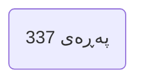
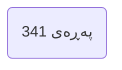
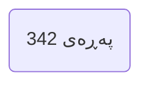
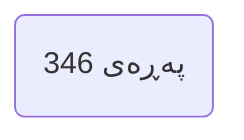
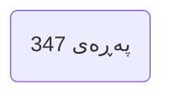

---

## بەشی شەشەم | پێشەنگکردنەوەی غەیبەکان Chapter 6 Foretelling the Unseen

### PDF Pages: 337–352 | Est. ~16 pages

---

§1

>[!summary] Arabic Text
>

>[!summary] English Text
>

>[!summary] Kurdish Text
>

---

---

§2

>[!summary] Arabic Text
>

>[!summary] English Text
>

>[!summary] Kurdish Text
>

---

---

§3

>[!summary] Arabic Text
>

>[!summary] English Text
>

>[!summary] Kurdish Text
>

---

---

§4

>[!summary] Arabic Text
>

>[!summary] English Text
>

>[!summary] Kurdish Text
>

---

---

§5

>[!summary] Arabic Text
>

>[!summary] English Text
>

>[!summary] Kurdish Text
>

---

---

§6

>[!summary] Arabic Text
>

>[!summary] English Text
>

>[!summary] Kurdish Text
>

---

---

§7

>[!summary] Arabic Text
>

>[!summary] English Text
>

>[!summary] Kurdish Text
>

---

---

§8

>[!summary] Arabic Text
>

>[!summary] English Text
>

>[!summary] Kurdish Text
>

---

---

§9

>[!summary] Arabic Text
>

>[!summary] English Text
>

>[!summary] Kurdish Text
>

---

---

§10

>[!summary] Arabic Text
>

>[!summary] English Text
>

>[!summary] Kurdish Text
>

---

---

§11

>[!summary] Arabic Text
>

>[!summary] English Text
>

>[!summary] Kurdish Text
>

---

---

§12

>[!summary] Arabic Text
>

>[!summary] English Text
>

>[!summary] Kurdish Text
>

---

---

§13

>[!summary] Arabic Text
>

>[!summary] English Text
>

>[!summary] Kurdish Text
>

---

---

§14

>[!summary] Arabic Text
>

>[!summary] English Text
>

>[!summary] Kurdish Text
>

---

---

§15

>[!summary] Arabic Text
>

>[!summary] English Text
>

>[!summary] Kurdish Text
>

---

---

§16

>[!summary] Arabic Text
>

>[!summary] English Text
>

>[!summary] Kurdish Text
>

---

---

