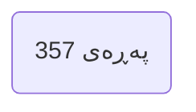
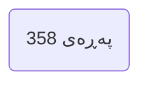
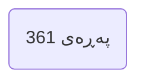
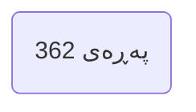
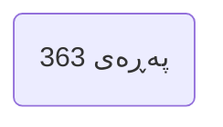
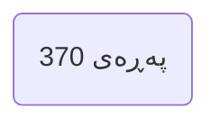
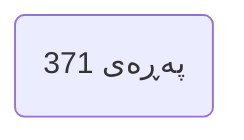
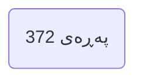

---

## بەشی حەوتەم | لێکەشتنەوەی گومان Chapter 7 Deconstructing Doubts

### PDF Pages: 353–419 | Est. ~67 pages

---

§1

>[!summary] Arabic Text
>

>[!summary] English Text
>

>[!summary] Kurdish Text
>

---


---

§2

>[!summary] Arabic Text
>

>[!summary] English Text
>

>[!summary] Kurdish Text
>

---


---

§3

>[!summary] Arabic Text
>

>[!summary] English Text
>

>[!summary] Kurdish Text
>

---


---

§4

>[!summary] Arabic Text
>

>[!summary] English Text
>

>[!summary] Kurdish Text
>

---


---

§5

>[!summary] Arabic Text
>

>[!summary] English Text
>

>[!summary] Kurdish Text
>

---



---

§6

>[!summary] Arabic Text
>

>[!summary] English Text
>

>[!summary] Kurdish Text
>

---



---

§7

>[!summary] Arabic Text
>

>[!summary] English Text
>

>[!summary] Kurdish Text
>

---


---

§8

>[!summary] Arabic Text
>

>[!summary] English Text
>

>[!summary] Kurdish Text
>

---


---

§9

>[!summary] Arabic Text
>

>[!summary] English Text
>

>[!summary] Kurdish Text
>

---



---

§10

>[!summary] Arabic Text
>

>[!summary] English Text
>

>[!summary] Kurdish Text
>

---



---

§11

>[!summary] Arabic Text
>

>[!summary] English Text
>

>[!summary] Kurdish Text
>

---



---

§12

>[!summary] Arabic Text
>

>[!summary] English Text
>

>[!summary] Kurdish Text
>

---


---

§13

>[!summary] Arabic Text
>

>[!summary] English Text
>

>[!summary] Kurdish Text
>

---


---

§14

>[!summary] Arabic Text
>

>[!summary] English Text
>

>[!summary] Kurdish Text
>

---


---

§15

>[!summary] Arabic Text
>

>[!summary] English Text
>

>[!summary] Kurdish Text
>

---


---

§16

>[!summary] Arabic Text
>

>[!summary] English Text
>

>[!summary] Kurdish Text
>

---


---

§17

>[!summary] Arabic Text
>

>[!summary] English Text
>

>[!summary] Kurdish Text
>

---


---

§18

>[!summary] Arabic Text
>

>[!summary] English Text
>

>[!summary] Kurdish Text
>

---



---

§19

>[!summary] Arabic Text
>

>[!summary] English Text
>

>[!summary] Kurdish Text
>

---



---

§20

>[!summary] Arabic Text
>

>[!summary] English Text
>

>[!summary] Kurdish Text
>

---



---

§21

>[!summary] Arabic Text
>

>[!summary] English Text
>

>[!summary] Kurdish Text
>

---

```mermaid
flowchart LR
P(پەڕەی 373)
```

---

§22

>[!summary] Arabic Text
>

>[!summary] English Text
>

>[!summary] Kurdish Text
>

---

```mermaid
flowchart LR
P(پەڕەی 374)
```

---

§23

>[!summary] Arabic Text
>

>[!summary] English Text
>

>[!summary] Kurdish Text
>

---

```mermaid
flowchart LR
P(پەڕەی 375)
```

---

§24

>[!summary] Arabic Text
>

>[!summary] English Text
>

>[!summary] Kurdish Text
>

---

```mermaid
flowchart LR
P(پەڕەی 376)
```

---

§25

>[!summary] Arabic Text
>

>[!summary] English Text
>

>[!summary] Kurdish Text
>

---

```mermaid
flowchart LR
P(پەڕەی 377)
```

---

§26

>[!summary] Arabic Text
>

>[!summary] English Text
>

>[!summary] Kurdish Text
>

---

```mermaid
flowchart LR
P(پەڕەی 378)
```

---

§27

>[!summary] Arabic Text
>

>[!summary] English Text
>

>[!summary] Kurdish Text
>

---

```mermaid
flowchart LR
P(پەڕەی 379)
```

---

§28

>[!summary] Arabic Text
>

>[!summary] English Text
>

>[!summary] Kurdish Text
>

---

```mermaid
flowchart LR
P(پەڕەی 380)
```

---

§29

>[!summary] Arabic Text
>

>[!summary] English Text
>

>[!summary] Kurdish Text
>

---

```mermaid
flowchart LR
P(پەڕەی 381)
```

---

§30

>[!summary] Arabic Text
>

>[!summary] English Text
>

>[!summary] Kurdish Text
>

---

```mermaid
flowchart LR
P(پەڕەی 382)
```

---

§31

>[!summary] Arabic Text
>

>[!summary] English Text
>

>[!summary] Kurdish Text
>

---

```mermaid
flowchart LR
P(پەڕەی 383)
```

---

§32

>[!summary] Arabic Text
>

>[!summary] English Text
>

>[!summary] Kurdish Text
>

---

```mermaid
flowchart LR
P(پەڕەی 384)
```

---

§33

>[!summary] Arabic Text
>

>[!summary] English Text
>

>[!summary] Kurdish Text
>

---

```mermaid
flowchart LR
P(پەڕەی 385)
```

---

§34

>[!summary] Arabic Text
>

>[!summary] English Text
>

>[!summary] Kurdish Text
>

---

```mermaid
flowchart LR
P(پەڕەی 386)
```

---

§35

>[!summary] Arabic Text
>

>[!summary] English Text
>

>[!summary] Kurdish Text
>

---

```mermaid
flowchart LR
P(پەڕەی 387)
```

---

§36

>[!summary] Arabic Text
>

>[!summary] English Text
>

>[!summary] Kurdish Text
>

---

```mermaid
flowchart LR
P(پەڕەی 388)
```

---

§37

>[!summary] Arabic Text
>

>[!summary] English Text
>

>[!summary] Kurdish Text
>

---

```mermaid
flowchart LR
P(پەڕەی 389)
```

---

§38

>[!summary] Arabic Text
>

>[!summary] English Text
>

>[!summary] Kurdish Text
>

---

```mermaid
flowchart LR
P(پەڕەی 390)
```

---

§39

>[!summary] Arabic Text
>

>[!summary] English Text
>

>[!summary] Kurdish Text
>

---

```mermaid
flowchart LR
P(پەڕەی 391)
```

---

§40

>[!summary] Arabic Text
>

>[!summary] English Text
>

>[!summary] Kurdish Text
>

---

```mermaid
flowchart LR
P(پەڕەی 392)
```

---

§41

>[!summary] Arabic Text
>

>[!summary] English Text
>

>[!summary] Kurdish Text
>

---

```mermaid
flowchart LR
P(پەڕەی 393)
```

---

§42

>[!summary] Arabic Text
>

>[!summary] English Text
>

>[!summary] Kurdish Text
>

---

```mermaid
flowchart LR
P(پەڕەی 394)
```

---

§43

>[!summary] Arabic Text
>

>[!summary] English Text
>

>[!summary] Kurdish Text
>

---

```mermaid
flowchart LR
P(پەڕەی 395)
```

---

§44

>[!summary] Arabic Text
>

>[!summary] English Text
>

>[!summary] Kurdish Text
>

---

```mermaid
flowchart LR
P(پەڕەی 396)
```

---

§45

>[!summary] Arabic Text
>

>[!summary] English Text
>

>[!summary] Kurdish Text
>

---

```mermaid
flowchart LR
P(پەڕەی 397)
```

---

§46

>[!summary] Arabic Text
>

>[!summary] English Text
>

>[!summary] Kurdish Text
>

---

```mermaid
flowchart LR
P(پەڕەی 398)
```

---

§47

>[!summary] Arabic Text
>

>[!summary] English Text
>

>[!summary] Kurdish Text
>

---

```mermaid
flowchart LR
P(پەڕەی 399)
```

---

§48

>[!summary] Arabic Text
>

>[!summary] English Text
>

>[!summary] Kurdish Text
>

---

```mermaid
flowchart LR
P(پەڕەی 400)
```

---

§49

>[!summary] Arabic Text
>

>[!summary] English Text
>

>[!summary] Kurdish Text
>

---

```mermaid
flowchart LR
P(پەڕەی 401)
```

---

§50

>[!summary] Arabic Text
>

>[!summary] English Text
>

>[!summary] Kurdish Text
>

---

```mermaid
flowchart LR
P(پەڕەی 402)
```

---

§51

>[!summary] Arabic Text
>

>[!summary] English Text
>

>[!summary] Kurdish Text
>

---

```mermaid
flowchart LR
P(پەڕەی 403)
```

---

§52

>[!summary] Arabic Text
>

>[!summary] English Text
>

>[!summary] Kurdish Text
>

---

```mermaid
flowchart LR
P(پەڕەی 404)
```

---

§53

>[!summary] Arabic Text
>

>[!summary] English Text
>

>[!summary] Kurdish Text
>

---

```mermaid
flowchart LR
P(پەڕەی 405)
```

---

§54

>[!summary] Arabic Text
>

>[!summary] English Text
>

>[!summary] Kurdish Text
>

---

```mermaid
flowchart LR
P(پەڕەی 406)
```

---

§55

>[!summary] Arabic Text
>

>[!summary] English Text
>

>[!summary] Kurdish Text
>

---

```mermaid
flowchart LR
P(پەڕەی 407)
```

---

§56

>[!summary] Arabic Text
>

>[!summary] English Text
>

>[!summary] Kurdish Text
>

---

```mermaid
flowchart LR
P(پەڕەی 408)
```

---

§57

>[!summary] Arabic Text
>

>[!summary] English Text
>

>[!summary] Kurdish Text
>

---

```mermaid
flowchart LR
P(پەڕەی 409)
```

---

§58

>[!summary] Arabic Text
>

>[!summary] English Text
>

>[!summary] Kurdish Text
>

---

```mermaid
flowchart LR
P(پەڕەی 410)
```

---

§59

>[!summary] Arabic Text
>

>[!summary] English Text
>

>[!summary] Kurdish Text
>

---

```mermaid
flowchart LR
P(پەڕەی 411)
```

---

§60

>[!summary] Arabic Text
>

>[!summary] English Text
>

>[!summary] Kurdish Text
>

---

```mermaid
flowchart LR
P(پەڕەی 412)
```

---

§61

>[!summary] Arabic Text
>

>[!summary] English Text
>

>[!summary] Kurdish Text
>

---

```mermaid
flowchart LR
P(پەڕەی 413)
```

---

§62

>[!summary] Arabic Text
>

>[!summary] English Text
>

>[!summary] Kurdish Text
>

---

```mermaid
flowchart LR
P(پەڕەی 414)
```

---

§63

>[!summary] Arabic Text
>

>[!summary] English Text
>

>[!summary] Kurdish Text
>

---

```mermaid
flowchart LR
P(پەڕەی 415)
```

---

§64

>[!summary] Arabic Text
>

>[!summary] English Text
>

>[!summary] Kurdish Text
>

---

```mermaid
flowchart LR
P(پەڕەی 416)
```

---

§65

>[!summary] Arabic Text
>

>[!summary] English Text
>

>[!summary] Kurdish Text
>

---

```mermaid
flowchart LR
P(پەڕەی 417)
```

---

§66

>[!summary] Arabic Text
>

>[!summary] English Text
>

>[!summary] Kurdish Text
>

---

```mermaid
flowchart LR
P(پەڕەی 418)
```

---

§67

>[!summary] Arabic Text
>

>[!summary] English Text
>

>[!summary] Kurdish Text
>

---

```mermaid
flowchart LR
P(پەڕەی 419)
```

---

