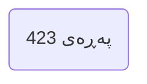
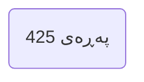
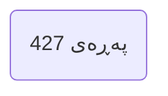
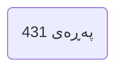
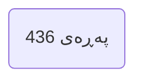
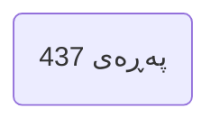

---

## بەشی هەشتەم | گومانی تێکژیشتوو Chapter 8 Obsessive Compulsive Doubts

### PDF Pages: 420–445 | Est. ~26 pages

---

§1

>[!summary] Arabic Text
>

>[!summary] English Text
>

>[!summary] Kurdish Text
>

---


---

§2

>[!summary] Arabic Text
>

>[!summary] English Text
>

>[!summary] Kurdish Text
>

---


---

§3

>[!summary] Arabic Text
>

>[!summary] English Text
>

>[!summary] Kurdish Text
>

---


---

§4

>[!summary] Arabic Text
>

>[!summary] English Text
>

>[!summary] Kurdish Text
>

---



---

§5

>[!summary] Arabic Text
>

>[!summary] English Text
>

>[!summary] Kurdish Text
>

---


---

§6

>[!summary] Arabic Text
>

>[!summary] English Text
>

>[!summary] Kurdish Text
>

---



---

§7

>[!summary] Arabic Text
>

>[!summary] English Text
>

>[!summary] Kurdish Text
>

---


---

§8

>[!summary] Arabic Text
>

>[!summary] English Text
>

>[!summary] Kurdish Text
>

---



---

§9

>[!summary] Arabic Text
>

>[!summary] English Text
>

>[!summary] Kurdish Text
>

---


---

§10

>[!summary] Arabic Text
>

>[!summary] English Text
>

>[!summary] Kurdish Text
>

---


---

§11

>[!summary] Arabic Text
>

>[!summary] English Text
>

>[!summary] Kurdish Text
>

---


---

§12

>[!summary] Arabic Text
>

>[!summary] English Text
>

>[!summary] Kurdish Text
>

---



---

§13

>[!summary] Arabic Text
>

>[!summary] English Text
>

>[!summary] Kurdish Text
>

---


---

§14

>[!summary] Arabic Text
>

>[!summary] English Text
>

>[!summary] Kurdish Text
>

---


---

§15

>[!summary] Arabic Text
>

>[!summary] English Text
>

>[!summary] Kurdish Text
>

---


---

§16

>[!summary] Arabic Text
>

>[!summary] English Text
>

>[!summary] Kurdish Text
>

---


---

§17

>[!summary] Arabic Text
>

>[!summary] English Text
>

>[!summary] Kurdish Text
>

---



---

§18

>[!summary] Arabic Text
>

>[!summary] English Text
>

>[!summary] Kurdish Text
>

---



---

§19

>[!summary] Arabic Text
>

>[!summary] English Text
>

>[!summary] Kurdish Text
>

---


---

§20

>[!summary] Arabic Text
>

>[!summary] English Text
>

>[!summary] Kurdish Text
>

---


---

§21

>[!summary] Arabic Text
>

>[!summary] English Text
>

>[!summary] Kurdish Text
>

---

```mermaid
flowchart LR
P(پەڕەی 440)
```

---

§22

>[!summary] Arabic Text
>

>[!summary] English Text
>

>[!summary] Kurdish Text
>

---

```mermaid
flowchart LR
P(پەڕەی 441)
```

---

§23

>[!summary] Arabic Text
>

>[!summary] English Text
>

>[!summary] Kurdish Text
>

---

```mermaid
flowchart LR
P(پەڕەی 442)
```

---

§24

>[!summary] Arabic Text
>

>[!summary] English Text
>

>[!summary] Kurdish Text
>

---

```mermaid
flowchart LR
P(پەڕەی 443)
```

---

§25

>[!summary] Arabic Text
>

>[!summary] English Text
>

>[!summary] Kurdish Text
>

---

```mermaid
flowchart LR
P(پەڕەی 444)
```

---

§26

>[!summary] Arabic Text
>

>[!summary] English Text
>

>[!summary] Kurdish Text
>

---

```mermaid
flowchart LR
P(پەڕەی 445)
```

---

