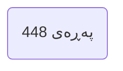
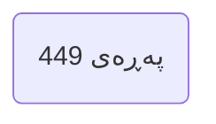
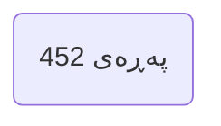
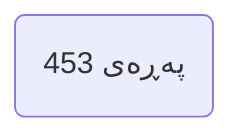
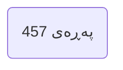
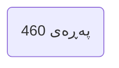

---

## بەشی نۆمەم | وەڵامدانەوە بۆ گومانە ناسراوەکانی بێباوەڕان Chapter 9 Answering Famous Atheist Objections

### PDF Pages: 446–657 | Est. ~212 pages

---

§1

>[!summary] Arabic Text
>

>[!summary] English Text
>

>[!summary] Kurdish Text
>

---


---

§2

>[!summary] Arabic Text
>

>[!summary] English Text
>

>[!summary] Kurdish Text
>

---


---

§3

>[!summary] Arabic Text
>

>[!summary] English Text
>

>[!summary] Kurdish Text
>

---



---

§4

>[!summary] Arabic Text
>

>[!summary] English Text
>

>[!summary] Kurdish Text
>

---



---

§5

>[!summary] Arabic Text
>

>[!summary] English Text
>

>[!summary] Kurdish Text
>

---


---

§6

>[!summary] Arabic Text
>

>[!summary] English Text
>

>[!summary] Kurdish Text
>

---


---

§7

>[!summary] Arabic Text
>

>[!summary] English Text
>

>[!summary] Kurdish Text
>

---



---

§8

>[!summary] Arabic Text
>

>[!summary] English Text
>

>[!summary] Kurdish Text
>

---



---

§9

>[!summary] Arabic Text
>

>[!summary] English Text
>

>[!summary] Kurdish Text
>

---


---

§10

>[!summary] Arabic Text
>

>[!summary] English Text
>

>[!summary] Kurdish Text
>

---


---

§11

>[!summary] Arabic Text
>

>[!summary] English Text
>

>[!summary] Kurdish Text
>

---


---

§12

>[!summary] Arabic Text
>

>[!summary] English Text
>

>[!summary] Kurdish Text
>

---



---

§13

>[!summary] Arabic Text
>

>[!summary] English Text
>

>[!summary] Kurdish Text
>

---


---

§14

>[!summary] Arabic Text
>

>[!summary] English Text
>

>[!summary] Kurdish Text
>

---


---

§15

>[!summary] Arabic Text
>

>[!summary] English Text
>

>[!summary] Kurdish Text
>

---



---

§16

>[!summary] Arabic Text
>

>[!summary] English Text
>

>[!summary] Kurdish Text
>

---


---

§17

>[!summary] Arabic Text
>

>[!summary] English Text
>

>[!summary] Kurdish Text
>

---


---

§18

>[!summary] Arabic Text
>

>[!summary] English Text
>

>[!summary] Kurdish Text
>

---


---

§19

>[!summary] Arabic Text
>

>[!summary] English Text
>

>[!summary] Kurdish Text
>

---


---

§20

>[!summary] Arabic Text
>

>[!summary] English Text
>

>[!summary] Kurdish Text
>

---


---

§21

>[!summary] Arabic Text
>

>[!summary] English Text
>

>[!summary] Kurdish Text
>

---

```mermaid
flowchart LR
P(پەڕەی 466)
```

---

§22

>[!summary] Arabic Text
>

>[!summary] English Text
>

>[!summary] Kurdish Text
>

---

```mermaid
flowchart LR
P(پەڕەی 467)
```

---

§23

>[!summary] Arabic Text
>

>[!summary] English Text
>

>[!summary] Kurdish Text
>

---

```mermaid
flowchart LR
P(پەڕەی 468)
```

---

§24

>[!summary] Arabic Text
>

>[!summary] English Text
>

>[!summary] Kurdish Text
>

---

```mermaid
flowchart LR
P(پەڕەی 469)
```

---

§25

>[!summary] Arabic Text
>

>[!summary] English Text
>

>[!summary] Kurdish Text
>

---

```mermaid
flowchart LR
P(پەڕەی 470)
```

---

§26

>[!summary] Arabic Text
>

>[!summary] English Text
>

>[!summary] Kurdish Text
>

---

```mermaid
flowchart LR
P(پەڕەی 471)
```

---

§27

>[!summary] Arabic Text
>

>[!summary] English Text
>

>[!summary] Kurdish Text
>

---

```mermaid
flowchart LR
P(پەڕەی 472)
```

---

§28

>[!summary] Arabic Text
>

>[!summary] English Text
>

>[!summary] Kurdish Text
>

---

```mermaid
flowchart LR
P(پەڕەی 473)
```

---

§29

>[!summary] Arabic Text
>

>[!summary] English Text
>

>[!summary] Kurdish Text
>

---

```mermaid
flowchart LR
P(پەڕەی 474)
```

---

§30

>[!summary] Arabic Text
>

>[!summary] English Text
>

>[!summary] Kurdish Text
>

---

```mermaid
flowchart LR
P(پەڕەی 475)
```

---

§31

>[!summary] Arabic Text
>

>[!summary] English Text
>

>[!summary] Kurdish Text
>

---

```mermaid
flowchart LR
P(پەڕەی 476)
```

---

§32

>[!summary] Arabic Text
>

>[!summary] English Text
>

>[!summary] Kurdish Text
>

---

```mermaid
flowchart LR
P(پەڕەی 477)
```

---

§33

>[!summary] Arabic Text
>

>[!summary] English Text
>

>[!summary] Kurdish Text
>

---

```mermaid
flowchart LR
P(پەڕەی 478)
```

---

§34

>[!summary] Arabic Text
>

>[!summary] English Text
>

>[!summary] Kurdish Text
>

---

```mermaid
flowchart LR
P(پەڕەی 479)
```

---

§35

>[!summary] Arabic Text
>

>[!summary] English Text
>

>[!summary] Kurdish Text
>

---

```mermaid
flowchart LR
P(پەڕەی 480)
```

---

§36

>[!summary] Arabic Text
>

>[!summary] English Text
>

>[!summary] Kurdish Text
>

---

```mermaid
flowchart LR
P(پەڕەی 481)
```

---

§37

>[!summary] Arabic Text
>

>[!summary] English Text
>

>[!summary] Kurdish Text
>

---

```mermaid
flowchart LR
P(پەڕەی 482)
```

---

§38

>[!summary] Arabic Text
>

>[!summary] English Text
>

>[!summary] Kurdish Text
>

---

```mermaid
flowchart LR
P(پەڕەی 483)
```

---

§39

>[!summary] Arabic Text
>

>[!summary] English Text
>

>[!summary] Kurdish Text
>

---

```mermaid
flowchart LR
P(پەڕەی 484)
```

---

§40

>[!summary] Arabic Text
>

>[!summary] English Text
>

>[!summary] Kurdish Text
>

---

```mermaid
flowchart LR
P(پەڕەی 485)
```

---

§41

>[!summary] Arabic Text
>

>[!summary] English Text
>

>[!summary] Kurdish Text
>

---

```mermaid
flowchart LR
P(پەڕەی 486)
```

---

§42

>[!summary] Arabic Text
>

>[!summary] English Text
>

>[!summary] Kurdish Text
>

---

```mermaid
flowchart LR
P(پەڕەی 487)
```

---

§43

>[!summary] Arabic Text
>

>[!summary] English Text
>

>[!summary] Kurdish Text
>

---

```mermaid
flowchart LR
P(پەڕەی 488)
```

---

§44

>[!summary] Arabic Text
>

>[!summary] English Text
>

>[!summary] Kurdish Text
>

---

```mermaid
flowchart LR
P(پەڕەی 489)
```

---

§45

>[!summary] Arabic Text
>

>[!summary] English Text
>

>[!summary] Kurdish Text
>

---

```mermaid
flowchart LR
P(پەڕەی 490)
```

---

§46

>[!summary] Arabic Text
>

>[!summary] English Text
>

>[!summary] Kurdish Text
>

---

```mermaid
flowchart LR
P(پەڕەی 491)
```

---

§47

>[!summary] Arabic Text
>

>[!summary] English Text
>

>[!summary] Kurdish Text
>

---

```mermaid
flowchart LR
P(پەڕەی 492)
```

---

§48

>[!summary] Arabic Text
>

>[!summary] English Text
>

>[!summary] Kurdish Text
>

---

```mermaid
flowchart LR
P(پەڕەی 493)
```

---

§49

>[!summary] Arabic Text
>

>[!summary] English Text
>

>[!summary] Kurdish Text
>

---

```mermaid
flowchart LR
P(پەڕەی 494)
```

---

§50

>[!summary] Arabic Text
>

>[!summary] English Text
>

>[!summary] Kurdish Text
>

---

```mermaid
flowchart LR
P(پەڕەی 495)
```

---

§51

>[!summary] Arabic Text
>

>[!summary] English Text
>

>[!summary] Kurdish Text
>

---

```mermaid
flowchart LR
P(پەڕەی 496)
```

---

§52

>[!summary] Arabic Text
>

>[!summary] English Text
>

>[!summary] Kurdish Text
>

---

```mermaid
flowchart LR
P(پەڕەی 497)
```

---

§53

>[!summary] Arabic Text
>

>[!summary] English Text
>

>[!summary] Kurdish Text
>

---

```mermaid
flowchart LR
P(پەڕەی 498)
```

---

§54

>[!summary] Arabic Text
>

>[!summary] English Text
>

>[!summary] Kurdish Text
>

---

```mermaid
flowchart LR
P(پەڕەی 499)
```

---

§55

>[!summary] Arabic Text
>

>[!summary] English Text
>

>[!summary] Kurdish Text
>

---

```mermaid
flowchart LR
P(پەڕەی 500)
```

---

§56

>[!summary] Arabic Text
>

>[!summary] English Text
>

>[!summary] Kurdish Text
>

---

```mermaid
flowchart LR
P(پەڕەی 501)
```

---

§57

>[!summary] Arabic Text
>

>[!summary] English Text
>

>[!summary] Kurdish Text
>

---

```mermaid
flowchart LR
P(پەڕەی 502)
```

---

§58

>[!summary] Arabic Text
>

>[!summary] English Text
>

>[!summary] Kurdish Text
>

---

```mermaid
flowchart LR
P(پەڕەی 503)
```

---

§59

>[!summary] Arabic Text
>

>[!summary] English Text
>

>[!summary] Kurdish Text
>

---

```mermaid
flowchart LR
P(پەڕەی 504)
```

---

§60

>[!summary] Arabic Text
>

>[!summary] English Text
>

>[!summary] Kurdish Text
>

---

```mermaid
flowchart LR
P(پەڕەی 505)
```

---

§61

>[!summary] Arabic Text
>

>[!summary] English Text
>

>[!summary] Kurdish Text
>

---

```mermaid
flowchart LR
P(پەڕەی 506)
```

---

§62

>[!summary] Arabic Text
>

>[!summary] English Text
>

>[!summary] Kurdish Text
>

---

```mermaid
flowchart LR
P(پەڕەی 507)
```

---

§63

>[!summary] Arabic Text
>

>[!summary] English Text
>

>[!summary] Kurdish Text
>

---

```mermaid
flowchart LR
P(پەڕەی 508)
```

---

§64

>[!summary] Arabic Text
>

>[!summary] English Text
>

>[!summary] Kurdish Text
>

---

```mermaid
flowchart LR
P(پەڕەی 509)
```

---

§65

>[!summary] Arabic Text
>

>[!summary] English Text
>

>[!summary] Kurdish Text
>

---

```mermaid
flowchart LR
P(پەڕەی 510)
```

---

§66

>[!summary] Arabic Text
>

>[!summary] English Text
>

>[!summary] Kurdish Text
>

---

```mermaid
flowchart LR
P(پەڕەی 511)
```

---

§67

>[!summary] Arabic Text
>

>[!summary] English Text
>

>[!summary] Kurdish Text
>

---

```mermaid
flowchart LR
P(پەڕەی 512)
```

---

§68

>[!summary] Arabic Text
>

>[!summary] English Text
>

>[!summary] Kurdish Text
>

---

```mermaid
flowchart LR
P(پەڕەی 513)
```

---

§69

>[!summary] Arabic Text
>

>[!summary] English Text
>

>[!summary] Kurdish Text
>

---

```mermaid
flowchart LR
P(پەڕەی 514)
```

---

§70

>[!summary] Arabic Text
>

>[!summary] English Text
>

>[!summary] Kurdish Text
>

---

```mermaid
flowchart LR
P(پەڕەی 515)
```

---

§71

>[!summary] Arabic Text
>

>[!summary] English Text
>

>[!summary] Kurdish Text
>

---

```mermaid
flowchart LR
P(پەڕەی 516)
```

---

§72

>[!summary] Arabic Text
>

>[!summary] English Text
>

>[!summary] Kurdish Text
>

---

```mermaid
flowchart LR
P(پەڕەی 517)
```

---

§73

>[!summary] Arabic Text
>

>[!summary] English Text
>

>[!summary] Kurdish Text
>

---

```mermaid
flowchart LR
P(پەڕەی 518)
```

---

§74

>[!summary] Arabic Text
>

>[!summary] English Text
>

>[!summary] Kurdish Text
>

---

```mermaid
flowchart LR
P(پەڕەی 519)
```

---

§75

>[!summary] Arabic Text
>

>[!summary] English Text
>

>[!summary] Kurdish Text
>

---

```mermaid
flowchart LR
P(پەڕەی 520)
```

---

§76

>[!summary] Arabic Text
>

>[!summary] English Text
>

>[!summary] Kurdish Text
>

---

```mermaid
flowchart LR
P(پەڕەی 521)
```

---

§77

>[!summary] Arabic Text
>

>[!summary] English Text
>

>[!summary] Kurdish Text
>

---

```mermaid
flowchart LR
P(پەڕەی 522)
```

---

§78

>[!summary] Arabic Text
>

>[!summary] English Text
>

>[!summary] Kurdish Text
>

---

```mermaid
flowchart LR
P(پەڕەی 523)
```

---

§79

>[!summary] Arabic Text
>

>[!summary] English Text
>

>[!summary] Kurdish Text
>

---

```mermaid
flowchart LR
P(پەڕەی 524)
```

---

§80

>[!summary] Arabic Text
>

>[!summary] English Text
>

>[!summary] Kurdish Text
>

---

```mermaid
flowchart LR
P(پەڕەی 525)
```

---

§81

>[!summary] Arabic Text
>

>[!summary] English Text
>

>[!summary] Kurdish Text
>

---

```mermaid
flowchart LR
P(پەڕەی 526)
```

---

§82

>[!summary] Arabic Text
>

>[!summary] English Text
>

>[!summary] Kurdish Text
>

---

```mermaid
flowchart LR
P(پەڕەی 527)
```

---

§83

>[!summary] Arabic Text
>

>[!summary] English Text
>

>[!summary] Kurdish Text
>

---

```mermaid
flowchart LR
P(پەڕەی 528)
```

---

§84

>[!summary] Arabic Text
>

>[!summary] English Text
>

>[!summary] Kurdish Text
>

---

```mermaid
flowchart LR
P(پەڕەی 529)
```

---

§85

>[!summary] Arabic Text
>

>[!summary] English Text
>

>[!summary] Kurdish Text
>

---

```mermaid
flowchart LR
P(پەڕەی 530)
```

---

§86

>[!summary] Arabic Text
>

>[!summary] English Text
>

>[!summary] Kurdish Text
>

---

```mermaid
flowchart LR
P(پەڕەی 531)
```

---

§87

>[!summary] Arabic Text
>

>[!summary] English Text
>

>[!summary] Kurdish Text
>

---

```mermaid
flowchart LR
P(پەڕەی 532)
```

---

§88

>[!summary] Arabic Text
>

>[!summary] English Text
>

>[!summary] Kurdish Text
>

---

```mermaid
flowchart LR
P(پەڕەی 533)
```

---

§89

>[!summary] Arabic Text
>

>[!summary] English Text
>

>[!summary] Kurdish Text
>

---

```mermaid
flowchart LR
P(پەڕەی 534)
```

---

§90

>[!summary] Arabic Text
>

>[!summary] English Text
>

>[!summary] Kurdish Text
>

---

```mermaid
flowchart LR
P(پەڕەی 535)
```

---

§91

>[!summary] Arabic Text
>

>[!summary] English Text
>

>[!summary] Kurdish Text
>

---

```mermaid
flowchart LR
P(پەڕەی 536)
```

---

§92

>[!summary] Arabic Text
>

>[!summary] English Text
>

>[!summary] Kurdish Text
>

---

```mermaid
flowchart LR
P(پەڕەی 537)
```

---

§93

>[!summary] Arabic Text
>

>[!summary] English Text
>

>[!summary] Kurdish Text
>

---

```mermaid
flowchart LR
P(پەڕەی 538)
```

---

§94

>[!summary] Arabic Text
>

>[!summary] English Text
>

>[!summary] Kurdish Text
>

---

```mermaid
flowchart LR
P(پەڕەی 539)
```

---

§95

>[!summary] Arabic Text
>

>[!summary] English Text
>

>[!summary] Kurdish Text
>

---

```mermaid
flowchart LR
P(پەڕەی 540)
```

---

§96

>[!summary] Arabic Text
>

>[!summary] English Text
>

>[!summary] Kurdish Text
>

---

```mermaid
flowchart LR
P(پەڕەی 541)
```

---

§97

>[!summary] Arabic Text
>

>[!summary] English Text
>

>[!summary] Kurdish Text
>

---

```mermaid
flowchart LR
P(پەڕەی 542)
```

---

§98

>[!summary] Arabic Text
>

>[!summary] English Text
>

>[!summary] Kurdish Text
>

---

```mermaid
flowchart LR
P(پەڕەی 543)
```

---

§99

>[!summary] Arabic Text
>

>[!summary] English Text
>

>[!summary] Kurdish Text
>

---

```mermaid
flowchart LR
P(پەڕەی 544)
```

---

§100

>[!summary] Arabic Text
>

>[!summary] English Text
>

>[!summary] Kurdish Text
>

---

```mermaid
flowchart LR
P(پەڕەی 545)
```

---

§101

>[!summary] Arabic Text
>

>[!summary] English Text
>

>[!summary] Kurdish Text
>

---

```mermaid
flowchart LR
P(پەڕەی 546)
```

---

§102

>[!summary] Arabic Text
>

>[!summary] English Text
>

>[!summary] Kurdish Text
>

---

```mermaid
flowchart LR
P(پەڕەی 547)
```

---

§103

>[!summary] Arabic Text
>

>[!summary] English Text
>

>[!summary] Kurdish Text
>

---

```mermaid
flowchart LR
P(پەڕەی 548)
```

---

§104

>[!summary] Arabic Text
>

>[!summary] English Text
>

>[!summary] Kurdish Text
>

---

```mermaid
flowchart LR
P(پەڕەی 549)
```

---

§105

>[!summary] Arabic Text
>

>[!summary] English Text
>

>[!summary] Kurdish Text
>

---

```mermaid
flowchart LR
P(پەڕەی 550)
```

---

§106

>[!summary] Arabic Text
>

>[!summary] English Text
>

>[!summary] Kurdish Text
>

---

```mermaid
flowchart LR
P(پەڕەی 551)
```

---

§107

>[!summary] Arabic Text
>

>[!summary] English Text
>

>[!summary] Kurdish Text
>

---

```mermaid
flowchart LR
P(پەڕەی 552)
```

---

§108

>[!summary] Arabic Text
>

>[!summary] English Text
>

>[!summary] Kurdish Text
>

---

```mermaid
flowchart LR
P(پەڕەی 553)
```

---

§109

>[!summary] Arabic Text
>

>[!summary] English Text
>

>[!summary] Kurdish Text
>

---

```mermaid
flowchart LR
P(پەڕەی 554)
```

---

§110

>[!summary] Arabic Text
>

>[!summary] English Text
>

>[!summary] Kurdish Text
>

---

```mermaid
flowchart LR
P(پەڕەی 555)
```

---

§111

>[!summary] Arabic Text
>

>[!summary] English Text
>

>[!summary] Kurdish Text
>

---

```mermaid
flowchart LR
P(پەڕەی 556)
```

---

§112

>[!summary] Arabic Text
>

>[!summary] English Text
>

>[!summary] Kurdish Text
>

---

```mermaid
flowchart LR
P(پەڕەی 557)
```

---

§113

>[!summary] Arabic Text
>

>[!summary] English Text
>

>[!summary] Kurdish Text
>

---

```mermaid
flowchart LR
P(پەڕەی 558)
```

---

§114

>[!summary] Arabic Text
>

>[!summary] English Text
>

>[!summary] Kurdish Text
>

---

```mermaid
flowchart LR
P(پەڕەی 559)
```

---

§115

>[!summary] Arabic Text
>

>[!summary] English Text
>

>[!summary] Kurdish Text
>

---

```mermaid
flowchart LR
P(پەڕەی 560)
```

---

§116

>[!summary] Arabic Text
>

>[!summary] English Text
>

>[!summary] Kurdish Text
>

---

```mermaid
flowchart LR
P(پەڕەی 561)
```

---

§117

>[!summary] Arabic Text
>

>[!summary] English Text
>

>[!summary] Kurdish Text
>

---

```mermaid
flowchart LR
P(پەڕەی 562)
```

---

§118

>[!summary] Arabic Text
>

>[!summary] English Text
>

>[!summary] Kurdish Text
>

---

```mermaid
flowchart LR
P(پەڕەی 563)
```

---

§119

>[!summary] Arabic Text
>

>[!summary] English Text
>

>[!summary] Kurdish Text
>

---

```mermaid
flowchart LR
P(پەڕەی 564)
```

---

§120

>[!summary] Arabic Text
>

>[!summary] English Text
>

>[!summary] Kurdish Text
>

---

```mermaid
flowchart LR
P(پەڕەی 565)
```

---

§121

>[!summary] Arabic Text
>

>[!summary] English Text
>

>[!summary] Kurdish Text
>

---

```mermaid
flowchart LR
P(پەڕەی 566)
```

---

§122

>[!summary] Arabic Text
>

>[!summary] English Text
>

>[!summary] Kurdish Text
>

---

```mermaid
flowchart LR
P(پەڕەی 567)
```

---

§123

>[!summary] Arabic Text
>

>[!summary] English Text
>

>[!summary] Kurdish Text
>

---

```mermaid
flowchart LR
P(پەڕەی 568)
```

---

§124

>[!summary] Arabic Text
>

>[!summary] English Text
>

>[!summary] Kurdish Text
>

---

```mermaid
flowchart LR
P(پەڕەی 569)
```

---

§125

>[!summary] Arabic Text
>

>[!summary] English Text
>

>[!summary] Kurdish Text
>

---

```mermaid
flowchart LR
P(پەڕەی 570)
```

---

§126

>[!summary] Arabic Text
>

>[!summary] English Text
>

>[!summary] Kurdish Text
>

---

```mermaid
flowchart LR
P(پەڕەی 571)
```

---

§127

>[!summary] Arabic Text
>

>[!summary] English Text
>

>[!summary] Kurdish Text
>

---

```mermaid
flowchart LR
P(پەڕەی 572)
```

---

§128

>[!summary] Arabic Text
>

>[!summary] English Text
>

>[!summary] Kurdish Text
>

---

```mermaid
flowchart LR
P(پەڕەی 573)
```

---

§129

>[!summary] Arabic Text
>

>[!summary] English Text
>

>[!summary] Kurdish Text
>

---

```mermaid
flowchart LR
P(پەڕەی 574)
```

---

§130

>[!summary] Arabic Text
>

>[!summary] English Text
>

>[!summary] Kurdish Text
>

---

```mermaid
flowchart LR
P(پەڕەی 575)
```

---

§131

>[!summary] Arabic Text
>

>[!summary] English Text
>

>[!summary] Kurdish Text
>

---

```mermaid
flowchart LR
P(پەڕەی 576)
```

---

§132

>[!summary] Arabic Text
>

>[!summary] English Text
>

>[!summary] Kurdish Text
>

---

```mermaid
flowchart LR
P(پەڕەی 577)
```

---

§133

>[!summary] Arabic Text
>

>[!summary] English Text
>

>[!summary] Kurdish Text
>

---

```mermaid
flowchart LR
P(پەڕەی 578)
```

---

§134

>[!summary] Arabic Text
>

>[!summary] English Text
>

>[!summary] Kurdish Text
>

---

```mermaid
flowchart LR
P(پەڕەی 579)
```

---

§135

>[!summary] Arabic Text
>

>[!summary] English Text
>

>[!summary] Kurdish Text
>

---

```mermaid
flowchart LR
P(پەڕەی 580)
```

---

§136

>[!summary] Arabic Text
>

>[!summary] English Text
>

>[!summary] Kurdish Text
>

---

```mermaid
flowchart LR
P(پەڕەی 581)
```

---

§137

>[!summary] Arabic Text
>

>[!summary] English Text
>

>[!summary] Kurdish Text
>

---

```mermaid
flowchart LR
P(پەڕەی 582)
```

---

§138

>[!summary] Arabic Text
>

>[!summary] English Text
>

>[!summary] Kurdish Text
>

---

```mermaid
flowchart LR
P(پەڕەی 583)
```

---

§139

>[!summary] Arabic Text
>

>[!summary] English Text
>

>[!summary] Kurdish Text
>

---

```mermaid
flowchart LR
P(پەڕەی 584)
```

---

§140

>[!summary] Arabic Text
>

>[!summary] English Text
>

>[!summary] Kurdish Text
>

---

```mermaid
flowchart LR
P(پەڕەی 585)
```

---

§141

>[!summary] Arabic Text
>

>[!summary] English Text
>

>[!summary] Kurdish Text
>

---

```mermaid
flowchart LR
P(پەڕەی 586)
```

---

§142

>[!summary] Arabic Text
>

>[!summary] English Text
>

>[!summary] Kurdish Text
>

---

```mermaid
flowchart LR
P(پەڕەی 587)
```

---

§143

>[!summary] Arabic Text
>

>[!summary] English Text
>

>[!summary] Kurdish Text
>

---

```mermaid
flowchart LR
P(پەڕەی 588)
```

---

§144

>[!summary] Arabic Text
>

>[!summary] English Text
>

>[!summary] Kurdish Text
>

---

```mermaid
flowchart LR
P(پەڕەی 589)
```

---

§145

>[!summary] Arabic Text
>

>[!summary] English Text
>

>[!summary] Kurdish Text
>

---

```mermaid
flowchart LR
P(پەڕەی 590)
```

---

§146

>[!summary] Arabic Text
>

>[!summary] English Text
>

>[!summary] Kurdish Text
>

---

```mermaid
flowchart LR
P(پەڕەی 591)
```

---

§147

>[!summary] Arabic Text
>

>[!summary] English Text
>

>[!summary] Kurdish Text
>

---

```mermaid
flowchart LR
P(پەڕەی 592)
```

---

§148

>[!summary] Arabic Text
>

>[!summary] English Text
>

>[!summary] Kurdish Text
>

---

```mermaid
flowchart LR
P(پەڕەی 593)
```

---

§149

>[!summary] Arabic Text
>

>[!summary] English Text
>

>[!summary] Kurdish Text
>

---

```mermaid
flowchart LR
P(پەڕەی 594)
```

---

§150

>[!summary] Arabic Text
>

>[!summary] English Text
>

>[!summary] Kurdish Text
>

---

```mermaid
flowchart LR
P(پەڕەی 595)
```

---

§151

>[!summary] Arabic Text
>

>[!summary] English Text
>

>[!summary] Kurdish Text
>

---

```mermaid
flowchart LR
P(پەڕەی 596)
```

---

§152

>[!summary] Arabic Text
>

>[!summary] English Text
>

>[!summary] Kurdish Text
>

---

```mermaid
flowchart LR
P(پەڕەی 597)
```

---

§153

>[!summary] Arabic Text
>

>[!summary] English Text
>

>[!summary] Kurdish Text
>

---

```mermaid
flowchart LR
P(پەڕەی 598)
```

---

§154

>[!summary] Arabic Text
>

>[!summary] English Text
>

>[!summary] Kurdish Text
>

---

```mermaid
flowchart LR
P(پەڕەی 599)
```

---

§155

>[!summary] Arabic Text
>

>[!summary] English Text
>

>[!summary] Kurdish Text
>

---

```mermaid
flowchart LR
P(پەڕەی 600)
```

---

§156

>[!summary] Arabic Text
>

>[!summary] English Text
>

>[!summary] Kurdish Text
>

---

```mermaid
flowchart LR
P(پەڕەی 601)
```

---

§157

>[!summary] Arabic Text
>

>[!summary] English Text
>

>[!summary] Kurdish Text
>

---

```mermaid
flowchart LR
P(پەڕەی 602)
```

---

§158

>[!summary] Arabic Text
>

>[!summary] English Text
>

>[!summary] Kurdish Text
>

---

```mermaid
flowchart LR
P(پەڕەی 603)
```

---

§159

>[!summary] Arabic Text
>

>[!summary] English Text
>

>[!summary] Kurdish Text
>

---

```mermaid
flowchart LR
P(پەڕەی 604)
```

---

§160

>[!summary] Arabic Text
>

>[!summary] English Text
>

>[!summary] Kurdish Text
>

---

```mermaid
flowchart LR
P(پەڕەی 605)
```

---

§161

>[!summary] Arabic Text
>

>[!summary] English Text
>

>[!summary] Kurdish Text
>

---

```mermaid
flowchart LR
P(پەڕەی 606)
```

---

§162

>[!summary] Arabic Text
>

>[!summary] English Text
>

>[!summary] Kurdish Text
>

---

```mermaid
flowchart LR
P(پەڕەی 607)
```

---

§163

>[!summary] Arabic Text
>

>[!summary] English Text
>

>[!summary] Kurdish Text
>

---

```mermaid
flowchart LR
P(پەڕەی 608)
```

---

§164

>[!summary] Arabic Text
>

>[!summary] English Text
>

>[!summary] Kurdish Text
>

---

```mermaid
flowchart LR
P(پەڕەی 609)
```

---

§165

>[!summary] Arabic Text
>

>[!summary] English Text
>

>[!summary] Kurdish Text
>

---

```mermaid
flowchart LR
P(پەڕەی 610)
```

---

§166

>[!summary] Arabic Text
>

>[!summary] English Text
>

>[!summary] Kurdish Text
>

---

```mermaid
flowchart LR
P(پەڕەی 611)
```

---

§167

>[!summary] Arabic Text
>

>[!summary] English Text
>

>[!summary] Kurdish Text
>

---

```mermaid
flowchart LR
P(پەڕەی 612)
```

---

§168

>[!summary] Arabic Text
>

>[!summary] English Text
>

>[!summary] Kurdish Text
>

---

```mermaid
flowchart LR
P(پەڕەی 613)
```

---

§169

>[!summary] Arabic Text
>

>[!summary] English Text
>

>[!summary] Kurdish Text
>

---

```mermaid
flowchart LR
P(پەڕەی 614)
```

---

§170

>[!summary] Arabic Text
>

>[!summary] English Text
>

>[!summary] Kurdish Text
>

---

```mermaid
flowchart LR
P(پەڕەی 615)
```

---

§171

>[!summary] Arabic Text
>

>[!summary] English Text
>

>[!summary] Kurdish Text
>

---

```mermaid
flowchart LR
P(پەڕەی 616)
```

---

§172

>[!summary] Arabic Text
>

>[!summary] English Text
>

>[!summary] Kurdish Text
>

---

```mermaid
flowchart LR
P(پەڕەی 617)
```

---

§173

>[!summary] Arabic Text
>

>[!summary] English Text
>

>[!summary] Kurdish Text
>

---

```mermaid
flowchart LR
P(پەڕەی 618)
```

---

§174

>[!summary] Arabic Text
>

>[!summary] English Text
>

>[!summary] Kurdish Text
>

---

```mermaid
flowchart LR
P(پەڕەی 619)
```

---

§175

>[!summary] Arabic Text
>

>[!summary] English Text
>

>[!summary] Kurdish Text
>

---

```mermaid
flowchart LR
P(پەڕەی 620)
```

---

§176

>[!summary] Arabic Text
>

>[!summary] English Text
>

>[!summary] Kurdish Text
>

---

```mermaid
flowchart LR
P(پەڕەی 621)
```

---

§177

>[!summary] Arabic Text
>

>[!summary] English Text
>

>[!summary] Kurdish Text
>

---

```mermaid
flowchart LR
P(پەڕەی 622)
```

---

§178

>[!summary] Arabic Text
>

>[!summary] English Text
>

>[!summary] Kurdish Text
>

---

```mermaid
flowchart LR
P(پەڕەی 623)
```

---

§179

>[!summary] Arabic Text
>

>[!summary] English Text
>

>[!summary] Kurdish Text
>

---

```mermaid
flowchart LR
P(پەڕەی 624)
```

---

§180

>[!summary] Arabic Text
>

>[!summary] English Text
>

>[!summary] Kurdish Text
>

---

```mermaid
flowchart LR
P(پەڕەی 625)
```

---

§181

>[!summary] Arabic Text
>

>[!summary] English Text
>

>[!summary] Kurdish Text
>

---

```mermaid
flowchart LR
P(پەڕەی 626)
```

---

§182

>[!summary] Arabic Text
>

>[!summary] English Text
>

>[!summary] Kurdish Text
>

---

```mermaid
flowchart LR
P(پەڕەی 627)
```

---

§183

>[!summary] Arabic Text
>

>[!summary] English Text
>

>[!summary] Kurdish Text
>

---

```mermaid
flowchart LR
P(پەڕەی 628)
```

---

§184

>[!summary] Arabic Text
>

>[!summary] English Text
>

>[!summary] Kurdish Text
>

---

```mermaid
flowchart LR
P(پەڕەی 629)
```

---

§185

>[!summary] Arabic Text
>

>[!summary] English Text
>

>[!summary] Kurdish Text
>

---

```mermaid
flowchart LR
P(پەڕەی 630)
```

---

§186

>[!summary] Arabic Text
>

>[!summary] English Text
>

>[!summary] Kurdish Text
>

---

```mermaid
flowchart LR
P(پەڕەی 631)
```

---

§187

>[!summary] Arabic Text
>

>[!summary] English Text
>

>[!summary] Kurdish Text
>

---

```mermaid
flowchart LR
P(پەڕەی 632)
```

---

§188

>[!summary] Arabic Text
>

>[!summary] English Text
>

>[!summary] Kurdish Text
>

---

```mermaid
flowchart LR
P(پەڕەی 633)
```

---

§189

>[!summary] Arabic Text
>

>[!summary] English Text
>

>[!summary] Kurdish Text
>

---

```mermaid
flowchart LR
P(پەڕەی 634)
```

---

§190

>[!summary] Arabic Text
>

>[!summary] English Text
>

>[!summary] Kurdish Text
>

---

```mermaid
flowchart LR
P(پەڕەی 635)
```

---

§191

>[!summary] Arabic Text
>

>[!summary] English Text
>

>[!summary] Kurdish Text
>

---

```mermaid
flowchart LR
P(پەڕەی 636)
```

---

§192

>[!summary] Arabic Text
>

>[!summary] English Text
>

>[!summary] Kurdish Text
>

---

```mermaid
flowchart LR
P(پەڕەی 637)
```

---

§193

>[!summary] Arabic Text
>

>[!summary] English Text
>

>[!summary] Kurdish Text
>

---

```mermaid
flowchart LR
P(پەڕەی 638)
```

---

§194

>[!summary] Arabic Text
>

>[!summary] English Text
>

>[!summary] Kurdish Text
>

---

```mermaid
flowchart LR
P(پەڕەی 639)
```

---

§195

>[!summary] Arabic Text
>

>[!summary] English Text
>

>[!summary] Kurdish Text
>

---

```mermaid
flowchart LR
P(پەڕەی 640)
```

---

§196

>[!summary] Arabic Text
>

>[!summary] English Text
>

>[!summary] Kurdish Text
>

---

```mermaid
flowchart LR
P(پەڕەی 641)
```

---

§197

>[!summary] Arabic Text
>

>[!summary] English Text
>

>[!summary] Kurdish Text
>

---

```mermaid
flowchart LR
P(پەڕەی 642)
```

---

§198

>[!summary] Arabic Text
>

>[!summary] English Text
>

>[!summary] Kurdish Text
>

---

```mermaid
flowchart LR
P(پەڕەی 643)
```

---

§199

>[!summary] Arabic Text
>

>[!summary] English Text
>

>[!summary] Kurdish Text
>

---

```mermaid
flowchart LR
P(پەڕەی 644)
```

---

§200

>[!summary] Arabic Text
>

>[!summary] English Text
>

>[!summary] Kurdish Text
>

---

```mermaid
flowchart LR
P(پەڕەی 645)
```

---

§201

>[!summary] Arabic Text
>

>[!summary] English Text
>

>[!summary] Kurdish Text
>

---

```mermaid
flowchart LR
P(پەڕەی 646)
```

---

§202

>[!summary] Arabic Text
>

>[!summary] English Text
>

>[!summary] Kurdish Text
>

---

```mermaid
flowchart LR
P(پەڕەی 647)
```

---

§203

>[!summary] Arabic Text
>

>[!summary] English Text
>

>[!summary] Kurdish Text
>

---

```mermaid
flowchart LR
P(پەڕەی 648)
```

---

§204

>[!summary] Arabic Text
>

>[!summary] English Text
>

>[!summary] Kurdish Text
>

---

```mermaid
flowchart LR
P(پەڕەی 649)
```

---

§205

>[!summary] Arabic Text
>

>[!summary] English Text
>

>[!summary] Kurdish Text
>

---

```mermaid
flowchart LR
P(پەڕەی 650)
```

---

§206

>[!summary] Arabic Text
>

>[!summary] English Text
>

>[!summary] Kurdish Text
>

---

```mermaid
flowchart LR
P(پەڕەی 651)
```

---

§207

>[!summary] Arabic Text
>

>[!summary] English Text
>

>[!summary] Kurdish Text
>

---

```mermaid
flowchart LR
P(پەڕەی 652)
```

---

§208

>[!summary] Arabic Text
>

>[!summary] English Text
>

>[!summary] Kurdish Text
>

---

```mermaid
flowchart LR
P(پەڕەی 653)
```

---

§209

>[!summary] Arabic Text
>

>[!summary] English Text
>

>[!summary] Kurdish Text
>

---

```mermaid
flowchart LR
P(پەڕەی 654)
```

---

§210

>[!summary] Arabic Text
>

>[!summary] English Text
>

>[!summary] Kurdish Text
>

---

```mermaid
flowchart LR
P(پەڕەی 655)
```

---

§211

>[!summary] Arabic Text
>

>[!summary] English Text
>

>[!summary] Kurdish Text
>

---

```mermaid
flowchart LR
P(پەڕەی 656)
```

---

§212

>[!summary] Arabic Text
>

>[!summary] English Text
>

>[!summary] Kurdish Text
>

---

```mermaid
flowchart LR
P(پەڕەی 657)
```

---

