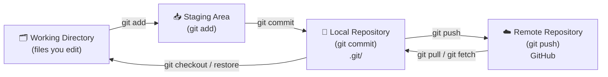
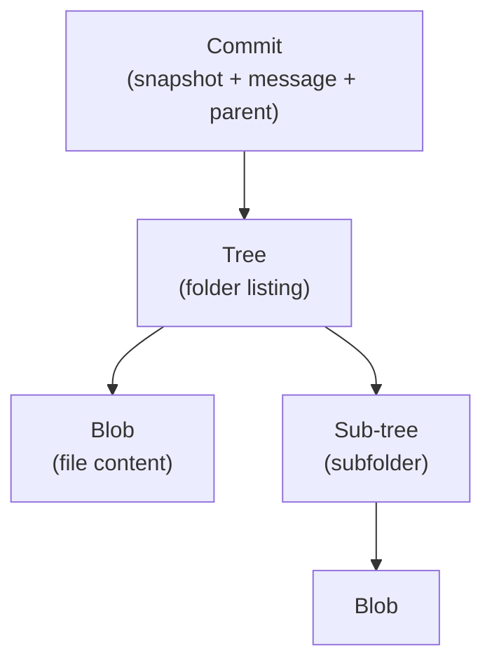
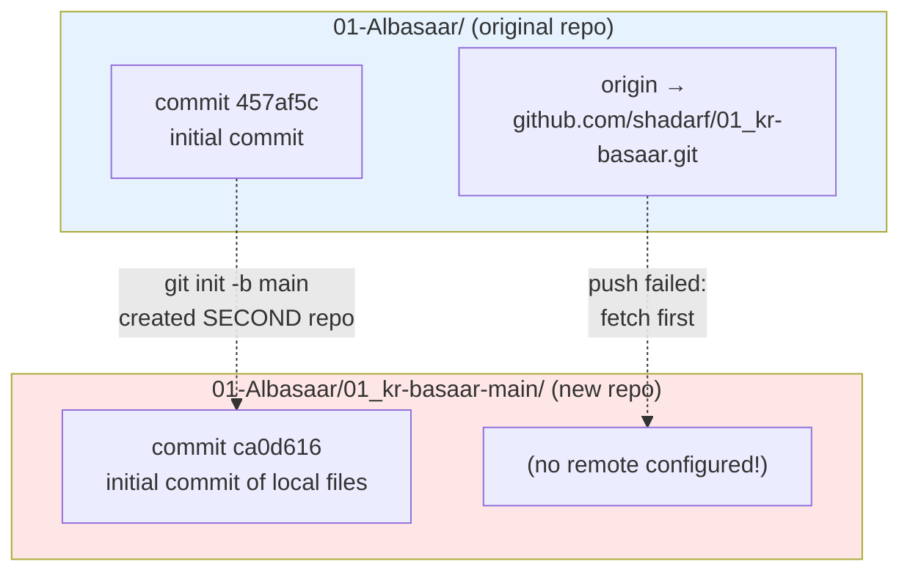
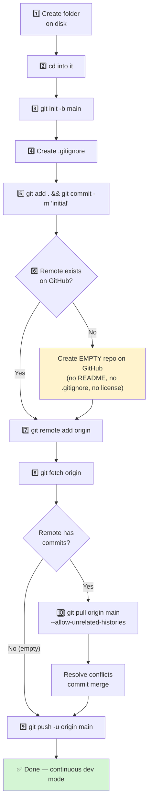
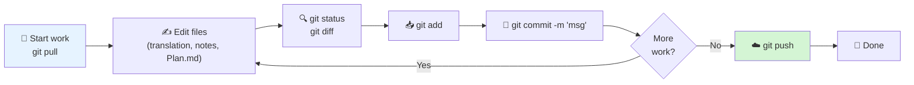
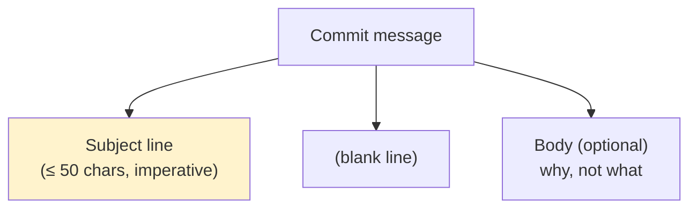
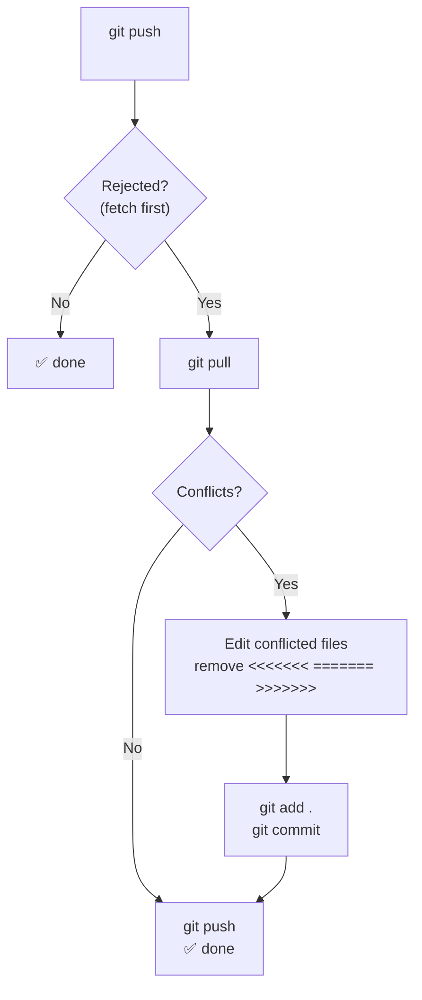
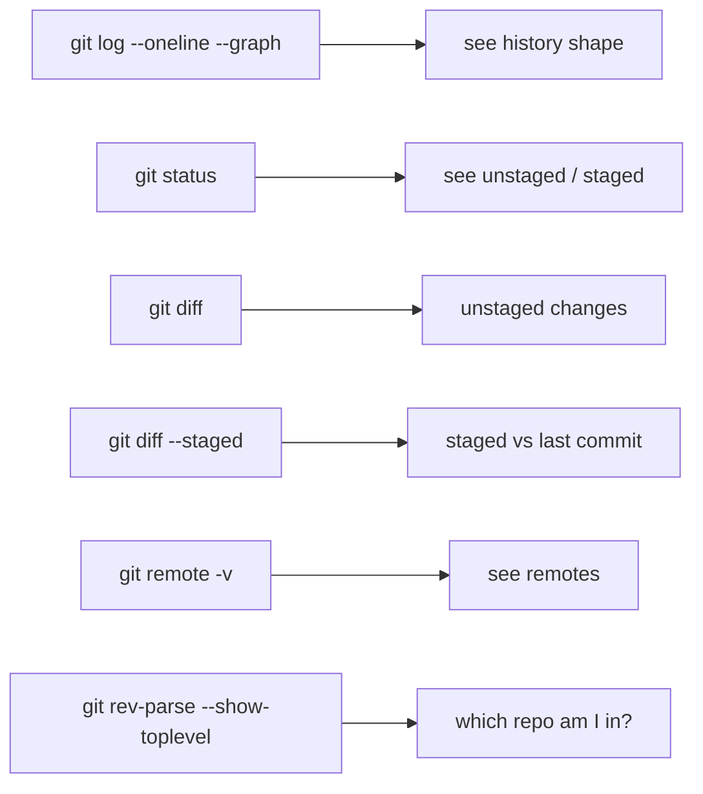
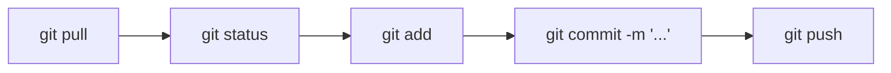

# Tutorial: Git + GitHub for a Translation Project (From Scratch → Continuous Dev)

> **Audience:** you, future-you, and any collaborator who joins later.
> **Goal:** understand Git's mental model, avoid the exact mistakes we made in `01_kr-basaar`, and run a clean continuous-dev loop for this and every future repo.

---

## 1. The Mental Model — Four Zones

Every Git action moves files between **four zones**. If you can picture this diagram, 90 % of Git stops being mysterious.



| Zone | Where it lives | Command to move **into** it |
|---|---|---|
| Working Directory | your folder on disk | (you edit files manually) |
| Staging Area (index) | `.git/index` | `git add <file>` |
| Local Repository | `.git/objects` | `git commit -m "..."` |
| Remote Repository | github.com | `git push` |

**Key insight:** `git add` and `git commit` are *local*. `git push` and `git pull` are *network*. You can commit 100 times offline and never touch GitHub.

---

## 2. The Three Objects Git Tracks



- **Blob** = file contents (no name, no path).
- **Tree** = a directory listing (names → blobs/trees).
- **Commit** = a snapshot: points to one tree + parent commit + author + message.
- **Branch** = a movable label pointing to a commit.
- **HEAD** = "where you are right now" (usually a branch label).

---

## 3. Case Study — What Went Wrong in `01_kr-basaar`

We accidentally created **two independent Git repositories** and pushed to the wrong one. Here is the graph of the mess:



**Root causes, in order of appearance:**

1. **Push rejected — `! [rejected] main -> main (fetch first)`**
   GitHub had commits we didn't. Git refuses to overwrite unknown history on a plain push.
2. **Typo in merge command** — `--allow-unrealated-histories` (wrong) vs `--allow-unrelated-histories` (right). Git rejects unknown options.
3. **`git init` inside an existing repo** — created a *second* `.git/` one level down. From then on, all commands inside `01_kr-basaar-main/` used the inner repo, which had **no remote**.
4. **`git remote set-url` before `git remote add`** — `set-url` edits an *existing* remote. Use `add` the first time.
5. **Invisible `U+0083` character** pasted before `git` → `bash: $'\302\203git': command not found`. Not a Git bug; a clipboard bug.
6. **Line-ending warnings (`LF will be replaced by CRLF`)** — harmless on Windows; *not* the root cause.

**How we finally fixed it (in the inner repo):**

```bash
git remote add origin https://github.com/shadarf/01_kr-basaar.git
git fetch origin
git pull origin main --allow-unrelated-histories
# resolve conflicts, then save the merge commit in the editor
git push -u origin main
```

The resulting history now looks like:

```mermaid
gitGraph
    commit id: "457af5c (remote initial)"
    commit id: "upstream edits"
    commit id: "ca0d616 (local initial)"
    merge main id: "Merge remote main into local main"
    commit id: "future work"
```

---

## 4. Starting a New Repo From Scratch — The Correct Order

Use this whenever you begin a new translation project (e.g. `02_kr-bookB`).



### Step-by-step commands (copy-paste template)

```bash
# 1 + 2  — create and enter project folder
mkdir -p /d/1_ProjDir/otherProj/Books/Translate/02_kr-bookB
cd /d/1_ProjDir/otherProj/Books/Translate/02_kr-bookB

# 3 — initialize repo with "main" as default branch (matches GitHub's default)
git init -b main

# 4 — create .gitignore BEFORE the first commit
cat > .gitignore <<'EOF'
# Obsidian machine-specific junk
.obsidian/workspace.json
.obsidian/workspace-mobile.json
.obsidian/cache/
.trash/

# OS junk
.DS_Store
Thumbs.db
desktop.ini

# Editor temp files
*.swp
*~
EOF

# 5 — first commit
git add .
git commit -m "initial commit: project skeleton"

# 6 — go to github.com/shadarf and create an EMPTY repo (no README!)
#     Otherwise you'll repeat the "fetch first" pain.

# 7 — attach the remote (use ADD, not SET-URL, on a fresh repo)
git remote add origin https://github.com/shadarf/02_kr-bookB.git

# 8 + 9 — push
git push -u origin main

# 10 — ONLY if you created the GitHub repo WITH files (README etc.):
git pull origin main --allow-unrelated-histories
#    resolve conflicts, then: git add . && git commit -m "merge remote"
#    then: git push -u origin main
```

### Why `git init -b main` (not `git init`)?

Modern Git on Windows still defaults to `master` in some installs. If you init as `master` but GitHub expects `main`, your first push will create a *second* branch on the remote and you'll confuse yourself later. `-b main` makes local and remote branch names agree from day one.

### Why create an **empty** GitHub repo?

- If you tick "Add a README" or "Add .gitignore", GitHub creates a commit.
- Your local repo also has a commit.
- The two histories share **no common ancestor** → the `! [rejected]` error.
- Empty remote = clean fast-forward push.

---

## 5. The Continuous Dev Loop (what you do every day)

This is the cycle you will repeat for the rest of the project.



### The four commands you need 95 % of the time

```bash
git pull                          # 1. get any remote changes
git status                        # 2. see what changed
git add <file>                    # 3. stage specific file (safer than "git add .")
git commit -m "clear message"     # 4. snapshot
git push                          # 5. upload
```

### Concrete example for **this** repo (`01_kr-basaar`)

Scenario: you've translated half of Chapter 1 and updated `Plan.md`.

```bash
# Step 0 — see where you are
pwd
# /d/1_ProjDir/otherProj/Books/Translate/01-Albasaar/01_kr-basaar-main
git status
# On branch main
# Your branch is up to date with 'origin/main'.
# Changes not staged for commit:
#   modified:   2-translation/Chapter-1.md
#   modified:   Plan.md

# Step 1 — pull FIRST (never edit on stale history)
git pull
# Already up to date.

# Step 2 — inspect what changed
git diff 2-translation/Chapter-1.md

# Step 3 — stage only the file you're ready to record
git add 2-translation/Chapter-1.md Plan.md

# Step 4 — commit with a message that future-you will understand
git commit -m "translate Chapter 1 pages 1-5; update Plan.md checkpoint"

# Step 5 — push
git push
# Enumerating objects: 9, done.
# ...
# To https://github.com/shadarf/01_kr-basaar.git
#    ca0d616..a1b2c3d  main -> main
```

The `ca0d616..a1b2c3d` line is your **commit ID range**: "remote went from `ca0d616` to `a1b2c3d`." Every successful push prints this. It is your receipt.

---

## 6. How to Write Good Commit Messages



**Good:**
- `translate Chapter 1 pages 1-5; update Plan.md checkpoint`
- `add glossary terms for Islamic finance vocabulary`
- `fix broken wikilink in notes/style-guide.md`

**Bad:**
- `update` (what did you update?)
- `asdf` (you will hate yourself in 2 months)
- `initial commit of my local files` on your 10th commit (only valid for #1)

**Rule of thumb:** if you cannot summarize the change in one short imperative sentence, split it into two commits.

---

## 7. Handling "fetch first" / Non-Fast-Forward Rejections

This is the #1 error beginners hit. Here is the decision tree:



**Preferred `git pull` configuration** (avoid surprise merge-commits on every pull):

```bash
git config --global pull.rebase true
```

With `rebase`, your local commits are replayed *on top of* the remote, giving a linear history. The `--allow-unrelated-histories` flag still works with `pull --rebase` only for truly unrelated histories (which you should avoid by creating empty remotes).

**Never** reach for `git push --force` unless you fully understand it. On a shared `main` branch it will delete other people's commits.

---

## 8. The `.gitignore` — What Not to Commit

Obsidian generates machine-specific files that will cause merge conflicts forever. Add them **before** your first commit.

Recommended `.gitignore` for a translation + Obsidian project:

```gitignore
# ---- Obsidian: machine / session-specific ----
.obsidian/workspace.json
.obsidian/workspace-mobile.json
.obsidian/cache/
.obsidian/plugins/*/data.json
.trash/

# ---- OS junk ----
.DS_Store
Thumbs.db
desktop.ini

# ---- Editor temp files ----
*.swp
*~
*.bak

# ---- Build artifacts (if you add a PDF pipeline later) ----
/build/
/out/
```

**Do** commit: `.obsidian/app.json`, `.obsidian/appearance.json`, `.obsidian/community-plugins.json`, `.obsidian/plugins/*/manifest.json`. These let collaborators reproduce your Obsidian setup.

If you already committed something that should be ignored:

```bash
git rm --cached .obsidian/workspace.json
echo ".obsidian/workspace.json" >> .gitignore
git commit -m "stop tracking workspace.json (machine-specific)"
```

`--cached` means "untrack, but keep the file on disk."

---

## 9. Inspecting What Happened — Diagnostic Commands



**The five commands to memorize when confused:**

```bash
git status                          # what's going on?
git log --oneline --graph -10      # recent history
git remote -v                       # where does this repo push to?
git branch -vv                      # branch ↔ upstream linkage
git rev-parse --show-toplevel       # which .git/ am I using?
```

That last one is the command that would have saved us an hour on `01_kr-basaar`. Run it whenever you switch directories.

---

## 10. Pitfalls Cheat Sheet (from our actual mistakes)

| Symptom | Real cause | Fix |
|---|---|---|
| `! [rejected] main -> main (fetch first)` | remote has commits you don't | `git pull` then `git push` |
| `error: unknown option '--allow-unrealated-histories'` | typo — missing `t` | correct spelling: `--allow-unrelated-histories` |
| `'origin' does not appear to be a git repository` | no remote configured | `git remote add origin <URL>` |
| `error: No such remote 'origin'` (from `set-url`) | `set-url` only edits existing remotes | use `remote add` first time |
| `bash: $'\302\203git': command not found` | invisible `U+0083` pasted before `git` | retype the line, or paste via Notepad first |
| Two `.git/` folders, confusing behavior | ran `git init` inside existing repo | `git rev-parse --show-toplevel` to confirm; delete the accidental one |
| `LF will be replaced by CRLF` warnings | Windows line endings | harmless — ignore, or set `git config --global core.autocrlf true` |
| `fatal: not a git repository` | you're in the wrong folder | `git rev-parse --show-toplevel` to locate |
| Merge editor with `# Please enter a commit message` | normal — this is the merge commit | vim: `Esc` `:wq` `Enter` • nano: `Ctrl+O` `Enter` `Ctrl+X` |

---

## 11. The 30-Second Daily Cheat Card



```bash
# Start of session
git pull

# During work (as often as you like)
git status
git add <file>
git commit -m "translate Chapter 1 pages 6-10"

# End of session
git push
```

If you ever feel lost:

```bash
git status                          # always safe, always informative
git rev-parse --show-toplevel       # which repo am I in?
git log --oneline --graph -10      # recent history
```

---

## 12. Applying It to the Next Project (checklist)

For repo `02_kr-<name>`:

- [ ] `git config --global user.name` and `user.email` are set (already done).
- [ ] `git config --global pull.rebase true` (recommended once).
- [ ] `mkdir` project, `cd` in, `git init -b main`.
- [ ] Create `.gitignore` **before** `git add`.
- [ ] `git add . && git commit -m "initial commit"`.
- [ ] Create **empty** GitHub repo (no README, no .gitignore, no license).
- [ ] `git remote add origin <URL>`.
- [ ] `git push -u origin main`.
- [ ] Verify: `git remote -v` shows `origin`, `git status` says *up to date*.
- [ ] Only then start editing content.

Then run Section 5's loop every day. If you follow the loop, you will never see `fetch first` again.

---

*Last updated: 2026-11-03 · Repo: `shadarf/01_kr-basaar` · Branch: `main`*