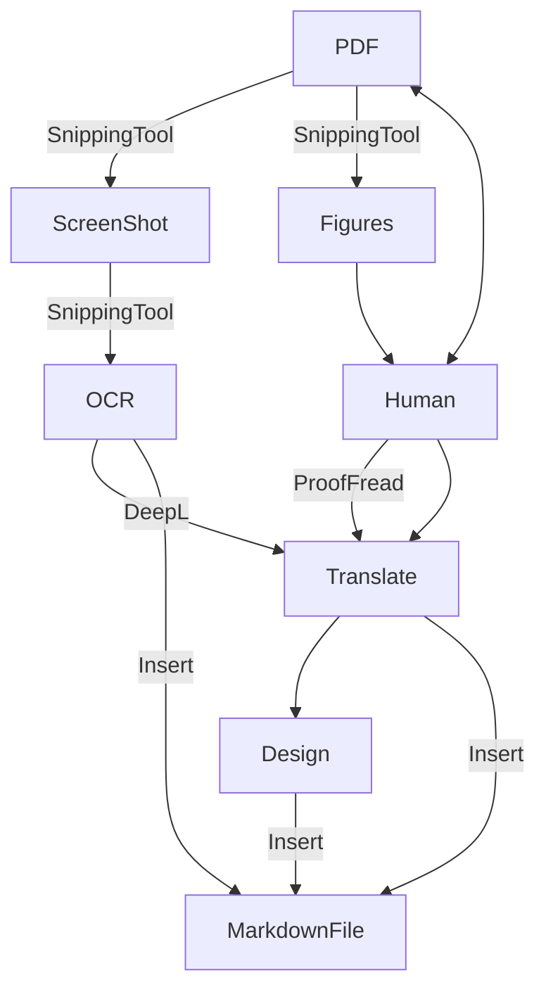

---

## Workflow

The following workflow is how I approach the translation strategy: 

---

## Bottlenecks and Strategies to tackle them

- [[The main bottleneck here is the process of extracting Arabic text ground truths from the PDF file and feeding it to DeepL for translation]]
	- To do this, the OpenCode agent must: 
	- [1] Use ==🟢Snipping tool== to take screenshot around each paragraph in the PDF page.
	- [2] Use OCR function inside the Snipping tool to extract the text from the screenshot.
	- [3] Copy the extracted text and paste it in the dedicated markdown file inside the >[!note] Arabic block specific for that page and that paragraph.
	- [4] use DeepL to translate the Arabic text into Kurdish Sorani and English Language.
	- [5] Place them into their location in the same file as the ground truth Arabic text.
	- [6] Example translation workflow file: 
		- [ ] An example file is prepared that contains a paragraph extracted from the PDF book named: [[1-input//ar-basaar.pdf]] , and the example markdown file is [[StructuredPlan/Example.md]]  
